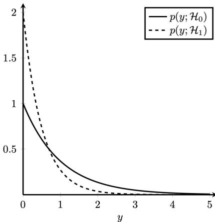

# 4.1 Likelihood ratio test

In 9 of 9 exams1–1.5 points35 min

<figure class="pod"><video src="video/pod_ep1_detection.mp4" poster="video/pod_ep1_detection.jpg" controls playsinline preload="none"></video><figcaption><b>Watch first: podcast episode 1, Detection: the likelihood ratio test</b> (with sound). Answer every purple YOUR TURN out loud before the countdown ends; pause if you need more time. <a href="podcast.html">All 5 episodes</a>.</figcaption></figure>

## What the exam asks

You get **two possible stories** for a measurement $x$, each with its own PDF (probability density function: the curve that says which values of $x$ are likely):

- $\mathcal H_0$: "nothing is there" (no device, noise only, the student wrote it), with PDF $p(x\mid\mathcal H_0)$.
- $\mathcal H_1$: "something is there", with PDF $p(x\mid\mathcal H_1)$.

Then they ask some of: **(a)** build the likelihood ratio test and simplify it to a rule like "decide $\mathcal H_1$ if $x>\gamma$", **(b)** shade $P_{FA}$ and $P_M$ in a sketch, **(c)** compute $P_{FA}$ and $P_D$, or the threshold for a given $P_{FA}$.

## The idea in one minute

You measured one $x$. Ask each story: *"how likely was this $x$ under you?"* That is the height of its PDF at $x$. If the $\mathcal H_1$ curve is much higher than the $\mathcal H_0$ curve at your $x$, say $\mathcal H_1$.

So the test is a **ratio of heights** compared with a number $\lambda$ (also called $\eta$ or $\gamma$, it is just "how convinced do I need to be"):

$$
L(x)=\frac{p(x\mid\mathcal H_1)}{p(x\mid\mathcal H_0)}\ \underset{\mathcal H_0}{\overset{\mathcal H_1}{\gtrless}}\ \lambda
\qquad\text{(read: bigger than }\lambda\text{ → say }\mathcal H_1\text{, smaller → say }\mathcal H_0).
$$

After a bit of algebra this always becomes a cut on the $x$ axis: a **threshold** $\gamma$. Two mistakes are possible, and the threshold trades one for the other:

| | what happened | name | area under... |
|---|---|---|---|
| $P_{FA}$ | $\mathcal H_0$ true, you said $\mathcal H_1$ | false alarm | the $\mathcal H_0$ curve, in the "decide $\mathcal H_1$" zone |
| $P_M$ | $\mathcal H_1$ true, you said $\mathcal H_0$ | miss | the $\mathcal H_1$ curve, in the "decide $\mathcal H_0$" zone |
| $P_D=1-P_M$ | $\mathcal H_1$ true, you said $\mathcal H_1$ | detection | the $\mathcal H_1$ curve, in the "decide $\mathcal H_1$" zone |

Drag the threshold. Watch the blue area ($P_{FA}$) and the red area ($P_M$): you can never shrink both at once.

Now switch to the **Nov 2022** tab. There the $\mathcal H_1$ curve is the one that is tall near 0, so small values point to $\mathcal H_1$: the rule becomes "$y<\gamma$" and the false alarm area sits on the **left**. This is the trap the exam loves.

## The recipe

!!! recipe key "LRT in 5 steps"
    1. **Ratio.** Write $\dfrac{p(x\mid\mathcal H_1)}{p(x\mid\mathcal H_0)}>\lambda$. Cancel what you can. With $N$ independent samples, each PDF is a product over $n$, so the ratio is a product too.
    2. **Log both sides.** $\ln$ keeps the direction of $>$ (it is an increasing function). Use $\ln(ab)=\ln a+\ln b$, $\ln e^{u}=u$, $\ln x^k=k\ln x$.
    3. **Isolate $x$** (or $\sum x_n$, $\sum x_n^2$, ...). Every time you multiply or divide by a **negative** number, **flip** the inequality.
    4. **Write the rule**: "decide $\mathcal H_1$ if $x>\gamma$" (or $<$), with $\gamma$ written in terms of $\lambda$.
    5. **Errors.** $P_{FA}=\int p(x\mid\mathcal H_0)\,dx$ over the decide-$\mathcal H_1$ zone; $P_D=\int p(x\mid\mathcal H_1)\,dx$ over the same zone; $P_M=1-P_D$.

## Watch it once: April 2025 · 4a

!!! exam "Final exam, 13 April 2025 · 4a · 0.5 p"
    You are conducting a likelihood ratio test using a single datapoint $x$, $0 < x < 1$ whereby $p(x) = k_1 \theta x^{k_2 \theta - 1}$. Two hypothesis can be distinguished

    $$\mathcal{H}_0 : \theta = 3, \qquad \mathcal{H}_1 : \theta = 6.$$

    If $\lambda = 0.2$, $k_1 = 1$, and $k_2 = 2$, what is the value for $x$ for which $\mathcal{H}_1$ should be accepted?

**Step 1 · Write both PDFs.** With $k_1=1$, $k_2=2$: $p(x)=\theta x^{2\theta-1}$.
Under $\mathcal H_0$ ($\theta=3$): $3x^{5}$. Under $\mathcal H_1$ ($\theta=6$): $6x^{11}$.

***

**Step 2 · Ratio > λ.**

$$\frac{6x^{11}}{3x^{5}}=2x^{6}>0.2$$

(dividing powers: $x^{11}/x^5=x^{11-5}=x^6$).

***

**Step 3 · Isolate $x$.** Divide by 2 (positive, no flip): $x^6>0.1$. Take the 6th root (increasing, no flip): $x>0.1^{1/6}$.
On the calculator: $0.1^{1/6}=e^{\ln(0.1)/6}=e^{-0.3838}\approx0.681$. No log was needed here because there was no exponential.

***

**Step 4 · The rule.** Accept $\mathcal H_1$ when $\mathbf{0.681\lt x\lt 1}$ (the upper limit 1 comes from the problem: $0\lt x\lt 1$).

## Watch it once more: November 2022 · 4c–4e (the flip)

!!! exam "Final exam, 7 November 2022 · 4c (0.5 p), 4d (0.25 p), 4e (0.5 p)"
    Under the two hypotheses, a single observation $x$ admits a zero mean Laplacian distribution, but with different variances:

    $$\mathcal{H}_0 : p(x; \mathcal{H}_0) = \frac{1}{2}e^{-|x|}\qquad\text{and}\qquad\mathcal{H}_1 : p(x; \mathcal{H}_1) = e^{-2|x|}.$$

    Each observation $x_n$ of the vector $\mathbf{x}$ (length $N$) is independent and identically distributed.

    **4c** Show that the likelihood ratio test takes the form $\sum_{n=0}^{N-1} |x_n| \underset{\mathcal{H}_1}{\overset{\mathcal{H}_0}{\gtrless}} \gamma'$ and determine $\gamma'$.

    **4d** For $N = 1$, with $Y=|X|$: $p(y; \mathcal{H}_0) = e^{-y}$, $p(y; \mathcal{H}_1) = 2e^{-2y}$. Indicate $P_{FA}$ and $P_M$ for $\gamma' = 1$ in the plot.
    

    **4e** For a $P_{FA} = 0.1$ calculate the threshold $\gamma'$, and the probability of detection $P_D$ for it.

**Step 1 · Ratio for ONE sample.** Same recipe as always: $\dfrac{p(x\mid\mathcal H_1)}{p(x\mid\mathcal H_0)}$. Here that is

$$\frac{e^{-2|x|}}{\tfrac12\,e^{-|x|}}.$$

Two small moves. (i) Dividing by $\tfrac12$ is the same as multiplying by 2, so the $\tfrac12$ becomes a $2$ in front. (ii) Two powers of $e$ divided: $\dfrac{e^{a}}{e^{b}}=e^{a-b}$ (subtract the exponents). With $a=-2|x|$ and $b=-|x|$:

$$2\,e^{-2|x|-(-|x|)}=2\,e^{-2|x|+|x|}=2\,e^{-|x|}\qquad(\text{because }-2|x|+|x|=-|x|).$$

***

**Step 2 · Ratio for $N$ samples.** The samples are independent, so the PDF of the whole vector is the **product** of the PDFs of each sample (that is what "independent" buys you, see [1.3](p4-lrt.md#13-many-samples-products-become-sums)). The same factor $2e^{-|x_n|}$ appears once per sample, $n=0,1,\dots,N-1$:

$$L(\mathbf x)=\prod_{n=0}^{N-1}2\,e^{-|x_n|}=\underbrace{2\cdot2\cdots2}_{N\text{ times}}\cdot e^{-|x_0|}\,e^{-|x_1|}\cdots e^{-|x_{N-1}|}=2^N\,e^{-\sum_n|x_n|}.$$

The last equality uses $e^{a}e^{b}=e^{a+b}$ (multiplying powers of $e$ adds the exponents), so all the $e^{-|x_n|}$ merge into one $e$ whose exponent is $-(|x_0|+\dots+|x_{N-1}|)=-\sum_n|x_n|$.
Tiny check, $N=3$, $\mathbf x=(0.5,\,-1,\,0.5)$: $\sum|x_n|=0.5+1+0.5=2$, so $L=2^3e^{-2}=8\cdot0.1353=1.083$.

The test is: decide $\mathcal H_1$ if $L(\mathbf x)>\gamma$ (the threshold called $\lambda$ above; the exam calls it $\gamma$, and it is a number we are free to choose). So:

$$2^N\,e^{-\sum_n|x_n|}>\gamma.$$

***

**Step 3 · Take $\ln$ to get rid of the $e$.** $\ln$ is increasing, so $>$ stays $>$. Use $\ln(ab)=\ln a+\ln b$, $\ln(2^N)=N\ln2$ and $\ln e^{u}=u$:

$$N\ln2-\sum_n|x_n|>\ln\gamma.$$

***

**Step 4 · Isolate the sum, and FLIP.** First subtract $N\ln2$ from both sides (no flip, it is only a subtraction):

$$-\sum_n|x_n|>\ln\gamma-N\ln2.$$

Now the sum has a minus sign in front and we want it alone, so multiply both sides by $-1$. A negative number: the inequality **flips** ($>$ becomes $<$), and the right side changes sign:

$$\sum_n|x_n|\lt N\ln2-\ln\gamma=:\gamma'.$$

Check the flip with numbers: $-3>-5$ is true; multiply by $-1$: $3<5$ (true), whereas $3>5$ would be false.

So we decide $\mathcal H_1$ when the sum is **small**. In the exam's notation, "decide $\mathcal H_1$ when the sum is below $\gamma'$" is written $\sum|x_n|\ \underset{\mathcal H_1}{\overset{\mathcal H_0}{\gtrless}}\ \gamma'$: the symbol under the sign ($\mathcal H_1$) is the one chosen when the left side is **smaller**, the one on top ($\mathcal H_0$) when it is **bigger**. That is exactly the form asked in 4c. It makes sense: $\mathcal H_1$ is the narrow curve $e^{-2|x|}$, concentrated near 0, so small $|x_n|$ point to it.

!!! answer "Answer 4c"
    The test is

    $$\sum_{n=0}^{N-1} |x_n| \underset{\mathcal{H}_1}{\overset{\mathcal{H}_0}{\gtrless}} \gamma'$$

    with the threshold

    $$\boxed{\gamma'=N\ln2-\ln\gamma}$$

    where $\gamma$ is the threshold of the original test $L(\mathbf x)>\gamma$ (the number we choose, or the Bayes value from priors and costs). Special case $\gamma=1$ (equal priors, plain "which is more likely"): $\gamma'=N\ln2$; for $N=1$ that is $\ln2\approx0.693$.

    Read: if the sum is bigger than $\gamma'$ decide $\mathcal H_0$, if it is smaller decide $\mathcal H_1$.

***

**Step 5 · Shade (4d).** Decide $\mathcal H_1$ when $y<1$. $P_{FA}$ = area under the $\mathcal H_0$ curve $e^{-y}$ **left** of 1. $P_M$ = area under the $\mathcal H_1$ curve $2e^{-2y}$ **right** of 1. (Check it in the widget above, tab Nov 2022.)

***

**Step 6 · Threshold from $P_{FA}$ (4e).**
$P_{FA}=\int_0^{\gamma'}e^{-y}\,dy=\big[-e^{-y}\big]_0^{\gamma'}=1-e^{-\gamma'}$. Set it to 0.1: $e^{-\gamma'}=0.9$, so $\gamma'=-\ln0.9\approx\mathbf{0.105}$.

$P_D=\int_0^{\gamma'}2e^{-2y}\,dy=1-e^{-2\gamma'}=1-(e^{-\gamma'})^2=1-0.81=\mathbf{0.19}$.

## Your turn

!!! exam "Resit, June 2026 · 4b · 1 p"
    A wireless sensor measures the received signal envelope $X$. Under $H_0$ (no device present), $X \sim \text{Rayleigh}(\sigma_0)$. Under $H_1$ (device present), $X \sim \text{Rayleigh}(\sigma_1)$, with $\sigma_1 > \sigma_0 > 0$, both known. The Rayleigh pdf is $p(x \mid \sigma) = \frac{x}{\sigma^2} \exp\left(-\frac{x^2}{2\sigma^2}\right)$, $x \geq 0$.

    - Construct the likelihood-ratio test for a threshold $\eta$.
    - Discuss how the separation between $\sigma_0$ and $\sigma_1$ affects detection performance.

??? solution "Check your answer"
    **Ratio.** The $x$ in front cancels:
    $\dfrac{\frac{x}{\sigma_1^2}e^{-x^2/(2\sigma_1^2)}}{\frac{x}{\sigma_0^2}e^{-x^2/(2\sigma_0^2)}}=\dfrac{\sigma_0^2}{\sigma_1^2}\exp\!\Big(\dfrac{x^2}{2}\Big(\dfrac1{\sigma_0^2}-\dfrac1{\sigma_1^2}\Big)\Big)>\eta.$

    **Log.** $\ln\dfrac{\sigma_0^2}{\sigma_1^2}+\dfrac{x^2}{2}\Big(\dfrac1{\sigma_0^2}-\dfrac1{\sigma_1^2}\Big)>\ln\eta$.

    **Isolate.** Because $\sigma_1>\sigma_0$, the bracket $\frac1{\sigma_0^2}-\frac1{\sigma_1^2}=\frac{\sigma_1^2-\sigma_0^2}{\sigma_0^2\sigma_1^2}$ is **positive**: no flip.

    !!! answer "Answer"
        Decide $H_1$ if $x>\gamma=\sqrt{\dfrac{2\sigma_0^2\sigma_1^2}{\sigma_1^2-\sigma_0^2}\,\ln\!\Big(\eta\,\dfrac{\sigma_1^2}{\sigma_0^2}\Big)}$.
        The further apart $\sigma_0$ and $\sigma_1$, the less the two curves overlap, so for the same $P_{FA}$ you get a higher $P_D$ (ROC closer to the top-left corner). Here $P_{FA}=e^{-\gamma^2/(2\sigma_0^2)}$ and $P_D=e^{-\gamma^2/(2\sigma_1^2)}$. Try it in the widget, tab Jun 2026.

!!! exam "Final exam, April 2024 · 4b · 1.5 p"

    $$\mathcal{H}_0: p(y) = \frac{1}{\sqrt{2\pi}} e^{-\frac{y^2}{2}}\qquad \mathcal{H}_1: p(y) = \frac{1}{4} e^{-\frac{y}{2}},\qquad y > 0.$$

    Sketch the likelihoods. For a threshold $\gamma = 1$, indicate $P_{FA}$ and $P_M$, and calculate $P_D$ and $P_{FA}$. Use $Q(x) = \int_x^{\infty} \frac{1}{\sqrt{2\pi}} e^{-\frac{u^2}{2}} du$. No need for exact numerical values.

??? solution "Check your answer"
    **Ratio > 1, then log.** $\ln\frac14-\frac y2-\ln\frac1{\sqrt{2\pi}}+\frac{y^2}{2}>0$, i.e. $\frac{y^2}{2}-\frac y2+\ln\frac{\sqrt{2\pi}}{4}>0$. Numbers: $\ln\frac{2.5066}{4}=\ln0.6267=-0.4674$. Multiply by 2: $y^2-y-0.9348>0$.

    **Solve the quadratic** $y^2-y-0.9348=0$: $y=\frac{1\pm\sqrt{1+3.739}}{2}=\frac{1\pm2.177}{2}$. Only the positive root matters ($y>0$): $y_{th}=1.588$. The parabola is positive to the right of it, so decide $\mathcal H_1$ for $y>1.588$.

    !!! answer "Answer"
        Decide $\mathcal H_1$ if $y>1.588$. $P_{FA}=\int_{1.588}^\infty\frac1{\sqrt{2\pi}}e^{-y^2/2}dy=Q(1.588)$; $P_D=\int_{1.588}^\infty\frac14e^{-y/2}dy=\frac12e^{-0.794}$. Sketch: half-bell starting at 0.40 vs a slow exponential starting at 0.25; shade $\mathcal H_0$ right of 1.588 ($P_{FA}$) and $\mathcal H_1$ left of it ($P_M$).

## Traps

!!! trap key "Where points are lost"
    - **Forgetting to flip** when you divide by a negative number. Then the whole rule points the wrong way.
    - **Wrong curve for the area**: $P_{FA}$ always uses $p(x\mid\mathcal H_0)$, $P_D$ and $P_M$ always use $p(x\mid\mathcal H_1)$.
    - **Shading the wrong side**: first decide where "decide $\mathcal H_1$" is (left or right of $\gamma$), then shade.
    - $N$ samples: the ratio is a **product**, its log a **sum** $\sum_n$. Do not drop the $N$ in front of constants ($2^N\to N\ln2$).
