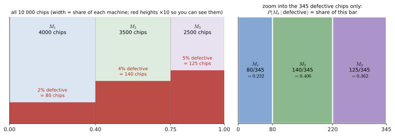
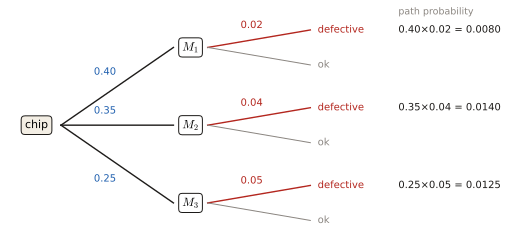
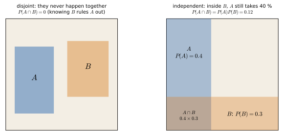

# 1.1 Bayes & total probability

Almost every exam opens with a short word problem: several machines, scanners or groups, each with its own failure rate. You need two formulas. Learn them here once and you get 0.25–1 point every time. This page explains both with a picture made of whole numbers of chips, then fits the formulas to it.

!!! need "Before this page"
    - Nothing beyond arithmetic with fractions and percentages. (A short version of conditional probability and independence is in [0.6](p0-foundations.md#conditional-probability-and-independence); this page builds the same thing again from counts.)

    If you read only one thing: **a probability is "what fraction of the time". Conditional probability = zoom into the part of the world where something is already known, and take the fraction inside it. Bayes = the same zoom, applied the other way round.**

---

## 1 · The idea, from zero

### 1.1 Probability as a fraction

A **probability** is a number between 0 and 1 (or 0–100 %) that says what fraction of the time something happens if you repeat the experiment many times. An **event** is something that can happen or not ("the chip is defective").

### 1.2 One picture with whole numbers

The trick that makes everything below obvious: ==**imagine 10 000 chips** and count.==

!!! example "The machine problem as counts (June 2026 1b)"
    Machine $M_1$ makes 40 % of the chips, $M_2$ 35 %, $M_3$ 25 %. Defect rates: 2 %, 4 %, 5 %.

    | Machine | chips (of 10 000) | defective chips |
    |---|---|---|
    | $M_1$ | 4000 | $2\%\cdot4000=80$ |
    | $M_2$ | 3500 | $4\%\cdot3500=140$ |
    | $M_3$ | 2500 | $5\%\cdot2500=125$ |
    | **total** | 10 000 | $80+140+125=345$ |

    - *Probability that a random chip is defective:* $\frac{345}{10\,000}=0.0345$.
    - *A chip is defective; how likely is it from $M_2$?* Look **only at the 345 defective chips**: 140 are from $M_2$: $\frac{140}{345}=0.406$.

    These two sentences are exactly the two formulas below, with the multiplication done on whole numbers.

<figure markdown>

<figcaption>Left: the 10 000 chips as a square. Each machine gets a strip as wide as its share, and the red part at the bottom of each strip is its defective chips. Right: "given that the chip is defective" means keep only the red pieces and line them up. Each machine's share of that bar is its posterior probability. That zoom is all Bayes' theorem does.</figcaption>
</figure>

<figure class="anim">
<video class="anim" src="video/bayes_zoom.mp4" poster="video/bayes_zoom.jpg" muted loop playsinline controls preload="none"></video>
<figcaption><b>Animation: Bayes as a zoom.</b> The strips appear, then the defective chips (red). Learning "the chip is defective" throws away everything that is not red, and the 345 red chips are regrouped by machine: 80, 140 and 125 of them, i.e. 0.232, 0.406 and 0.362.</figcaption>
</figure>

### 1.3 The three formulas

**Conditional probability.** $P(A\mid B)$ ("probability of $A$ given $B$") is the probability of $A$ *when you already know that $B$ happened*. You zoom into the part of the world where $B$ is true and ask how much of it is also $A$:

$$P(A\mid B)=\frac{P(A\cap B)}{P(B)}\qquad\Longleftrightarrow\qquad P(A\cap B)=P(A\mid B)\,P(B)$$

($A\cap B$ = "both $A$ and $B$"). In the picture: $\frac{140}{345}$ is "defective and from $M_2$" divided by "defective".

**Law of total probability.** If the world is split into non-overlapping groups $A_1,A_2,\dots$ (machine 1, machine 2, …) that together cover everything, the probability of $B$ is the weighted average of the per-group probabilities:

$$P(B)=\sum_i P(B\mid A_i)\,P(A_i).$$

In the picture: $0.02\cdot0.40+0.04\cdot0.35+0.05\cdot0.25=0.008+0.014+0.0125=0.0345$, i.e. the 345 defective chips divided by 10 000.

**Bayes' theorem.** Turn the conditional around: from "how often does group $k$ produce $B$" to "given $B$, how likely is it that it came from group $k$":

$$P(A_k\mid B)=\frac{P(B\mid A_k)\,P(A_k)}{P(B)}=\frac{P(B\mid A_k)\,P(A_k)}{\sum_i P(B\mid A_i)P(A_i)}.$$

(Derivation: write $P(A_k\cap B)$ in the two possible ways, $P(B\mid A_k)P(A_k)=P(A_k\mid B)P(B)$, and divide by $P(B)$.)

Names you will see: ==$P(A_k)$ = **prior** (before knowing the outcome), $P(B\mid A_k)$ = **likelihood**, $P(B)$ = **evidence**, $P(A_k\mid B)$ = **posterior** (after knowing the outcome)==. The same structure comes back in Part 2 (Bayesian estimation) and Part 4 (Bayesian detection).

<figure markdown>

<figcaption>How to read a probability tree: the first split is "which group" (priors, blue), the second split is "what happens inside that group" (likelihoods, red). Multiply along a branch to get the probability of that whole path. Add the "defective" paths to get $P(\text{defective})$. Divide one path by that sum to get Bayes.</figcaption>
</figure>

### 1.4 Independent events

==$A$ and $B$ are **independent** when knowing $B$ tells you nothing about $A$: $P(A\mid B)=P(A)$, equivalently $P(A\cap B)=P(A)P(B)$.== Two coin flips: $P(\text{both heads})=\frac12\cdot\frac12=\frac14$.

Do not confuse with **mutually exclusive** (disjoint) events, which cannot happen together ($P(A\cap B)=0$). ==Two events with non-zero probabilities that are independent can never be disjoint== ($P(A)P(B)>0$). And ==the addition rule in general is $P(A\cup B)=P(A)+P(B)-P(A\cap B)$==; plain addition is only for disjoint events.

<figure markdown>

<figcaption>The square is "everything that can happen", area 1. Left: disjoint events do not touch, so knowing $B$ happened tells you for sure that $A$ did not. That is the opposite of independent. Right: independent events cross like a grid. Inside the strip $B$, the event $A$ still takes 40 % of the width, exactly as in the whole square, and the overlap's area is $0.4\times0.3$.</figcaption>
</figure>

!!! recipe key "Recipe: every Bayes word problem"
    1. Name the events. Write the groups $A_1,\dots$ and the "outcome" $B$.
    2. Read off the priors $P(A_i)$. If they give counts (18, 22, 15 patients), divide by the total.
    3. Read off the likelihoods $P(B\mid A_i)$. **If they give "% that pass", the defect rate is 1 minus that.**
    4. Total probability: $P(B)=\sum_i P(B\mid A_i)P(A_i)$.
    5. Bayes: $P(A_k\mid B)=P(B\mid A_k)P(A_k)/P(B)$, i.e. one branch divided by the sum.
    6. *(Check)* the posteriors of all groups add up to 1.

!!! trap key "Traps"
    - "Probability that a car **passed** the test **was** painted by $M_3$" is $P(M_3\mid\text{pass})$, not $P(\text{pass}\mid M_3)$.
    - A test that is "99% accurate" means $P(+\mid\text{sick})=0.99$ **and** $P(+\mid\text{healthy})=0.01$.
    - Watch whether they ask about the **good** or the **bad** outcome; use the complement $P(B^c)=1-P(B)$.
    - A rare disease with an accurate test still gives a *small* posterior: healthy people are so numerous that even a 1 % false-positive rate produces more false alarms than true cases.

---

## Exam questions

### June 2026 resit · 1b {#jun26-1b}

!!! exam "Resit Q4, June 2026 · 1b · 0.3 p"
    A manufacturing plant has three machines, $M_1$, $M_2$, and $M_3$, that produce microchips. Machine $M_1$ produces 40% of the chips, $M_2$ produces 35%, and $M_3$ produces 25%. The probability that a chip is defective is 2% for $M_1$, 4% for $M_2$, and 5% for $M_3$. The chips from all machines are mixed together randomly before quality control.

    **Please provide only the final answer. The workout will not be checked.**

    1. What is the probability that a randomly selected chip will be defective? [0.15]
    2. If a randomly selected chip is found to be defective, what is the probability that it was produced by machine $M_2$? [0.15]

???+ solution "Solution"

    **What is being asked?** Q1 is "total probability" (a chip from *any* machine). Q2 is Bayes, because the question is turned around ("given defective, which machine?").

    **Symbols in this question**

    | Symbol | Meaning |
    |---|---|
    | $M_i$ | "the chip was made by machine $i$" |
    | $D$ | "the chip is defective" |
    | $P(M_i)$ | priors: $0.40,\ 0.35,\ 0.25$ |
    | $P(D\mid M_i)$ | likelihoods (defect rates): $0.02,\ 0.04,\ 0.05$ |

    **Step 1 — total probability** ([1.3](#13-the-three-formulas)): sum the three branches that end in "defective":

    $$P(D)=0.40(0.02)+0.35(0.04)+0.25(0.05)=0.008+0.014+0.0125=0.0345.$$

    **Step 2 — Bayes.** The branch through $M_2$ divided by the sum:

    $$P(M_2\mid D)=\frac{P(D\mid M_2)P(M_2)}{P(D)}=\frac{0.014}{0.0345}=0.406.$$

    (Same as the counting picture in [1.2](#12-one-picture-with-whole-numbers): $\frac{140}{345}$.)

    !!! answer "Answer"
        1. $P(D)=0.0345$ (3.45 %)  2. $P(M_2\mid D)\approx0.41$

### April 2025 exam · 1a {#apr25-1a}

!!! exam "Final exam Q3, 13 April 2025 · 1a · 0.3 p"
    An hospital has three CT scanners CT1, CT2, and CT3. It has been observed that 85% of the images produced by CT1 have sufficient quality, while CT2 and CT3 the percentages of images with sufficient quality are 90% and 66%, respectively. Each day, CT1 scans 18 patients, CT2 scans 22 patients, and CT3 scans 15 patients. The images from all CT scanners are mixed at random before image quality control. Assuming that the same number of images are produced for each patients:

    ***Provide only the final answer. The workout will not be checked.***

    1. What is the probability the one image will NOT pass the quality test?
    2. What is the probability that a bad quality image comes from CT2?

???+ solution "Solution"

    **What is being asked?** (1) Total probability of a *bad* image. (2) Bayes: given bad, which scanner?

    **Symbols in this question.** $CT_i$: image from scanner $i$; "bad": the image fails the quality test.

    **Step 1 — priors come from counts.** $18+22+15=55$ patients, so $P(CT_1)=\frac{18}{55}$, $P(CT_2)=\frac{22}{55}$, $P(CT_3)=\frac{15}{55}$.

    **Step 2 — likelihoods of the bad outcome** are the complements of the given percentages: $1-0.85=0.15$, $1-0.90=0.10$, $1-0.66=0.34$.

    **Step 3 — total probability:**

    $$P(\text{bad})=\frac{18(0.15)+22(0.10)+15(0.34)}{55}=\frac{2.7+2.2+5.1}{55}=\frac{10}{55}=0.18.$$

    (Equivalently $P(\text{good})=0.82$ and $1-0.82=0.18$.)

    **Step 4 — Bayes:** $P(CT_2\mid\text{bad})=\dfrac{22(0.10)/55}{10/55}=\dfrac{2.2}{10}=0.22$.

    !!! answer "Answer"
        1. $0.18$  2. $0.22$

### April 2024 exam · 1b {#apr24-1b}

!!! exam "Final exam Q3, April 2024 · 1b · 0.25 p"
    Assume the probability of having tuberculosis (TB) is 0.0005, and a test for TB is 99% accurate. What is the probability one has TB if one tests positive for the disease?

    **Note: provide only the final answer. No passages will be checked.**

    Provide the value of $\Pr[TB]$

???+ solution "Solution"

    **What is being asked?** The posterior $P(TB\mid +)$: given a positive test, how likely is the disease? (The statement "$\Pr[TB]$" at the end means this posterior.)

    **Symbols in this question.** $TB$: has the disease; $+$: tests positive.

    **Step 1 — read the numbers.** Prior $P(TB)=0.0005$. "99 % accurate" → $P(+\mid TB)=0.99$ **and** $P(+\mid\text{no }TB)=0.01$.

    **Step 2 — evidence** (total probability over the two groups, sick and healthy; $P(\text{no TB})=0.9995$):

    $$P(+)=0.99(0.0005)+0.01(0.9995)=0.000495+0.009995=0.010490.$$

    **Step 3 — Bayes:**

    $$P(TB\mid +)=\frac{0.99(0.0005)}{0.010490}=\frac{0.000495}{0.010490}=0.047.$$

    **Why so small?** Per 100 000 people: 50 have TB (49.5 test positive) and 99 950 are healthy (999.5 test positive by mistake). Of about 1049 positives only 49.5 are sick: $\frac{49.5}{1049}=4.7\%$. The disease is so rare that false positives outnumber true ones. That "base-rate" effect is the whole point of the question.

    !!! answer "Answer"
        $P(TB\mid +)\approx0.047$ (about 5 %)

### April 2024 exam · 1a {#apr24-1a}

!!! exam "Final exam Q3, April 2024 · 1a · 0.25 p"
    The manual of an ultrasound transducer states that the lifetime $T$ of the product, defined as the amount of time (in years) the product works properly until it breaks down, follows the following probability distribution:

    $$\Pr[T \geq t] = e^{-t/5},$$

    with $t \leq 0$ measured in years.

    Suppose that in an ultrasound lab, they have been using the transducer for two years without any problems. What is the probability that it breaks down in the third year, given that it was still working after 2 years?

    **Hint:** the third year is the year between the $t = 2$ and $t = 3$.

    (a) 0.24  (b) 0.12  (c) 0.30  (d) 0.18

???+ solution "Solution"

    **What is being asked?** A conditional probability: restrict to "still working at 2 years" and ask what fraction of those fail before year 3. ("$t\le0$" is a typo for $t\ge0$.)

    **Symbols in this question**

    | Symbol | Meaning |
    |---|---|
    | $T$ | lifetime of the transducer in years |
    | $\Pr[T\ge t]=e^{-t/5}$ | the probability it is still working at time $t$ ("survival") |
    | $A=\{2\lt T\le3\}$ | breaks down in year 3 |
    | $B=\{T>2\}$ | still working after 2 years |

    **Step 1 — conditional probability.** $P(A\mid B)=\frac{P(A\cap B)}{P(B)}$. Since $A$ lies inside $B$, $A\cap B=A$, and $P(A)=P(T>2)-P(T>3)$ (survive to 2 but not to 3).

    **Step 2 — plug in:**

    $$P(2\lt T\le3\mid T>2)=\frac{e^{-2/5}-e^{-3/5}}{e^{-2/5}}=1-e^{-1/5}=1-0.8187=0.181.$$

    Notice the answer does not depend on the 2 years already survived: the exponential distribution is **memoryless**. $1-e^{-1/5}$ is just the probability that a brand-new transducer breaks in its first year.

    !!! answer "Answer"
        **(d) 0.18**

### January 2025 resit · 1a {#jan25-1a}

!!! exam "Resit January 2025 · 1a · 0.5 p (shown in the Part 1 review lecture)"
    Two-hundred high school students were asked which university studies they would like to do. Their answers are shown in the table below. Please calculate the following probabilities:

    |        | Engineering | Life Sciences | Literature | Psychology |
    |--------|-------------|---------------|------------|------------|
    | Male   | 45          | 27            | 8          | 10         |
    | Female | 22          | 42            | 20         | 26         |

    Please only provide the final answer. The workout will not be checked.

    1. Given a student at random that chose psychology, the probability that the students was a female.
    2. The probability of choosing Engineering

???+ solution "Solution"

    **What is being asked?** With a table of counts, probabilities are just fractions of counts. (1) is conditional: restrict to the psychology column. (2) is a plain fraction of everybody.

    **Step 1 — (1).** "Given psychology" → look only at the psychology column: $10+26=36$ students, of which 26 are female: $P(F\mid P)=\frac{26}{36}=0.72$.

    **Step 2 — (2).** Engineering column total: $45+22=67$ students out of 200: $P(E)=\frac{67}{200}=0.335$. (This is total probability: male engineers plus female engineers.)

    !!! answer "Answer"
        1. $0.72$  2. $0.335$

### November 2022 exam · 1a {#nov22-1a}

!!! exam "Final exam Q1, 7 November 2022 · 1a · 0.25 p"
    About 65% of students who enroll for the exam of the course statistical signal processing have followed the course. Suppose we know that the probability of passing the exam for students who have followed the course is 0.75, while it is 0.4 for students who have not followed it. What is the probability of passing the exam?

    (a) 0.53  (b) 0.52  (c) 0.63  (d) 0.65

???+ solution "Solution"

    **What is being asked?** Total probability of passing, over the two groups "followed" and "did not follow".

    **Step 1 — priors.** Followed: $0.65$. Did not follow: $1-0.65=0.35$.

    **Step 2 — total probability:**

    $$P(\text{pass})=0.75(0.65)+0.40(0.35)=0.4875+0.14=0.6275.$$

    !!! answer "Answer"
        **(c) 0.63**

### January 2022 resit · 1a {#jan22-1a}

!!! exam "Resit, 24 January 2022 · 1a · 0.3 p"
    A small manufacturing company has rated 75% of its employees as satisfactory (S) and 25% as unsatisfactory ($S^c$). Personnel records show that 80% of the satisfactory workers had previous work experience (E) in the job they are now doing, while 15% of the unsatisfactory workers had no work experience ($E^c$) in the job they are now doing. If a person who has had previous work experience is hired, what is the approximate empirical probability that this person will be an unsatisfactory employee?

    a) 0.24  b) 0.25  c) 0.26  d) 0.28

???+ solution "Solution"

    **What is being asked?** $P(S^c\mid E)$: among workers **with** experience, what fraction is unsatisfactory? (Bayes.)

    **Step 1 — read the rates carefully.** $P(S)=0.75$, $P(S^c)=0.25$. $P(E\mid S)=0.80$. The trap: "15 % of the unsatisfactory had **no** experience" → $P(E\mid S^c)=1-0.15=0.85$.

    **Step 2 — Bayes:**

    $$P(S^c\mid E)=\frac{0.85(0.25)}{0.80(0.75)+0.85(0.25)}=\frac{0.2125}{0.6+0.2125}=\frac{0.2125}{0.8125}=0.26.$$

    !!! answer "Answer"
        **(c) 0.26**

### Practice exam 2021 · 1a {#pe21-1a}

!!! exam "Practice exam, 28 October 2021 · 1a · 0.5 p"
    A virus has infected 1.8% of a population. A test detects this virus 95% of the time when it is actually present, but it returns a false positive 3% of the time when the virus is not present. If a person selected at random from this population tests positive for the virus, what is the probability that this person is actually infected? Please round to the nearest percent.

    a) 26%  b) 37%  c) 95%  d) 92%

???+ solution "Solution"

    **What is being asked?** $P(V\mid +)$ with $V$ = infected. Prior $P(V)=0.018$; $P(+\mid V)=0.95$; $P(+\mid\text{not }V)=0.03$ (the false-positive rate); $P(\text{not }V)=0.982$.

    **Step 1 — Bayes with the evidence expanded over the two groups:**

    $$P(V\mid +)=\frac{0.95(0.018)}{0.95(0.018)+0.03(0.982)}=\frac{0.0171}{0.0171+0.02946}=\frac{0.0171}{0.04656}=0.367.$$

    Rounded: 37 %. (Again the base-rate effect: the test is "95 % accurate" yet most positives are false.)

    !!! answer "Answer"
        **(b) 37 %**

### January 2020 retake · Exercise 2 {#jan20-2}

!!! exam "Retake exam, 20 January 2020 · Exercise 2 · 2 × 1 p"
    A car production company has three machines $M_1$, $M_2$, and $M_3$ for painting cars. It has been observed that 85% of the cars painted by $M_1$ pass the quality test, while for machines $M_2$ and $M_3$ the percentages of a car passing the quality test are 92% and 60%, respectively. Each day, machine $M_1$ paints 30 cars, $M_2$ paints 45 cars, and $M_3$ paints 25 cars. All the cars are mixed at random before quality control.

    - (a) What is the probability that a car will pass the quality test? [1 pt]
    - (b) What is the probability that a car that has passed the test was painted by machine $M_3$? [1 pt]

???+ solution "Solution"

    **What is being asked?** (a) total probability of passing; (b) Bayes for the group $M_3$, given *pass* (the good outcome this time).

    **Step 1 — priors from counts.** $30+45+25=100$ cars a day, so $P(M_1)=0.30$, $P(M_2)=0.45$, $P(M_3)=0.25$. Likelihoods of passing: $0.85,\ 0.92,\ 0.60$.

    **Step 2 — (a):**

    $$P(A)=0.85(0.30)+0.92(0.45)+0.60(0.25)=0.255+0.414+0.15=0.819.$$

    **Step 3 — (b):** $P(M_3\mid A)=\dfrac{0.60(0.25)}{0.819}=\dfrac{0.15}{0.819}=0.183.$

    !!! answer "Answer"
        (a) $0.819$  (b) $0.18$

### June 2026 resit · 1a {#jun26-1a}

!!! exam "Resit Q4, June 2026 · 1a · 0.2 p"
    Which of the following statements about two events $A$ and $B$ (assuming both have non-zero probabilities) is ALWAYS TRUE if they are statistically independent?

    - (a) $P(A \cup B) = P(A) + P(B)$
    - (b) $P(A | B) = P(B)$
    - (c) $P(A \cap B) = 0$
    - (d) $P(A | B) = P(A)$

???+ solution "Solution"

    **What is being asked?** The definition of independence ([1.4](#14-independent-events)).

    **Step 1.** Independent means knowing $B$ tells you nothing about $A$: $P(A\mid B)=P(A)$, equivalently $P(A\cap B)=P(A)P(B)$. That is (d).

    **Step 2 — the others.** (a) is the rule for **mutually exclusive** (disjoint) events; in general $P(A\cup B)=P(A)+P(B)-P(A\cap B)$. (b) mixes up the letters. (c) is again "disjoint": independent events with non-zero probability can never be disjoint, since $P(A)P(B)>0$.

    !!! answer "Answer"
        **(d)** $P(A\mid B)=P(A)$

### November 2019 exam · 1b {#nov19-1b}

!!! exam "Written exam, 4 November 2019 · 1b · 0.5 p"
    Please indicate if the following statements are true or false.

    - A. Bayes theorem is obtained from the total law of probability and the conditional probability (T/F)
    - B. There is a 50% chance of rain here and a 25% chance of rain on Mars. Therefore, there is a 75% chance that it will rain here or on Mars. (T/F)
    - C. For discrete random variables, the relative frequency tends to the probability mass function as the number of trials tends to infinity (T/F)
    - D. For any random variable, the cumulative distribution function in $-\infty$ and $\infty$ are 0 and 1, respectively. (T/F)
    - E. The Wiener FIR filter for 1-step linear prediction can be used for moving-average parametric spectral estimation (T/F).

???+ solution "Solution"

    **What is being asked?** Five independent true/false statements.

    | | Verdict | Reason |
    |---|---|---|
    | A | **F** | official key: F (and the item was removed from grading as ambiguous). Bayes follows from the definition of conditional probability ([1.3](#13-the-three-formulas)); total probability only expands the denominator |
    | B | **F** | adding is only allowed for disjoint events. For independent events: $0.5+0.25-0.5(0.25)=0.625$ ([1.4](#14-independent-events)) |
    | C | **T** | that is the frequentist definition of probability (law of large numbers) |
    | D | **T** | a CDF ($P(X\le x)$) always goes from 0 to 1 |
    | E | **F** | the 1-step linear predictor (Wiener filter) gives the **AR** parameters ([3.4](p3-chain.md#12-arp-by-yulewalker-pretend-the-signal-is-ar-and-fit-it)); MA parameters need non-linear equations |

    !!! answer "Answer"
        F F T T F

*[probability]: the fraction of the time an event happens when the experiment is repeated many times; a number between 0 and 1.
*[event]: something that can happen or not, e.g. "the chip is defective".
*[conditional probability]: P(A | B): the probability of A when B is already known to have happened.
*[total probability]: P(B) = Σ P(B | Aᵢ)P(Aᵢ): the weighted average of per-group probabilities.
*[Bayes' theorem]: P(A | B) = P(B | A)P(A)/P(B): turns a conditional probability around.
*[prior]: the probability of a group before the outcome is known.
*[posterior]: the probability of a group after the outcome is known.
*[independent]: knowing one event tells nothing about the other: P(A | B) = P(A).
*[disjoint]: events that cannot happen together: P(A ∩ B) = 0.
*[memoryless]: an exponential lifetime has the same chance of failing in the next year however long it has already survived.
