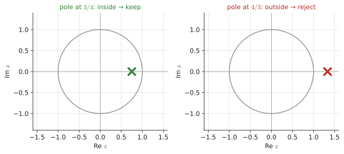

# 1.4 Spectral factorisation (the innovation filter)

In every exam since 2022 you get a power spectral density written with cosines and must find the filter $L(z)$ and noise variance $\sigma_i^2$ that produce it. It is a mechanical 5-minute procedure worth 0.25–0.75 p. One idea decides it: <b>pick the root inside the unit circle</b>. This page shows why that rule exists and then drills the procedure.

!!! need "Before this page"
    - Complex exponentials and $\cos\theta=\frac{e^{j\theta}+e^{-j\theta}}2$, $\lvert u\rvert^2=u\bar u$ ([0.3](p0-foundations.md#03-complex-numbers-and-ejtheta))
    - White noise, the PSD of a filtered signal $P=\sigma_i^2\lvert H\rvert^2$, AR/MA models ([3.3 §1–2](p3-autocorr.md#1-the-idea-giving-randomness-a-memory))
    - Quadratic formula and the identity $\lvert1+ce^{-j\theta}\rvert^2=1+c^2+2c\cos\theta$ ([Toolbox](toolbox.md))

    If you read only one thing: **spectral factorisation is [3.3](p3-autocorr.md) run backwards. There you got a PSD from a model; here you get the model from a PSD. The only subtlety is that two models fit, and you pick the stable one (root inside the unit circle).**

---

## 1 · The idea, from zero

### 1.1 What is being asked

**White noise** $i[n]$ is a sequence of uncorrelated random numbers with zero mean and variance $\sigma_i^2$. Its PSD is flat: every frequency has the same power $\sigma_i^2$ ([3.3 §1.1](p3-autocorr.md#11-white-noise-the-raw-material)).

If you pass a random signal through a linear filter $H(z)$, its spectrum gets multiplied by the squared magnitude of the filter ([3.3 §2](p3-autocorr.md#2-the-psd-of-a-model-without-any-autocorrelation)):

$$P_y(e^{j\theta})=|H(e^{j\theta})|^2\,P_x(e^{j\theta}).$$

So white noise through a filter $L(z)$ gives a "coloured" signal with PSD $\sigma_i^2|L(e^{j\theta})|^2$. The **innovation representation** says: almost any WSS signal can be seen as white noise through a filter. Finding that filter and the noise variance from the PSD is **spectral factorisation**:

$$P_x(z)=\sigma_i^2\,L(z)\,L(z^{-1}),\qquad z=e^{j\theta}$$

(on the unit circle $L(z^{-1})$ is the complex conjugate of $L(z)$, so the product is $\lvert L\rvert^2$).

### 1.2 Why two answers fit, and why we pick "inside the unit circle"

The PSD only knows $|L|^2$. Take the factor $(1-az^{-1})$ and its twin $(1-a^{-1}z^{-1})$. Their squared magnitudes differ only by a constant:

$$\lvert1-a^{-1}e^{-j\theta}\rvert^2=1+a^{-2}-2a^{-1}\cos\theta=a^{-2}\big(a^2+1-2a\cos\theta\big)=a^{-2}\,\lvert1-ae^{-j\theta}\rvert^2 .$$

So there are always two candidates for every factor, and the constant $a^{-2}$ just gets absorbed in $\sigma_i^2$. Which one is the "real" filter? The convention that makes the answer unique: $L(z)$ is **causal, stable and minimum phase**, i.e. all poles **and** zeros inside the unit circle ($|a|<1$), and its first impulse-response sample is $l[0]=1$.

*Why that is natural:* the AR(1) recipe $x[n]=a\,x[n-1]+i[n]$ has the pole at $a$. If $|a|<1$ the memory fades and the signal stays bounded (e.g. $a=\frac34$: each value remembers $\frac34$ of the previous one). If $|a|>1$ (e.g. $a=\frac43$) the recursion explodes. Minimum phase also guarantees that the inverse $1/L(z)$, the *whitening filter* that turns $x[n]$ back into $i[n]$, is stable.

<figure markdown>

<figcaption>April 2024 1e: the equations give $a=3/4$ or $a=4/3$. Same $|L|^2$ shape, but only the pole inside the unit circle gives a stable, minimum-phase innovation filter.</figcaption>
</figure>

### 1.3 The key identity

The PSD is written with cosines, the filter with $z$. The bridge ([Toolbox](toolbox.md#5-complex-exponentials-needed-for-every-psd), derived in [3.3 §2](p3-autocorr.md#2-the-psd-of-a-model-without-any-autocorrelation)): using $z+z^{-1}=2\cos\theta$ on the unit circle,

$$(1-az^{-1})(1-az)=1+a^2-a(z+z^{-1})=\underbrace{(1+a^2)}_{\text{constant}}-\underbrace{2a}_{\text{cos coeff.}}\cos\theta .$$

With a **plus** sign, $(1+az^{-1})(1+az)=(1+a^2)+2a\cos\theta$.

!!! recipe "Recipe: spectral factorisation of $P(e^{j\theta})=\dfrac{\alpha_n\pm\beta_n\cos\theta}{\alpha_d\pm\beta_d\cos\theta}$"
    Do numerator and denominator separately. For "$\alpha\pm\beta\cos\theta$":

    1. Match it to $C\big[(1+a^2)\pm2a\cos\theta\big]$:
       $\quad C(1+a^2)=\alpha,\qquad 2Ca=\beta.$
    2. Divide the two equations to remove $C$: $\dfrac{1+a^2}{2a}=\dfrac{\alpha}{\beta}$, i.e. $a^2-\dfrac{2\alpha}{\beta}a+1=0$. The two roots are $a$ and $1/a$ (their product is 1).
    3. **Keep the root with $|a|<1$.**
    4. $C=\beta/(2a)$.
    5. With $C_n,b$ from the numerator and $C_d,a$ from the denominator:
       $$\sigma_i^2=\frac{C_n}{C_d},\qquad L(z)=\frac{1\pm bz^{-1}}{1\pm az^{-1}}$$
       using the same sign as the cosine term (minus cos ↔ minus in $L$).
    6. **Check** at $\theta=0$: $\sigma_i^2\,\frac{(1\pm b)^2}{(1\pm a)^2}$ must equal $P(e^{j0})$.

!!! example "Smallest possible example: $P=\dfrac{5}{4}+\cos\theta$ (a numerator only)"
    Match $C(1+b^2)=\frac54$ and $2Cb=1$ (plus sign). Divide: $\frac{1+b^2}{2b}=\frac54\Rightarrow2b^2-5b+2=0\Rightarrow b=\frac12$ or $2$. Keep $b=\frac12$, $C=\frac1{2b}=1$. So $P=1\cdot(1+\frac12z^{-1})(1+\frac12z)$: an MA(1) with $b=\frac12$ driven by unit-variance noise (compare [3.4 Jan 2020 ex. 3](p3-chain.md#jan20-3)).

!!! trap "Traps"
    - $\cos\theta=\frac{z+z^{-1}}{2}$: the coefficient of $z$ is **half** the cosine coefficient. Writing $60\cos\theta$ as $60(z+z^{-1})$ is the classic mistake.
    - A constant numerator (e.g. 1 or 7) gives $b=0$, $C_n=$ that constant.
    - $L(z^{-1})$ (poles outside the circle) is the *maximum-phase* twin, never the answer.

---

## Exam questions

### April 2025 exam · 1e {#apr25-1e}

!!! exam "Final exam Q3, 13 April 2025 · 1e · 0.4 p"
    Random signal $x[n]$ has the following power spectral density:

    $$P_x(e^{j\theta}) = \frac{1}{61 + 60 \cos \theta}$$

    Find the spectral factorization of $x[n]$, that is, the innovation filter $L(z)$ and the variance of the input noise $\sigma_i^2$.

???+ solution "Solution"

    **What is being asked?** Write $P_x=\sigma_i^2L(z)L(z^{-1})$ with $L$ minimum phase: give $L(z)$ and $\sigma_i^2$.

    **Symbols in this question.** $C_n,C_d$: the constants for numerator and denominator; $a$: the denominator's root (pole of $L$); $b$: the numerator's root (zero of $L$).

    **Step 1 — numerator.** It is the constant 1: $C_n=1$, no zero ($b=0$).

    **Step 2 — denominator.** $61+60\cos\theta$ has a **plus** sign, so match with $C_d(1+az^{-1})(1+az)=C_d(1+a^2)+2C_da\cos\theta$:

    $$C_d(1+a^2)=61,\qquad 2C_da=60\;\Rightarrow\;C_da=30.$$

    **Step 3 — remove $C_d$.** Divide: $\dfrac{1+a^2}{a}=\dfrac{61}{30}\Rightarrow30a^2-61a+30=0$. Quadratic formula: $a=\dfrac{61\pm\sqrt{61^2-4\cdot900}}{60}=\dfrac{61\pm11}{60}=\dfrac65\text{ or }\dfrac56.$

    **Step 4 — pick the root inside the unit circle:** $a=\frac56$. Then $C_d=30/a=30\cdot\frac65=36$.

    **Step 5 — assemble.** $\sigma_i^2=\dfrac{C_n}{C_d}=\dfrac1{36}$ and, with the plus sign, $L(z)=\dfrac{1}{1+\frac56z^{-1}}$.

    **Check** at $\theta=0$: $\frac{1/36}{(1+5/6)^2}=\frac{1/36}{121/36}=\frac1{121}$ and $\frac1{61+60}=\frac1{121}$ ✓

    !!! answer "Answer"
        $L(z)=\dfrac{1}{1+\frac56z^{-1}}$, $\quad\sigma_i^2=\dfrac1{36}$

### April 2024 exam · 1e {#apr24-1e}

!!! exam "Final exam Q3, April 2024 · 1e · 0.4 p"
    A random signal $x[n]$ has the power spectra density given by:

    $$P(e^{j\theta}) = \frac{7}{25 - 24 \cos(\theta)}.$$

    Find the spectral factorization of $x[n]$. In other words, find the coefficients of the innovation filter $L(z)$ and the variance of the input noise $\sigma_i^2$, so that $x[n]$ can be expressed as the output of the innovation filter when white noise with variance $\sigma_i^2$ is given as input.

???+ solution "Solution"

    **What is being asked?** Same recipe; the denominator now has a **minus** cosine.

    **Step 1 — numerator.** Constant 7: $C_n=7$.

    **Step 2 — denominator** ($25-24\cos\theta$, match with $C_d[(1+a^2)-2a\cos\theta]$): $C_d(1+a^2)=25$ and $2C_da=24\Rightarrow C_da=12$.

    **Step 3 — remove $C_d$:** $\dfrac{1+a^2}{a}=\dfrac{25}{12}\Rightarrow12a^2-25a+12=0\Rightarrow a=\dfrac{25\pm7}{24}=\dfrac43\text{ or }\dfrac34.$ ($\sqrt{625-576}=7$.)

    **Step 4 — inside the circle:** $a=\frac34$; $C_d=12/a=16$. (Check: $16(1+\frac9{16})=25$ ✓.)

    **Step 5 — assemble:** $\sigma_i^2=\dfrac{C_n}{C_d}=\dfrac7{16}$ and (minus sign) $L(z)=\dfrac{1}{1-\frac34z^{-1}}$.

    **Check** $\theta=0$: $\frac{7/16}{(1/4)^2}=7$ and $\frac{7}{25-24}=7$ ✓. So $x[n]$ is an AR(1) process: $x[n]=\frac34x[n-1]+i[n]$ ([3.3 §1.2](p3-autocorr.md#12-three-recipes-that-add-memory)).

    !!! answer "Answer"
        $L(z)=\dfrac{1}{1-\frac34z^{-1}}$, $\quad\sigma_i^2=\dfrac7{16}$

### November 2022 exam · 1d {#nov22-1d}

!!! exam "Final exam Q1, 7 November 2022 · 1d · 0.75 p"
    A random signal $x[n]$ has power spectral density given by $P_x(e^{j\theta}) = \frac{1}{\frac{5}{3} - \cos(\theta)}$. Find the spectral factorization of $x[n]$. In other words, modeling $x[n]$ as the output of an LTI driven by white noise, find the variance of the input noise $\sigma_i^2$ and the innovation filter $L(z)$.

???+ solution "Solution"

    **What is being asked?** The same recipe with fractions in the denominator.

    **Step 1 — numerator:** $C_n=1$.

    **Step 2 — denominator** $\frac53-\cos\theta$ (minus sign): $C_d(1+a^2)=\frac53$ and $2C_da=1$.

    **Step 3 — remove $C_d$:** $\dfrac{1+a^2}{2a}=\dfrac53\Rightarrow3(1+a^2)=10a\Rightarrow3a^2-10a+3=0\Rightarrow a=\dfrac{10\pm8}{6}=3\text{ or }\dfrac13.$

    **Step 4 — inside the circle:** $a=\frac13$, so $C_d=\frac{1}{2a}=\frac32$.

    **Step 5 — assemble:** $\sigma_i^2=\frac{C_n}{C_d}=\frac{1}{3/2}=\frac23$ and $L(z)=\dfrac{1}{1-\frac13z^{-1}}$, i.e.

    $$P_x(z)=\frac23\cdot\frac{1}{1-\frac13z^{-1}}\cdot\frac{1}{1-\frac13z}.$$

    **Check** $\theta=0$: $\frac{2/3}{(2/3)^2}=\frac32$ and $\frac{1}{5/3-1}=\frac32$ ✓

    !!! answer "Answer"
        $L(z)=\dfrac{1}{1-\frac13z^{-1}}$, $\quad\sigma_i^2=\dfrac23$

### January 2024 resit · 1f {#jan24-1f}

!!! exam "Resit January 2024 · 1f · 0.25 p (shown in the Part 1 review lecture)"
    A random signal has the following power spectral density:

    $$P(e^{j\theta}) = \frac{10+6\cos(\theta)}{17-8\cos(\theta)}$$

    Which of the following is the spectral factorization of $P(e^{j\theta})$?

    - (a) $L(z) = \frac{1+3z^{-1}}{1-4z^{-1}}$, and $\sigma_i^2 = 1$
    - (b) $L(z) = \frac{1+3z^{-1}}{1-\frac{1}{4}z^{-1}}$, and $\sigma_i^2 = \frac{1}{16}$
    - (c) $L(z) = \frac{1+\frac{1}{3}z^{-1}}{1-\frac{1}{4}z^{-1}}$, and $\sigma_i^2 = \frac{9}{16}$
    - (d) $L(z) = \frac{1+\frac{1}{3}z^{-1}}{1-4z^{-1}}$, and $\sigma_i^2 = 9$

???+ solution "Solution"

    **What is being asked?** Pick the correct factorisation among four that look alike.

    **Step 1 — the fast way (MC).** All four options produce the same PSD (the roots $3\leftrightarrow\frac13$ and $4\leftrightarrow\frac14$ are the twins of [1.2](#12-why-two-answers-fit-and-why-we-pick-inside-the-unit-circle), with the constants absorbed in $\sigma_i^2$). Only one has every pole and zero inside the unit circle: (c), with zero $-\frac13$ and pole $\frac14$.

    **Step 2 — the full way.** Numerator $10+6\cos\theta$ (plus sign): $C_n(1+b^2)=10$, $C_nb=3\Rightarrow\frac{1+b^2}{b}=\frac{10}3\Rightarrow3b^2-10b+3=0\Rightarrow b=\frac13$ (keep), $C_n=\frac{3}{b}=9$.

    **Step 3.** Denominator $17-8\cos\theta$ (minus sign): $C_d(1+a^2)=17$, $C_da=4\Rightarrow4a^2-17a+4=0\Rightarrow a=\frac{17\pm15}{8}=\frac14$ (keep) or $4$, $C_d=\frac4a=16$.

    **Step 4 — assemble:** $\sigma_i^2=\frac{C_n}{C_d}=\frac9{16}$, $L(z)=\frac{1+\frac13z^{-1}}{1-\frac14z^{-1}}$.

    !!! answer "Answer"
        **(c)**

    !!! trap "Slide typo"
        The "extra exercise" in the 2026-27 Part 1 review deck ends with $L(z)=\frac{1-\frac14z^{-1}}{1-\frac13z^{-1}}$: numerator and denominator swapped and a sign flipped. The correct factorisation is option (c) above.

### January 2022 resit · 1d {#jan22-1d}

!!! exam "Resit, 24 January 2022 · 1d · 0.3 p"
    Random signal $x[n]$ has power spectral density given by

    $$P_x(e^{j\theta}) = \frac{\frac{17}{8} - \cos(\theta)}{\frac{25}{16} - \frac{3}{2} \cos(\theta)},$$

    which is factorized as

    $$P_x(e^{j\theta}) = 2 \frac{(1 - \frac{1}{4}z^{-1})(1 - \frac{1}{4}z)}{(1 + \frac{3}{4}z^{-1})(1 + \frac{3}{4}z)}.$$

    Which of the following statements is true?

    - a) The provided factorization does not represent the spectral factorization of signal $x[n]$.
    - b) The innovation filter is given by $L(z^{-1}) = \frac{1 - \frac{1}{4}z}{1 + \frac{3}{4}z}$.
    - c) The innovation filter is given by $L(z) = \frac{1 - \frac{1}{4}z^{-1}}{1 + \frac{3}{4}z^{-1}}$.
    - d) The input variance is given by $\sigma_i^2 = 1/2$.

???+ solution "Solution"

    **What is being asked?** Read the given factorisation $\sigma_i^2L(z)L(z^{-1})$ and decide which statement about it is right. (The printed PSD was garbled by the conversion; the official clarification: the denominator should be $\frac{25}{16}+\frac32\cos\theta$, otherwise the sign does not match the factorisation. Check: $(1+\frac34z^{-1})(1+\frac34z)=\frac{25}{16}+\frac32\cos\theta$ ✓ and $2(1-\frac14z^{-1})(1-\frac14z)=2\big(\frac{17}{16}-\frac12\cos\theta\big)=\frac{17}8-\cos\theta$ ✓.)

    **Step 1 — read off the pieces.** $\sigma_i^2=2$ (the constant in front), $L(z)=\frac{1-\frac14z^{-1}}{1+\frac34z^{-1}}$: zero at $\frac14$, pole at $-\frac34$, both inside the unit circle, so this is the minimum-phase factor.

    **Step 2 — the options.** (a) false: it *is* a valid factorisation. (b) $L(z^{-1})$ has its zero and pole outside the circle (maximum phase): not the innovation filter. (c) **true.** (d) the constant in front is $\sigma_i^2=2$, not $\frac12$.

    !!! answer "Answer"
        **(c)**

### June 2026 resit · 1e {#jun26-1e}

!!! exam "Resit Q4, June 2026 · 1e · 0.25 p"
    Which of the following conditions is required for a discrete-time rational filter $H(z)$ to be the innovation filter obtained through the spectral factorisation of a given Power Spectral Density $P_x(z)$?

    - (a) $H(z)$ must be a minimum-phase system, meaning all its poles and zeros must lie inside (or on) the unit circle.
    - (b) $H(z)$ must be a maximum-phase system, meaning all its poles and zeros must lie strictly outside the unit circle.
    - (c) $H(z)$ must have a purely real-valued impulse response with strict linear phase to avoid phase distortion.
    - (d) $H(z)$ must be an all-pass system to ensure that the power of the driving noise is perfectly preserved.

???+ solution "Solution"

    **What is being asked?** The defining property of the innovation filter ([1.2](#12-why-two-answers-fit-and-why-we-pick-inside-the-unit-circle)).

    **Step 1.** The innovation filter is causal, stable and **minimum phase** (poles and zeros inside the unit circle): (a). The reader excludes poles *on* the circle; the "(or on)" refers to zeros, which may sit on it, e.g. the zero at $z=1$ in [Nov 2022 3d](p3-autocorr.md#nov22-3c).

    **Step 2.** (b) is the maximum-phase twin. (c) linear phase is unrelated. (d) An all-pass system has a flat $|H|^2$, so it could never shape a spectrum.

    !!! answer "Answer"
        **(a)** minimum phase

*[spectral factorisation]: writing a PSD as σ² L(z) L(z⁻¹) to find the innovation filter L and the noise variance σ².
*[innovation filter]: the causal, stable, minimum-phase filter L(z) that turns white noise into the given random signal.
*[minimum phase]: all poles and zeros inside the unit circle; makes both L and 1/L stable.
*[unit circle]: the points z = e^{jθ}, |z| = 1; where the frequency response lives.
*[pole]: a value of z where the filter's denominator is zero.
*[zero]: a value of z where the filter's numerator is zero.
*[whitening filter]: 1/L(z); turns the coloured signal back into white noise.
