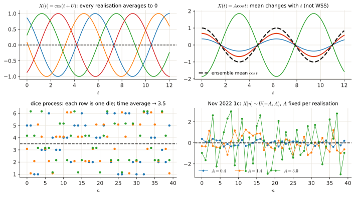
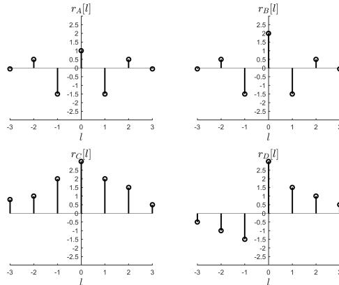
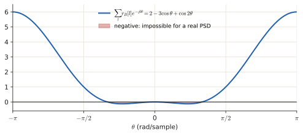

# 1.3 Random processes: stationarity, ergodicity, autocorrelation

One multiple-choice question per exam, usually 0.25–0.3 p. They test two words: <b>stationary</b> (WSS) and <b>ergodic</b>. Once you can picture a process as a stack of signals, both are easy. This page builds that picture first, then gives a two-step test and applies it to every exam question.

!!! need "Before this page"
    - What a signal is, $x[n]$ vs $x(t)$ ([0.1](p0-foundations.md#01-what-a-signal-is)); cosines ([0.2](p0-foundations.md#02-sine-cosine-frequency)); the identity $\cos\alpha\cos\beta=\frac12[\cos(\alpha+\beta)+\cos(\alpha-\beta)]$ ([Toolbox](toolbox.md#5-complex-exponentials-needed-for-every-psd))
    - Expectation (mean) of a random variable ([0.6](p0-foundations.md#expectation-variance)); random signal, autocorrelation, PSD ([0.6](p0-foundations.md#random-signals-stationarity-and-autocorrelation))

    If you read only one thing: **a random process is a stack of signals. "Stationary" = the statistics are the same whichever *column* (time) you look at. "Ergodic" = one *row* (one realisation) over time tells you the same as the whole stack at one time.**

---

## 1 · The idea, from zero

### 1.1 A process is a stack of signals

A **random process** $X(t)$ (or $X[n]$ in discrete time) is a **collection of signals**. Each time you run the experiment you get one whole signal, called a **realisation**. The collection of all possible realisations is the **ensemble**. Picture a table: each **row** is one realisation, each **column** is one time instant.

Two ways to average:

- **Ensemble average** (down a column): fix a time $t$, average over *all realisations*. This is $\mathbb E[X(t)]$.
- **Time average** (along a row): take *one* realisation and average it over time, $\frac1N\sum_n x[n]$.

<figure markdown>

<figcaption>Top left: $\cos(t+U)$. Every realisation wiggles around 0, so the time average of any one of them equals the ensemble mean 0. Top right: $A\cos t$. The ensemble mean is $\cos t$, which changes with time. Bottom left: dice. Every row is i.i.d. rolls, so time averages are the same for every row. Bottom right: the Nov 2022 process. $A$ is drawn once per realisation, so the spread differs from row to row.</figcaption>
</figure>

### 1.2 Wide-sense stationary (WSS)

The statistics up to second order do not depend on *when* you look:

1. The mean is constant: $\mathbb E[X(t)]=\mu$ for all $t$ (every column has the same average).
2. The autocorrelation $r(t_1,t_2)=\mathbb E[X(t_1)X(t_2)]$ depends only on the lag $\tau=t_2-t_1$ (how related two columns are depends on how far apart they are, not on where they sit).

*Examples.* White noise: constant mean 0, $r[l]=\sigma^2\delta[l]$ → WSS. A signal whose average power grows with time (a volume knob turned up): mean or $r(t,t)$ depends on $t$ → not WSS.

### 1.3 Ergodic

**Ergodic**: you can learn the ensemble statistics from **one** (infinitely long) realisation, because the time average along a row equals the ensemble average down a column. The course requires a process to be stationary before it can be ergodic.

- **Ergodic in the mean**: $\frac1N\sum x[n]\to\mathbb E[X]$ for every realisation.
- **Ergodic in the variance / autocorrelation**: the same for $x^2$ or $x[n]x[n+l]$.

The thing that breaks ergodicity is a **random quantity drawn once per realisation and then frozen** (an amplitude $A$, a range): each row then has its own personality, and no row alone can reveal the average over personalities.

!!! recipe "Recipe: is it WSS? is it ergodic?"
    1. Compute $\mathbb E[X(t)]$. If it depends on $t$ → **not WSS** → not ergodic. Stop.
    2. Compute $\mathbb E[X(t_1)X(t_2)]$. Use $\cos\alpha\cos\beta=\tfrac12[\cos(\alpha+\beta)+\cos(\alpha-\beta)]$ when there are cosines. If only $t_1-t_2$ survives → WSS.
    3. For ergodicity, look for a random quantity that is **drawn once per realisation and then frozen** (an amplitude $A$, the size of the range). Any statistic that depends on it differs from realisation to realisation → not ergodic in that statistic. A random **phase** $U$ that is uniform over $[0,2\pi)$ does not hurt the mean: every realisation still averages to 0.
    4. If everything is drawn fresh at every time step (i.i.d. samples: dice, white noise), the process is ergodic in everything.

### 1.4 Autocorrelation: what a valid one looks like

For a real WSS signal, $r[l]=\mathbb E\{x[n]\,x[n-l]\}$ must satisfy:

1. **Symmetric**: $r[-l]=r[l]$ (the relation of $x[n]$ with $x[n-l]$ is the same as of $x[n]$ with $x[n+l]$).
2. **Peak at zero lag**: $r[0]\ge|r[l]|$ ($r[0]=\mathbb E[x^2]$ is the power; nothing can be more related to $x[n]$ than $x[n]$ itself).
3. **Non-negative spectrum**: the PSD $P(e^{j\theta})=\sum_l r[l]e^{-jl\theta}$ (Wiener–Khinchin) must be $\ge0$ for every $\theta$.

White noise has $r[l]=\sigma^2\delta[l]$ (correlated only with itself) and a flat PSD $P=\sigma^2$.

The **cross-correlation** between two signals is $r_{xy}[l]=\mathbb E\{x[n]\,y[n-l]\}$. For ergodic signals you estimate it from data as $\hat r_{xy}[l]=\frac1N\sum_n x[n]\,y[n-l]$ (slide $y$ along $x$, multiply the overlapping samples, add, divide by $N$).

---

## Exam questions

### June 2026 resit · 1d {#jun26-1d}

!!! exam "Resit Q4, June 2026 · 1d · 0.25 p"
    Which of the following conditions is required for a random process to be considered Wide-Sense Stationary (WSS)?

    - (a) Time averages of all its individual realizations are strictly equal to its ensemble averages.
    - (b) Its mean is constant and its autocorrelation function depends only on the time difference (lag).
    - (c) Its probability density function remains strictly constant over all time indices.
    - (d) Its power spectral density is a constant value across all frequencies.

???+ solution "Solution"

    **What is being asked?** The definition of WSS ([1.2](#12-wide-sense-stationary-wss)).

    - (a) That is the definition of **ergodic** (time averages = ensemble averages).
    - (b) **WSS**: constant mean and autocorrelation that depends only on the lag.
    - (c) That is (first-order) **strict-sense** stationarity, more than WSS asks for.
    - (d) That describes **white** noise.

    !!! answer "Answer"
        **(b)**

### April 2025 exam · 1d {#apr25-1d}

!!! exam "Final exam Q3, 13 April 2025 · 1d · 0.25 p"
    *(The question text was missing from the printed exam. The official clarification gives it:)* Suppose we have infinitely many fair dice and we define a random process $X[n]$ as the ensemble of the random signals $x_i[n]$ obtained by rolling each die infinitely many times and recording the number on the upward face of the die. Which of the following statements is true?

    - (a) The process is ergodic, but only in the mean.
    - (b) The process is ergodic in both mean and variance.
    - (c) $E[X[n]] = E[x_i[n]] = 0, \forall i$
    - (d) The process is stationary but not ergodic.

???+ solution "Solution"

    **What is being asked?** Picture the stack: each row is one die rolled again and again; the ensemble has infinitely many rows. Is it ergodic, and in what?

    **Step 1 — structure.** Every die is fair and every roll is independent, so every row is an i.i.d. sequence with the **same** distribution. Nothing is drawn once per row: no frozen quantity ([1.3](#13-ergodic)).

    **Step 2 — time averages.** For any single row, the average of many rolls tends to the ensemble mean $3.5$, and its average squared deviation tends to the ensemble variance $\frac{35}{12}$ (the die example of [1.2](p1-rv.md#12-expected-value-and-variance): mean 3.5, variance 2.92). So the process is ergodic in the mean **and** the variance.

    **Step 3 — the options.** (a) too weak (it is ergodic in more). (c) wrong: the mean is $3.5$, not 0. (d) wrong: it is ergodic.

    !!! answer "Answer"
        **(b)** ergodic in both mean and variance

### January 2022 resit · 1c {#jan22-1c}

!!! exam "Resit, 24 January 2022 · 1c · 0.3 p"
    Suppose we have infinitely many fair dice and we define a random process as the ensemble of the random signals obtained by rolling each die infinitely many times and recording the number on the upward face. Which of the following statements is true?

    - a) This random process is not ergodic, but it is stationary.
    - b) This random process is ergodic in the mean and variance.
    - c) This random process is ergodic in the mean, but not in the variance.
    - d) None of the above.

???+ solution "Solution"

    **What is being asked?** The same question as April 2025: i.i.d. rolls from identical dice, so one row tells you everything ([above](#apr25-1d)). Ergodic in the mean and in the variance.

    !!! answer "Answer"
        **(b)**

### April 2024 exam · 1d {#apr24-1d}

!!! exam "Final exam Q3, April 2024 · 1d · 0.3 p"
    For the following random processes, indicate if they are WSS and ergodic in the mean:

    1. $X(t) = \cos(t + U)$, where $U \sim Uniform(0, 2\pi)$
    2. $X(t) = A \cos(t)$, where $A \sim N(1, 2)$

    The following formula might be useful:

    $$\cos(\alpha) \cos(\beta) = \frac{\cos(\alpha + \beta) + \cos(\alpha - \beta)}{2}$$

    | Random process | WSS (Yes/No) | Ergodic in the mean (Yes/No) |
    |---|---|---|
    | 1 | | |
    | 2 | | |

???+ solution "Solution"

    **What is being asked?** Apply the recipe of [1.3](#13-ergodic) to two processes.

    **Symbols in this question.** $U$: a random **phase**, drawn once per realisation, uniform on $[0,2\pi)$. $A$: a random **amplitude**, drawn once per realisation (normal with mean 1).

    **Process 1 — Step 1, the mean.** Averaging $\cos(t+U)$ over a uniform phase covers a full period, so $\mathbb E[X(t)]=\frac1{2\pi}\int_0^{2\pi}\cos(t+u)\,du=0$ for every $t$. Constant ✓.

    **Step 2 — the autocorrelation**, with the hint ($\alpha=t_1+U$, $\beta=t_2+U$):

    $$\mathbb E[\cos(t_1+U)\cos(t_2+U)]=\tfrac12\mathbb E[\cos(t_1+t_2+2U)]+\tfrac12\cos(t_1-t_2)=\tfrac12\cos(t_1-t_2).$$

    The first term averages to 0 ($2U$ also sweeps full periods). Only the lag $t_1-t_2$ survives → **WSS**.

    **Step 3 — ergodic?** Every realisation is a cosine that averages to 0 over time, equal to the ensemble mean → **ergodic in the mean**. (The random phase is frozen per row, but it does not change the average.)

    **Process 2 — Step 1.** $\mathbb E[X(t)]=\mathbb E[A]\cos t=\cos t$ depends on $t$ → **not WSS** → not ergodic. In the figure above: one realisation $a\cos t$ averages to 0 over time, while the ensemble mean is $\cos t$.

    !!! answer "Answer"
        | | WSS | Ergodic in the mean |
        |---|---|---|
        | 1 | Yes | Yes |
        | 2 | No | No |

### November 2022 exam · 1c {#nov22-1c}

!!! exam "Final exam Q1, 7 November 2022 · 1c · 0.25 p"
    A random process $X(t)$ is represented by a random number generator. For each realization of the random process, the random number generator samples randomly (with equal probability) infinitely many numbers between $-A$ and $A$. Random variable $A$ follows a normal distribution with mean $\mu_A = 1$ and $\sigma_A = 2$. Which of the following statements is TRUE?

    - a) The random process is NOT ergodic. The mean of the process is constant and equal to $\mu_{X(t)} = 1$
    - b) The random process is ergodic. The mean of the process is constant and equal to $\mu_{X(t)} = 1$
    - c) The random process is NOT ergodic. The mean of the process is constant and equal to $\mu_{X(t)} = 0$
    - d) The random process is ergodic. The mean of the process is constant and equal to $\mu_{X(t)} = 0$

???+ solution "Solution"

    **What is being asked?** The frozen quantity here is $A$: it is drawn once per realisation, and then that row's samples are uniform on $[-A,A]$. Find the mean, then decide ergodicity.

    **Step 1 — the mean.** Given $A=a$, each sample is uniform on $[-a,a]$, which has mean 0. Averaging over $A$ too: $\mathbb E[X]=0$. This kills options (a) and (b).

    **Step 2 — ergodic in the mean?** One realisation has a fixed $a$ and i.i.d. samples with mean 0, so its time average → 0 = ensemble mean. **Yes.**

    **Step 3 — ergodic in the variance?** One realisation has time-averaged power $a^2/3$ (the power of a uniform on $[-a,a]$), which depends on the $a$ drawn for that row. The ensemble power is $\mathbb E[A^2]/3=(\sigma_A^2+\mu_A^2)/3=(4+1)/3=\frac53$. Different rows give different values → **No.** (The process is still WSS: $\mathbb E[X[n]X[n+k]]=\tfrac53\delta[k]$.)

    **Step 4 — which option?** It comes down to what "ergodic" means in the question. The **official 2026 key** says: *"ergodic" is meant as ergodic in the mean* → (d). The 2026-27 review slides marked (c) instead ("not ergodic"). If this exact question shows up again, (d) follows the latest key. If they say "ergodic in the variance/autocorrelation", the answer is "not ergodic".

    !!! answer "Answer"
        **(d)** per the official key (ergodic in the mean, mean = 0)

### January 2020 retake · 1a {#jan20-1a}

!!! exam "Retake exam, 20 January 2020 · Exercise 1(a) · 0.25 p"
    Looking at Figure 1, which sequences are legitimate auto-correlation functions

    

    - A. Only $r_B[l]$.
    - B. Only $r_D[l]$.
    - C. $r_A[l]$ and $r_B[l]$.
    - D. $r_B[l]$ and $r_D[l]$.
    - E. $r_C[l]$ and $r_D[l]$.
    - F. All.

???+ solution "Solution"

    **What is being asked?** Check each plotted sequence against the rules of [1.4](#14-autocorrelation-what-a-valid-one-looks-like). Each stem is one lag $l$, its height is $r[l]$.

    - $r_A$: $r_A[0]=1$ but $r_A[\pm1]=-1.5$, so $\lvert r[1]\rvert>r[0]$: **peak at zero lag fails** ✗.
    - $r_C$: not symmetric ($r_C[-3]=0.8$ but $r_C[3]=0.5$; $r_C[-2]=1$ but $r_C[2]=1.5$): **symmetry fails** ✗.
    - $r_D$: negative on the left, positive on the right: **symmetry fails** ✗.
    - $r_B$: symmetric, peak $r_B[0]=2$ at zero lag ✓.

    Expected answer: only $r_B$.

    !!! trap "Strictly speaking"
        The third rule (PSD ≥ 0) fails for $r_B$ too: $P(e^{j\theta})=2-3\cos\theta+\cos2\theta=(2\cos\theta-1)(\cos\theta-1)$ is negative for $|\theta|<\pi/3$. The question only meant the two quick checks, so answer A, but know that symmetry and a peak at 0 are necessary, not sufficient.

        

    !!! answer "Answer"
        **A** (only $r_B$), per the key

### November 2019 exam · 1a {#nov19-1a}

!!! exam "Written exam, 4 November 2019 · Exercise 1(a) · 1 p"
    Let $x[n]$ and $y[n]$ be two random signals. Suppose we observe $x[n]$ and $y[n]$ in a limited time window as shown in Fig. 1 below. Assuming $x[n]$ and $y[n]$ to be ergodic, what is the cross-correlation $r_{xy}[\tau]$?

    ![Figure 1: x[n] and y[n]](img/exam/nov19-1a-xy.jpg)

    - A. $r_{xy}[0] = 5/4$, $r_{xy}[1] = -8/4$, $r_{xy}[2] = 11/4$, $r_{xy}[3] = -7/4$, $r_{xy}[4] = 1$, $r_{xy}[5] = 1/4$ and zero elsewhere
    - B. $r_{xy}[0] = 5/4$, $r_{xy}[1] = 8/4$, $r_{xy}[2] = 11/4$, $r_{xy}[3] = 7/4$, $r_{xy}[4] = 1$, $r_{xy}[5] = 1/4$ and zero elsewhere
    - C. $r_{xy}[0] = 5/4$, $r_{xy}[1] = -8/4$, $r_{xy}[2] = 13/4$, $r_{xy}[3] = 7/4$ and zero elsewhere
    - D. $r_{xy}[0] = 5/4$, $r_{xy}[1] = 8/4$, $r_{xy}[2] = 13/4$, $r_{xy}[3] = 7/4$ and zero elsewhere

???+ solution "Solution"

    **What is being asked?** Estimate the cross-correlation of two short signals by sliding one over the other.

    **Symbols in this question.** $x[n]=[1,1,1,0]$ and $y[n]=[1,3,3,5]$ for $n=0,1,2,3$ (read from the stems); $N=4$ samples; $\tau$ or $l$: the lag.

    **Step 1 — ergodic → time average.** "Ergodic" lets us replace the expectation $\mathbb E\{\cdot\}$ by a time average over the $N=4$ samples ([1.4](#14-autocorrelation-what-a-valid-one-looks-like)): $\hat r_{xy}[l]=\frac14\sum_n x[n]\,y[n-l]$.

    **Step 2 — slide $y$ along $x$** and add the products where both exist:

    | $l$ | products | $\hat r_{xy}[l]$ |
    |---|---|---|
    | $-3$ | $x_0y_3=5$ | $5/4$ |
    | $-2$ | $x_0y_2+x_1y_3=3+5$ | $8/4$ |
    | $-1$ | $x_0y_1+x_1y_2+x_2y_3=3+3+5$ | $11/4$ |
    | $0$ | $1\cdot1+1\cdot3+1\cdot3+0\cdot5$ | $7/4$ |
    | $1$ | $x_1y_0+x_2y_1+x_3y_2=1+3+0$ | $4/4$ |
    | $2$ | $x_2y_0+x_3y_1=1+0$ | $1/4$ |

    **Step 3 — compare.** These are exactly the numbers of option B, but B puts them at lags $0\dots5$ instead of $-3\dots2$. All values are positive (all samples are $\ge0$), which rules out A and C immediately. The official key: *"Due to mistake, there is no correct answer. The closest is B, but the correct answer should be shifted by 3."*

    !!! answer "Answer"
        **B** (the right values, shifted by 3 lags; strictly no option is correct)

*[random process]: a collection (ensemble) of signals; each experiment run gives one signal.
*[realisation]: one actual signal drawn from a random process.
*[ensemble]: the collection of all possible realisations of a random process.
*[ensemble average]: average over all realisations at a fixed time.
*[time average]: average of one realisation over time.
*[WSS]: wide-sense stationary: constant mean and autocorrelation that depends only on the lag.
*[ergodic]: time averages of one realisation equal the ensemble averages.
*[strict-sense stationary]: the whole PDF does not change with time (stronger than WSS).
*[cross-correlation]: r_xy[l] = E{x[n] y[n−l]}: how related two signals are at lag l.
*[Wiener–Khinchin]: the PSD is the Fourier transform of the autocorrelation.
