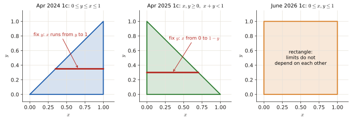
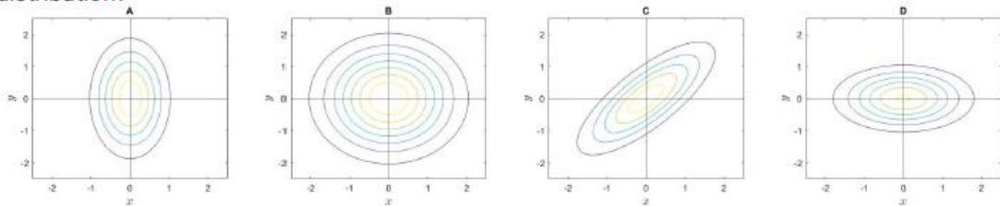
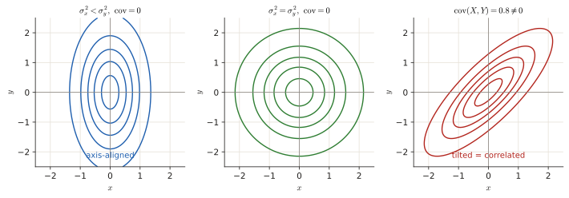

# 1.2 Random variables & joint PDFs

Two kinds of questions live here: quick multiple choice on what a random variable, expected value or covariance <em>is</em>, and a small calculation on a joint PDF (find the constant, a marginal, a conditional, or check independence). Recent exams have one of each.

## The idea, from zero

A **random variable** (RV) $X$ maps the outcome of an experiment to a **number**: the face of a die, the voltage on a wire, the number of patients.

- **Discrete RV**: it can take a countable list of values (counts, integers, die faces, a phone number). Described by a **PMF** $p_X(x)=P(X=x)$, which sums to 1.
- **Continuous RV**: it can take any value in an interval (time, distance, weight, voltage, an *average* of money). Described by a **PDF** $p_X(x)$, which integrates to 1. Probabilities are areas: $P(a\le X\le b)=\int_a^b p_X(x)\,dx$.
- **CDF** $P_X(x)=P(X\le x)$: always goes from 0 at $-\infty$ to 1 at $+\infty$ and never decreases.

**Expected value** = the average outcome, each outcome weighted by its probability:

$$E[X]=\sum_x x\,p_X(x)\quad\text{(discrete)},\qquad E[X]=\int x\,p_X(x)\,dx\quad\text{(continuous)}.$$

It is the long-run average over infinitely many repetitions. It is **not** "the most likely value" and not "the most common value".

**Variance** = average squared distance from the mean: $\operatorname{Var}[X]=E[(X-\mu)^2]=E[X^2]-\mu^2$.

### Two random variables at once

A **joint PDF** $p_{X,Y}(x,y)$ describes $X$ and $Y$ together. Three operations:

| Operation | Formula | In words |
|---|---|---|
| **Marginal** | $p_X(x)=\int p_{X,Y}(x,y)\,dy$ | forget $Y$ by summing/integrating over all its values |
| **Conditional** | $p_{X\mid Y}(x\mid y)=\dfrac{p_{X,Y}(x,y)}{p_Y(y)}$ | slice at a fixed $y$ and renormalise |
| **Independence** | $p_{X,Y}(x,y)=p_X(x)\,p_Y(y)$ for all $x,y$ | knowing $Y$ tells nothing about $X$ |

**Covariance** $\operatorname{Cov}[X,Y]=E[(X-\mu_X)(Y-\mu_Y)]=E[XY]-\mu_X\mu_Y$. Its sign tells the direction of the relation. It has **no upper bound** and **depends on the units** (measure in grams instead of kg and it changes 1000×). The **correlation coefficient** $\rho=\frac{\operatorname{Cov}}{\sigma_X\sigma_Y}$ fixes that: it is always between $-1$ and $1$.

!!! recipe "Recipe: joint PDF questions"
    1. **Draw the region** where the PDF is non-zero. This is the step that gives you the integration limits.
    2. **Normalise:** set $\iint p\,dx\,dy=1$ and solve for the constant.
    3. **Marginal of $X$:** fix $x$, integrate over $y$ from the bottom to the top of the region at that $x$. The answer is a function of $x$ only, valid on the $x$-range of the region.
    4. **Conditional $p_{X\mid Y}$:** joint divided by marginal. Its domain is the slice of the region at that $y$.
    5. **Independence:** the region must be a **rectangle** (limits of $x$ do not depend on $y$) **and** the joint must factor into $f(x)g(y)$.

<figure markdown>

<figcaption>The region tells you the limits. Triangle regions mean the limits of one variable depend on the other, which also means the two variables cannot be independent. Only the square (right) allows independence.</figcaption>
</figure>

---

## Exam questions: joint PDFs

### June 2026 resit · 1c {#jun26-1c}

!!! exam "Resit Q4, June 2026 · 1c · 0.5 p"
    Let $X$ and $Y$ be jointly continuous random variables with a joint Probability Density Function (PDF) given by:

    $$p_{X,Y}(x, y) = \begin{cases} 6x^2y, & 0 \leq x \leq 1 \text{ and } 0 \leq y \leq 1 \\ 0, & \text{otherwise} \end{cases}$$

    **Please provide only the final answer. The workout will not be checked.**

    1. Find the marginal PDF $p_X(x)$ and indicate its domain. [0.25]
    2. Determine whether $X$ and $Y$ are independent, and briefly justify why. [0.25]

???+ solution "Solution"
    **Region:** the unit square, so for every $x$ the variable $y$ runs from 0 to 1.

    $$p_X(x)=\int_0^1 6x^2y\,dy=6x^2\Big[\tfrac{y^2}{2}\Big]_0^1=3x^2,\qquad 0\le x\le1.$$

    Same for $Y$: $p_Y(y)=\int_0^1 6x^2y\,dx=6y\cdot\frac13=2y$, $0\le y\le1$.

    Check: $p_X(x)p_Y(y)=3x^2\cdot2y=6x^2y=p_{X,Y}(x,y)$ everywhere, and the support is a rectangle.

    !!! answer "Answer"
        1. $p_X(x)=3x^2$ for $0\le x\le1$, 0 otherwise.
        2. **Independent**: $p_{X,Y}(x,y)=p_X(x)\,p_Y(y)=3x^2\cdot2y$ on a rectangular support.

### April 2025 exam · 1c {#apr25-1c}

!!! exam "Final exam Q3, 13 April 2025 · 1c · 0.3 p"
    Let $X$ and $Y$ be jointly continuous random variables with joint PDF given by:

    $$p_{X,Y}(x,y) = \begin{cases} cx + 1 & x, y \geq 0, x + y < 1 \\ 0 & \text{otherwise} \end{cases}$$

    **Note:** For the conditions $x, y \geq 0, x + y < 1$ to be satisfied, $x < 1 - y$ and $y < 1$, or equivalently $y < 1 - x$ and $x < 1$.

    ***Provide only the final answer. The workout will not be checked.***

    Find the constant $c$.

???+ solution "Solution"
    **Region:** the triangle under the line $x+y=1$ (middle panel above). The note gives the limits: for fixed $y\in[0,1]$, $x$ goes from 0 to $1-y$.

    Inner integral (over $x$):

    $$\int_0^{1-y}(cx+1)\,dx=\frac{c(1-y)^2}{2}+(1-y).$$

    Outer integral (over $y$), substitute $u=1-y$:

    $$\int_0^1\left(\frac{c\,u^2}{2}+u\right)du=\frac c6+\frac12.$$

    Set the total to 1: $\frac c6+\frac12=1\Rightarrow c=3$.

    !!! answer "Answer"
        $c=3$

### April 2024 exam · 1c {#apr24-1c}

!!! exam "Final exam Q3, April 2024 · 1c · 0.3 p"
    Random variables $X$ and $Y$ have joint PDF

    $$p_{X,Y}(x,y) = \begin{cases} 2, & 0 \leq y \leq x \leq 1 \\ 0, & \text{otherwise} \end{cases}$$

    Find the marginal PDF of $Y$ ($p_Y(y)$), and the conditional PDF $p_{X|Y}(x|y)$. For both PDFs make sure to correctly indicate their domain.

    **Note: provide only the final answer. No passages will be checked.**

???+ solution "Solution"
    **Region:** the triangle below the diagonal (left panel above). For a fixed $y$, $x$ runs from $y$ up to 1.

    $$p_Y(y)=\int_y^1 2\,dx=2(1-y),\qquad 0\le y\le1.$$

    Conditional = joint / marginal, on the slice at that $y$:

    $$p_{X\mid Y}(x\mid y)=\frac{2}{2(1-y)}=\frac1{1-y},\qquad y\le x\le1\ \ (0\le y<1).$$

    So given $Y=y$, $X$ is **uniform on $[y,1]$**. That makes sense: the joint is flat, so every point of the slice is equally likely.

    !!! answer "Answer"
        $p_Y(y)=2(1-y)$ for $0\le y\le1$ (0 otherwise); $\;p_{X\mid Y}(x\mid y)=\dfrac{1}{1-y}$ for $y\le x\le1$ (0 otherwise).

!!! trap "Domain of the conditional"
    The review slides write the domain of $p_{X\mid Y}$ as "$0\le y\le 1$". That is the range of the *given* $y$. The variable of the conditional PDF is $x$, and it lives on $y\le x\le1$. Write both and you are safe.

### June 2024 resit · 1c {#jun24-1c}

!!! exam "Resit June 2024 · 1c · 0.25 p (shown in the Part 1 review lecture)"
    Random variables have joint PDF given by:

    $$p_{X,Y}(x, y) = ce^{-x}e^{-y},$$

    for $0 \leq y \leq x < \infty$.

    What is the correct values for the normalization constant $c$?

    a) 1  b) 4  c) 1/2  d) 2

???+ solution "Solution"
    Region: below the diagonal, unbounded. For fixed $x$, $y$ runs from 0 to $x$:

    $$\int_0^\infty\!\!\int_0^x ce^{-x}e^{-y}\,dy\,dx=c\int_0^\infty e^{-x}(1-e^{-x})\,dx=c\left(1-\tfrac12\right)=\frac c2=1.$$

    !!! answer "Answer"
        **(d) $c=2$**

### November 2022 exam · 1b {#nov22-1b}

!!! exam "Final exam Q1, 7 November 2022 · 1b · 0.25 p"
    Consider two random variables $X$ and $Y$ with joint PMF $p_{X,Y}(x,y)$ given by the following table. What is the marginal PMF of $X$?

    |         | $Y = 0$ | $Y = 1$ | $Y = 2$ |
    |---------|---------|---------|---------|
    | $X = 0$ | 1/6     | 1/4     | 1/8     |
    | $X = 1$ | 1/8     | 1/6     | 1/6     |

    - (a) $p_X(0)=7/24$, $p_X(1)=5/24$, 0 otherwise
    - (b) $p_X(0)=13/24$, $p_X(1)=11/24$, 0 otherwise
    - (c) $p_X(0)=13/24$, $p_X(1)=5/24$, $p_X(2)=11/24$, 0 otherwise
    - (d) $p_X(0)=7/24$, $p_X(1)=5/12$, $p_X(2)=7/24$, 0 otherwise

???+ solution "Solution"
    Marginal of $X$ = **sum each row** (sum over all values of $Y$). With denominator 24: row $X=0$: $4+6+3=13$, row $X=1$: $3+4+4=11$. Check: $13+11=24$ ✓. Options (c) and (d) are wrong at a glance: $X$ only takes values 0 and 1.

    !!! answer "Answer"
        **(b)** $p_X(0)=13/24$, $p_X(1)=11/24$

### January 2025 resit · 1b {#jan25-1b}

!!! exam "Resit January 2025 · 1b · 0.25 p (shown in the Part 1 review lecture)"
    Random variables $X$ and $Y$ follow a bi-variate Gaussian distribution, with covariance matrix of the form:

    $$\begin{bmatrix} \sigma_x^2 & 0 \\ 0 & \sigma_y^2 \end{bmatrix}$$

    Which of the following contour plots is NOT a possible 2D projection of this bi-variate Gaussian distribution?

    

???+ solution "Solution"
    **How to read a contour plot:** each closed curve connects points with the same density, like height lines on a map. The centre is the mean. The shape tells you the covariance matrix:

    <figure markdown>
    
    </figure>

    - Zeros off the diagonal (no covariance) → ellipses **aligned with the axes**. Longer along the axis with the bigger variance (A: taller in $y$; D: wider in $x$), a circle if the variances are equal (B).
    - A **tilted** ellipse means that large $x$ tends to come with large $y$, i.e. positive covariance. That needs a non-zero off-diagonal entry.

    !!! answer "Answer"
        **C** (the tilted ellipse needs $\operatorname{Cov}(X,Y)\neq0$)

---

## Exam questions: concepts (multiple choice)

### April 2025 exam · 1b {#apr25-1b}

!!! exam "Final exam Q3, 13 April 2025 · 1b · 0.25 p"
    Which of the following best describes the expected value of a discrete random variable?

    - (a) It is the geometric average of the probability mass function over all possible outcomes.
    - (b) It is the simple average of the probability mass function over all possible outcomes.
    - (c) It is integral of the probability mass function over the range on which the random variable is defined.
    - (d) It is the weighted average of the probability mass function over over all possible outcomes.

???+ solution "Solution"
    $E[X]=\sum_x x\,p_X(x)$: the outcomes averaged with weights $p_X(x)$. The official clarification says (d) should read "the average of the outcomes, weighted by the probability mass function". The same question appeared in the 2021 practice exam ([1c below](#pe21-1c)).

    !!! answer "Answer"
        **(d)**

### June 2024 resit · 1b {#jun24-1b}

!!! exam "Resit June 2024 · 1b (shown in the Part 1 review lecture)"
    Classify each random variable as either discrete or continuous:

    | | Random variable |
    |---|---|
    | 1 | The duration of the next outgoing telephone call from a business office. |
    | 2 | The number of applicants for a job. |
    | 3 | The distance a rental car rented on a daily rate is driven each day. |
    | 4 | The number of accident-free days in one month at a factory. |
    | 5 | The average amount spent on electricity each July by a randomly selected household in a certain state. |

???+ solution "Solution"
    Ask: *can I count the possible values (0, 1, 2, …), or is it a measurement on a continuum?* Durations, distances and averages are measurements; "number of …" is a count.

    !!! answer "Answer"
        1 continuous · 2 discrete · 3 continuous · 4 discrete · 5 continuous

### January 2022 resit · 1b {#jan22-1b}

!!! exam "Resit, 24 January 2022 · 1b · 0.3 p"
    Suppose we are analyzing a infinite set of pictures. For each pixel in each picture we record its color as an integer between 0 and 255. Which of the following statements is true?

    - a) The color of each pixel is a continuous random variable.
    - b) Each picture is a realization of a random process, hence a random signal.
    - c) The infinite set of pictures represents a wide sense stationary random process.
    - d) Each picture represents a random process, and the color of each pixel is a realization of the random process, hence a random signal.

???+ solution "Solution"
    - (a) No: integers 0–255 are a countable set, so the colour is **discrete**.
    - (b) Yes: the **set** of all pictures is the random process (the ensemble); **one** picture is one realisation = a random signal (indexed by pixel position instead of time).
    - (c) Nothing in the text tells you the statistics are the same at every pixel position, so you cannot claim WSS.
    - (d) Swaps the roles: one pixel value is a single random **variable**, not a signal.

    !!! answer "Answer"
        **(b)**

### Practice exam 2021 · 1b, 1c, 1d {#pe21-1b}

!!! exam "Practice exam, 28 October 2021 · 1b · 0.5 p"
    The covariance of two random variables: (**Hint**: think about the differences between covariance and correlation.)

    - a) does not have an upper bound.
    - b) it provides an indication of the direction (positive/negative) of the relationship between the variables.
    - c) is greatly influenced by the scaling of the variables.
    - d) All of the above.

???+ solution "Solution"
    All three are true. Covariance can be any size (no upper bound) and changes when you change units: in the review slides the same physical force/mass experiment gives Cov = 1.30 in N·kg and 19 in lbf·lb, while $\rho\approx0.9$ in both. Its sign shows the direction. The correlation **coefficient** is the scaled, bounded version.

    !!! answer "Answer"
        **(d)** All of the above

!!! exam "Practice exam, 28 October 2021 · 1c · 0.5 p"
    Which of the following best describes the expected value of a discrete random variable?

    - a) It is the geometric average over all possible outcomes.
    - b) It is the weighted average over all possible outcomes.
    - c) It is the simple average over all possible outcomes.
    - d) It is the integral of the probability mass function over the range on which the random variable is defined.

???+ solution "Solution"
    $E[X]=\sum x\,p(x)$, outcomes weighted by their probabilities. (d) is just $\sum p(x)=1$.

    !!! answer "Answer"
        **(b)**

!!! exam "Practice exam, 28 October 2021 · 1d · 0.5 p"
    A basketball player makes 80 percent of his free throws during the season. What is the probability that he will make exactly 6 of his next 8 free throws?

    a) 0.1468  b) 0.3355  c) 0.1678  d) 0.2936

???+ solution "Solution"
    "Exactly $k$ successes in $n$ independent tries with success probability $p$" is the **binomial** distribution:

    $$P(6)=\binom86(0.8)^6(0.2)^2=28\cdot0.2621\cdot0.04=0.2936.$$

    ($\binom86=\frac{8\cdot7}{2}=28$ counts the ways to choose which 2 throws are missed.)

    !!! answer "Answer"
        **(d) 0.2936**

### January 2020 retake · 1d {#jan20-1d}

!!! exam "Retake exam, 20 January 2020 · Exercise 1(d) · 0.25 p"
    The expected value of a random variable is the

    - A. value that has the highest probability of occurring.
    - B. mean value over a infinite number of observations of the variable.
    - C. largest value that will ever occur.
    - D. most common value over an infinite number of observations of the variable.

???+ solution "Solution"
    A and D describe the **mode**, C the maximum. The expected value is the long-run average. Example: for a die, $E[X]=3.5$, a value that never occurs.

    !!! answer "Answer"
        **B**

### January 2019 retake · 1a {#jan19-1a}

!!! exam "Written exam, 21 January 2019 · Exercise 1(a) · 0.5 p (1 or 2 answers correct)"
    Let $X$ be a random variable. Which $X$ defined below is discrete?

    - A. Take a random student in the classroom and let $X$ be his/her weight.
    - B. Roll the dice $n$ times and let $X$ be the number of 4s.
    - C. Take a person in the street and let $X$ be his/her phone number.
    - D. Let $X$ be the time it takes for you to get to university in the morning.

???+ solution "Solution"
    Weight and time are measurements (continuous). "Number of 4s" is a count; a phone number comes from a countable list.

    !!! answer "Answer"
        **B and C**
