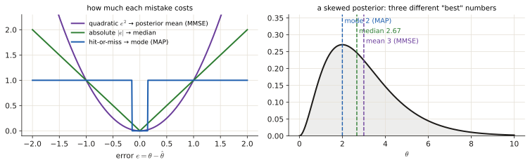
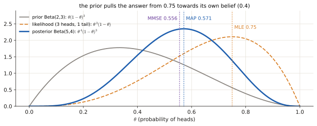
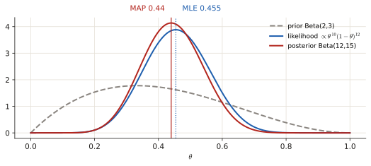
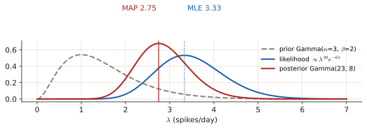
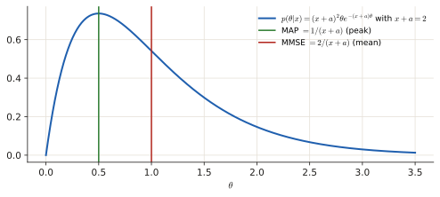
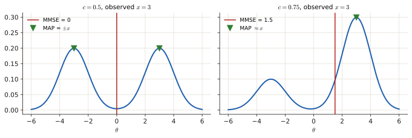
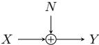

# 2.3 Bayesian estimation: MAP and MMSE

In Bayesian estimation the unknown θ is itself random, with a <b>prior</b> distribution. Recent exams ask for a MAP almost every time, often with a prior that makes the algebra trivial (Beta, Gamma). MMSE shows up less often but is quick once you know the three integrals. This page starts from "what do you believe before the data?" and ends with the exam derivations.

!!! need "Before this page"
    - Likelihood, MLE and the 4-step recipe ([2.1](p2-mle.md))
    - Conditional probability and Bayes' theorem ([0.6](p0-foundations.md#conditional-probability-and-independence), [1.1](p1-bayes.md))
    - PDF, expectation (mean) of a random variable ([0.6](p0-foundations.md#expectation-variance))
    - The integral $\int_0^\infty\theta^ne^{-s\theta}d\theta$ ([Toolbox](toolbox.md#4-the-integrals-that-keep-coming-back))

    If you read only one thing: **MAP and MMSE both start from the same object, the posterior $p(\theta\mid\mathbf x)\propto p(\mathbf x\mid\theta)\,p(\theta)$ (data fit × prior belief). MAP reports its highest point (the *mode*), MMSE reports its average (the *mean*).**

---

## 1 · The idea, from zero

### 1.1 Prior, likelihood, posterior

Before seeing any data you already believe something about $\theta$: that is the **prior** $p(\theta)$ (e.g. "this coin is probably close to fair"). The data update that belief through Bayes' theorem (the same formula as in [1.1](p1-bayes.md), now with a continuous unknown):

$$\underbrace{p(\theta\mid\mathbf x)}_{\text{posterior}}=\frac{\overbrace{p(\mathbf x\mid\theta)}^{\text{likelihood}}\ \overbrace{p(\theta)}^{\text{prior}}}{\underbrace{p(\mathbf x)}_{\text{evidence}=\int p(\mathbf x\mid\theta)p(\theta)d\theta}}\ \propto\ p(\mathbf x\mid\theta)\,p(\theta).$$

The posterior is *everything* you know about $\theta$ after the data. ==The evidence $p(\mathbf x)$ does not depend on $\theta$; it is only the number that makes the area equal 1== (the "$\propto$" means "equal up to such a constant").

### 1.2 From a distribution to one number

You must report a single value $\hat\theta$. Choose a **cost** for being wrong and minimise its posterior average (the **Bayes risk**). Three standard costs, three standard answers:

| Cost of error $e=\theta-\hat\theta$ | Best estimate | Name |
|---|---|---|
| quadratic $e^2$ | **mean** of the posterior | MMSE (minimum mean square error) |
| absolute $\lvert e\rvert$ | median of the posterior | |
| uniform / "hit-or-miss" (cost 0 if $\hat\theta$ is right, 1 otherwise) | **mode** (highest point) of the posterior | MAP (maximum a posteriori) |

*Why the mean for squared error:* the average cost of reporting $a$ is $\mathbb E[(\theta-a)^2\mid\mathbf x]$; its derivative with respect to $a$ is $2\big(a-\mathbb E[\theta\mid\mathbf x]\big)$, which is zero at $a=\mathbb E[\theta\mid\mathbf x]$. *Why the mode for hit-or-miss:* you are rewarded only for landing on the right value, so bet on the most probable one.

<figure markdown>

<figcaption>Left: the three ways of charging for an error. Squared error punishes big misses hard; absolute error grows evenly; hit-or-miss only cares whether you are (almost) exactly right. Right: one skewed posterior and the three answers. Mode (MAP) at the top of the hill, median in the middle of the area, mean (MMSE) dragged right by the long tail. For a symmetric bell all three coincide.</figcaption>
</figure>

**MAP vs MLE.** ==MAP maximises likelihood × prior; MLE maximises the likelihood alone. With a flat prior they are equal.== With lots of data the likelihood dominates and MAP moves towards the MLE (usually; a prior that rules out the true value never lets go).

**MAP vs MMSE.** ==Equal when the posterior is symmetric with one peak (e.g. a Gaussian: mean = mode).== Different otherwise: skewed or two-peaked posteriors (figures below).

!!! example "A coin, with numbers"
    Prior: Beta(2, 3), shape $\propto\theta^1(1-\theta)^2$ (mean $\frac25=0.4$: "probably a bit biased towards tails"). Data: 3 heads, 1 tail → likelihood $\propto\theta^3(1-\theta)^1$. Posterior $\propto\theta^{1+3}(1-\theta)^{2+1}=\theta^4(1-\theta)^3$ → **Beta(5, 4)**.
    MLE $=\frac34=0.75$. MAP $=$ mode $=\frac{5-1}{5+4-2}=\frac47=0.571$. MMSE $=$ mean $=\frac59=0.556$. The prior pulled all Bayesian answers away from the MLE towards its own mean.

<figure markdown>

<figcaption>The coin example drawn. Grey: what you believed before (centred near 0.4). Orange: what the 4 flips say (peak at 0.75 = MLE). Blue: the posterior, their product rescaled to area 1. It sits between the two, and its peak (MAP 0.571) and balance point (MMSE 0.556) are pulled towards the prior.</figcaption>
</figure>

### 1.3 Recipes

!!! recipe key "Recipe: MAP"
    1. Write $\ln p(\mathbf x\mid\theta)+\ln p(\theta)$ (or $\ln p(\theta\mid\mathbf x)$ if the posterior is given). The evidence $p(\mathbf x)$ does not depend on $\theta$: ignore it.
    2. Differentiate with respect to $\theta$, set to 0, solve (exactly the MLE recipe of [2.1](p2-mle.md#13-the-recipe)).
    3. Check the solution lies inside the allowed range of $\theta$ (otherwise the max is at the boundary).

!!! recipe key "Recipe: MMSE"
    1. You need the **normalised** posterior. If it is not given: posterior = likelihood × prior / (its integral over $\theta$).
    2. $\hat\theta_{MMSE}=\int\theta\,p(\theta\mid\mathbf x)\,d\theta$.
    3. The integrals are almost always of the form $\int_0^\infty\theta^n e^{-s\theta}d\theta=\frac{n!}{s^{n+1}}$.

### 1.4 Conjugate priors: the shortcut used in recent exams

A prior is **conjugate** to a likelihood when the posterior has the same *shape family* as the prior. ==Then you never integrate: you just **add exponents**.==

- Likelihood $\propto\theta^{A}(1-\theta)^{B}$ (Bernoulli, binomial, negative binomial: counts of successes $A$ and failures $B$) + prior Beta($\alpha,\beta$) $\propto\theta^{\alpha-1}(1-\theta)^{\beta-1}$
  → ==posterior Beta($\alpha+A,\ \beta+B$), **mode** $=\dfrac{\alpha+A-1}{\alpha+\beta+A+B-2}$==.
- Likelihood $\propto\lambda^{S}e^{-n\lambda}$ (Poisson: $S$ = total count over $n$ days) + prior Gamma($\alpha,\beta$) $\propto\lambda^{\alpha-1}e^{-\beta\lambda}$
  → ==posterior Gamma($\alpha+S,\ \beta+n$), **mode** $=\dfrac{\alpha+S-1}{\beta+n}$==.

(The Beta distribution is a flexible bump on $(0,1)$, which is why it is the natural prior for a probability; ==Beta($\alpha,\beta$) has mode $\frac{\alpha-1}{\alpha+\beta-2}$ and mean $\frac{\alpha}{\alpha+\beta}$. Gamma($\alpha,\beta$) has mode $\frac{\alpha-1}{\beta}$ and mean $\frac\alpha\beta$.==)

<figure class="anim">
<video class="anim" src="video/bayes_update.mp4" poster="video/bayes_update.jpg" muted loop playsinline controls preload="none"></video>
<figcaption><b>Animation: conjugate updating, flip by flip.</b> Start from the prior Beta(2, 3) (grey). Every head adds 1 to the first number and every tail adds 1 to the second, so the posterior stays a Beta (blue). After a few flips the prior still matters; after 60 flips of a coin with true $\theta=0.7$ the posterior is a narrow bump around 0.7, and the MAP has moved there.</figcaption>
</figure>

---

## Exam questions: derivations

### June 2026 resit · 2c {#jun26-2c}

!!! exam "Resit Q4, June 2026 · 2c"
    A genomics researcher screens patients sequentially to recruit eligible participants for a trial. Each patient is independently eligible with unknown probability $\theta \in (0, 1)$. The researcher records the number of patients screened $X_i$ until exactly $k = 2$ eligible participants are found. This is modelled as

    $$X_i \sim \text{NegBin}(k, \theta), \quad k = 2 \text{ (known)},$$

    with PMF

    $$P(X = x \mid \theta) = \binom{x-1}{k-1} \theta^k (1-\theta)^{x-k}, \quad x = k, k+1, k+2, \dots$$

    The observed screening counts over five recruitment rounds are $x = \{3, 5, 4, 6, 4\}$. Assume a Beta prior on $\theta$:

    $$\theta \sim \text{Beta}(\alpha = 2, \beta = 3).$$

    - Write the likelihood function for $\theta$.
    - Derive the posterior distribution for $\theta$.
    - Compute the MAP estimate for $\theta$.

    Hint: A random variable $X$ is said to follow a Beta distribution with parameters $\alpha > 0$ and $\beta > 0$, denoted $X \sim \text{Beta}(\alpha, \beta)$, if its probability density function is

    $$p(x \mid \alpha, \beta) = \frac{1}{B(\alpha, \beta)} x^{\alpha-1} (1-x)^{\beta-1}, \quad 0 < x < 1,$$

    where the Beta function is defined as $B(\alpha, \beta) = \Gamma(\alpha)\Gamma(\beta)/\Gamma(\alpha + \beta).$

???+ solution "Solution"

    **What is being asked?** The data are five counts of "patients screened until 2 eligible ones were found". Write the likelihood of $\theta$, multiply by the Beta prior to get the posterior, and report its peak.

    **Symbols in this question**

    | Symbol | Meaning |
    |---|---|
    | $\theta$ | probability that one patient is eligible (unknown) |
    | $k=2$ | number of eligible patients we wait for in each round |
    | $x_i$ | patients screened in round $i$: $3,5,4,6,4$ |
    | $n=5$ | number of rounds |
    | $\binom{x-1}{k-1}$ | a counting factor that does not contain $\theta$ |

    **Step 1 — likelihood** (rounds independent → product). With $k=2$, $\binom{x_i-1}{1}=x_i-1$. In round $i$: $k=2$ eligible patients (factor $\theta^2$) and $x_i-2$ non-eligible ones (factor $(1-\theta)^{x_i-2}$). Over 5 rounds, $\sum x_i=3+5+4+6+4=22$:

    $$L(\theta)=\prod_{i=1}^5(x_i-1)\,\theta^2(1-\theta)^{x_i-2}=\Big[\prod_i(x_i-1)\Big]\theta^{2n}(1-\theta)^{\sum x_i-2n}=360\,\theta^{10}(1-\theta)^{12}.$$

    ($\prod(x_i-1)=2\cdot4\cdot3\cdot5\cdot3=360$, a constant that does not matter. In words: in total 10 eligible and 12 non-eligible patients were seen.)

    **Step 2 — posterior** ∝ likelihood × prior, with the prior Beta(2, 3) $\propto\theta^{2-1}(1-\theta)^{3-1}=\theta^{1}(1-\theta)^{2}$ ([conjugate rule](#14-conjugate-priors-the-shortcut-used-in-recent-exams): add exponents):

    $$p(\theta\mid\mathbf x)\propto\theta^{10}(1-\theta)^{12}\cdot\theta^{1}(1-\theta)^{2}=\theta^{11}(1-\theta)^{14}\;\Rightarrow\;\theta\mid\mathbf x\sim\text{Beta}(12,\,15)$$

    (exponent 11 = $\alpha'-1$ so $\alpha'=12$; exponent 14 = $\beta'-1$ so $\beta'=15$). Normalised: $p(\theta\mid\mathbf x)=\frac{1}{B(12,15)}\theta^{11}(1-\theta)^{14}$, $0<\theta<1$.

    **Step 3 — MAP.** $\ln p=11\ln\theta+14\ln(1-\theta)+\text{const}$; $\frac{d}{d\theta}=\frac{11}{\theta}-\frac{14}{1-\theta}=0\Rightarrow11(1-\theta)=14\theta\Rightarrow\hat\theta=\frac{11}{25}=0.44$.

    

    The MLE alone would be $10/22=0.455$. The prior Beta(2,3) has mean $0.4$ and leans towards smaller $\theta$, so it pulls the estimate slightly down.

    !!! answer "Answer"
        $L(\theta)\propto\theta^{10}(1-\theta)^{12}$; posterior Beta(12, 15); $\hat\theta_{MAP}=\dfrac{11}{25}=0.44$

### June 2026 resit · 2d {#jun26-2d}

!!! exam "Resit Q4, June 2026 · 2d"
    An environmental scientist monitors the number of pollution spikes recorded per day at an air quality monitoring station on the outskirts of a city. The daily spike count is modelled as $X_i \sim \text{Poisson}(\lambda)$, where $\lambda > 0$ is the unknown average number of pollution spikes per day. The observed counts over six days are $x = \{2, 4, 3, 5, 2, 4\}$. Assume a Gamma prior on $\lambda$ with pdf $p(\lambda) \propto \lambda^{\alpha-1}e^{-\beta\lambda}$, $\lambda > 0$, $\alpha = 3$, $\beta = 2$.

    - Write the likelihood function for $\lambda$.
    - Derive the posterior distribution for $\lambda$.
    - Find the MAP estimate for $\lambda$.
    - Compare the MAP estimate with the MLE and explain the effect of the prior.

???+ solution "Solution"

    **What is being asked?** Daily spike counts follow a Poisson law (the PMF of "how many events in a day when the average is $\lambda$": $P(X=x)=\frac{\lambda^xe^{-\lambda}}{x!}$). Find the posterior with a Gamma prior, its peak (MAP), and compare with the MLE.

    **Symbols in this question.** $\lambda$: average spikes per day (unknown); $x_i$: the six counts; $n=6$; $S=\sum x_i=2+4+3+5+2+4=20$; $\alpha=3,\beta=2$: the prior's parameters.

    **Step 1 — likelihood** (independent days → product):

    $$L(\lambda)=\prod_{i=1}^6\frac{\lambda^{x_i}e^{-\lambda}}{x_i!}=\frac{\lambda^{20}e^{-6\lambda}}{\prod_i x_i!}\propto\lambda^{20}e^{-6\lambda}$$

    (exponents add: $\lambda^{\sum x_i}$ and $e^{-n\lambda}$; the factorials do not contain $\lambda$).

    **Step 2 — posterior** ∝ $\lambda^{20}e^{-6\lambda}\cdot\lambda^{2}e^{-2\lambda}=\lambda^{22}e^{-8\lambda}$ (prior: $\lambda^{\alpha-1}e^{-\beta\lambda}=\lambda^2e^{-2\lambda}$), i.e. **Gamma($\alpha'=23$, $\beta'=8$)** ($\alpha'-1=22$).

    **Step 3 — MAP.** $\frac{d}{d\lambda}\big[22\ln\lambda-8\lambda\big]=\frac{22}{\lambda}-8=0\Rightarrow\hat\lambda_{MAP}=\frac{22}{8}=2.75.$

    **Step 4 — MLE** (the same without the prior): $\frac{d}{d\lambda}[20\ln\lambda-6\lambda]=0\Rightarrow\hat\lambda_{ML}=\frac{20}{6}=\bar x\approx3.33.$

    

    **Step 5 — effect of the prior.** The prior Gamma(3, 2) has mean $\alpha/\beta=1.5$ spikes/day, lower than the data suggest. It acts like **2 extra days** ($\beta=2$) with **2 extra spikes** ($\alpha-1=2$): $\hat\lambda_{MAP}=\frac{20+2}{6+2}$. So the MAP is pulled from 3.33 towards the prior belief (shrinkage). With more days of data the prior's weight shrinks and MAP → MLE.

    !!! answer "Answer"
        Posterior Gamma(23, 8); $\hat\lambda_{MAP}=2.75$, $\hat\lambda_{ML}=3.33$; the prior pulls the estimate down towards its own mean (1.5) and its influence fades as $n$ grows.

### April 2025 exam · 2d {#apr25-2d}

!!! exam "Final exam Q3, 13 April 2025 · 2d · 1 p"
    An experiment with binary outcomes Y/N has been independently repeated $N$ times and resulted in a dataset $\mathcal{D} = \{x_1, \dots, x_N\}$ in which $x_n \in \{Y, N\}$. Let $N_0$ and $N_1$ denote the number of obtained Ns and Ys, respectively. Furthermore, let $\theta$ denote the probability of obtaining a Y whereby the posterior distribution takes the form

    $$p(\theta | \mathcal{D}) = \theta^{\beta_1 - 1 + k_1 N_1} (1 - \theta)^{\beta_0 - 1 + k_0 N_0}.$$

    Derive the MAP estimate of $\theta$.

???+ solution "Solution"

    **What is being asked?** The posterior is **given**, so skip the Bayes step: find its peak.

    **Symbols in this question.** $N_1,N_0$: counts of Y and N; $\beta_1,\beta_0,k_1,k_0$: known positive constants; $\theta$: probability of Y. To keep it readable call the exponents $a=\beta_1-1+k_1N_1$ and $b=\beta_0-1+k_0N_0$, so $p\propto\theta^a(1-\theta)^b$.

    **Step 1 — log and differentiate:** $\ln p=a\ln\theta+b\ln(1-\theta)$; $\ \frac{d}{d\theta}=\frac a\theta-\frac b{1-\theta}$.

    **Step 2 — set to 0:** $\frac a\theta=\frac b{1-\theta}\Rightarrow a(1-\theta)=b\theta\Rightarrow\theta=\frac{a}{a+b}$.

    !!! answer "Answer"
        $\hat\theta_{MAP}=\dfrac{a}{a+b}=\dfrac{\beta_1-1+k_1N_1}{\beta_1+\beta_0-2+k_1N_1+k_0N_0}$

### April 2024 exam · 2d {#apr24-2d}

!!! exam "Final exam Q3, April 2024 · 2d · 1.5 p"
    Consider the posterior distribution

    $$p(\theta | x) = \frac{\lambda(\theta)}{2} e^{-\frac{\lambda(\theta)}{2}x}, \quad x > 1$$

    where $\lambda(\cdot)$ is defined as the logistic sigmoid function

    $$\lambda(\theta) = \frac{1}{1+e^{-\theta}}.$$

    Derive the MAP for the parameter $\theta$. Hint: The derivative of the logistic sigmoid is $\frac{\partial \lambda(\theta)}{\partial \theta} = \lambda(\theta)(1 - \lambda(\theta))$.

???+ solution "Solution"

    **What is being asked?** The posterior is given and $\theta$ hides inside the sigmoid $\lambda(\theta)$. Same structure as [April 2025 2c](p2-mle.md#apr25-2c) (the MLE version, explained step by step there): solve for $\lambda$, then invert the sigmoid $\theta=\ln\frac{\lambda}{1-\lambda}$.

    **Step 1 — log:** $\ln p=\ln\lambda-\ln2-\frac x2\lambda$.

    **Step 2 — derivative** (chain rule, $\lambda'=\lambda(1-\lambda)$, $\frac{\lambda'}{\lambda}=1-\lambda$):

    $$\frac{\partial\ln p}{\partial\theta}=(1-\lambda)-\frac x2\lambda(1-\lambda)=(1-\lambda)\Big(1-\frac{x}{2}\lambda\Big)=0.$$

    **Step 3 — solve.** $1-\lambda=0$ would need $\theta\to\infty$, so $\lambda(\hat\theta)=\frac2x$.

    **Step 4 — back to $\theta$:** $\hat\theta=\ln\frac{\lambda}{1-\lambda}=\ln\frac{2/x}{1-2/x}=\ln\frac{2}{x-2}$ (multiply top and bottom by $x$).

    Valid when $\lambda=\frac2x<1$, i.e. $x>2$. For $1\lt x\le2$ the derivative stays positive: no finite maximum.

    !!! answer "Answer"
        $\hat\theta_{MAP}=\ln\dfrac{2}{x-2}=-\ln\!\left(\dfrac x2-1\right)$, for $x>2$

### November 2022 exam · 2f, 2g {#nov22-2f}

!!! exam "Final exam Q1, 7 November 2022 · 2f, 2g · 0.5 p each"
    Assume that the parameter $\theta \geq 0$ is a random variable that admits an exponential distribution with probability density function

    $$p(\theta) = ae^{-a\theta}.$$

    The conditional probability function of the observation $x \geq 0$ depends is

    $$p(x|\theta) = \theta e^{-\theta x}.$$

    Using Bayes' theorem, the posterior distribution for the parameter $\theta$ after observing $x$ is

    $$p(\theta|x) = \begin{cases} (x+a)^2 \theta e^{-(x+a)\theta} & \theta \geq 0, \\ 0, & \text{else.} \end{cases}$$

    **2f** Find the minimum-mean square error estimator. Hint: You can use the identity

    $$\int x^2 e^{-x} dx = -e^{-x}(x^2 + 2x + 2),$$

    which is obtained by using integration by parts twice.

    **2g** Find the maximum a posteriori estimator.

???+ solution "Solution"

    **What is being asked?** From the same given posterior: its **mean** (2f, MMSE) and its **peak** (2g, MAP).

    **Symbols in this question.** $\theta$: the unknown rate; $x$: the single observation; $a$: the prior's rate; to shorten, write $s=x+a$ (a positive number).

    **Step 1 — 2f: MMSE = posterior mean.**

    $$\hat\theta_{MMSE}=\int_0^\infty\theta\cdot s^2\theta e^{-s\theta}d\theta=s^2\int_0^\infty\theta^2e^{-s\theta}d\theta.$$

    **Step 2 — the integral.** Substitute $y=s\theta$ ($\theta=y/s$, $d\theta=dy/s$): $\int_0^\infty\theta^2e^{-s\theta}d\theta=\frac1{s^3}\int_0^\infty y^2e^{-y}dy=\frac{1}{s^3}\Big[-e^{-y}(y^2+2y+2)\Big]_0^\infty=\frac{1}{s^3}(0+2)=\frac2{s^3}$ (the hint). So $\hat\theta_{MMSE}=s^2\cdot\frac{2}{s^3}=\frac{2}{x+a}$.

    **Step 3 — 2g: MAP = posterior peak.** $\ln p=\ln\theta-s\theta+\text{const}$; $\frac d{d\theta}=\frac1\theta-s=0\Rightarrow\hat\theta_{MAP}=\frac1{x+a}$.

    

    The posterior is skewed to the right (long tail), so its mean lies to the right of its peak: MMSE = 2 × MAP here.

    !!! answer "Answer"
        2f: $\hat\theta_{MMSE}=\dfrac{2}{x+a}$  2g: $\hat\theta_{MAP}=\dfrac{1}{x+a}$

### Q3 2022-23 exam · 2f, 2g (mixture posterior) {#q3-23-2f}

!!! exam "Exam Q3 2022-23 · 2f, 2g (shown in the Part 2 review lecture)"
    For the posterior PDF

    $$p(\theta|x) = \frac{c}{\sqrt{2\pi}}\exp\left[-\frac{1}{2}(\theta - x)^2\right] + \frac{1-c}{\sqrt{2\pi}}\exp\left[-\frac{1}{2}(\theta + x)^2\right]$$

    **2f** Find the Bayesian MMSE estimator for $\theta$, in case $c = \frac{1}{2}$ and $c = \frac{3}{4}$.

    **Hint:** *Depending the way the solution is approached, the following integral might be useful.* $\int_{-\infty}^{\infty} x e^{-a(x-b)^2} = b \sqrt{\frac{\pi}{a}}, \ \text{Re}(a) > 0.$

    **2g** Provide a sketch of $p(\theta|x)$ for $c = \frac{1}{2}$ and $c = \frac{3}{4}$. Looking at the sketch, what is the MAP estimate in the two cases? You do not need to find it analytically.

    For this exercise, we restrict our attention to $|x| > 2$.

???+ solution "Solution"

    **What is being asked?** A posterior that is a *mixture* of two Gaussian bumps. Find its mean (MMSE) for two weights, and read the peak (MAP) from a sketch.

    **Reading the posterior.** Each term is $c\times\mathcal N(\theta;\,x,1)$: a unit-variance bump centred at $+x$ with weight $c$, plus a bump centred at $-x$ with weight $1-c$.

    **Step 1 — 2f: the mean of a mixture is the weighted mean of the bump centres** (the mean is linear, and each bump's mean is its centre, which is what the hint integral says):

    $$\hat\theta_{MMSE}=c\cdot x+(1-c)(-x)=x(2c-1).$$

    $c=\frac12\Rightarrow0$; $\quad c=\frac34\Rightarrow\frac x2$.

    **Step 2 — 2g: sketch.** With $|x|>2$ the two bumps are more than 4 standard deviations apart, so they barely overlap and the peaks sit at $\pm x$:

    

    - $c=\frac12$: two equally high peaks → MAP $=\pm x$ (not unique). The MMSE (0) lands where the posterior is almost zero: a perfectly *valid* answer that is never a likely value.
    - $c=\frac34$: the peak at $+x$ is three times taller → MAP $\approx x$.

    !!! answer "Answer"
        MMSE: $0$ ($c=\tfrac12$), $x/2$ ($c=\tfrac34$). MAP: $\pm x$ ($c=\tfrac12$), $x$ ($c=\tfrac34$). MMSE and MAP only agree for unimodal, symmetric posteriors.

### Q3 2022-23 exam · 2g, 2h (exponential posterior) {#q3-23-2h}

!!! exam "Exam Q3 2022-23 · 2g, 2h (shown in the Part 2 review lecture)"
    Suppose we have single observation of random variable $X$ which follows the following probability distribution conditioned on $\theta$: $p(x|\theta) = \frac{1}{x} e^{-\theta x}$, for $x > 0, \theta > 0$, and suppose that $\theta$ follows an exponential prior as $p(\theta) = \frac{1}{a} e^{-a\theta}$ with $a > 0$ a known value.

    Additionally, the following known integrals are given: $\int e^{cx} dx = \frac{1}{c} e^{cx}$, $\int x e^{cx} dx = \left( \frac{cx - 1}{c^2} \right) e^{cx}$, $\int x^2 e^{cx} dx = \left( \frac{x^2}{c} - \frac{2x}{c^2} + \frac{2}{c^3} \right) e^{cx}$.

    **2g** Compute the posterior distribution $p(\theta|x)$.

    **2h** Find the Bayesian minimum mean square error estimator.

???+ solution "Solution"

    **What is being asked?** 2g: the full Bayes computation, including the normalising integral (the evidence). 2h: its mean.

    **Step 1 — numerator.** $p(x\mid\theta)p(\theta)=\frac1xe^{-\theta x}\cdot\frac1ae^{-a\theta}=\frac1{ax}e^{-\theta(x+a)}$. The constant $\frac1{ax}$ does not contain $\theta$ and will cancel with the same constant in the denominator.

    **Step 2 — evidence** (integrate the numerator over $\theta$; the given integral $\int e^{c\theta}=\frac1ce^{c\theta}$ with $c=-(x+a)$): $\int_0^\infty e^{-\theta(x+a)}d\theta=\frac{1}{x+a}$.

    **Step 3 — posterior:**

    $$p(\theta\mid x)=\frac{e^{-\theta(x+a)}}{1/(x+a)}=(x+a)\,e^{-\theta(x+a)},\quad\theta>0,$$

    an exponential distribution with rate $x+a$.

    **Step 4 — 2h: mean of an exponential = 1/rate.** Directly: $\hat\theta_{MMSE}=\int_0^\infty\theta(x+a)e^{-\theta(x+a)}d\theta=(x+a)\cdot\frac{1}{(x+a)^2}=\frac{1}{x+a}$ (using $\int_0^\infty\theta e^{-s\theta}d\theta=\frac1{s^2}$).

    !!! answer "Answer"
        $p(\theta\mid x)=(x+a)e^{-(x+a)\theta}$ for $\theta>0$; $\ \hat\theta_{MMSE}=\dfrac{1}{x+a}$

### January 2022 resit · 2f, 2g, 2h {#jan22-2f}

!!! exam "Resit, 24 January 2022 · 2f, 2g, 2h · 0.6 p each"
    Let $Y = X + N$ where $X$, and $N$ are independent random variables. $X$ takes the values +1 and -1 with equal probability, and $N$ is a zero-mean Gaussian random variable with variance $\sigma^2$, respectively.

    

    **2f** Evaluate the aposteriori probabilities $P[X = 1|Y]$ and $P[X = -1|Y]$.

    **2g** Find the minimum mean square error estimate $\hat{X}_{\text{MMSE}}$ of $X$ given $Y$. If you were not able to solve f) you can use $P[X = 1|Y] = \frac{1}{e^{-\frac{y}{\sigma^2}} \left( e^{\frac{y}{\sigma^2}} + e^{-\frac{y}{\sigma^2}} \right)}$ and $P[X = -1|Y] = \frac{1}{e^{\frac{y}{\sigma^2}} \left( e^{\frac{y}{\sigma^2}} + e^{-\frac{y}{\sigma^2}} \right)}$. Useful identities: $\frac{e^{2u} - 1}{e^{2u} + 1} = \frac{e^u - e^{-u}}{e^u + e^{-u}} = \tanh(u)$

    **2h** Find the maximum a posterior estimator $\hat{X}_{\text{MAP}}$ of $X$ given the observation $Y$. More specifically, find a threshold value $y_{\text{th}}$ such that a decision on $X$ depends on whether or not this threshold value is exceeded or not. *Hint:* Recall that $X$ is a discrete random variable. Hence, $\hat{X}_{\text{MAP}} = \arg \max_{X \in \{1, -1\}} P[X|Y]$. To check which value of $X$ maximizes the a posterior probability, you simply can check the ratio of the a posterior probabilities.

???+ solution "Solution"

    **What is being asked?** A bit $X=\pm1$ (equally likely) is sent; noise is added; you see $Y$. (2f) the probability of each bit given $Y$; (2g) the posterior mean; (2h) the most probable bit as a rule on $y$. This is a detection problem in disguise ([4.3](p4-bayes.md)).

    **Symbols in this question.** $X\in\{+1,-1\}$ sent bit; $N\sim\mathcal N(0,\sigma^2)$ noise; $Y=X+N$ observation. Given $X=+1$: $Y\sim\mathcal N(1,\sigma^2)$; given $X=-1$: $Y\sim\mathcal N(-1,\sigma^2)$.

    **Step 1 — 2f: Bayes with two hypotheses.** Equal priors ($\tfrac12$ each) and the Gaussian prefactors cancel:

    $$P[X=1\mid y]=\frac{e^{-(y-1)^2/2\sigma^2}}{e^{-(y-1)^2/2\sigma^2}+e^{-(y+1)^2/2\sigma^2}}.$$

    **Step 2 — simplify.** Divide top and bottom by the top term: the ratio of the bottom to the top term is $e^{[(y-1)^2-(y+1)^2]/2\sigma^2}=e^{-4y/2\sigma^2}=e^{-2y/\sigma^2}$ (because $(y+1)^2-(y-1)^2=4y$). So

    $$P[X=1\mid y]=\frac{1}{1+e^{-2y/\sigma^2}},\qquad P[X=-1\mid y]=\frac{1}{1+e^{2y/\sigma^2}}.$$

    **Step 3 — 2g: posterior mean of a two-valued variable** is a weighted sum, with $r=e^{2y/\sigma^2}$ (so $P[X=1\mid y]=\frac{r}{1+r}$, $P[X=-1\mid y]=\frac1{1+r}$):

    $$\hat X_{MMSE}=(+1)\frac{r}{1+r}+(-1)\frac1{1+r}=\frac{r-1}{r+1}=\frac{e^{2y/\sigma^2}-1}{e^{2y/\sigma^2}+1}=\tanh\!\left(\frac{y}{\sigma^2}\right)$$

    (the given identity with $u=y/\sigma^2$). Note: the MMSE estimate is a number between $-1$ and $1$, usually not $\pm1$ itself.

    **Step 4 — 2h: MAP picks the larger posterior.** Their ratio is $\frac{P[X=1\mid y]}{P[X=-1\mid y]}=r=e^{2y/\sigma^2}$, which is $>1$ exactly when $2y/\sigma^2>0$, i.e. $y>0$:

    $$\frac{P[X=1\mid y]}{P[X=-1\mid y]}=e^{2y/\sigma^2}\ \underset{-1}{\overset{+1}{\gtrless}}\ 1\iff y\ \underset{-1}{\overset{+1}{\gtrless}}\ 0.$$

    !!! answer "Answer"
        2f: as above (sigmoids of $2y/\sigma^2$). 2g: $\hat X_{MMSE}=\tanh(y/\sigma^2)$. 2h: $\hat X_{MAP}=+1$ if $y>0$, $-1$ if $y<0$; $y_{th}=0$.

### November 2019 exam · 3c {#nov19-3c}

!!! exam "Written exam, 4 November 2019 · Exercise 3(c) · 1 p"
    *(Same likelihood as [3a](p2-mle.md#nov19-3a): i.i.d. $p(x;\theta)=\frac{x}{\theta^2}e^{-x^2/(2\theta^2)}$.)*

    Now consider the case where $p(\theta)$ is also a random variable with PDF $p(\theta) = \lambda \exp[-\lambda\theta]$. Find the MAP estimator for the parameter $\theta$. The answer does **not** have to be in the form $\hat{\theta} = f(x, \lambda)$.

???+ solution "Solution"

    **What is being asked?** The MLE of 3a, plus an exponential prior on $\theta$. MAP = maximise $\ln p(\mathbf x\mid\theta)+\ln p(\theta)$.

    **Step 1 — log of likelihood × prior:**

    $$\ln p(\mathbf x\mid\theta)+\ln p(\theta)=\text{const}-2N\ln\theta-\frac{1}{2\theta^2}\sum x^2[n]+\ln\lambda-\lambda\theta.$$

    **Step 2 — differentiate:** $-\frac{2N}{\theta}+\frac{1}{\theta^3}\sum x^2[n]-\lambda=0$. (The prior adds the constant $-\lambda$.)

    **Step 3 — clear the denominators.** Multiply by $\theta^3$: $-2N\theta^2+\sum x^2[n]-\lambda\theta^3=0$, i.e.

    $$\lambda\theta^3+2N\theta^2-\sum x^2[n]=0.$$

    A cubic: no neat closed form is needed (the question says so). Sanity check: with $\lambda\to0$ (flat prior) it gives back the MLE $\theta^2=\frac{1}{2N}\sum x^2$ ✓.

    !!! answer "Answer"
        $\hat\theta_{MAP}$ is the positive root of $\lambda\theta^3+2N\theta^2-\sum_n x^2[n]=0$

### January 2019 retake · 2b, 2c {#jan19-2b}

!!! exam "Written exam, 21 January 2019 · Exercise 2(b), 2(c) · 1 p each"
    *(Same model as [2a](p2-mle.md#jan19-2a): $p(x;\lambda)=\lambda e^{-\lambda x}$.)*

    (b) Additional information regarding $\lambda$ is provided in terms of a distribution

    $$p(\lambda) = \begin{cases} \frac{1}{2} & 0 \leq \lambda \leq 2 \\ 0 & \text{otherwise} \end{cases}$$

    Treat the distribution $p(x; \lambda)$ as a conditional distribution $p(x|\lambda)$ and determine the Bayesian minimum mean square estimator (MMSE) for $\lambda$. To do so, (1) first provide the formula to calculate the Bayesian MMSE, specifying each probability distribution explicitly; [0.7 pt.] (2) then, determine the Bayesian MMSE by solving the formula obtained in b1. [0.3 pt.]

    (c) Using the same information given above, find the maximum a-posteriori (MAP) estimator for $\lambda$. [1 pt.]

    Below some useful integrals: $\int f g' dx = fg - \int f' g dx$, $\int e^{ax} dx = \frac{1}{a} e^{ax}$, $\int x e^{ax} dx = \left( \frac{x}{a} - \frac{1}{a^2} \right) e^{ax}$, $\int x^2 e^{ax} dx = \left( \frac{x^2}{a} - \frac{2x}{a^2} + \frac{2}{a^3} \right) e^{ax}$

???+ solution "Solution"

    **What is being asked?** A flat prior on $[0,2]$ (every rate between 0 and 2 equally believed, impossible outside). (b) the posterior mean, with the formula written out and the integrals evaluated. (c) the posterior peak.

    **Symbols in this question.** $\lambda$: the unknown rate; $x$: one observation (like the official key; for $N$ samples replace $\lambda$ by $\lambda^N$ and $x$ by $\sum x_i$); $p(\lambda)=\frac12$ on $[0,2]$.

    **Step 1 — (b1) the formula.** MMSE = posterior mean. The posterior is likelihood × prior, normalised over the allowed range $[0,2]$:

    $$\hat\lambda_{MMSE}=\int_0^2\lambda\,p(\lambda\mid x)\,d\lambda,\qquad p(\lambda\mid x)=\frac{\lambda e^{-\lambda x}\cdot\frac12}{\int_0^2\lambda e^{-\lambda x}\cdot\frac12\,d\lambda},\ 0\le\lambda\le2.$$

    The constant $\frac12$ cancels: $\hat\lambda_{MMSE}=\dfrac{\int_0^2\lambda^2e^{-\lambda x}d\lambda}{\int_0^2\lambda e^{-\lambda x}d\lambda}$.

    **Step 2 — (b2) the integrals.** Use the given antiderivatives with $a=-x$ and evaluate from 0 to 2:

    $$\int_0^2\lambda e^{-\lambda x}d\lambda=\frac{1-e^{-2x}(1+2x)}{x^2},\qquad\int_0^2\lambda^2e^{-\lambda x}d\lambda=\frac{2-e^{-2x}(4x^2+4x+2)}{x^3}.$$

    **Step 3 — divide:**

    $$\hat\lambda_{MMSE}=\frac{2}{x}\cdot\frac{1-e^{-2x}(2x^2+2x+1)}{1-e^{-2x}(1+2x)}=\frac2x\left(1-\frac{2x^2e^{-2x}}{1-e^{-2x}(1+2x)}\right)$$

    (the numerator $1-e^{-2x}(2x^2+2x+1)$ equals the denominator minus $2x^2e^{-2x}$).

    !!! trap "Official key is off by a factor 2"
        The key prints $x^2e^{-2x}$ inside the bracket instead of $2x^2e^{-2x}$. Numerical check at $x=0.7$: the true posterior mean is 1.166; the key's formula gives 2.011, which is impossible because $\lambda\le2$.

    **Step 4 — (c) MAP.** The posterior is $\propto\lambda^Ne^{-\lambda\sum x_i}$ on $[0,2]$ (the flat prior adds only a constant). Derivative of the log: $\frac N\lambda-\sum x_i=0\Rightarrow\lambda=\frac{N}{\sum x_i}$, the same as the MLE, because a flat prior does not change where the peak is. The prior does cut the range off at 2, so if $N/\sum x_i>2$ the maximum sits at the boundary $2$.

    !!! answer "Answer"
        (b) $\hat\lambda_{MMSE}=\dfrac2x\left(1-\dfrac{2x^2e^{-2x}}{1-e^{-2x}(1+2x)}\right)$  (c) $\hat\lambda_{MAP}=\min\!\left(\dfrac{N}{\sum_i x_i},\,2\right)$ (key: $N/\sum x_i$)

---

## Exam questions: multiple choice

### June 2026 resit · 2a {#jun26-2a}

!!! exam "Resit Q4, June 2026 · 2a · 0.5 p"
    Which of the following statements about Bayesian estimation is TRUE?

    - (a) The MAP estimate always equals the posterior mean.
    - (b) As the number of observations increases, the MAP estimate converges to the MLE regardless of the choice of prior.
    - (c) The MAP estimate depends on both the likelihood and the prior, and therefore cannot be computed without specifying a prior distribution.

???+ solution "Solution"

    **What is being asked?** One true statement. No official key is available for this paper, so this is the reasoning.

    - (a) False: MAP = posterior **mode**, MMSE = posterior **mean**. They differ for skewed or multimodal posteriors ([Nov 2022 2f/2g](#nov22-2f)).
    - (b) The usual intuition (the likelihood dominates for large $N$) is right, but "**regardless of the choice of prior**" is too strong: a prior that is zero around the true value (e.g. uniform on $[0,2]$ when the truth is 3, like [Jan 2019 2c](#jan19-2b)) keeps the MAP away from the MLE forever.
    - (c) True by definition: $\hat\theta_{MAP}=\arg\max p(\mathbf x\mid\theta)p(\theta)$ needs $p(\theta)$.

    !!! answer "Answer"
        **(c)** (most defensible; (b) fails because of "regardless of the prior")

### April 2025 exam · 2a {#apr25-2a}

!!! exam "Final exam Q3, 13 April 2025 · 2a · 0.5 p"
    Which of the following statements is FALSE?

    - a) The MLE is the argument maximising the likelihood.
    - b) The MMSE estimate results from minimising the square error.
    - c) In Bayesian estimation, the minimum mean square error estimator and the maximum posterior estimator will always result in a different estimate.

???+ solution "Solution"

    **What is being asked?** The one false statement. (a) and (b) are definitions. (c) is false because of the word "always": for a Gaussian (symmetric, one-peak) posterior, mean = mode, so MMSE = MAP ([1.2](#12-from-a-distribution-to-one-number)).

    !!! answer "Answer"
        **(c)**

### April 2024 exam · 2b {#apr24-2b}

!!! exam "Final exam Q3, April 2024 · 2b · 0.5 p"
    Which of the following statements is TRUE?

    - (a) In Bayesian estimation, the minimum mean square error is the mean of the posterior PDF.
    - (b) In Bayesian estimation, the minimum mean square error is the maximum of the posterior PDF.
    - (c) In Bayesian estimation, the minimum mean square error estimator and the maximum posterior estimator will always result in a different estimate.

???+ solution "Solution"

    **What is being asked?** The cost → estimate table of [1.2](#12-from-a-distribution-to-one-number): MMSE = posterior **mean**; the maximum of the posterior is the MAP; "always different" is false.

    !!! answer "Answer"
        **(a)**

### January 2022 resit · 2d {#jan22-2d}

!!! exam "Resit, 24 January 2022 · 2d · 0.3 p"
    Which of the following statements about the Bayesian estimators is true?

    - (a) The minimum mean square error is the maximum of the aposterior PDF.
    - (b) The minimum mean square error is the mean of the aposterior PDF.
    - (c) The minimum mean square error estimator and the maximum aposterior estimator will always result in a different estimate.

???+ solution "Solution"

    **What is being asked?** Same trio as April 2024 2b: the MMSE is the posterior **mean** ([1.2](#12-from-a-distribution-to-one-number)).

    !!! answer "Answer"
        **(b)**

### November 2022 exam · 2c {#nov22-2c}

!!! exam "Final exam Q1, 7 November 2022 · 2c · 0.25 p"
    Which of the following statements about Bayesian estimation is TRUE?

    - (a) Unlike classical estimators, Bayesian estimators do not incorporate prior knowledge about the unknown parameter.
    - (b) The Bayesian estimate is the estimate that minimizes the Bayes risk, i.e., $\hat{\theta} = \arg \min_{\hat{\theta}} \int \int C(e)p(\theta|\mathbf{x})d\theta p(\mathbf{x})d\mathbf{x}$.
    - (c) Minimizing Bayes Risk for the uniform error cost function results in the minimum mean square error estimator.

???+ solution "Solution"

    **What is being asked?** One true statement about the Bayes risk ([1.2](#12-from-a-distribution-to-one-number)).

    - (a) Backwards: incorporating a prior is exactly what makes an estimator Bayesian.
    - (b) **True**: the Bayes risk is the cost $C(e)$ averaged over $\theta$ (posterior) and over the data; the Bayesian estimate minimises it.
    - (c) Wrong cost: the uniform (hit-or-miss) cost gives the **MAP**; the quadratic cost gives the MMSE.

    !!! answer "Answer"
        **(b)**

*[prior]: p(θ): what you believe about θ before seeing the data.
*[posterior]: p(θ | x) ∝ p(x | θ) p(θ): what you believe about θ after the data.
*[MAP]: maximum a posteriori: the peak (mode) of the posterior.
*[MMSE]: minimum mean square error: the mean of the posterior.
*[mode]: the value where a PDF is highest.
*[conjugate prior]: a prior whose posterior has the same shape family, so updating = adding exponents.
*[Beta]: a flexible bump on (0,1); shape θ^(α−1)(1−θ)^(β−1); the natural prior for a probability.
*[Gamma]: a bump on (0,∞); shape λ^(α−1)e^(−βλ); mean α/β, mode (α−1)/β.
*[Poisson]: the distribution of event counts per interval with average rate λ: λ^x e^(−λ)/x!.
*[evidence]: p(x) = ∫p(x | θ)p(θ)dθ: only a normalising constant for the posterior.
*[Bayes risk]: the average cost of an estimator over both the parameter and the data.
