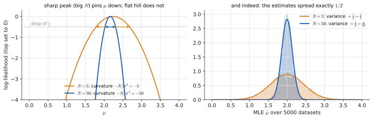
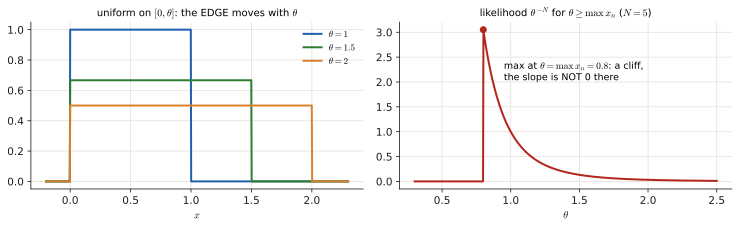

# 2.2 CRLB & Fisher information

The Cramér–Rao lower bound says how good <em>any</em> unbiased estimator can possibly be. Exams ask three things: a multiple choice on the definitions (this one repeats almost word for word), "compute the Fisher information / CRLB", and "can you even compute the CRLB here?" (no, if the support depends on θ). This page builds the idea from a picture of a hill.

!!! need "Before this page"
    - Likelihood, log-likelihood, bias and variance of an estimator ([2.1](p2-mle.md))
    - Expectation of a function of a random variable, $\mathbb E[g(X)]$ ([0.6](p0-foundations.md#expectation-variance))
    - First and second derivatives ([0.4](p0-foundations.md#04-the-three-calculations-you-keep-meeting), [Toolbox](toolbox.md#2-logs-and-exponentials))

    If you read only one thing: **the Fisher information is how sharply peaked the log-likelihood is. A sharp peak means the data pin $\theta$ down precisely, so the best possible variance $1/\mathcal I$ is small.**

---

## 1 · The idea, from zero

### 1.1 Sharp peak or flat hill?

Plot the log-likelihood of $\theta$ for the data you have ([2.1](p2-mle.md#12-the-likelihood)). Its top is the MLE. Two situations:

- **Sharp peak:** moving $\theta$ a little away from the top makes the data much less likely, so only values very close to the top are plausible. $\theta$ is pinned down: **small variance** is possible.
- **Flat hill:** many different $\theta$ explain the data almost equally well. $\theta$ cannot be pinned down: **large variance**.

<figure markdown>

<figcaption>Left: log-likelihoods of a Gaussian mean from 5 samples (orange) and 50 samples (blue), both with their top set to 0. The arrows mark how far $\mu$ can move before the log-likelihood drops by $\frac12$: about $\pm\frac{1}{\sqrt N}$. The sharper curve allows a much smaller range. Right: repeat the experiment 5000 times and histogram the MLE. The spread matches the bound, $\frac{1}{\mathcal I}=\frac{1}{N}$, exactly.</figcaption>
</figure>

"How sharp" = how strongly the curve bends downward at the top = the size of the **second derivative** (it is negative at a peak; a sharp peak has a very negative one). ==The **Fisher information** is this bend, averaged over the random data:==

$$\mathcal I(\theta)=-\mathbb E\!\left[\frac{\partial^2\ln p(\mathbf x;\theta)}{\partial\theta^2}\right]=\mathbb E\!\left[\left(\frac{\partial\ln p(\mathbf x;\theta)}{\partial\theta}\right)^2\right]\ \ (>0).$$

(The two forms are equal under the regularity condition below. $\frac{\partial\ln p}{\partial\theta}$ is called the **score**.)

!!! example "Constant in Gaussian noise, with numbers"
    $x_n=\mu+w_n$, $w_n\sim\mathcal N(0,\sigma^2)$ i.i.d. Then $\ln p=-\frac{1}{2\sigma^2}\sum(x_n-\mu)^2+\text{const}$. First derivative: $\frac1{\sigma^2}\sum(x_n-\mu)$. Second derivative: $-\frac N{\sigma^2}$ (it does not even depend on the data). So $\mathcal I=\frac N{\sigma^2}$.
    With $\sigma^2=1$, $N=100$: $\mathcal I=100$, a very sharp peak (the log-likelihood drops by $\tfrac12$ when $\mu$ moves only $0.1$ from the top), and the bound below is $\frac1{100}=0.01$.

### 1.2 The bound

**Cramér–Rao lower bound.** For every **unbiased** estimator,

$$\operatorname{Var}[\hat\theta]\ \ge\ \frac{1}{\mathcal I(\theta)}.$$

In the example: $\operatorname{Var}[\hat\mu]\ge\frac{\sigma^2}N$, and the sample mean has variance exactly $\sigma^2/N$ ([2.1 §1.1](p2-mle.md#11-estimation-from-zero)): it **reaches** the bound, so it is optimal.

Facts that get tested:

- ==For $N$ i.i.d. observations, $\mathcal I(\theta)=N\,i(\theta)$ with $i(\theta)$ the information of **one** observation== (log-likelihoods add, so their second derivatives add). So ==the bound $\frac{1}{N\,i(\theta)}$ **decreases as $1/N$**== ("linearly" in the sense of the old key).
- ==The bound is the **reciprocal** of the information, not the information itself.== And ==the information is **positive**, never negative==.
- ==An unbiased estimator whose variance **equals** the bound is **efficient**.== Nothing unbiased can go below it.
- ==Equality holds iff the score can be written as $\frac{\partial\ln p}{\partial\theta}=\mathcal I(\theta)\,\big(g(\mathbf x)-\theta\big)$; then $g(\mathbf x)$ is the efficient estimator.== (Used backwards in Practice exam 2021 2a.)

### 1.3 When the bound does *not* exist (regularity)

The theorem needs $\mathbb E\!\left[\frac{\partial\ln p}{\partial\theta}\right]=0$. Why that holds normally: $\int p(x;\theta)dx=1$ for every $\theta$; differentiate both sides; if you may swap $\frac d{d\theta}$ and $\int$, you get $\int\frac{\partial p}{\partial\theta}dx=0$, and since $\frac{\partial p}{\partial\theta}=p\,\frac{\partial\ln p}{\partial\theta}$ this says $\mathbb E[\text{score}]=0$.

==The swap **fails when the support of $p(x;\theta)$ depends on $\theta$** (e.g. $0\le x\le\theta$)==: the moving integration limit adds an extra term. ==Then the CRLB cannot be derived.==

<figure markdown>

<figcaption>Left: for $\mathcal U[0,\theta]$ the place where the PDF stops moves with $\theta$. That moving edge is the "support depends on $\theta$" condition. Right: the likelihood is 0 for $\theta$ below the largest sample and $\theta^{-N}$ above it, so its maximum is a cliff edge, not a smooth hilltop. There is no "curvature at the top" to measure, and the CRLB machinery does not apply.</figcaption>
</figure>

!!! recipe key "Recipe: compute the CRLB"
    1. Log-likelihood $\ln p(\mathbf x;\theta)$ (sum over samples).
    2. Differentiate **twice** with respect to $\theta$.
    3. Take the expected value: replace every data term by its mean ($\mathbb E[x_n]$, $\mathbb E[x_n^2]$, …). The exam often gives these as a hint.
    4. $\mathcal I(\theta)=-\mathbb E[\cdot]$, $\ \text{CRLB}=1/\mathcal I(\theta)$.

---

## Exam questions: computations

### November 2022 exam · 2e {#nov22-2e}

!!! exam "Final exam Q1, 7 November 2022 · 2e · 0.5 p"
    *(Same model as [2d](p2-mle.md#nov22-2d): $\mathbf x=A[\cos\theta,\ \sin\theta]^T+\mathbf w$, white Gaussian noise with variance $\sigma^2$.)*

    Derive the Fisher information $\mathcal{I}(\theta)$. **Hint:** The expected values of $x_1$ and $x_2$ are $A \cos(\theta)$ and $A \sin(\theta)$, respectively.

???+ solution "Solution"

    **What is being asked?** How much information one observation of the noisy point carries about the angle $\theta$.

    **Symbols in this question.** $x_1,x_2$: observed coordinates (random); $A$: known radius; $\sigma^2$: noise variance; $\theta$: unknown angle.

    **Step 1 — first derivative** (already computed in [2d](p2-mle.md#nov22-2d)): $\frac{\partial\ln p}{\partial\theta}=\frac{A}{\sigma^2}(-x_1\sin\theta+x_2\cos\theta)$.

    **Step 2 — second derivative** ($\frac d{d\theta}\sin\theta=\cos\theta$, $\frac d{d\theta}\cos\theta=-\sin\theta$):

    $$\frac{\partial^2\ln p}{\partial\theta^2}=\frac{A}{\sigma^2}(-x_1\cos\theta-x_2\sin\theta).$$

    **Step 3 — expectation.** Replace $x_1$ and $x_2$ by their means (the hint): $\mathbb E[\cdot]=\frac{A}{\sigma^2}\big(-A\cos^2\theta-A\sin^2\theta\big)=-\frac{A^2}{\sigma^2}(\cos^2\theta+\sin^2\theta)=-\frac{A^2}{\sigma^2}$.

    **Step 4 — sign.** $\mathcal I(\theta)=-\mathbb E[\cdot]=\dfrac{A^2}{\sigma^2}$.

    Interpretation: the angle is easier to estimate when the circle is big ($A$) compared with the noise ($\sigma$). The CRLB is $\sigma^2/A^2$. (Information does not depend on $\theta$ itself: every angle is equally easy.)

    !!! answer "Answer"
        $\mathcal I(\theta)=\dfrac{A^2}{\sigma^2}$

### November 2019 exam · 3b {#nov19-3b}

!!! exam "Written exam, 4 November 2019 · Exercise 3(b) · 1 p"
    *(Same model as [3a](p2-mle.md#nov19-3a): i.i.d. $p(x;\theta)=\frac{x}{\theta^2}e^{-x^2/(2\theta^2)}$, $x\ge0$.)*

    (b) Find the Cramer-Rao Lower Bound for the MLE.

???+ solution "Solution"

    **What is being asked?** The smallest variance any unbiased estimator of $\theta$ can have for $N$ samples of this Rayleigh PDF.

    **Step 1 — first derivative** (from 3a): $\frac{\partial\ln L}{\partial\theta}=-\frac{2N}{\theta}+\frac{1}{\theta^3}\sum x^2[n]$.

    **Step 2 — second derivative** ($\frac d{d\theta}\frac1\theta=-\frac1{\theta^2}$, $\frac d{d\theta}\theta^{-3}=-3\theta^{-4}$):

    $$\frac{\partial^2\ln L}{\partial\theta^2}=\frac{2N}{\theta^2}-\frac{3}{\theta^4}\sum x^2[n].$$

    **Step 3 — expectation.** The only random thing is $\sum x^2[n]$; for this Rayleigh PDF $\mathbb E[x^2]=2\theta^2$ (toolbox table), so $\mathbb E\big[\sum x^2[n]\big]=N\cdot2\theta^2$:

    $$\mathbb E\!\left[\frac{\partial^2\ln L}{\partial\theta^2}\right]=\frac{2N}{\theta^2}-\frac{3\cdot2N\theta^2}{\theta^4}=\frac{2N-6N}{\theta^2}=-\frac{4N}{\theta^2}\quad\Rightarrow\quad\mathcal I(\theta)=\frac{4N}{\theta^2}.$$

    (If you do not remember $\mathbb E[x^2]$: $\int_0^\infty x^2\frac{x}{\theta^2}e^{-x^2/2\theta^2}dx=2\theta^2$ with the substitution $u=x^2/2\theta^2$.)

    **Step 4 — the bound:** $\text{CRLB}=\dfrac1{\mathcal I}=\dfrac{\theta^2}{4N}$.

    !!! answer "Answer"
        $\operatorname{Var}(\hat\theta)\ge\dfrac{\theta^2}{4N}$ (the key writes $\hat\theta^2/4N$, i.e. the bound evaluated at the estimate)

### Practice exam 2021 · 2a {#pe21-2a}

!!! exam "Practice exam, 28 October 2021 · 2a · 1 p"
    Given the minimum variance unbiased estimator (MVUE) $\hat{\theta} = \sum_{n=0}^{N-1} x[n]/N$ with variance $\sigma_{\hat{\theta}}^2 = A^2/N$, find the probability density function (PDF) $p(\mathbf{x}; \theta)$ for the data vector $\mathbf{x}$ that consists of data points $x[n]$, $n \in \{0, 1, \dots, N-1\}$. Use the MVUE condition and show the derivation of the PDF. Assume independent identically distributed noise samples act on the signal model that generates the data samples.

    **Hint:** Use this trick if needed: $\int (x+a)dx = x^2/2 + ax + b$ and $b$ can be chosen as $b = a^2/2$ to obtain $\int (x+a)dx = 0.5(x+a)^2$.

???+ solution "Solution"

    **What is being asked?** This is the CRLB run **backwards**. You are told the estimator ($\bar x$) is the best possible one (it reaches the bound) and its variance; find the PDF that makes that true.

    **Symbols in this question.** $\hat\theta=\bar x$: the estimator (the sample mean); $\sigma^2_{\hat\theta}=A^2/N$: its variance, which means each sample has noise variance $A^2$ (here $A^2$ is a *noise variance*, not an amplitude); $\theta$: the unknown constant.

    **Step 1 — information.** An MVUE reaches the bound: $\operatorname{Var}[\hat\theta]=\frac1{\mathcal I(\theta)}=\frac{A^2}{N}$, so $\mathcal I(\theta)=\frac{N}{A^2}$.

    **Step 2 — the equality condition** ([1.2](#12-the-bound)): $\frac{\partial\ln p}{\partial\theta}=\mathcal I(\theta)\big(g(\mathbf x)-\theta\big)$ with $g(\mathbf x)=\bar x$:

    $$\frac{\partial\ln p}{\partial\theta}=\frac{N}{A^2}(\bar x-\theta)=\frac{1}{A^2}\sum_{n=0}^{N-1}\big(x[n]-\theta\big)\qquad\big(N\bar x=\textstyle\sum x[n]\big).$$

    **Step 3 — integrate over $\theta$** (the hint: $\int(x[n]-\theta)\,d\theta=-\frac12(x[n]-\theta)^2+\text{const}$):

    $$\ln p(\mathbf x;\theta)=-\frac{1}{2A^2}\sum_{n=0}^{N-1}(x[n]-\theta)^2+C.$$

    **Step 4 — exponentiate and fix the constant** so that the PDF integrates to 1 (it is a product of $N$ Gaussians, each with normalisation $\frac1{\sqrt{2\pi A^2}}$):

    $$p(\mathbf x;\theta)=\frac{1}{(2\pi A^2)^{N/2}}\exp\!\left(-\frac{1}{2A^2}\sum_{n=0}^{N-1}(x[n]-\theta)^2\right).$$

    So the data model is $x[n]=\theta+w[n]$ with $w[n]$ i.i.d. $\mathcal N(0,A^2)$: a constant in white Gaussian noise (the example of [1.1](#11-sharp-peak-or-flat-hill)).

    !!! answer "Answer"
        $p(\mathbf x;\theta)=(2\pi A^2)^{-N/2}\exp\!\left(-\frac{1}{2A^2}\sum_n(x[n]-\theta)^2\right)$

### January 2022 resit · 2e {#jan22-2e}

!!! exam "Resit, 24 January 2022 · 2e · 0.5 p"
    Let

    $$p(x; \theta) = \begin{cases} \frac{2}{\theta}x, & \text{for } 0 \leq x \leq \theta, \\ 0, & \text{else} \end{cases}$$

    be the probability density function of an observation $X$. Check whether or not it is possible to derive the Cramer Rao lower bound. In case it is possible, derive the Cramer Rao lower bound. If it is not possible, justify why.

???+ solution "Solution"

    **What is being asked?** Decide whether the regularity condition of [1.3](#13-when-the-bound-does-not-exist-regularity) holds.

    **Step 1 — look at the support first.** $0\le x\le\theta$: the range of $x$ depends on $\theta$. That is exactly the situation where the swap of $\frac d{d\theta}$ and $\int dx$ fails.

    **Step 2 — verify it with numbers** (the official clarification corrects the PDF to $\frac{2}{\theta^2}x$ so that it integrates to 1: $\int_0^\theta\frac{2x}{\theta^2}dx=\frac{\theta^2}{\theta^2}=1$ ✓):

    - $\frac{d}{d\theta}\int_0^\theta p\,dx=\frac{d}{d\theta}(1)=0$,
    - $\int_0^\theta\frac{\partial p}{\partial\theta}dx=\int_0^\theta\!-\frac{4x}{\theta^3}dx=-\frac{4}{\theta^3}\cdot\frac{\theta^2}{2}=-\frac2\theta\ne0$.

    The two are not equal, so differentiation and integration cannot be swapped (the moving upper limit adds a boundary term), so $\mathbb E[\partial\ln p/\partial\theta]\neq0$ and the proof of the bound breaks.

    !!! answer "Answer"
        **Not possible:** the support depends on $\theta$, so the regularity condition is violated and the CRLB does not apply.

---

## Exam questions: multiple choice

### November 2022 exam · 2a {#nov22-2a}

!!! exam "Final exam Q1, 7 November 2022 · 2a · 0.25 p"
    Which of the following statements about the Fisher information $\mathcal{I}(\theta)$ is TRUE?

    - (a) The Fisher information for $N$ identical and independent distributed observations is $Ni(\theta)$, where $i(\theta)$ is the Fisher information for a single observation.
    - (b) The variance of any unbiased estimator is lower bounded by the Fisher information, i.e., $\text{Var}(\hat{\theta}) \geq \mathcal{I}(\theta)$.
    - (c) The Fisher information $\mathcal{I}(\theta)$ is strictly negative.

???+ solution "Solution"

    **What is being asked?** One true statement among the three standard facts ([1.2](#12-the-bound)).

    - (a) **True**: information of independent observations adds.
    - (b) False: the bound is $1/\mathcal I$, the *reciprocal*.
    - (c) False: $\mathcal I$ is the expected *square* of the score, so it is positive.

    !!! answer "Answer"
        **(a)**

### April 2024 exam · 2a {#apr24-2a}

!!! exam "Final exam Q3, April 2024 · 2a · 0.5 p"
    Which of the following statements is TRUE?

    - a) The variance of any unbiased estimator is lower bounded by the Fisher information, i.e., $Var(\hat{\theta}) \geq \mathcal{I}(\theta)$.
    - b) The Fisher information is strictly negative.
    - c) The Fisher information for $N$ identical and independently distributed observations is $N i(\theta)$, where $i(\theta)$ is the Fisher information for a single observation.

???+ solution "Solution"

    **What is being asked?** The same three statements as Nov 2022, shuffled: (a) false (needs $1/\mathcal I$), (b) false (positive), (c) true (adds over i.i.d. samples).

    !!! answer "Answer"
        **(c)**

### Q1 2023 resit · 2a {#q1-23-2a}

!!! exam "Resit Q1 2023 · 2a (shown in the Part 2 review lecture)"
    Which of the following statements is FALSE? (exactly one)

    - (a) The Fisher information for $N$ i.i.d. observations is $N \cdot i(\theta)$, where $i(\theta)$ is the Fisher information for a single observation.
    - (b) The variance of any unbiased estimator satisfies $\text{Var}(\hat{\theta}) \geq \mathcal{I}(\theta)$.
    - (c) The Fisher information is strictly positive.

???+ solution "Solution"

    **What is being asked?** Same family, but now find the **false** one. Read the question word!

    (a) true, (c) true, (b) false: the bound is $1/\mathcal I(\theta)$, not $\mathcal I(\theta)$.

    !!! answer "Answer"
        **(b)** (the bound is $1/\mathcal I(\theta)$)

### January 2022 resit · 2a {#jan22-2a}

!!! exam "Resit, 24 January 2022 · 2a · 0.3 p"
    Which of the following statements about the Cramer Rao lower bound is true?

    - (a) The Cramer Rao lower bound can always be derived.
    - (b) For identical and independent distributed observations, the Cramer Rao lower bound decreases linearly with the number of observations.
    - (c) An estimator whose variance is lower than the Cramer Rao lower bound is called efficient.

???+ solution "Solution"

    **What is being asked?** One true statement about the bound.

    - (a) False: only when the regularity conditions hold ([1.3](#13-when-the-bound-does-not-exist-regularity), Jan 2022 2e).
    - (b) **True** (as the key reads it): $\text{CRLB}=\frac{1}{N\,i(\theta)}$ shrinks proportionally to $1/N$.
    - (c) False: efficient means variance **equal** to the bound; going below it is impossible for unbiased estimators.

    !!! answer "Answer"
        **(b)**

*[CRLB]: Cramér–Rao lower bound: the smallest variance any unbiased estimator can have, 1/𝓘(θ).
*[Fisher information]: 𝓘(θ) = −E[second derivative of ln p]: how sharply peaked the log-likelihood is.
*[score]: the first derivative of the log-likelihood with respect to θ.
*[efficient]: an unbiased estimator whose variance equals the CRLB.
*[regularity condition]: E[score] = 0, i.e. derivative and integral can be swapped; fails when the support depends on θ.
*[support]: the set of x values where the PDF is non-zero.
*[MVUE]: minimum variance unbiased estimator.
