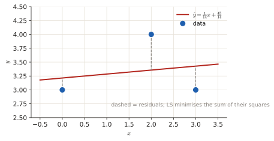

# 2.4 Least squares

Least squares (LS) is the estimator you use when you know the <em>shape</em> of the signal but nothing about the noise distribution. It has appeared as a line fit (April 2025, 1 p), a statement MC, and an older nonlinear-model exercise.

## The idea, from zero

You have data $x[n]$ and a model $s[n;\theta]$ that should explain it. Choose $\theta$ so that the model is as close as possible to the data, measuring "close" by the sum of squared differences:

$$J(\theta)=\sum_n\big(x[n]-s[n;\theta]\big)^2,\qquad\hat\theta_{LS}=\arg\min_\theta J(\theta).$$

No PDF of the noise is needed. That is the main difference with MLE (if the noise is white Gaussian, the two coincide).

**Linear model.** If the signal is a weighted sum of known columns, $\mathbf x=\mathbf H\boldsymbol\theta+\mathbf w$ with $\mathbf H$ of size $N\times K$, setting the gradient of $J$ to zero gives the **normal equations** $\mathbf H^T\mathbf H\hat{\boldsymbol\theta}=\mathbf H^T\mathbf x$, so

$$\hat{\boldsymbol\theta}_{LS}=(\mathbf H^T\mathbf H)^{-1}\mathbf H^T\mathbf x.$$

- **Geometry:** $\mathbf H\hat{\boldsymbol\theta}$ is the projection of $\mathbf x$ onto the space spanned by the columns of $\mathbf H$. The **error** $\mathbf x-\mathbf H\hat{\boldsymbol\theta}$ is **orthogonal** to that space (it is *not* in it).
- $\mathbf H^T\mathbf H$ must be invertible: you need **at least** as many observations as parameters ($N\ge K$), not exactly as many.
- **Weighted LS:** $J=(\mathbf x-\mathbf H\boldsymbol\theta)^T\mathbf W(\mathbf x-\mathbf H\boldsymbol\theta)$ gives $\hat{\boldsymbol\theta}=(\mathbf H^T\mathbf W\mathbf H)^{-1}\mathbf H^T\mathbf W\mathbf x$. With $\mathbf W=\mathbf C_x^{-1}$ (inverse noise covariance) this is the **BLUE**, the best linear unbiased estimator.
- **Nonlinear models:** if an invertible transformation $\alpha=g(\theta)$ makes the model linear, solve for $\hat\alpha$ and map back: $\hat\theta=g^{-1}(\hat\alpha)$. Otherwise iterate (Gauss–Newton, Newton–Raphson).

!!! recipe "Recipe: fit a line $y=ax+b$ to points $(x_i,y_i)$"
    1. $J(a,b)=\sum_i(y_i-ax_i-b)^2$.
    2. $\partial J/\partial a=0$ and $\partial J/\partial b=0$ give the 2×2 system
       $$\Big(\sum x_i^2\Big)a+\Big(\sum x_i\Big)b=\sum x_iy_i,\qquad\Big(\sum x_i\Big)a+n\,b=\sum y_i.$$
    3. Solve with Cramer's rule ([toolbox](toolbox.md#7-solving-things-fast)).

---

## Exam questions

### April 2025 exam · 2b {#apr25-2b}

!!! exam "Final exam Q3, 13 April 2025 · 2b · 1 p"
    Find the linear function having least squares error for the data $\{(0, 3), (2, 4), (3, 3)\}$.

???+ solution "Solution"
    Sums: $n=3$, $\sum x=5$, $\sum x^2=0+4+9=13$, $\sum y=10$, $\sum xy=0+8+9=17$.

    $$\begin{cases}13a+5b=17\\5a+3b=10\end{cases}\qquad\det=13\cdot3-5\cdot5=14$$

    $$a=\frac{17\cdot3-5\cdot10}{14}=\frac1{14}\approx0.071,\qquad b=\frac{13\cdot10-5\cdot17}{14}=\frac{45}{14}\approx3.21.$$

    (The official key expands $J=13a^2+3b^2+10ab-34a-20b+34$ and differentiates. Same equations: $26a+10b-34=0$ and $10a+6b-20=0$.)

    

    !!! answer "Answer"
        $y=\dfrac{1}{14}x+\dfrac{45}{14}\approx0.071x+3.21$

### Q3 2022-23 exam · 2d {#q3-23-2d}

!!! exam "Exam Q3 2022-23 · 2d (shown in the Part 2 review lecture)"
    Suppose we observe data from the following signal model:

    $$x[n] = \ln(\theta) + w[n],$$

    with $n = 0, 1, \dots, N - 1$.

    **2d** Can you find a way to avoid the non linear optimization? In other words, can you find a closed-form solution for $\hat{\theta}_{LSE}$?

???+ solution "Solution"
    **Direct approach:** $J(\theta)=\sum_n(x[n]-\ln\theta)^2$ is nonlinear in $\theta$.

    **Transformation:** let $\alpha=\ln\theta$ (invertible for $\theta>0$, inverse $\theta=e^\alpha$). The model becomes $x[n]=\alpha+w[n]$, a constant in noise:

    $$J(\alpha)=\sum_n(x[n]-\alpha)^2,\qquad\frac{dJ}{d\alpha}=-2\sum_n(x[n]-\alpha)=0\;\Rightarrow\;\hat\alpha=\bar x.$$

    Map back: $\hat\theta=e^{\hat\alpha}=e^{\bar x}$. This works for LS and MLE (a relabelling of the parameter axis does not move the minimum), but **not** for the MMSE: $E[e^{\alpha}\mid\mathbf x]\ne e^{E[\alpha\mid\mathbf x]}$.

    !!! answer "Answer"
        Yes: with $\alpha=\ln\theta$, $\hat\theta_{LS}=e^{\bar x}=\exp\!\Big(\frac1N\sum_n x[n]\Big)$

### Q3 2023 resit · 2c {#q3r-23-2c}

!!! exam "Resit Q3 2023 · 2c · 0.3 p (shown in the Part 2 review lecture)"
    Which statement about the least square estimator is TRUE?

    - a) For linear system models $x = \mathbf{H}\theta + w$, the estimation error is in the column space of the observation matrix $\mathbf{H}$.
    - b) To find the least square estimate, we need exactly as many observations as parameters to be estimated.
    - c) For a linear model $x = \mathbf{H}\theta + w$ with mean $\mathrm{E}[x] = \mathbf{H}\theta$ and covariance matrix $\mathbf{C}_{\mathbf{x}}$, the weighted least square estimator with weighting matrix $\mathbf{W} = \mathbf{C}_{\mathbf{x}}^{-1}$ is the best linear unbiased estimator.

???+ solution "Solution"
    (a) The error is **orthogonal** to the column space; the *fit* $\mathbf H\hat\theta$ is in it. (b) At least as many ($N\ge K$). (c) Weighted LS with the inverse covariance is the BLUE.

    !!! answer "Answer"
        **(c)**

### January 2022 resit · 2c {#jan22-2c}

!!! exam "Resit, 24 January 2022 · 2c · 0.3 p"
    Which of the following statements about the least-squares estimator is true?

    - (a) Some nonlinear least-squares estimation problems can be solved analytically by either separating the problem into nonlinear and linear least-squares problems or by transforming the nonlinear problem into a linear problem.
    - (b) For linear signal models, the solution vector $\hat{\theta}$ is orthogonal to the span of the columns of the observation matrix $\mathbf{H}$.
    - (c) Only the Gauss-Newton method can be applied for nonlinear least-squares problems but not the Newton-Raphson method.

???+ solution "Solution"
    (b) It is the **error** that is orthogonal to the columns of $\mathbf H$. (c) Both iterative methods can be used.

    !!! answer "Answer"
        **(a)**

### January 2020 retake · Exercise 4 {#jan20-4}

!!! exam "Retake exam, 20 January 2020 · Exercise 4 · 2.5 p"
    Consider the observed data $x[0], x[1], \dots, x[n]$, which consists of independent identically distributed samples. The data comes from an experiment, which generates a signal according to model

    $$s[n] = Ae^{\phi n}$$

    where the amplitude $A$ and the power term $\phi < 0$ are to be estimated based on the observed data.

    - (a) What kind of estimators can be used to solve this problem? Explain your reasoning and write down the formulations for the estimators that can be used. [0.5 pt.]
    - (b) For the case where $\phi$ is known but $A$ is unknown, find an estimator for $A$. The estimator you find must have a closed form that depends on $\phi$ and observed data $x[0], x[1], \dots, x[n]$. [0.5 pt.]
    - (c) For the case where both $\phi$ and $A$ are unknown, write the cost function for an estimator for $\theta = [\phi \ A]^T$, where $[\cdot]^T$ indicates the transpose of a vector or matrix. **Hint:** The expression you find will be non-linear, which is why the solution in (d) is asked. [0.5 pt.]
    - (d) Formulate the Gauss-Newton solution for the estimator cost function derived in (c). Clearly show the iterative formulation. [1 pt.]

???+ solution "Solution"
    **(a)** Nothing is said about the noise distribution and there is no prior, so MLE and Bayesian estimators cannot be written down. **Least squares** only needs the signal model:

    $$\hat{\boldsymbol\theta}_{LS}=\arg\min_{\boldsymbol\theta}\sum_n\big(x[n]-Ae^{\phi n}\big)^2.$$

    (If the noise were white Gaussian, the MLE would give the same thing.)

    **(b)** With $\phi$ known the model is **linear in $A$**: $\mathbf x=\mathbf hA+\mathbf w$ with $\mathbf h=[1,e^{\phi},e^{2\phi},\dots]^T$. Then $\hat A=(\mathbf h^T\mathbf h)^{-1}\mathbf h^T\mathbf x$, or by hand: $\frac{dJ}{dA}=-2\sum_n e^{\phi n}(x[n]-Ae^{\phi n})=0$, so

    $$\hat A=\frac{\sum_n x[n]\,e^{\phi n}}{\sum_n e^{2\phi n}}.$$

    **(c)** $J(\boldsymbol\theta)=\sum_n\big(x[n]-Ae^{\phi n}\big)^2$ with $\boldsymbol\theta=[\phi\ A]^T$. Setting the gradient to zero gives equations with $e^{\phi n}$ and $ne^{\phi n}$ that cannot be solved in closed form for $\phi$.

    **(d) Gauss–Newton:** linearise the signal around the current guess $\boldsymbol\theta_k$ and solve a *linear* LS problem for the update. The Jacobian (one row per sample) is

    $$\mathbf H(\boldsymbol\theta_k)=\begin{bmatrix}\frac{\partial s[n]}{\partial\phi}&\frac{\partial s[n]}{\partial A}\end{bmatrix}_{\boldsymbol\theta_k}=\begin{bmatrix}A_k\,n\,e^{\phi_kn}&e^{\phi_kn}\end{bmatrix}_{n=0,1,\dots}$$

    and the iteration is

    $$\boldsymbol\theta_{k+1}=\boldsymbol\theta_k+\big(\mathbf H^T(\boldsymbol\theta_k)\mathbf H(\boldsymbol\theta_k)\big)^{-1}\mathbf H^T(\boldsymbol\theta_k)\big(\mathbf x-\mathbf s(\boldsymbol\theta_k)\big),$$

    repeated until $\boldsymbol\theta$ stops changing. (The official key writes the Newton–Raphson update $\boldsymbol\theta_{k+1}=\boldsymbol\theta_k-[\nabla^2J]^{-1}\nabla J$ instead. Gauss–Newton is that update with the second-derivative terms of the signal dropped.) The 2022 key notes that nonlinear LS is "no longer part of the content", so this is low priority.

    !!! answer "Answer"
        (a) LS; (b) $\hat A=\sum x[n]e^{\phi n}/\sum e^{2\phi n}$; (c) $J=\sum(x[n]-Ae^{\phi n})^2$; (d) Gauss–Newton update above.
