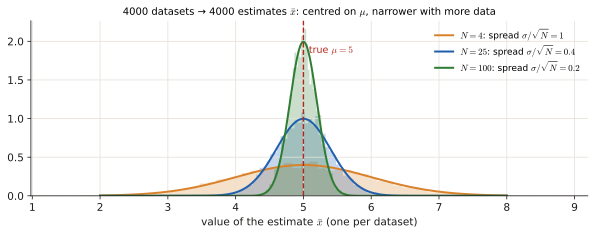
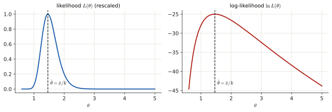
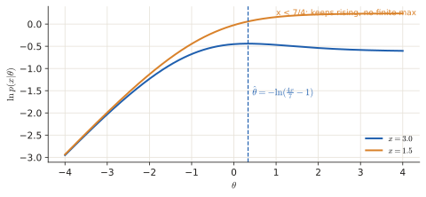

# 2.1 Maximum likelihood (MLE)

"Derive the MLE" is in almost every exam and is worth 0.5–1 p each time. It is always the same four steps. The only things that change are the PDF and the algebra at the end. This page explains what you are doing and why each step is allowed, then repeats the recipe on every exam PDF.

!!! need "Before this page"
    - A PDF, and independence of samples ([0.6](p0-foundations.md#random-variable-and-pdf), [0.6](p0-foundations.md#conditional-probability-and-independence))
    - Expectation, variance ([0.6](p0-foundations.md#expectation-variance)); "likelihood" ([0.6](p0-foundations.md#likelihood-the-same-formula-read-backwards))
    - Derivatives of $\ln$ and $e^x$, and "derivative $=0$ at a peak" ([0.4](p0-foundations.md#04-the-three-calculations-you-keep-meeting), [Toolbox](toolbox.md#2-logs-and-exponentials))

    If you read only one thing: **the MLE is the parameter value under which the data you actually saw would have been the least surprising. You find it by writing the PDF, taking its log, differentiating with respect to the parameter and setting the result to zero.**

---

## 1 · What estimation is, and what "good" means

### 1.1 Estimation from zero

**Estimation** = guessing an unknown fixed number $\theta$ (a mean, a rate, an angle) from noisy data $x_1,\dots,x_N$. An **estimator** $\hat\theta=g(x_1,\dots,x_N)$ is a recipe that turns the data into a guess (a hat means "estimate of"). The data is random, so $\hat\theta$ is a random variable too, and it has two quality numbers (the same two as in [3.2 §1.2](p3-nonparametric.md#12-two-ways-a-guess-can-be-bad-bias-and-variance), dartboard picture included):

| | Meaning | Formula |
|---|---|---|
| **bias** | wrong on average? ($0$ = *unbiased*; $\to0$ as $N\to\infty$ = *asymptotically unbiased*) | $\mathbb E[\hat\theta]-\theta$ |
| **variance** | how much the guess jumps between datasets | $\operatorname{Var}[\hat\theta]$ |
| **consistent** | converges to the true $\theta$ as $N\to\infty$ | |

!!! example "The sample mean, with numbers"
    Samples $x_n\sim\mathcal N(\mu,\sigma^2)$, estimator $\hat\mu=\bar x=\frac1N\sum x_n$. Averaging is linear, so $\mathbb E[\bar x]=\frac1N\cdot N\mu=\mu$: **unbiased**. The variance of a sum of independent samples is the sum of variances, so $\operatorname{Var}[\bar x]=\frac1{N^2}\cdot N\sigma^2=\frac{\sigma^2}N$: with $\sigma^2=4$ and $N=100$ it is $0.04$ (standard deviation $0.2$) and it shrinks to 0 as $N$ grows: **consistent**.

<figure markdown>

<figcaption>The example, simulated: 4000 datasets with $\mu=5$, $\sigma=2$, one estimate $\bar x$ per dataset. With $N=4$ the estimates spread widely; with $N=100$ they cluster tightly. All three histograms are centred on the true value (unbiased), and they narrow as $\sigma/\sqrt N$ (consistent).</figcaption>
</figure>

### 1.2 The likelihood

Take the PDF of the data, $p(\mathbf x;\theta)$, plug in the numbers you **actually observed**, and read it as a function of $\theta$. That is the **likelihood** $L(\theta)$: how well each candidate $\theta$ explains what you saw. The **maximum likelihood estimate** is the $\theta$ that explains the data best:

$$\hat\theta_{ML}=\arg\max_\theta\ p(\mathbf x;\theta)\qquad(\arg\max=\text{"the value of }\theta\text{ at which it is largest"}).$$

<figure class="anim">
<video class="anim" src="video/likelihood_sweep.mp4" poster="video/likelihood_sweep.jpg" muted loop playsinline controls preload="none"></video>
<figcaption><b>Animation: what the likelihood is.</b> Three measurements (black dots) and a candidate model $\mathcal N(\mu,1)$ sliding along. For each $\mu$, read the bell's height at the three data points (red) and multiply them: that product is $L(\mu)$, drawn below. It is largest when the bell sits on top of the data, at $\hat\mu=\bar x=4.07$: that is the MLE.</figcaption>
</figure>

For **independent** samples the joint PDF is a product ([0.6](p0-foundations.md#conditional-probability-and-independence)), and the log turns it into a sum:

$$L(\theta)=\prod_{n=1}^Np(x_n;\theta),\qquad\ln L(\theta)=\sum_{n=1}^N\ln p(x_n;\theta).$$

**Why the log is allowed.** $\ln$ is *increasing*: if $a\lt b$ then $\ln a<\ln b$. So $L$ and $\ln L$ are largest at the **same** $\theta$ (figure). And sums are far easier to differentiate than products: $\ln(ab)=\ln a+\ln b$, $\ln e^u=u$.

<figure markdown>

<figcaption>Likelihood (left) and log-likelihood (right) for 12 Gamma samples. The log changes the shape but not the location of the peak, and the peak is the MLE.</figcaption>
</figure>

**Why "derivative $=0$" finds the peak.** At the top of a smooth hill the slope is zero. And if the *second* derivative is negative there, the hill curves downward, so it is a peak (maximum), not a valley.

### 1.3 The recipe

!!! recipe "Recipe: MLE in 4 steps (+1 check)"
    1. **Likelihood**: $L(\theta)=\prod_n p(x_n;\theta)$ (independent samples).
    2. **Log**: $\ln L=\sum_n\ln p(x_n;\theta)$. Expand with $\ln(ab)=\ln a+\ln b$, $\ln e^u=u$. Terms without $\theta$ can be dropped.
    3. **Differentiate** with respect to $\theta$.
    4. **Set to 0 and solve** for $\theta$. Put a hat on it.
    5. *(Check)* second derivative < 0 at the solution → maximum. Mention it in one line.

!!! example "Two complete examples with numbers"
    **(i) Exponential, $p(x;\lambda)=\lambda e^{-\lambda x}$, data $x=[1,2,3]$.** $\ln L=N\ln\lambda-\lambda\sum x_n=3\ln\lambda-6\lambda$. Derivative $\frac3\lambda-6=0\Rightarrow\hat\lambda=\frac36=0.5$. Check: the mean of this PDF is $1/\lambda$, and $1/0.5=2=\bar x$ ✓.

    **(ii) Gaussian mean, $x_n\sim\mathcal N(\mu,1)$, data $x=[2,4,6]$.** $\ln L=\text{const}-\frac12\sum(x_n-\mu)^2$. Derivative: $\sum(x_n-\mu)=0\Rightarrow\hat\mu=\bar x=4$.

### 1.4 Properties you get asked about (multiple choice)

- MLE is **asymptotically unbiased**, **asymptotically efficient** (its variance approaches the CRLB, [2.2](p2-crlb.md)) and **asymptotically Gaussian**: $\hat\theta\sim\mathcal N(\theta,\mathcal I^{-1}(\theta))$ for large $N$ ($\mathcal I$ = Fisher information, [2.2](p2-crlb.md)).
- If an efficient estimator exists, the MLE finds it.
- It does **not** always reach the CRLB for finite $N$, and it is **not** limited to linear models (it works for any model you can write a PDF for).
- **Invariance:** the MLE of $\alpha=g(\theta)$ is $g(\hat\theta_{ML})$. So you can estimate a convenient parameter and transform back (used in Nov 2019 3a and Apr 2025 2c).

!!! trap "Traps"
    - The MLE maximises over the **parameter** $\theta$, not over the data $x$.
    - Normalising constants that do not contain $\theta$ (like $\Gamma(k)$, $\ln x_n$) disappear when you differentiate. Do not waste time on them.
    - Constants that **do** contain $\theta$ (like $1/\theta^k$, $\lambda(\theta)$) must stay in.

### 1.5 Results you will keep meeting (a cross-check list)

| PDF of one sample | MLE |
|---|---|
| exponential $\lambda e^{-\lambda x}$ | $\hat\lambda=1/\bar x$ |
| Gaussian mean ($\sigma$ known) | $\hat\mu=\bar x$ |
| $\frac x\theta e^{-x^2/2\theta}$ (Rayleigh-type) | $\hat\theta=\frac1{2N}\sum x_n^2$ |
| $\frac x\theta e^{-x^2/\theta}$ | $\hat\theta=\frac1N\sum x_n^2$ |
| $\frac x{\theta^2}e^{-x^2/2\theta^2}$ | $\hat\theta=\sqrt{\frac1{2N}\sum x_n^2}$ |
| Gamma$(k,\theta)$, $k$ known | $\hat\theta=\bar x/k$ |

---

## Exam questions: derivations

### June 2026 resit · 2b {#jun26-2b}

!!! exam "Resit Q4, June 2026 · 2b · 1 p"
    A hospital administrator records the recovery time $X$ (in days) for patients following a routine surgical procedure. Recovery times are modelled as

    $$X \sim \text{Gamma}(k, \theta),$$

    where $k > 0$ is a *known* shape parameter and $\theta > 0$ is the unknown scale parameter (average recovery contribution per stage). The Gamma pdf is

    $$p(x \mid \theta) = x^{k-1} e^{-x/\theta} / (\theta^k \Gamma(k)), \quad x > 0.$$

    - Write the likelihood and log-likelihood functions for $\theta$ given observations $x_1, \dots, x_n$.
    - Derive the maximum likelihood estimator (MLE) for $\theta$.
    - Explain what the MLE tells us about patient recovery at the hospital.

???+ solution "Solution"

    **What is being asked?** Write $L$ and $\ln L$ for $n$ patients, find the $\theta$ that maximises it, and say in words what that number means.

    **Symbols in this question**

    | Symbol | Meaning |
    |---|---|
    | $x_i$ | recovery time of patient $i$ (days), $i=1..n$ |
    | $k$ | known shape (think: number of recovery "stages"); a fixed number, **not** estimated |
    | $\theta$ | unknown scale: the average duration of one stage |
    | $\Gamma(k)$ | the gamma function: just a number that depends on $k$ only |

    **Step 1 — likelihood** (patients independent → product):

    $$L(\theta)=\prod_{i=1}^n\frac{x_i^{k-1}e^{-x_i/\theta}}{\theta^k\Gamma(k)}=\frac{\left(\prod_i x_i\right)^{k-1}}{\Gamma(k)^n}\;\theta^{-nk}\;e^{-\frac1\theta\sum_i x_i}.$$

    (Exponents of equal bases add: $\prod e^{-x_i/\theta}=e^{-\sum x_i/\theta}$.)

    **Step 2 — log-likelihood** ($\ln(ab)=\ln a+\ln b$, $\ln\theta^{-nk}=-nk\ln\theta$):

    $$\ln L(\theta)=(k-1)\sum_i\ln x_i-n\ln\Gamma(k)-nk\ln\theta-\frac1\theta\sum_i x_i.$$

    **Step 3 — differentiate.** The first two terms do not contain $\theta$ → derivative 0. $\frac{d}{d\theta}(-nk\ln\theta)=-\frac{nk}\theta$ and $\frac d{d\theta}(-\frac1\theta S)=+\frac{S}{\theta^2}$ with $S=\sum x_i$:

    $$\frac{\partial\ln L}{\partial\theta}=-\frac{nk}{\theta}+\frac{1}{\theta^2}\sum_i x_i.$$

    **Step 4 — set to 0.** Multiply by $\theta^2$: $-nk\,\theta+\sum_ix_i=0$, so

    $$\hat\theta_{ML}=\frac{1}{nk}\sum_{i=1}^n x_i=\frac{\bar x}{k}.$$

    **Check (maximum).** $\frac{\partial^2\ln L}{\partial\theta^2}=\frac{nk}{\theta^2}-\frac{2\sum x_i}{\theta^3}$. At $\hat\theta$ we have $\sum x_i=nk\hat\theta$, so this equals $\frac{nk}{\hat\theta^2}-\frac{2nk}{\hat\theta^2}=-\frac{nk}{\hat\theta^2}<0$ → maximum.

    **Interpretation.** A Gamma($k,\theta$) variable is like $k$ consecutive stages, each lasting on average $\theta$ days, so the mean recovery time is $\mathbb E[X]=k\theta$. The MLE sets $k\hat\theta=\bar x$: the fitted model reproduces the **observed average recovery time**, and $\hat\theta=\bar x/k$ is the estimated average number of days each stage takes at this hospital. A larger $\hat\theta$ means slower recovery. (The estimate is unbiased, since $\mathbb E[\bar x]=k\theta$, and gets more precise as more patients are recorded.)

    !!! answer "Answer"
        $\hat\theta_{ML}=\dfrac{1}{nk}\displaystyle\sum_{i=1}^n x_i=\dfrac{\bar x}{k}$ (mean recovery time divided by the number of stages)

### April 2025 exam · 2c {#apr25-2c}

!!! exam "Final exam Q3, 13 April 2025 · 2c · 1 p"
    Consider the likelihood

    $$p(x|\theta) = 3\lambda(\theta)e^{-4\frac{\lambda(\theta)x}{7}}, \quad x > 1$$

    where $\lambda(\cdot)$ is defined as the logistic sigmoid function

    $$\lambda(\theta) = \frac{1}{1+e^{-\theta}}.$$

    Derive the MLE for the parameter $\theta$. Hint: The derivative of the logistic sigmoid is $\frac{\partial \lambda(\theta)}{\partial \theta} = \lambda(\theta)(1 - \lambda(\theta))$.

???+ solution "Solution"

    **What is being asked?** The usual MLE, but the parameter $\theta$ is hidden inside a function $\lambda(\theta)$ (a "sigmoid": an S-shaped curve that squeezes any $\theta$ into $(0,1)$). Single observation $x$.

    **Symbols in this question**

    | Symbol | Meaning |
    |---|---|
    | $x$ | the observed data point ($x>1$) |
    | $\theta$ | unknown parameter to estimate |
    | $\lambda(\theta)$ | the sigmoid; always between 0 and 1; $\lambda'=\lambda(1-\lambda)$ (given) |

    **Step 1 — think first.** $\theta$ only enters through $\lambda$. Plan: get an equation for $\lambda$, solve it, then convert back to $\theta$ with the inverse sigmoid $\theta=\ln\frac{\lambda}{1-\lambda}$ (solve $\lambda=\frac1{1+e^{-\theta}}$ for $\theta$: $\frac1\lambda-1=e^{-\theta}$, i.e. $\frac{1-\lambda}\lambda=e^{-\theta}$).

    **Step 2 — log.** $\ln p=\ln3+\ln\lambda(\theta)-\frac47\lambda(\theta)\,x$.

    **Step 3 — differentiate** (chain rule: $\frac d{d\theta}\ln\lambda=\frac{\lambda'}{\lambda}=1-\lambda$, and $\frac d{d\theta}\lambda=\lambda(1-\lambda)$):

    $$\frac{\partial\ln p}{\partial\theta}=(1-\lambda)-\frac47x\,\lambda(1-\lambda)=(1-\lambda)\Big(1-\frac47x\lambda\Big).$$

    **Step 4 — set to 0.** $1-\lambda=0$ would need $\theta\to\infty$, so the stationary point is $1-\frac47x\lambda=0$:

    $$\lambda(\hat\theta)=\frac{7}{4x}.$$

    **Step 5 — back to $\theta$.** $\frac{\lambda}{1-\lambda}=\frac{7/(4x)}{1-7/(4x)}=\frac{7}{4x-7}$ (multiply numerator and denominator by $4x$), so

    $$\hat\theta_{ML}=\ln\frac{7}{4x-7}=-\ln\!\left(\frac{4x}{7}-1\right).$$

    **When does it exist?** A sigmoid is between 0 and 1, so we need $\frac7{4x}<1$, i.e. $x>\frac74$. For $1\lt x\le\frac74$ the derivative is positive everywhere and the likelihood keeps increasing ($\hat\theta\to\infty$), as the orange curve shows. For $x>\frac74$ the derivative is positive for $\lambda<\frac7{4x}$ and negative after: a peak ✓.

    

    !!! answer "Answer"
        $\hat\theta_{ML}=-\ln\!\left(\dfrac{4x}{7}-1\right)$, valid for $x>7/4$

### April 2024 exam · 2c {#apr24-2c}

!!! exam "Final exam Q3, April 2024 · 2c"
    For the data vector $\mathbf{x} = \{x_1, \dots, x_N\}$ consisting of independent samples with probability density function

    $$p(x_n | \theta) = \frac{x_n}{2\theta} e^{-\frac{x_n^2}{2\theta}},$$

    derive the MLE for the parameter $\theta$.

???+ solution "Solution"

    **What is being asked?** The recipe on a Rayleigh-type PDF. Symbols: $x_n>0$ the data, $\theta>0$ the unknown, $N$ the number of samples.

    **Step 1 — log of the product.** $\ln p(x_n)=\ln x_n-\ln(2\theta)-\frac{x_n^2}{2\theta}$; summing over $n$:

    $$\ln L(\theta)=\sum_n\ln x_n-N\ln(2\theta)-\frac{1}{2\theta}\sum_n x_n^2.$$

    **Step 2 — differentiate.** $\ln(2\theta)=\ln2+\ln\theta$, so $\frac d{d\theta}\ln(2\theta)=\frac1\theta$; and $\frac d{d\theta}\big(-\frac{1}{2\theta}S\big)=\frac{S}{2\theta^2}$:

    $$\frac{\partial\ln L}{\partial\theta}=-\frac N\theta+\frac{1}{2\theta^2}\sum_n x_n^2=0.$$

    **Step 3 — solve.** Multiply by $2\theta^2$: $-2N\theta+\sum x_n^2=0\Rightarrow\hat\theta=\frac{1}{2N}\sum_{n=1}^N x_n^2$.

    **Check.** Second derivative at $\hat\theta$: $\frac{N}{\hat\theta^2}-\frac{2N}{\hat\theta^2}=-\frac N{\hat\theta^2}<0$ ✓.

    !!! answer "Answer"
        $\hat\theta_{ML}=\dfrac{1}{2N}\displaystyle\sum_{n=1}^N x_n^2$

### January 2025 resit · 2b {#jan25-2b}

!!! exam "Resit January 2025 · 2b · 1 p (shown in the Part 2 review lecture)"
    Assume that

    $$p(\mu, \sigma, \theta | \rho) = \frac{1}{2\pi(1-\theta^2)^{1/2}} \exp\left(-\frac{\mu^2\rho^2 - 2\rho\mu\sigma\theta + \sigma^2\rho^2}{2(1-\theta^2)}\right)$$

    Determine the maximum likelihood estimate of $\rho$ for a single observation of $\mu, \sigma, \theta$.

    *Note: $\rho$ is the unknown parameter here; $\mu, \sigma, \theta$ are the observed data (a single realization of each).*

???+ solution "Solution"

    **What is being asked?** Don't be thrown by the letters: here $\mu,\sigma,\theta$ are just *numbers you observed* (fixed), and $\rho$ is the unknown. Same 4 steps with respect to $\rho$.

    **Step 1 — log.** The prefactor gives $-\ln2\pi-\frac12\ln(1-\theta^2)$ (no $\rho$ in it); the exponent is already a plain expression:

    $$\ln p=-\ln(2\pi)-\tfrac12\ln(1-\theta^2)-\frac{(\mu^2+\sigma^2)\rho^2-2\mu\sigma\theta\,\rho}{2(1-\theta^2)}.$$

    **Step 2 — differentiate in $\rho$** (power rule: $\frac d{d\rho}\rho^2=2\rho$):

    $$\frac{\partial\ln p}{\partial\rho}=-\frac{2(\mu^2+\sigma^2)\rho-2\mu\sigma\theta}{2(1-\theta^2)}=0.$$

    **Step 3 — solve.** The numerator must vanish: $(\mu^2+\sigma^2)\rho=\mu\sigma\theta$, so $\hat\rho=\dfrac{\mu\sigma\theta}{\mu^2+\sigma^2}$.

    **Check.** Second derivative $-\frac{\mu^2+\sigma^2}{1-\theta^2}<0$ when $|\theta|<1$ (needed anyway for the PDF to exist) → maximum.

    !!! answer "Answer"
        $\hat\rho_{ML}=\dfrac{\mu\sigma\theta}{\mu^2+\sigma^2}$

### Q1 2023 resit · 2b {#q1-23-2b}

!!! exam "Resit Q1 2023 · 2b (shown in the Part 2 review lecture)"
    For the data vector $\mathbf{x} = \{x_1, \dots x_N\}$ consisting of independent samples with probability density function

    $$p(\mathbf{x} | \theta) = \prod_{n=1}^N \frac{x_n}{\theta} e^{-\frac{x_n^2}{\theta}},$$

    derive the MLE for the parameter $\theta$.

???+ solution "Solution"

    **What is being asked?** The PDF is already the product over the $N$ samples. Same steps; only the constant in the exponent differs from April 2024.

    **Step 1 — log:** $\ln L=\sum_n\ln x_n-N\ln\theta-\frac1\theta\sum_nx_n^2$.

    **Step 2 — differentiate and set to 0:** $\frac{\partial\ln L}{\partial\theta}=-\frac N\theta+\frac{1}{\theta^2}\sum_nx_n^2=0$. Multiply by $\theta^2$: $-N\theta+\sum x_n^2=0$.

    **Step 3 — solve:** $\hat\theta=\frac1N\sum_{n=1}^Nx_n^2$.

    Compare with April 2024: there the exponent was $\frac{x^2}{2\theta}$ and the answer had $\frac1{2N}$. The factor 2 in the exponent shows up as the factor 2 in the answer.

    !!! answer "Answer"
        $\hat\theta_{ML}=\dfrac1N\displaystyle\sum_{n=1}^N x_n^2$

### November 2022 exam · 2d {#nov22-2d}

!!! exam "Final exam Q1, 7 November 2022 · 2d · 0.5 p"
    Consider the observation

    $$\mathbf{x} = A \begin{bmatrix} \cos(\theta) \\ \sin(\theta) \end{bmatrix} + \mathbf{w},$$

    where $\mathbf{w}$ is white Gaussian noise. The probability density function of the observation is

    $$p(\mathbf{x}; \theta) = \frac{1}{2\pi\sigma^2} \exp\left(-\frac{1}{2\sigma^2} \left((x_1 - A \cos(\theta))^2 + (x_2 - A \sin(\theta))^2\right)\right)$$

    Find the maximum likelihood estimator of the parameter $\theta$.

???+ solution "Solution"

    **What is being asked?** The unknown is an **angle** $\theta$. The true point $A(\cos\theta,\sin\theta)$ sits on a circle of radius $A$; noise moves it a bit to the observed point $(x_1,x_2)$. The best guess of the angle should be the angle of the observed point.

    **Symbols in this question.** $\mathbf x=(x_1,x_2)$ observed point; $A$ known radius; $\sigma^2$ noise variance; $\theta$ unknown angle.

    **Step 1 — log, and expand the squares:**

    $$\ln p=-\ln(2\pi\sigma^2)-\frac{1}{2\sigma^2}\Big(x_1^2+x_2^2-2A(x_1\cos\theta+x_2\sin\theta)+A^2\underbrace{(\cos^2\theta+\sin^2\theta)}_{=1}\Big).$$

    The terms $x_1^2+x_2^2$ and $A^2$ do not depend on $\theta$ and vanish on differentiating.

    **Step 2 — differentiate** ($\frac d{d\theta}\cos\theta=-\sin\theta$, $\frac d{d\theta}\sin\theta=\cos\theta$):

    $$\frac{\partial\ln p}{\partial\theta}=\frac{A}{\sigma^2}\big(-x_1\sin\theta+x_2\cos\theta\big)=0\ \Rightarrow\ x_2\cos\theta=x_1\sin\theta\ \Rightarrow\ \tan\theta=\frac{x_2}{x_1}.$$

    **Step 3 — pick the right solution.** $\tan\theta=x_2/x_1$ has two solutions per turn ($\theta$ and $\theta+\pi$). The second derivative $-\frac A{\sigma^2}(x_1\cos\theta+x_2\sin\theta)$ is negative (a maximum) when $(\cos\theta,\sin\theta)$ points the same way as $(x_1,x_2)$. So $\hat\theta=\tan^{-1}(x_2/x_1)$ **in the quadrant of the point $(x_1,x_2)$**; the other solution is the minimum of the likelihood.

    !!! answer "Answer"
        $\hat\theta_{ML}=\tan^{-1}\!\left(\dfrac{x_2}{x_1}\right)$ (the angle of the observed vector)

### Practice exam 2021 · 2b {#pe21-2b}

!!! exam "Practice exam, 28 October 2021 · 2b · 1 p"
    For the data vector $\mathbf{x}$ consisting of independent samples with probability density function $p(x[n]) = \frac{x}{\theta} \exp\left(-\frac{x^2}{2\theta}\right)$, where $n = 0, 1, \dots, N-1$, find an estimator for the parameter $\theta$.

???+ solution "Solution"

    **What is being asked?** "Find an estimator" means: use the MLE. Same family as [April 2024 2c](#apr24-2c) (the PDF there has $2\theta$ in the prefactor; here only $\theta$; the prefactor's $\ln$ gives the same $-N\ln\theta$ up to a constant).

    **Step 1 — log:** $\ln L=\sum\ln x[n]-N\ln\theta-\frac{1}{2\theta}\sum x^2[n]$.

    **Step 2 — differentiate:** $\frac{\partial\ln L}{\partial\theta}=-\frac N\theta+\frac{1}{2\theta^2}\sum x^2[n]=0$.

    **Step 3 — solve:** multiply by $2\theta^2$: $-2N\theta+\sum x^2[n]=0$.

    !!! answer "Answer"
        $\hat\theta=\dfrac{1}{2N}\displaystyle\sum_{n=0}^{N-1}x^2[n]$

### November 2019 exam · 3a {#nov19-3a}

!!! exam "Written exam, 4 November 2019 · Exercise 3(a) · 1 p"
    The data $x[0], x[1], \dots, x[N-1]$ are observed, where $x[n]$'s are independent and identically distributed according to the PDF

    $$p(x; \theta) = \frac{x}{\theta^2} \exp \left[ -\frac{x^2}{2\theta^2} \right], \quad x \geq 0.$$

    (a) Find the maximum likelihood estimator for the parameter $\theta$.

???+ solution "Solution"

    **What is being asked?** Same Rayleigh family, but now the parameter appears squared inside, so $\theta$ here plays the role of $\sqrt{\theta}$ in the previous questions.

    **Step 1 — log:** $\ln L=\sum\ln x[n]-N\ln\theta^2-\frac{1}{2\theta^2}\sum x^2[n]=\sum\ln x[n]-2N\ln\theta-\frac{1}{2\theta^2}\sum x^2[n]$.

    **Step 2 — differentiate:** $\frac{d}{d\theta}\big(-\frac1{2\theta^2}S\big)=+\frac{S}{\theta^3}$, so $\frac{\partial\ln L}{\partial\theta}=-\frac{2N}{\theta}+\frac{1}{\theta^3}\sum x^2[n]=0$.

    **Step 3 — solve.** Multiply by $\theta^3$: $-2N\theta^2+\sum x^2[n]=0$, so $\theta^2=\frac{1}{2N}\sum x^2[n]$ and $\theta>0$ gives the square root. (By **invariance**, [1.4](#14-properties-you-get-asked-about-multiple-choice), this is the square root of the answer to the $\theta$-version: as it should be.)

    !!! answer "Answer"
        $\hat\theta_{ML}=\sqrt{\dfrac{1}{2N}\displaystyle\sum_{n=0}^{N-1}x^2[n]}$

### January 2019 retake · 2a {#jan19-2a}

!!! exam "Written exam, 21 January 2019 · Exercise 2(a) · 1 p"
    For the random variable $x$ with distribution

    $$p(x; \lambda) = \lambda e^{-\lambda x}$$

    find the maximum likelihood estimator for $\lambda$, given $N$ independent identically distributed observations $x_i, i \in \{0 : N - 1\}$.

???+ solution "Solution"

    **What is being asked?** Exactly example (i) of [1.3](#13-the-recipe) with letters instead of numbers.

    **Step 1 — log.** $\ln L=\sum_i\big(\ln\lambda-\lambda x_i\big)=N\ln\lambda-\lambda\sum_ix_i$.

    **Step 2 — differentiate and set to 0:** $\frac N\lambda-\sum_ix_i=0$.

    **Step 3 — solve:** $\hat\lambda=\dfrac{N}{\sum x_i}$. Sanity: the mean of an exponential is $1/\lambda$, so $\hat\lambda=1/\bar x$.

    !!! answer "Answer"
        $\hat\lambda_{ML}=\dfrac{N}{\sum_i x_i}=\dfrac1{\bar x}$

---

## Exam questions: multiple choice

### November 2022 exam · 2b {#nov22-2b}

!!! exam "Final exam Q1, 7 November 2022 · 2b · 0.25 p"
    Which of the following statements about the maximum likelihood estimator is TRUE?

    - (a) The maximum likelihood estimator always achieves the Cramér-Rao lower bound.
    - (b) The maximum likelihood estimator can only be found for special estimation problems, such as linear signal models.
    - (c) The maximum likelihood estimator is asymptotically unbiased.

???+ solution "Solution"

    **What is being asked?** One true statement about MLE properties ([1.4](#14-properties-you-get-asked-about-multiple-choice)).

    - (a) False: it reaches the CRLB only **asymptotically** (or when an efficient estimator exists), not "always".
    - (b) False: the MLE works for any model for which you can write a PDF.
    - (c) **True**: bias → 0 as $N\to\infty$.

    !!! answer "Answer"
        **(c)**

### January 2022 resit · 2b {#jan22-2b}

!!! exam "Resit, 24 January 2022 · 2b · 0.3 p"
    Which of the following statements about the maximum likelihood estimator is true?

    - (a) The maximum likelihood estimate is the value of $x$ that maximizes the likelihood function.
    - (b) For large sample sizes, the maximum likelihood estimate is uniformly distributed, i.e., $\hat{\theta}_{ML} \sim \text{Uniform}(-a, a)$ where $a = \mathcal{I}^{-1}(\theta)$.
    - (c) For a transformed parameter $\alpha = \psi(\theta)$, where $\psi(\cdot)$ is a one-to-one mapping, the maximum likelihood estimate $\hat{\theta}_{ML}$ can be obtained as $\hat{\theta}_{ML} = \psi^{-1}(\hat{\alpha}_{ML})$ where $\psi^{-1}(\cdot)$ is the inverse mapping of $\psi(\cdot)$ and $\hat{\alpha}_{ML}$ is the maximum likelihood estimate of the transformed parameter $\alpha$, respectively.

???+ solution "Solution"

    **What is being asked?** One true statement.

    - (a) False: the MLE maximises over the **parameter** $\theta$, not over the data $x$.
    - (b) False: for large $N$ it is **Gaussian**, $\mathcal N(\theta,\mathcal I^{-1}(\theta))$, not uniform.
    - (c) **True**: this is the invariance property: estimate the convenient parameter, transform back.

    !!! answer "Answer"
        **(c)**

### January 2019 retake · 1b {#jan19-1b}

!!! exam "Written exam, 21 January 2019 · Exercise 1(b) · 0.5 p"
    Which expression describes the maximum likelihood estimator?

    - A. $\hat{\theta} = \arg \min_{\theta} \sum_{n=1}^N (x[n] - s[n; \theta])^2$
    - B. $\hat{\theta} = \arg \min_{\hat{\theta}} \int (\hat{\theta} - \theta)^2 p(x|\theta) dx$
    - C. $\hat{\theta} = \arg \max_{\theta} p(\theta|x)$
    - D. $\hat{\theta} = \arg \max_{\theta} p(x|\theta)$

???+ solution "Solution"

    **What is being asked?** Recognise the MLE definition among three other estimators.

    | Option | What it is |
    |---|---|
    | A | minimise the squared distance between data and model: **least squares** ([2.4](p2-ls.md)) |
    | B | minimise the average squared error of the estimator: **MMSE** ([2.3](p2-bayes.md)) |
    | C | maximise the **posterior** $p(\theta\mid x)$: **MAP** ([2.3](p2-bayes.md)) |
    | D | maximise the **likelihood** $p(x\mid\theta)$: the **MLE** |

    !!! answer "Answer"
        **D**

*[estimator]: a recipe that turns the data into a guess of an unknown parameter.
*[MLE]: maximum likelihood estimator: the parameter value that makes the observed data most probable.
*[argmax]: the argument (input) at which a function is largest.
*[log-likelihood]: ln of the likelihood; has its peak at the same place but is a sum instead of a product.
*[invariance]: the MLE of g(θ) is g of the MLE of θ.
*[efficient]: an unbiased estimator whose variance equals the CRLB.
*[Fisher information]: 𝓘(θ): how much information the data carry about θ; the CRLB is 1/𝓘.
*[sigmoid]: the S-shaped function 1/(1+e^(−θ)) that squeezes any number into (0, 1).
