# 3.4 The correlogram → AR → MA chain

This is the single most valuable page of the guide. Since 2019 almost every exam gives you a few autocorrelation values and asks for the same chain: <b>correlogram PSD</b>, then an <b>AR model by Yule–Walker</b>, often an <b>MA(1) model</b>, and recently <b>"which plot is right?"</b>. Around 2 points, fully mechanical, and every step below is explained from the first line.

!!! need "Before this page"
    - Autocorrelation $r[l]$ and the PSD as its FTD ([0.6](p0-foundations.md#random-signals-stationarity-and-autocorrelation))
    - $\cos\theta=\frac{e^{j\theta}+e^{-j\theta}}2$ and $\lvert u\rvert^2=u\bar u$ ([0.3](p0-foundations.md#03-complex-numbers-and-ejtheta))
    - What MA, AR and ARMA models are, and the formula $P=\sigma_i^2\lvert H\rvert^2$ ([3.3](p3-autocorr.md))
    - Solving a 2×2 linear system ([Toolbox](toolbox.md))

    If you read only one thing: **you are handed the same few numbers $r[0],r[1],\dots$ and asked to turn them into a PSD in three different ways: (1) just transform them, (2) pretend the signal is AR, (3) pretend it is MA(1). The three answers are different guesses at the same unknown spectrum.**

---

## 1 · The three estimates from the same numbers

You are given $r[0]$, $r[\pm1]$, sometimes $r[\pm2]$, $r[\pm3]$ (estimated from data; the true autocorrelation continues forever but you do not know it).

### 1.1 Correlogram (non-parametric): just transform what you have

**Plain words.** The PSD is *defined* as $P(e^{j\theta})=\sum_{l=-\infty}^{\infty}r[l]e^{-jl\theta}$ ([0.6](p0-foundations.md#random-signals-stationarity-and-autocorrelation)). You do not know the lags beyond the ones given, so **assume they are zero** and sum what you have. Pair lag $l$ with lag $-l$ ($r[-l]=r[l]$) and use $e^{jl\theta}+e^{-jl\theta}=2\cos l\theta$:

$$\boxed{\hat P_{corr}(e^{j\theta})=r[0]+2\sum_{k\ge1}r[k]\cos(k\theta)}$$

!!! example "Numbers: $r[0]=3,\ r[1]=2,\ r[2]=1$"
    $\hat P_{corr}=3+4\cos\theta+2\cos2\theta$. At $\theta=0$ every cosine is 1: $3+4+2=9$ (the sum of all the lags, $3+2\cdot2+2\cdot1$). At $\theta=\pi$: $\cos\pi=-1,\ \cos2\pi=1$: $3-4+2=1$.

**Weakness.** If the true autocorrelation does not really stop at the last lag you used, chopping it there can make the sum **dip below zero**. A real PSD never does. (This is how you reject plots.)

<figure markdown>
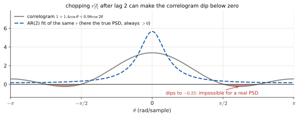
<figcaption>$r[l]=0.7^{|l|}$ is a perfectly valid autocorrelation (an AR(1) process). Keeping only lags 0, 1, 2 gives the grey correlogram, which dips below zero (red) around $\theta\approx\pm1.94$: impossible for a power. The AR(2) fit of the same three numbers (blue dashed) is the true PSD here, and it stays positive everywhere.</figcaption>
</figure>

### 1.2 AR($p$) by Yule–Walker: pretend the signal is AR and fit it

**Idea.** An AR($p$) model $x[n]=i[n]-a_1x[n-1]-\dots-a_px[n-p]$ is determined by $p+1$ numbers: $a_1,\dots,a_p$ and $\sigma_i^2$. Choose them so that the model's autocorrelation matches the first $p+1$ lags you were given. The resulting equations are the **Yule–Walker equations**. Here is where they come from.

**Derivation.** Write the model as $x[n]+a_1x[n-1]+\dots+a_px[n-p]=i[n]$. Multiply by $x[n-l]$ and take expectations (exactly the method of [3.3 §3](p3-autocorr.md#3-the-autocorrelation-derived)):

$$r[l]+a_1r[l-1]+\dots+a_pr[l-p]=\mathbb E\{i[n]\,x[n-l]\}=\begin{cases}\sigma_i^2&l=0\\0&l\ge1\end{cases}$$

(today's noise is unrelated to the past signal, except for $l=0$). Write this for $l=0,1,\dots,p$ and use $r[-k]=r[k]$:

$$\begin{bmatrix}r[0]&r[1]&\cdots&r[p]\\r[1]&r[0]&\cdots&r[p-1]\\\vdots&&\ddots&\vdots\\r[p]&r[p-1]&\cdots&r[0]\end{bmatrix}\begin{bmatrix}1\\a_1\\\vdots\\a_p\end{bmatrix}=\begin{bmatrix}\sigma_i^2\\0\\\vdots\\0\end{bmatrix}$$

**How to solve it.** Rows 2 to $p+1$ contain only the unknown $a$'s: solve those first (a small linear system). Then row 1 gives the noise variance: $\sigma_i^2=r[0]+a_1r[1]+\dots+a_pr[p]$.

| Order | Coefficients | Noise variance |
|---|---|---|
| AR(1) | $a_1=-\dfrac{r[1]}{r[0]}$ (row 2: $r[1]+a_1r[0]=0$) | $\sigma_i^2=r[0]+a_1r[1]$ |
| AR(2) | solve $\begin{cases}r[0]a_1+r[1]a_2=-r[1]\\r[1]a_1+r[0]a_2=-r[2]\end{cases}$ (rows 2 and 3) | $\sigma_i^2=r[0]+a_1r[1]+a_2r[2]$ |

**The PSD.** By $P=\sigma_i^2/\lvert A(e^{j\theta})\rvert^2$ ([3.3 §2](p3-autocorr.md#2-the-psd-of-a-model-without-any-autocorrelation)). To turn $\lvert A\rvert^2$ into cosines, multiply $A$ by its conjugate:

$$\lvert1+a_1e^{-j\theta}\rvert^2=1+a_1^2+2a_1\cos\theta,$$

$$\lvert1+a_1e^{-j\theta}+a_2e^{-j2\theta}\rvert^2=1+a_1^2+a_2^2+2(a_1+a_1a_2)\cos\theta+2a_2\cos2\theta .$$

(Where the second line comes from: the 3×3 products give $1,\ a_1^2,\ a_2^2$ on the diagonal; $1\cdot a_1e^{j\theta}$ and its conjugate give $2a_1\cos\theta$; $a_1e^{-j\theta}\cdot a_2e^{j2\theta}=a_1a_2e^{j\theta}$ and its conjugate give $2a_1a_2\cos\theta$; $1\cdot a_2e^{j2\theta}$ and its conjugate give $2a_2\cos2\theta$.)

The same numbers come out of the *one-step linear predictor* (Wiener filter, see [Jan 2019 ex. 4](#jan19-4)): $\mathbf w=-\mathbf a$ and the minimum prediction error is $\sigma_i^2$.

### 1.3 MA(1): pretend the signal is a one-memory-step moving average

Model $x[n]=i[n]+b\,i[n-1]$. From [3.3 §3.1](p3-autocorr.md#31-maq-slide-the-coefficient-list-over-itself): $r[0]=\sigma_i^2(1+b^2)$ and $r[1]=\sigma_i^2b$. Match these two to the given $r[0],r[1]$. Dividing the second equation by the first eliminates $\sigma_i^2$:

$$\frac{b}{1+b^2}=\frac{r[1]}{r[0]}\ \Longrightarrow\ \boxed{r[1]\,b^2-r[0]\,b+r[1]=0}.$$

A quadratic: two roots, and they are $b$ and $1/b$ (their product is $r[1]/r[1]=1$). Both give exactly the same autocorrelation and the same PSD. **Keep the root with $\lvert b\rvert<1$** (the *minimum-phase* choice, the same choice as in spectral factorisation, [1.4](p1-factorisation.md)). Then $\sigma_i^2=r[1]/b$.

!!! idea "Shortcut that saves minutes"
    Expand the MA(1) PSD: $\sigma_i^2\lvert1+be^{-j\theta}\rvert^2=\sigma_i^2(1+b^2)+2\sigma_i^2b\cos\theta=r[0]+2r[1]\cos\theta$.
    **The MA(1) PSD is just the correlogram truncated at lag 1.** You still have to give $b$ and $\sigma_i^2$ if they are asked, but you can write the PSD immediately and exactly, without the rounding errors of, say, $b\approx-0.127$.

<figure markdown>
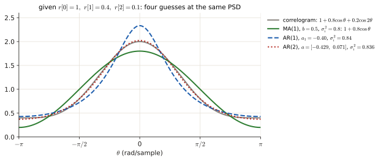
<figcaption>The whole chain on one small example, $r[0]=1,\ r[1]=0.4,\ r[2]=0.1$. The MA(1) quadratic $0.4b^2-b+0.4=0$ gives $b=0.5$ or $2$; keep $0.5$, so $\sigma_i^2=\frac{0.4}{0.5}=0.8$. Its PSD is exactly $1+0.8\cos\theta$, the correlogram cut after lag 1 (green). Check the end values: correlogram $1+0.8+0.2=2$ at $\theta=0$ and $1-0.8+0.2=0.4$ at $\pi$; AR(1) $\frac{0.84}{0.6^2}=2.33$ and $\frac{0.84}{1.4^2}=0.43$. Four different curves, because each method assumes something different about the lags you were not given.</figcaption>
</figure>

### 1.4 Reading PSD plots (the "which plot is right?" question)

<figure markdown>
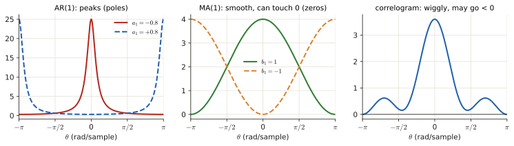
<figcaption>Horizontal axis: normalised frequency $\theta$ from $-\pi$ to $\pi$. A PSD of a real signal is symmetric, so only $0\ldots\pi$ really matters. $\theta=0$ is DC (no oscillation), $\theta=\pm\pi$ the fastest possible oscillation. AR(1) with $a_1<0$ (i.e. $x[n]=0.8x[n-1]+\dots$, a smooth slow signal) peaks at 0; $a_1>0$ peaks at $\pi$. MA spectra are smooth and can touch 0. A truncated correlogram can wiggle and even go below zero.</figcaption>
</figure>

!!! recipe "Recipe: the whole chain"
    1. **Correlogram:** $r[0]+2r[1]\cos\theta+2r[2]\cos2\theta+\dots$
    2. **AR($p$):** write the Yule–Walker matrix; solve the $a$'s from rows 2…; $\sigma_i^2$ from row 1; plug into $\sigma_i^2/\lvert A(e^{j\theta})\rvert^2$ and expand.
    3. **MA(1):** quadratic $r[1]b^2-r[0]b+r[1]=0$, keep $\lvert b\rvert<1$, $\sigma_i^2=r[1]/b$; PSD $=r[0]+2r[1]\cos\theta$.
    4. **Which plot?** Evaluate every curve at $\theta=0$ and $\theta=\pm\pi$ (where $\cos\theta=\pm1$, $\cos2\theta=1$). Remove plots where an AR/MA curve goes negative or the end values do not match. Done.
    5. **"As a function of $\cos\theta$ only":** replace $\cos2\theta=2\cos^2\theta-1$ (and $\cos3\theta=4\cos^3\theta-3\cos\theta$).

---

## 2 · How many AR coefficients? Model order selection

**The problem.** You can choose any order $p$. A bigger $p$ has more freedom, so it can follow the *recorded* data more closely: the residual error variance $\hat\sigma_p^2$ (the average squared difference between data and the model's one-step prediction) **never increases** with $p$. But beyond the true order the extra freedom is spent fitting this record's **noise**, not the signal: this is **overfitting** (spurious peaks, a spectrum that would not generalise to a new record).

**The fix: charge a penalty per parameter.** An **information criterion** adds to the error term a cost that grows with the number of parameters $P=p+1$:

$$\text{AIC}(P)=N\ln\hat\sigma_P^2+2P,\qquad \text{FPE}(P)=\frac{N+P}{N-P}\,\hat\sigma_P^2 .$$

($N$ = number of samples.) The first term of the AIC falls as the model improves, the second ($2P$) rises: pick the order with the **minimum** value. FPE does the same through the factor $\frac{N+P}{N-P}$, which grows with $P$.

<figure markdown>
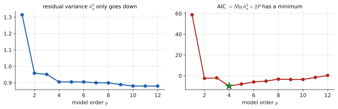
<figcaption>The residual variance (left) keeps falling with the order. The AIC (right) first falls, then rises again: its minimum is the order to use.</figcaption>
</figure>

**One more fact (asked in June 2026).** *Any* PSD can be approximated by an AR model if the order is high enough, even one with deep notches (which an MA/ARMA would describe). Reason: for a minimum-phase $B(z)$, the series $1/B(z)=1+c_1z^{-1}+c_2z^{-2}+\dots$ is an *infinite* AR model. So a notch needs a **very high AR order** (and $N\gg p$ samples to estimate it).

<figure markdown>
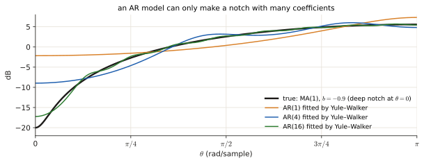
<figcaption>Black: an MA(1) spectrum with a deep notch (−20 dB at $\theta=0$). AR models fitted to its exact autocorrelation: AR(1) barely bends, AR(4) starts to dip, AR(16) follows the notch closely. AR models are built for peaks (poles); to fake a dip they need many coefficients.</figcaption>
</figure>

---

## Exam questions

### June 2026 resit · 3c, 3d {#jun26-3c}

!!! exam "Resit Q4, June 2026 · 3c (0.5 p), 3d (1 p)"
    Consider a wide-sense stationary, real-valued random process $x[n]$ whose first three autocorrelation values have been estimated as:

    $$r_x[0] = 3, \quad r_x[1] = 2, \quad r_x[2] = 1$$

    **3c** Calculate the non-parametric correlogram estimate of the power spectral density, $\hat{P}_{Corr}(e^{j\theta})$, using only the given autocorrelation lags. Assume $r_x[k] = 0$ for $|k| > 2$. Derive $\hat{P}_{Corr}(e^{j\theta})$ as a function of $\cos(\theta)$.

    **3d** You now wish to model this process parametrically using an Autoregressive (AR) model of order $p = 2$:

    $$x[n] = i[n] - a_1 x[n-1] - a_2 x[n-2]$$

    where $i[n]$ is zero-mean white noise with variance $\sigma_i^2$.

    - State the Yule-Walker equations for this AR(2) process in matrix form. [0.1]
    - Calculate the AR coefficients $a_1$ and $a_2$. [0.4]
    - Calculate the variance of the driving white noise $\sigma_i^2$. [0.2]
    - Based on your estimated parameters, write the expression for the parametric power spectral density estimate $\hat{P}_{AR}(e^{j\theta})$. Express it as a function of $\cos(\theta)$. [0.3]

???+ solution "Solution"

    **What is being asked?** 3c: transform the three lags into a PSD and write it with only $\cos\theta$. 3d: fit an AR(2) to the same lags (Yule–Walker), then write *its* PSD, again with only $\cos\theta$.

    **Symbols in this question**

    | Symbol | Meaning |
    |---|---|
    | $r_x[0],r_x[1],r_x[2]$ | the given lags $3,2,1$ |
    | $a_1,a_2$ | AR coefficients, with the **minus** convention $x[n]=i[n]-a_1x[n-1]-a_2x[n-2]$ |
    | $\sigma_i^2$ | variance of the white noise driving the model |

    **Step 1 — 3c: sum the lags** ([1.1](#11-correlogram-non-parametric-just-transform-what-you-have)): $\hat P_{corr}=3+2\cdot2\cos\theta+2\cdot1\cos2\theta=3+4\cos\theta+2\cos2\theta.$

    **Step 2 — as a function of $\cos\theta$ only.** Use $\cos2\theta=2\cos^2\theta-1$ ([Chapter 0 §0.4](p0-foundations.md#04-the-three-calculations-you-keep-meeting)): $3+4\cos\theta+2(2\cos^2\theta-1)=4\cos^2\theta+4\cos\theta+1=(2\cos\theta+1)^2.$

    **Step 3 — 3d: the Yule–Walker equations** ([1.2](#12-arp-by-yulewalker-pretend-the-signal-is-ar-and-fit-it)) with $p=2$:

    $$\begin{bmatrix}3&2&1\\2&3&2\\1&2&3\end{bmatrix}\begin{bmatrix}1\\a_1\\a_2\end{bmatrix}=\begin{bmatrix}\sigma_i^2\\0\\0\end{bmatrix}$$

    **Step 4 — the coefficients, from rows 2 and 3** (they contain no $\sigma_i^2$): row 2: $2+3a_1+2a_2=0$; row 3: $1+2a_1+3a_2=0$. Move the constants:

    $$\begin{cases}3a_1+2a_2=-2\\2a_1+3a_2=-1\end{cases}\qquad\det=3\cdot3-2\cdot2=5.$$

    Cramer's rule: $a_1=\dfrac{(-2)(3)-(2)(-1)}{5}=\dfrac{-6+2}{5}=-\dfrac45$, $\ a_2=\dfrac{(3)(-1)-(-2)(2)}{5}=\dfrac{-3+4}{5}=\dfrac15$. Check in row 2: $2+3(-0.8)+2(0.2)=2-2.4+0.4=0$ ✓.

    **Step 5 — the noise variance, from row 1:** $\sigma_i^2=3+2a_1+1\cdot a_2=3-\frac85+\frac15=\frac{15-8+1}{5}=\frac85.$

    **Step 6 — the PSD.** $\hat P_{AR}=\sigma_i^2/\lvert A\rvert^2$. Expand $\lvert A\rvert^2$ with the AR(2) formula of [1.2](#12-arp-by-yulewalker-pretend-the-signal-is-ar-and-fit-it):

    - $1+a_1^2+a_2^2=1+\frac{16}{25}+\frac1{25}=\frac{42}{25}$
    - $2(a_1+a_1a_2)=2\big(-\frac45-\frac4{25}\big)=2\cdot\big(-\frac{24}{25}\big)=-\frac{48}{25}$
    - $2a_2=\frac25$

    So $\lvert A\rvert^2=\frac{42}{25}-\frac{48}{25}\cos\theta+\frac25\cos2\theta$. Put $\cos2\theta=2\cos^2\theta-1$: $\frac{42}{25}-\frac{10}{25}-\frac{48}{25}\cos\theta+\frac{20}{25}\cos^2\theta=\frac4{25}\big(5\cos^2\theta-12\cos\theta+8\big)$. Then

    $$\hat P_{AR}=\frac{8/5}{\frac4{25}(5\cos^2\theta-12\cos\theta+8)}=\frac{8}{5}\cdot\frac{25}{4}\cdot\frac1{(\dots)}=\frac{10}{5\cos^2\theta-12\cos\theta+8}.$$

    **Sanity check.** At $\theta=0$: $\hat P_{AR}=\frac{10}{5-12+8}=10$, $\hat P_{corr}=9$. At $\theta=\pi$: $\frac{10}{5+12+8}=0.4$ and $\hat P_{corr}=(-2+1)^2=1$. Both are low-pass (big at 0, small at $\pi$), as expected from positive, slowly decaying $r$.

    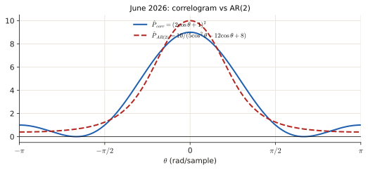

    !!! answer "Answer"
        3c: $\hat P_{corr}=3+4\cos\theta+2\cos2\theta=(2\cos\theta+1)^2$.
        3d: $a_1=-\frac45$, $a_2=\frac15$, $\sigma_i^2=\frac85$, $\hat P_{AR}=\dfrac{10}{5\cos^2\theta-12\cos\theta+8}$.

### June 2026 resit · 3e {#jun26-3e}

!!! exam "Resit Q4, June 2026 · 3e · 0.75 p"
    You are given a finite data record of length $N$ and you decide to estimate its power spectral density by fitting an Autoregressive (AR) model of order $p$.

    1. Suppose you evaluate the quality of your fitted model by strictly looking at the variance of the residual error (the difference between the data and the prediction). As you increase the model order $p$, what will happen to this residual error, and what is the primary risk of choosing an excessively high order $p$? [0.25]
    2. Name at least one specific model selection criteria discussed in the course that are designed to prevent the issue identified in question 1. Briefly explain the mathematical mechanism it uses to do so. [0.25]
    3. It is a known property that any arbitrary power spectrum (even one originating from an MA process containing deep spectral nulls) can be approximated using strictly an AR model. What is required to achieve this? [0.25]

???+ solution "Solution"

    **What is being asked?** Three short theory answers, all from [section 2](#2-how-many-ar-coefficients-model-order-selection).

    **Step 1 — (1).** More parameters can only fit the recorded data better, so the residual variance $\hat\sigma_p^2$ **keeps decreasing** and never goes up. The risk is **overfitting**: the model starts fitting the noise of this particular record, giving spurious peaks and a spectrum that does not generalise.

    **Step 2 — (2).** **Akaike's information criterion** $\text{AIC}(P)=N\ln\hat\sigma_P^2+2P$ (or the **final prediction error** $\text{FPE}(P)=\frac{N+P}{N-P}\hat\sigma_P^2$, or AICc), with $P=p+1$ parameters. The first term falls as the fit improves; the **penalty** $2P$ grows with the number of parameters. Choose the order with the **minimum** criterion.

    **Step 3 — (3).** A **sufficiently high AR order** (in theory $p\to\infty$): for a minimum-phase $B(z)$, $1/B(z)$ expands into an infinite series, i.e. an MA is an infinite-order AR. In practice: a high $p$ **and** enough data ($N\gg p$) to estimate it.

    !!! answer "Answer"
        1. Decreases monotonically; risk = overfitting (fitting noise, spurious peaks). 2. AIC $=N\ln\hat\sigma^2+2P$ (or FPE/AICc): error term + complexity penalty, choose the minimum. 3. A high enough AR order (AR(∞) in theory).

### April 2025 exam · 3d, 3e, 3f, 3g {#apr25-3d}

!!! exam "Final exam Q3, 13 April 2025 · 3d (0.5 p), 3e (0.5 p), 3f (0.5 p), 3g (0.25 p)"
    Suppose you have an estimate of the autocorrelation function of a random signal at lags $0, \pm 1, \pm 2$ as: $r[0] = 2, \quad r[\pm 1] = -\frac{1}{4}, \quad r[\pm 2] = -\frac{3}{16}$

    **3d** Use the correlogram method to calculate the power spectral density in a non-parametric fashion. Express the obtained power spectral density $P_{corr}(e^{j\theta})$ as a function of cosines.

    **3e** Model the signal as an AR(1) process, find the parameters of the model, and calculate the corresponding power spectral density in a parametric fashion. Express the obtained power spectral density $P_{AR}(e^{j\theta})$ as a function of cosines.

    **3f** Model the signal as an MA(1) process, find the parameters of the model, and calculate the corresponding power spectral density in a parametric fashion. Express the obtained power spectral density $P_{MA}(e^{j\theta})$ as a function of cosines.

    **3g** Given the plots in the figure below, which option represents the correct power spectral densities, as found in 3d, 3e, and 3f?

    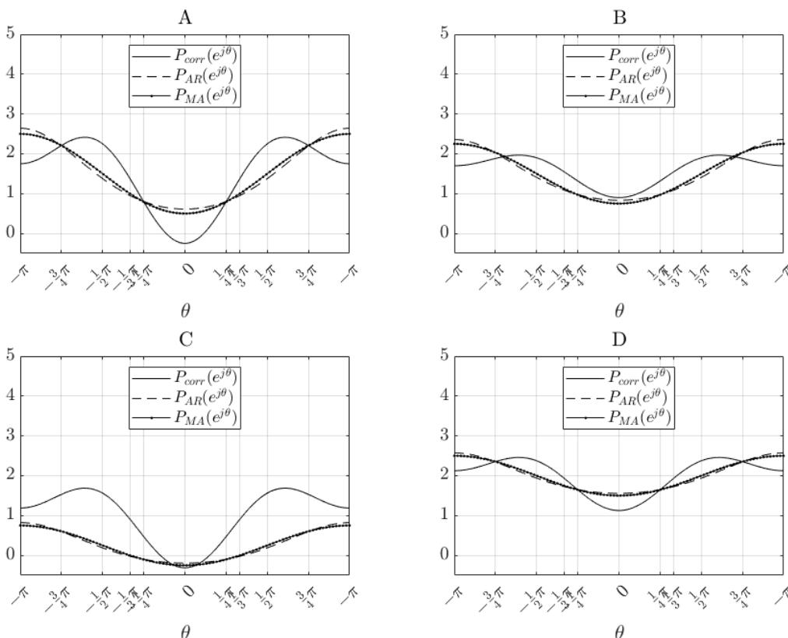

    - (a) Plot D
    - (b) Plot C
    - (c) Plot B
    - (d) Plot A

???+ solution "Solution"

    **What is being asked?** The full chain on $r=[2,-\frac14,-\frac3{16}]$: correlogram (3d), AR(1) (3e), MA(1) (3f), then pick the picture that contains all three curves (3g).

    **Symbols in this question.** $r[0]=2$, $r[1]=-\frac14$, $r[2]=-\frac3{16}$; $a_1,\sigma_i^2$ for the AR(1) model; $b,\sigma_i^2$ for the MA(1) model.

    **Step 1 — 3d: correlogram** ([1.1](#11-correlogram-non-parametric-just-transform-what-you-have)):

    $$P_{corr}=2+2\left(-\tfrac14\right)\cos\theta+2\left(-\tfrac3{16}\right)\cos2\theta=2-\tfrac12\cos\theta-\tfrac38\cos2\theta.$$

    **Step 2 — 3e: AR(1).** Yule–Walker with $p=1$: $\begin{bmatrix}2&-\frac14\\-\frac14&2\end{bmatrix}\begin{bmatrix}1\\a_1\end{bmatrix}=\begin{bmatrix}\sigma_i^2\\0\end{bmatrix}$. Row 2: $-\frac14+2a_1=0\Rightarrow a_1=\frac18$. Row 1: $\sigma_i^2=2+a_1r[1]=2-\frac14\cdot\frac18=2-\frac1{32}=\frac{63}{32}$.

    **Step 3 — the AR(1) PSD.** $\lvert1+a_1e^{-j\theta}\rvert^2=1+\frac1{64}+\frac14\cos\theta=\frac{65+16\cos\theta}{64}$, so

    $$P_{AR}=\frac{63/32}{(65+16\cos\theta)/64}=\frac{63\cdot64}{32\,(65+16\cos\theta)}=\frac{126}{65+16\cos\theta}.$$

    **Step 4 — 3f: MA(1)** ([1.3](#13-ma1-pretend-the-signal-is-a-one-memory-step-moving-average)). $\sigma_i^2(1+b^2)=2$ and $\sigma_i^2b=-\frac14$. Dividing: $\frac b{1+b^2}=-\frac18\Rightarrow b^2+8b+1=0\Rightarrow b=\frac{-8\pm\sqrt{64-4}}2=-4\pm\sqrt{15}$. Numerically $-4+3.873=-0.127$ or $-7.873$. **Keep $b=-4+\sqrt{15}\approx-0.127$** ($\lvert b\rvert<1$). Then $\sigma_i^2=\frac{-1/4}{-0.127}\approx1.968$.

    **Step 5 — the MA(1) PSD, by the shortcut** (it is the correlogram cut at lag 1): $P_{MA}=r[0]+2r[1]\cos\theta=2-0.5\cos\theta$. (Check: $1.968\,(1+0.0161-0.254\cos\theta)=2-0.5\cos\theta$ ✓.)

    **Step 6 — 3g: pick the plot.** Evaluate at the two ends:

    | | $\theta=0$ | $\theta=\pm\pi$ |
    |---|---|---|
    | $P_{corr}$ | $2-0.5-0.375=1.125$ | $2+0.5-0.375=2.125$ |
    | $P_{AR}$ | $126/81=1.56$ | $126/49=2.57$ |
    | $P_{MA}$ | $1.5$ | $2.5$ |

    Plot A has $P_{corr}<0$ at 0 and C has an AR/MA curve negative → out (a PSD cannot be negative). B has everything ≈ 0.8–0.9 at 0 → out. **D** matches: corr ≈ 1.1 at 0 and ≈ 2.1 at ±π, AR and MA almost on top of each other going from ≈ 1.5 to ≈ 2.5.

    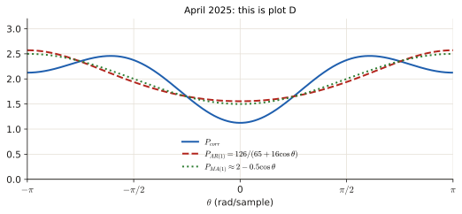

    !!! answer "Answer"
        3d: $2-\frac12\cos\theta-\frac38\cos2\theta$. 3e: $a_1=\frac18$, $\sigma_i^2=\frac{63}{32}$, $P_{AR}=\frac{126}{65+16\cos\theta}$. 3f: $b_1\approx-0.13$, $\sigma_i^2\approx1.97$, $P_{MA}\approx2-0.5\cos\theta$. 3g: **(a) Plot D**.

### April 2024 exam · 3d, 3e, 3f {#apr24-3d}

!!! exam "Final exam Q3, April 2024 · 3d (0.4 p), 3e (0.7 p), 3f (0.4 p)"
    *(Signal from [3b/3c](p3-autocorr.md#apr24-3b): $x[n]=i[n]-\frac12i[n-1]+\frac14i[n-2]-\frac12i[n-3]$, so $r[0]=\frac{25}{16}$, $r[\pm1]=-\frac34$, $r[\pm2]=\frac12$, $r[\pm3]=-\frac12$.)*

    **3d** Using the correlogram method, give an estimate of the power spectral density. Express it as a function of cosines.

    **3e** Now model the signal as AR(2) process. Find the model parameters and the power spectral density,

    **3f** Which of the following figures gives the correct plots for $P_{corr}(e^{j\theta})$ (calculated in d) and of $P_{AR}(e^{j\theta})$ (calculated in e) ? If you cannot find the correct answer, please sketch $P_{corr}(e^{j\theta})$ and $P_{AR}(e^{j\theta})$ in the plot below.

    

    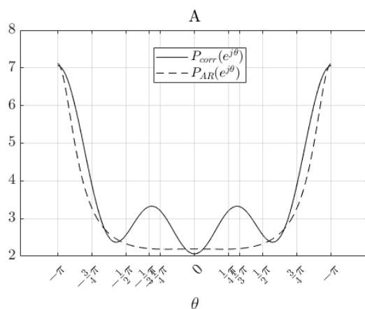
    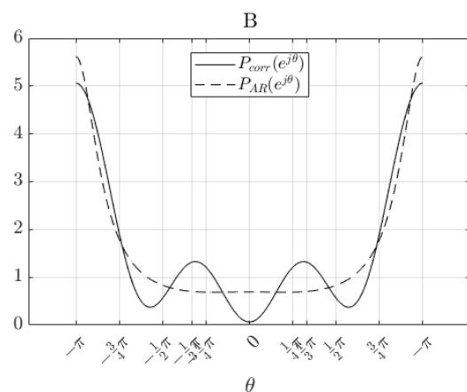
    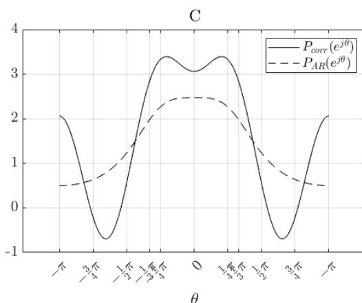
    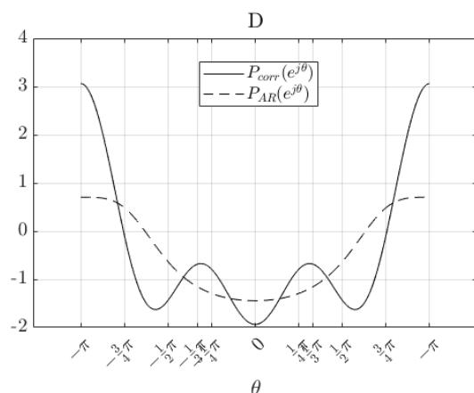
    

    (a) C  (b) A  (c) B  (d) D

???+ solution "Solution"

    **What is being asked?** Correlogram of four lags (3d), AR(2) fit (3e), and which picture shows both curves (3f).

    **Step 1 — 3d.** $P_{corr}=r[0]+2r[1]\cos\theta+2r[2]\cos2\theta+2r[3]\cos3\theta=\frac{25}{16}-\frac32\cos\theta+\cos2\theta-\cos3\theta.$ Because this is an MA(3), its autocorrelation really is 0 beyond lag 3, so this is also the **true** PSD.

    **Step 2 — 3e: Yule–Walker rows 2 and 3** (AR(2)): $r[1]+a_1r[0]+a_2r[1]=0$ and $r[2]+a_1r[1]+a_2r[0]=0$:

    $$\begin{cases}\frac{25}{16}a_1-\frac34a_2=\frac34\\-\frac34a_1+\frac{25}{16}a_2=-\frac12\end{cases}\xrightarrow{\ \times16\ }\begin{cases}25a_1-12a_2=12\\-12a_1+25a_2=-8\end{cases}\qquad\det=625-144=481.$$

    $$a_1=\frac{12\cdot25-(-12)(-8)}{481}=\frac{300-96}{481}=\frac{204}{481}\approx0.424,\qquad a_2=\frac{25(-8)-(-12)(12)}{481}=\frac{-200+144}{481}=-\frac{56}{481}\approx-0.116.$$

    **Step 3 — noise variance** (row 1): $\sigma_i^2=r[0]+a_1r[1]+a_2r[2]=1.5625-0.75(0.424)+0.5(-0.116)=1.5625-0.318-0.058\approx1.186.$

    **Step 4 — AR(2) PSD.** $\lvert A\rvert^2=1+a_1^2+a_2^2+2(a_1+a_1a_2)\cos\theta+2a_2\cos2\theta=1.193+0.750\cos\theta-0.233\cos2\theta$, so $P_{AR}\approx\dfrac{1.186}{1.193+0.750\cos\theta-0.233\cos2\theta}$.

    **Step 5 — 3f: pick the plot** (evaluate at the ends):

    | | $\theta=0$ | $\theta=\pm\pi$ |
    |---|---|---|
    | $P_{corr}$ | $\frac{25}{16}-\frac32+1-1=0.06$ | $\frac{25}{16}+\frac32+1+1=5.06$ |
    | $P_{AR}$ | $1.186/1.710=0.69$ | $1.186/0.211=5.6$ |

    A: corr ≈ 2 at 0 and ≈ 7 at π → no. C: peak at 0 → wrong shape. D: the AR curve goes **negative**, impossible. **B** matches: corr ≈ 0 at 0 and ≈ 5 at π; AR ≈ 0.7 and ≈ 5.6.

    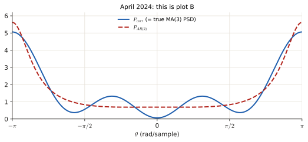

    !!! answer "Answer"
        3d: $\frac{25}{16}-\frac32\cos\theta+\cos2\theta-\cos3\theta$. 3e: $a_1=\frac{204}{481}$, $a_2=-\frac{56}{481}$, $\sigma_i^2\approx1.19$. 3f: **(c) plot B**.

### November 2022 exam · 3f, 3g {#nov22-3f}

!!! exam "Final exam Q1, 7 November 2022 · 3f (0.75 p), 3g (0.75 p)"
    *(Process from [3c–3e](p3-autocorr.md#nov22-3c): ARMA(1,1) with $r[0]=1$, $r[l]=-\frac18(\frac34)^{|l|-1}$.)*

    **3f** Try to model $x[k]$ as a AR(1) signal and calculate the corresponding power spectral density $P_{AR1}(e^{j\theta})$.

    **3g** Try to model $x[k]$ as a MA(1) signal and calculate the corresponding power spectral density $P_{MA1}(e^{j\theta})$. You can approximate the model parameters and the resulting PSD expression by using decimal numbers.

???+ solution "Solution"

    **What is being asked?** The true process is ARMA(1,1), but you must approximate it by the *simpler* AR(1) and MA(1) models, using only $r[0]=1$ and $r[1]=-\frac18$ (an AR(1) / MA(1) fit only needs lags 0 and 1).

    **Step 1 — 3f: AR(1)** ([1.2](#12-arp-by-yulewalker-pretend-the-signal-is-ar-and-fit-it)): $a_1=-\frac{r[1]}{r[0]}=\frac18$, $\sigma_i^2=r[0]+a_1r[1]=1-\frac1{64}=\frac{63}{64}$.

    **Step 2 — the PSD:** $\lvert1+\frac18e^{-j\theta}\rvert^2=1+\frac1{64}+\frac14\cos\theta=\frac{65+16\cos\theta}{64}$, so $P_{AR1}=\dfrac{63/64}{(65+16\cos\theta)/64}=\dfrac{63}{65+16\cos\theta}$.

    **Step 3 — 3g: MA(1)** ([1.3](#13-ma1-pretend-the-signal-is-a-one-memory-step-moving-average)): $\frac b{1+b^2}=-\frac18\Rightarrow b^2+8b+1=0\Rightarrow b=-4+\sqrt{15}\approx-0.13$ (keep $\lvert b\rvert<1$); $\sigma_i^2=\frac{r[1]}b=\frac{-0.125}{-0.127}\approx0.98$.

    **Step 4 — the PSD**, by the shortcut: $P_{MA1}=r[0]+2r[1]\cos\theta=1-0.25\cos\theta$.

    **Extra question from the review:** with 3 lags ($r[\pm2]=-\frac3{32}$) the correlogram is $1-\frac14\cos\theta-\frac3{16}\cos2\theta$.

    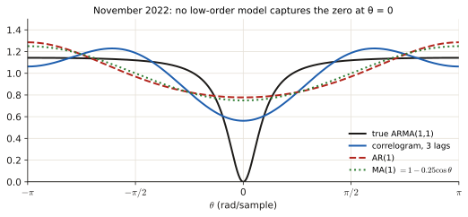

    The true PSD is exactly 0 at $\theta=0$ (zero on the unit circle, [3.3](p3-autocorr.md#nov22-3c)). None of the low-order estimates can reproduce that deep notch: AR models can only make peaks, and MA(1)/correlogram with 2–3 lags are too smooth. (To get a notch from an AR you need a very high order, [section 2](#2-how-many-ar-coefficients-model-order-selection).)

    !!! answer "Answer"
        3f: $a_1=\frac18$, $\sigma_i^2=\frac{63}{64}$, $P_{AR1}=\frac{63}{65+16\cos\theta}$. 3g: $b_1\approx-0.13$, $\sigma_i^2\approx0.98$, $P_{MA1}\approx1-0.25\cos\theta$.

### January 2022 resit · 3c, 3d {#jan22-3c}

!!! exam "Resit, 24 January 2022 · 3c (1 p), 3d (1 p)"
    *(MA(2) process from [3b](p3-autocorr.md#jan22-3b): $x[n]=i[n]+ai[n-1]+bi[n-2]$, unit variance, $r[\pm1]=-\frac{15}{16}$, $r[\pm2]=\frac14$.)*

    **3c** Calculate the power spectral density of $x[n]$ using the correlogram method. If you were not able to solve question 3b, you may use the following parameters $a = \frac{1}{4}$ and $b = \frac{5}{4}$ for $x[n]$. Please express the power spectral density as a function of $\cos(\theta)$. **Hint:** The autocorrelation of a MA process is of finite length.

    **3d** Now assume that $x[n]$ can be modeled as generated by an AR(1) process. Find the AR model parameters and the power spectral density of the AR(1) process (expressed as a function of $\cos(\theta)$). If you were not able to solve question 3b, you may use the following parameters $a = \frac{1}{4}$ and $b = \frac{5}{4}$ for $x[n]$. **Hint:** Some parameters may results in fractions with large numbers.

???+ solution "Solution"

    **What is being asked?** 3c: correlogram of the MA(2) (we know $r[\pm1],r[\pm2]$; $r[0]$ is missing, compute it). 3d: AR(1) fit with large fractions.

    **Step 1 — the missing lag.** From the sliding formula ([3.3 §3.1](p3-autocorr.md#31-maq-slide-the-coefficient-list-over-itself)), $r[0]=1+a^2+b^2=1+\frac9{16}+\frac1{16}=\frac{16+9+1}{16}=\frac{26}{16}=\frac{13}8$ (with $a=-\frac34$, $b=\frac14$ from 3b).

    **Step 2 — 3c.** An MA(2) has $r[l]=0$ beyond lag 2, so the correlogram is exact: $P=\frac{13}8+2\big(-\frac{15}{16}\big)\cos\theta+2\cdot\frac14\cos2\theta=\frac{13}8-\frac{15}8\cos\theta+\frac12\cos2\theta.$

    **Step 3 — 3d: the AR(1) coefficient.** $a_1=-\frac{r[1]}{r[0]}=\frac{15/16}{13/8}=\frac{15}{16}\cdot\frac8{13}=\frac{15}{26}$, and $\sigma_i^2=r[0]+a_1r[1]=\frac{13}8-\frac{15}{26}\cdot\frac{15}{16}=\frac{13}8-\frac{225}{416}=\frac{676-225}{416}=\frac{451}{416}\approx1.084$.

    **Step 4 — the PSD.** $\lvert1+a_1e^{-j\theta}\rvert^2=1+\frac{225}{676}+\frac{15}{13}\cos\theta=\frac{901}{676}+\frac{15}{13}\cos\theta$. To clear the fractions multiply numerator and denominator by $5408$ ($=8\cdot676=13\cdot416$, which cancels $676$, $13$ and $416$ at once):

    - numerator: $\frac{451}{416}\cdot5408=451\cdot13=5863$
    - denominator: $\frac{901}{676}\cdot5408=901\cdot8=7208$ and $\frac{15}{13}\cdot5408=15\cdot416=6240$

    $$P_{AR}=\frac{451/416}{\frac{901}{676}+\frac{15}{13}\cos\theta}=\frac{5863}{7208+6240\cos\theta}.$$

    Check at $\theta=0$: $\frac{5863}{7208+6240}=\frac{5863}{13448}=0.436$, and directly $\frac{1.084}{1.333+1.154}=0.436$ ✓.

    (With the fallback values $a=\frac14$, $b=\frac54$: $r=[\frac{21}8,\frac9{16},\frac54]$, $P_{corr}=\frac{21}8+\frac98\cos\theta+\frac52\cos2\theta$, $a_1=-\frac3{14}$, $\sigma_i^2=\frac{561}{224}$, $P_{AR}=\frac{3927}{1640-672\cos\theta}$.)

    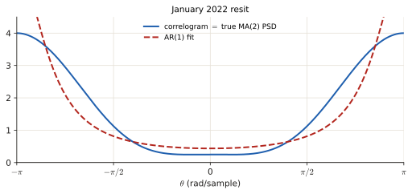

    !!! answer "Answer"
        3c: $\frac{13}8-\frac{15}8\cos\theta+\frac12\cos2\theta$. 3d: $a_1=\frac{15}{26}$, $\sigma_i^2=\frac{451}{416}$, $P_{AR}=\dfrac{5863}{7208+6240\cos\theta}$.

### Practice exam 2021 · 3b, 3c {#pe21-3b}

!!! exam "Practice exam, 28 October 2021 · 3b (0.75 p), 3c (0.5 p)"
    *(Signal from [3a](p3-autocorr.md#pe21-3a): $\rho[0]=\frac{28}{27}$, $\rho[1]=-\frac4{27}$, $\rho[\tau]=(\frac12)^{|\tau|-1}\rho[1]$.)*

    **3b** Now suppose you model the random signal as generated by a AR(1) process. 1. Find the AR model parameters. 2. Obtain the power spectral density function $P_{AR1}(e^{j\theta})$ from the AR(1) model and provide a sketch.

    **3c** Now suppose that you approximate the random signal as generated by a MA(1) process. 1. use the correlogram method to calculate the power spectral density $P_{\text{corrMA1}}(e^{j\theta})$ from the autocorrelation function calculated in 3a. **There is no need to calculate the MA model parameters.** 2. Provide a sketch of the $P_{\text{corrMA1}}(e^{j\theta})$. You may draw this sketch on top of the plot obtained in 3b. **Hint:** For an MA process, the number of autocorrelation lags different than zero is finite and related to the order of the MA process.

???+ solution "Solution"

    **What is being asked?** 3b: fit AR(1) to lags 0 and 1, give its PSD and a sketch. 3c: the MA(1) PSD, which is just the correlogram cut at lag 1 (that is why "no need to calculate the MA parameters": the shortcut of [1.3](#13-ma1-pretend-the-signal-is-a-one-memory-step-moving-average)).

    **Step 1 — 3b: parameters.** $a_1=-\frac{\rho[1]}{\rho[0]}=\frac{4/27}{28/27}=\frac17$; $\sigma_i^2=\rho[0]+a_1\rho[1]=\frac{28}{27}-\frac17\cdot\frac4{27}=\frac{196-4}{189}=\frac{192}{189}=\frac{64}{63}$.

    **Step 2 — the PSD:** $\lvert1+\frac17e^{-j\theta}\rvert^2=1+\frac1{49}+\frac27\cos\theta=\frac{50}{49}+\frac27\cos\theta$. Multiplying numerator and denominator by $\frac72$: $P_{AR1}=\dfrac{\frac{64}{63}\cdot\frac72}{\frac{25}7+\cos\theta}=\dfrac{32/9}{25/7+\cos\theta}$.

    **Step 3 — sketch values:** $\theta=0$: $\frac{3.556}{4.571}=0.78$; $\theta=\pm\frac\pi2$ ($\cos=0$): $\frac{3.556}{3.571}=1.00$; $\theta=\pm\pi$: $\frac{3.556}{2.571}=1.38$. A gentle high-pass curve (small at 0, larger at $\pi$).

    **Step 4 — 3c.** MA(1) means only lags $0,\pm1$ are non-zero: $P_{corr,MA1}=\rho[0]+2\rho[1]\cos\theta=\frac{28}{27}-\frac{8}{27}\cos\theta$, i.e. $0.74$ at 0, $1.04$ at $\pm\frac\pi2$, $1.33$ at $\pm\pi$: almost on top of the AR(1) curve.

    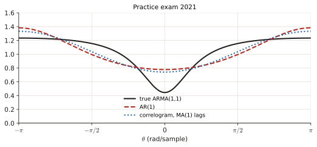

    !!! answer "Answer"
        3b: $a_1=\frac17$, $\sigma_i^2=\frac{64}{63}$, $P_{AR1}=\dfrac{32/9}{25/7+\cos\theta}$. 3c: $P=\frac{28}{27}-\frac8{27}\cos\theta$.

### January 2020 retake · Exercise 3 {#jan20-3}

!!! exam "Retake exam, 20 January 2020 · Exercise 3 · 0.8 p + 1.2 p"
    Let $x[n]$ be a random process whose auto-correlation is given by

    $$r_x[l] = \begin{cases} 1/21 & l = 0 \\ 2/105 & l = \pm 1 \\ 0 & \text{else} \end{cases}$$

    - (a) Determine and plot the correlogram power spectrum estimate. [0.8 pt]
    - (b) Assume that $x[n]$ can be modeled by an MA(1) random process. Determine and plot its spectrum estimate. How does this relate to the spectrum estimate obtained in 3(a)? Motivate your answer. [1.2 pt]

???+ solution "Solution"

    **What is being asked?** (a) the correlogram. (b) fit an MA(1) and compare: the interesting part is the comparison.

    **Step 1 — (a).** $P_{corr}=\frac1{21}+2\cdot\frac2{105}\cos\theta=\frac1{21}+\frac4{105}\cos\theta$. At $\theta=0$: $\frac5{105}+\frac4{105}=\frac9{105}\approx0.086$; at $\pm\pi$: $\frac5{105}-\frac4{105}=\frac1{105}\approx0.0095$ (low-pass).

    **Step 2 — (b): the quadratic.** $\frac b{1+b^2}=\frac{r[1]}{r[0]}=\frac{2/105}{1/21}=\frac{2}{105}\cdot21=\frac25\Rightarrow5b=2+2b^2\Rightarrow2b^2-5b+2=0\Rightarrow b=\frac{5\pm\sqrt{25-16}}{4}=\frac{5\pm3}4=2\text{ or }\frac12.$ Keep $b=\frac12$ ($\lvert b\rvert<1$). $\sigma_i^2=\frac{r[1]}{b}=\frac{2/105}{1/2}=\frac4{105}$.

    **Step 3 — its PSD.** $\frac4{105}\lvert1+\frac12e^{-j\theta}\rvert^2=\frac4{105}\big(\frac54+\cos\theta\big)=\frac5{105}+\frac4{105}\cos\theta=\frac1{21}+\frac4{105}\cos\theta.$

    **Step 4 — the comparison.** Identical curves. The given autocorrelation is zero beyond lag 1, which is exactly the structure of an MA(1); the fitted MA(1) reproduces $r[0]$ and $r[1]$ exactly, so it has *the same* autocorrelation and therefore the same PSD.

    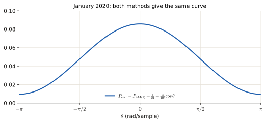

    !!! answer "Answer"
        (a) $\frac1{21}+\frac4{105}\cos\theta$. (b) $b=\frac12$, $\sigma_i^2=\frac4{105}$, identical PSD (the given $r$ is exactly an MA(1) autocorrelation).

### November 2019 exam · Exercise 2 {#nov19-2}

!!! exam "Written exam, 4 November 2019 · Exercise 2 · 1 p + 1 p"
    Let $x[n]$ be a random process whose correlation is estimated. The values for the first five lags are $r_x[0] = 1$, $r_x[\pm 1] = 0.7$, $r_x[\pm 2] = 0.5$, $r_x[\pm 3] = 0.3$, and $r_x[\pm 4] = 0$.

    - (a) Determine and plot the correlogram power spectrum estimate. [1 pt.]
    - (b) Assume that $x[n]$ is modeled by an AR(2) model. Determine and plot its spectrum estimate. [1 pt.]

???+ solution "Solution"

    **What is being asked?** Correlogram of lags 0–3 ($r[4]=0$ adds nothing) and an AR(2) fit.

    **Step 1 — (a).** $P_{cor}=1+2(0.7)\cos\theta+2(0.5)\cos2\theta+2(0.3)\cos3\theta=1+1.4\cos\theta+\cos2\theta+0.6\cos3\theta$. At $\theta=0$: $1+1.4+1+0.6=4.0$.

    **Step 2 — (b): Yule–Walker rows 2, 3** with $r=[1,0.7,0.5]$: $0.7+a_1+0.7a_2=0$ and $0.5+0.7a_1+a_2=0$, i.e.

    $$\begin{cases}a_1+0.7a_2=-0.7\\0.7a_1+a_2=-0.5\end{cases}\qquad\det=1-0.49=0.51.$$

    $a_1=\dfrac{(-0.7)(1)-(0.7)(-0.5)}{0.51}=\dfrac{-0.7+0.35}{0.51}=-0.686$, $\ a_2=\dfrac{(1)(-0.5)-(0.7)(-0.7)}{0.51}=\dfrac{-0.5+0.49}{0.51}=-0.0196$.

    **Step 3 — noise variance:** $\sigma_i^2=1+0.7a_1+0.5a_2=1-0.4804-0.0098=0.5098.$

    **Step 4 — the PSD:** $P_{AR2}=\dfrac{0.5098}{\lvert1-0.686e^{-j\theta}-0.0196e^{-j2\theta}\rvert^2}$; at $\theta=0$ the denominator is $(1-0.686-0.0196)^2=0.294^2$, so $P_{AR2}(0)=\frac{0.5098}{0.0864}\approx5.9$.

    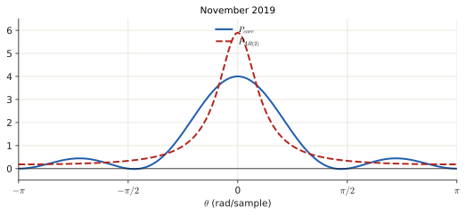

    !!! answer "Answer"
        (a) $1+1.4\cos\theta+\cos2\theta+0.6\cos3\theta$. (b) $a_1=-0.686$, $a_2=-0.0196$, $\sigma_i^2=0.510$ (the key prints 0.5089, a typo).

### January 2019 retake · Exercise 4 (Wiener filter) {#jan19-4}

!!! exam "Written exam, 21 January 2019 · Exercise 4 · 1.25 p + 1.25 p"
    In this exercise you need to design an optimal FIR Wiener filter with two coefficients $w_0$ and $w_1$ for the situation depicted in Figure 1, for which the following relationship holds $\hat{e}[k] = w[k] * h[k] * x[k] = w[k] * g[k]$.

    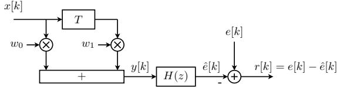

    The measured signal is AR(1) and can be described by the following difference equation: $x[k] = i[k] + \frac{1}{2}x[k-1]$. The innovation signal $i[k]$ is a white noise sequence with zero mean and variance $E\{i^2[k]\} = \sigma_i^2 = \frac{1}{4}$. The reference signal $e[k]$ has zero mean and variance $E\{e^2[k]\} = \sigma_e^2 = \frac{7}{3}$. This reference signal is correlated with the measured signal $x[k]$, which is expressed by the cross correlation $E\{e[k]x[k-\tau]\} = \rho_{ex}[\tau]$ from which we know the following values: $\rho_{ex}[0] = \frac{2}{3}$, $\rho_{ex}[1] = \frac{5}{6}$ and $\rho_{ex}[2] = \frac{5}{12}$.

    (a) Now we have $H(z) = 1$. Calculate the optimal coefficients $w_0$ en $w_1$ and the minimal error $J_{min}$. [1.25 pt.]

    (b) Now we have $H(z) = 1 - 2z^{-1}$. Do the same as in (a). Note that now $\hat{e}[k] = w[k] * h[k] * x[k] = w[k] * g[k]$, and the input-output cross correlation is $\rho_{eg}[\tau] = E\{e[k]g[k-\tau]\}$ [1.25 pt.]

???+ solution "Solution"

    **What is being asked?** Build the best 2-tap weighted sum of the filter input that imitates the reference signal $e[k]$ (best = smallest average squared error $J$). This is old material (2019); the reader now treats Wiener filtering as beyond scope except as the AR predictor, so only study it if you have time.

    **Where the equations come from.** The filter output is $\hat e[k]=w_0g[k]+w_1g[k-1]$ ($g$ = the filter's input; $g=x$ when $H=1$). The error is $J(\mathbf w)=\mathbb E\{(e-\hat e)^2\}=\sigma_e^2-2\mathbf w^T\boldsymbol\rho+\mathbf w^T\mathbf R\mathbf w$, with $\mathbf R$ the autocorrelation matrix of $g$ and $\boldsymbol\rho=[\rho_{eg}[0],\rho_{eg}[1]]^T$ the cross-correlation with $e$. Setting the derivative to zero, $-2\boldsymbol\rho+2\mathbf R\mathbf w=0$, gives the **normal equations** $\mathbf R\mathbf w=\boldsymbol\rho$, and putting that back gives $J_{min}=\sigma_e^2-\mathbf w^T\boldsymbol\rho$.

    **Step 1 — autocorrelation of $x$.** AR(1) with $a=-\frac12$: $r_x[0]=\frac{\sigma_i^2}{1-a^2}=\frac{1/4}{3/4}=\frac13$, $r_x[1]=-a\,r_x[0]=\frac16$, $r_x[2]=\frac1{12}$ ([3.3 §3.2](p3-autocorr.md#32-ar1-a-geometric-tail)).

    **Step 2 — (a), normal equations.** $\begin{bmatrix}\frac13&\frac16\\\frac16&\frac13\end{bmatrix}\begin{bmatrix}w_0\\w_1\end{bmatrix}=\begin{bmatrix}\frac23\\\frac56\end{bmatrix}$. Multiply by 6: $\begin{cases}2w_0+w_1=4\\w_0+2w_1=5\end{cases}$ → $w_0=\frac{2\cdot4-5}{3}=1$, $w_1=\frac{2\cdot5-4}{3}=2$. $\ J_{min}=\frac73-\big(1\cdot\frac23+2\cdot\frac56\big)=\frac73-\frac73=0$.

    **Step 3 — (b), the filtered input** $g[k]=x[k]-2x[k-1]$ (that is $H(z)=1-2z^{-1}$). Its autocorrelation: $r_g[l]=\mathbb E\{(x[k]-2x[k-1])(x[k-l]-2x[k-l-1])\}=5r_x[l]-2r_x[l+1]-2r_x[l-1]$. So $r_g[0]=\frac53-\frac26-\frac26=1$, and $r_g[1]=\frac56-\frac2{12}-\frac23=\frac{10-2-8}{12}=0$. The cross-correlation: $\rho_{eg}[\tau]=\rho_{ex}[\tau]-2\rho_{ex}[\tau+1]$, so $\rho_{eg}[0]=\frac23-\frac{10}6=-1$ and $\rho_{eg}[1]=\frac56-\frac{10}{12}=0$.

    **Step 4 — solve.** $\begin{bmatrix}1&0\\0&1\end{bmatrix}\mathbf w=\begin{bmatrix}-1\\0\end{bmatrix}\Rightarrow w_0=-1$, $w_1=0$; $J_{min}=\frac73-(-1)(-1)=\frac43$.

    !!! answer "Answer"
        (a) $w_0=1$, $w_1=2$, $J_{min}=0$. (b) $w_0=-1$, $w_1=0$, $J_{min}=\frac43$.

*[Yule–Walker]: the linear equations that tie the AR coefficients to the autocorrelation lags, obtained by multiplying the AR equation by x[n−l] and taking expectations.
*[minimum phase]: the choice of the root with magnitude below 1 (here: |b| < 1) so that the model is stable and invertible.
*[overfitting]: a model so flexible that it fits the noise of this particular record instead of the signal.
*[AIC]: Akaike information criterion: N ln σ² + 2P; error term plus a penalty per parameter; choose the minimum.
*[FPE]: final prediction error: (N+P)/(N−P) σ²; another order-selection criterion.
*[residual]: the difference between the data and what the model predicts for it.
*[normal equations]: R w = ρ: the linear equations whose solution minimises the squared error of a Wiener filter.
