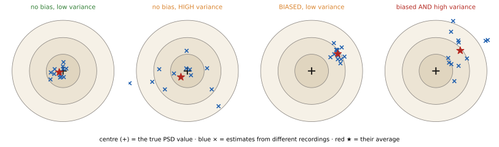
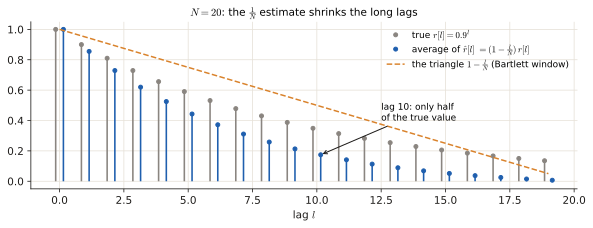
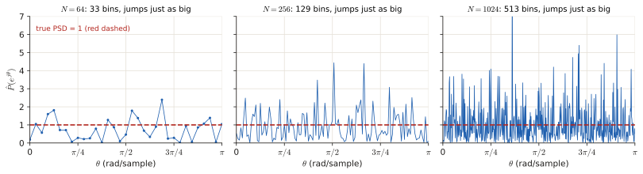
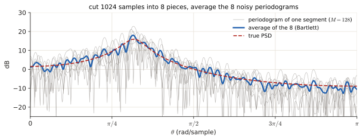
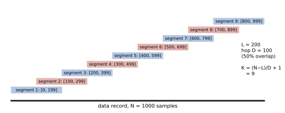
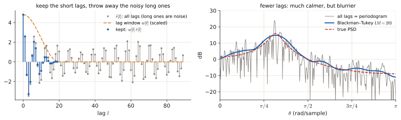
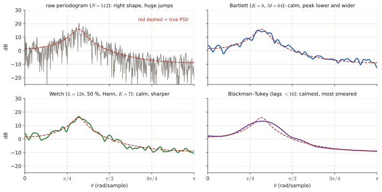

# 3.2 Non-parametric estimators: periodogram, correlogram, Bartlett, Welch, Blackman–Tukey

Every exam has at least one theory question here, usually a multiple choice or a "match the statement to the method" table. It all comes down to one idea and one table. The idea: <b>you only have a short noisy recording, so every spectrum you compute is a <i>guess</i></b>, and a guess can be wrong in two different ways (<i>bias</i> and <i>variance</i>). The table: what each method does to those two things. This page builds both from nothing.

!!! need "Before this page"
    - What a signal and a sample are, $x[n]$ ([0.1](p0-foundations.md#01-what-a-signal-is))
    - What a spectrum, the FTD, the DFT and a bin are ([0.5](p0-foundations.md#05-spectrum-what-a-fourier-transform-tells-you))
    - Random variable, mean, variance ([0.6](p0-foundations.md#06-probability-from-zero))
    - Random signal, autocorrelation $r[l]$, PSD ([0.6](p0-foundations.md#random-signals-stationarity-and-autocorrelation))
    - Windows, main lobe, side lobes, resolution, leakage ([3.1](p3-windows.md#2-windows-what-cutting-the-signal-to-n-samples-does))

    If you read only one thing: **the PSD says how the power of a *random* signal is spread over frequencies. You never see the true PSD; you see one noisy recording and compute an *estimate*.**

---

## 1 · The problem: guessing a PSD from one recording

### 1.1 What we want, in plain words

A **random signal** (a microphone in a noisy room, say) is different every time you record it. What stays the same is its *statistics*, and one of them is the **PSD** $P(e^{j\theta})$: "how much power sits at each frequency". It is defined from the autocorrelation ([0.6](p0-foundations.md#random-signals-stationarity-and-autocorrelation)):

$$P(e^{j\theta})=\sum_{l=-\infty}^{\infty} r[l]\,e^{-jl\theta}.$$

($r[l]$ = how related the signal is to itself $l$ steps later; $\theta$ = frequency in radians per sample; the sum over **all** lags needs infinitely many numbers.)

You have $N$ samples. So you can neither know $r[l]$ exactly nor sum to infinity. You must build an **estimator**: a recipe that turns your $N$ samples into a guess $\hat P(e^{j\theta})$ (the hat means "estimate of").

### 1.2 Two ways a guess can be bad: bias and variance

Think of throwing darts at a bullseye. The bullseye is the true PSD value at one frequency; every throw is one estimate from one fresh recording.

| | Plain meaning | In darts | Formula |
|---|---|---|---|
| **Bias** | wrong **on average**: systematic error | all darts land clustered, but off-centre | $\text{bias}=\mathbb E[\hat P]-P$ |
| **Variance** | wrong **by luck**: jumps around from recording to recording | darts scattered all around | $\operatorname{Var}[\hat P]=\mathbb E\big[(\hat P-\mathbb E[\hat P])^2\big]$ |
| **Consistent** | gets perfect as $N\to\infty$ (bias → 0 **and** variance → 0) | with enough data, every dart hits the centre | |
| **Asymptotically unbiased** | bias → 0 as $N\to\infty$ (nothing said about variance) | | |

<figure markdown>

<figcaption>Each blue × is the estimate from one recording; the red star is their average. <b>Bias</b> = how far the star is from the centre. <b>Variance</b> = how scattered the crosses are. The raw periodogram behaves like the second board (right on average, wildly scattered); the fixes in section 3 move it towards the third (calm, slightly off).</figcaption>
</figure>

!!! example "Tiny numbers"
    True value $P=4$. Five recordings give estimates $3.1,\ 4.9,\ 1.2,\ 7.0,\ 3.8$. Their average is $20/5=4.0$: no bias. But they spread between 1.2 and 7.0: huge variance. Another method gives $5.1,\ 5.0,\ 4.9,\ 5.0,\ 5.0$: tiny variance but average 5.0, a bias of $+1$. Averaging trades one for the other, and that is the whole story of this page.

### 1.3 Where the bias comes from

Any estimate uses only $N$ samples, which is the same as looking at the signal through a **window** ([3.1 §2](p3-windows.md#2-windows-what-cutting-the-signal-to-n-samples-does)). A window smears the spectrum, so on average you see *the true PSD smeared*. Smearing is the bias; it costs resolution and gives leakage. Longer $N$ → thinner main lobe → smaller bias.

---

## 2 · The two raw estimators

### 2.1 Periodogram ("direct" method)

**Plain words.** Take the DFT of your $N$ samples, take the squared size of every bin, and divide by $N$.

$$\hat P_{per}(e^{j\theta})=\frac1N\Big|\sum_{n=0}^{N-1}x[n]\,e^{-jn\theta}\Big|^2 .$$

| Symbol | Meaning |
|---|---|
| $N$ | number of samples you recorded |
| $\sum_{n=0}^{N-1}x[n]e^{-jn\theta}$ | the FTD of your $N$ samples = the DFT when $\theta=2\pi k/N$ ([0.5](p0-foundations.md#05-spectrum-what-a-fourier-transform-tells-you)): "how much of frequency $\theta$ is present" |
| $\lvert\cdot\rvert^2$ | squared size: a **power-like** quantity, as in [3.1 §1](p3-windows.md#1-energy-vs-power-which-one-is-this-signal) (energy = squares added) |
| $\frac1N$ | energy over $N$ samples divided by $N$ = **average power**; without it the estimate would grow with the record length |

!!! example "Tiny example: $x=[1,1,1,1]$ ($N=4$)"
    At $\theta=0$ the DFT is $1+1+1+1=4$, so $\hat P(0)=\frac{4^2}{4}=4$. At the other three bins ($\theta=\frac{2\pi}{4},\pi,\frac{3\pi}{2}$) the DFT is exactly 0. Sanity check: the average of the periodogram over the 4 bins is $\frac{4+0+0+0}{4}=1$, which is exactly the average power of the data, $\frac{1^2+1^2+1^2+1^2}{4}=1$. (That is Parseval: *the periodogram redistributes the same power over frequencies.*)

### 2.2 Correlogram ("indirect" method)

**Plain words.** Estimate the autocorrelation $r[l]$ from the data, then plug it into the PSD definition (cut at the lags you can estimate).

First the estimate of $r[l]$ (the usual "biased" one):

$$\hat r[l]=\frac1N\sum_{n=l}^{N-1}x[n]\,x[n-l],\qquad l=0,\dots,N-1 \quad(\hat r[-l]=\hat r[l]).$$

(*Meaning:* line the signal up against a copy of itself shifted by $l$, multiply sample by sample, add, divide by $N$. Only $N-l$ products exist, but we still divide by $N$.) Then

$$\hat P_{cor}(e^{j\theta})=\sum_{l=-(N-1)}^{N-1}\hat r[l]\,e^{-jl\theta}=\hat r[0]+2\sum_{l=1}^{N-1}\hat r[l]\cos(l\theta).$$

!!! example "Tiny example: $x=[1,2,3]$ ($N=3$)"
    $\hat r[0]=\frac{1+4+9}{3}=\frac{14}{3}$, $\ \hat r[1]=\frac{2\cdot1+3\cdot2}{3}=\frac83$, $\ \hat r[2]=\frac{3\cdot1}{3}=1$.
    At $\theta=0$ (all cosines equal 1): $\hat P_{cor}(0)=\frac{14}3+2\cdot\frac83+2\cdot1=\frac{14+16+6}{3}=12$.
    Periodogram at $\theta=0$: $\frac{(1+2+3)^2}{3}=\frac{36}{3}=12$. **Same number.**

<figure class="anim">
<video class="anim" src="video/slide_corr.mp4" poster="video/slide_corr.jpg" muted loop playsinline controls preload="none"></video>
<figcaption><b>Animation: the $\hat r[l]$ of this example, step by step.</b> The orange copy of $x$ slides $l$ boxes to the right; the boxes that overlap are multiplied, the products added and divided by $N=3$. Each result becomes a stem at $+l$ and $-l$. At $l=2$ only one product is left, which is why long lags are the least reliable (and why Blackman–Tukey drops them, section 3.4).</figcaption>
</figure>

That is not a coincidence: with the $\frac1N$ ("biased") autocorrelation estimate, **the periodogram and the correlogram are the same estimator** (just computed in a different order). If you use the "unbiased" version (divide by $N-l$) the equivalence breaks, and the estimate can even go negative, which a power can never be.

### 2.3 Their bias

Why is $\hat r[l]$ called "biased"? Its average is $\mathbb E[\hat r[l]]=\frac{N-l}{N}\,r[l]$ (there are $N-l$ products, each with average $r[l]$, divided by $N$). So every lag is shrunk by the factor $\left(1-\frac{l}{N}\right)$: a **triangle** (the Bartlett window) multiplying $r[l]$.

*Example:* $N=100$ and lag $l=50$: factor $1-\frac{50}{100}=0.5$, the estimate sees only half of the true correlation. A multiplication by a triangle in lag = a **smearing by the triangle's spectrum** in frequency (the rule from [3.1 §2.2](p3-windows.md#22-what-multiplication-does-to-the-spectrum)). So

$$\mathbb E[\hat P]=P\ \otimes\ W_{\text{triangle}}\quad(\text{true PSD smeared}),$$

giving some loss of resolution and some leakage, and **both vanish as $N\to\infty$** (the triangle becomes a thin spike). Therefore the raw estimators are **asymptotically unbiased**.

<figure markdown>

<figcaption>Grey: a true autocorrelation. Blue: what the $\frac1N$ estimate gives on average. Every lag is multiplied by the orange triangle $1-\frac{l}{N}$, so lag 10 of 20 keeps only half its value and the last lag almost nothing. For $N=1000$ the triangle would be almost flat over the first lags, which is why this bias disappears as $N$ grows.</figcaption>
</figure>

### 2.4 Their variance: the real problem

$$\operatorname{Var}\big[\hat P(e^{j\theta})\big]\approx P^2(e^{j\theta}).$$

**Why, in words.** At each frequency the periodogram is the squared size of *one single random number* (that DFT bin). A single random number does not average anything: its typical size is about its mean, so the spread of the estimate is about as big as the estimate itself. **Doubling $N$ gives you twice as many bins, not better bins.** Each bin is still one random draw.

*Example:* if the true $P=4$, the estimate has variance $\approx16$, a standard deviation of about 4: errors as large as the value being estimated, **for any $N$**.

So the raw estimators are **not consistent**: bias → 0 but variance does **not** → 0. All the other methods in this page exist to fix exactly this.

<figure markdown>

<figcaption>Periodograms of white noise (true PSD = 1, red) from 64, 256 and 1024 samples. More samples give more bins (more points across), but every bin still jumps between about 0 and 5: the spread around the true value does not shrink. That is "variance $\approx P^2$ for any $N$".</figcaption>
</figure>

<figure class="anim">
<video class="anim" src="video/periodogram_average.mp4" poster="video/periodogram_average.jpg" muted loop playsinline controls preload="none"></video>
<figcaption><b>Animation: the problem and the fix.</b> First $N$ grows from 64 to 4096: the periodogram gets denser, not calmer. Then the same 4096 samples are cut into $K=4,16,64$ pieces and the pieces' periodograms are averaged (Bartlett): the curve settles onto the true value 1. The price, a coarser frequency resolution $2\pi/M$, is shown in the figures of section 3.</figcaption>
</figure>

---

## 3 · The three fixes, and why they all cost bias

### 3.1 The one trick: average several estimates

If you have $K$ **independent** estimates, each with variance $V$, their average has variance $V/K$. (Variances of independent things add, $K\cdot V$; dividing by $K$ divides the variance by $K^2$; net $V/K$, from the rules in [0.6](p0-foundations.md#expectation-variance).) Averaging $K=9$ estimates cuts the variance to $\frac19\approx0.11$ of the original.

Where do independent estimates come from, when you have a single recording? **Cut the recording into segments** and compute one periodogram per segment. The price: each segment is shorter ($M\lt N$ samples), so each periodogram has a **wider main lobe** (resolution about $2\pi/M$), i.e. **more bias**. Fewer samples per estimate = blurrier estimate. Always the same trade:

!!! idea "The trade in one line"
    **More, shorter pieces** → lower variance, higher bias (worse resolution). Bartlett, Welch and Blackman–Tukey are three ways of making this trade.

### 3.2 Bartlett: average non-overlapping segments

Cut the $N$ samples into $K$ **non-overlapping** pieces of length $M=N/K$, take the periodogram of each, average. Since the pieces do not share samples, they are (nearly) independent, so

$$\operatorname{Var}\approx\frac{P^2}{K}\qquad(\text{proportional to }1/K),\qquad\text{resolution}\approx\frac{2\pi}{M}\ (\text{worse}).$$

<figure markdown>

<figcaption>A signal with a peak near $\theta=1$ (true PSD in red, dB scale). Grey: the periodograms of the 8 separate pieces, each one noisy in its own way. Blue: their average. The noise largely cancels; the price is visible at the peak, which comes out lower and wider because each piece has only 128 samples.</figcaption>
</figure>

### 3.3 Welch (WOSA): overlapping, windowed segments

Same idea, but the pieces **overlap** (typically 50 % to 75 %) and each is multiplied by a smooth **window** (Hann, Hamming…) before its periodogram. (WOSA = *Weighted Overlapped Segment Averaging*.)

- Overlap lets you fit **more** segments, or **longer** ones, from the same data → less bias than Bartlett for the same variance reduction.
- But overlapping segments **share samples**, so they are correlated, so averaging them helps **less than $1/K$**. The variance still drops compared to the raw periodogram, and is *larger than Bartlett's with the same $K$*.

**Counting segments.** Segment length $L$, hop $D$ (= how many samples you move forward each time = $L\times(1-\text{overlap})$), record length $N$. Segments start at $0,\ D,\ 2D,\dots$ and the last one must still fit: start $\le N-L$. So

$$K=\frac{N-L}{D}+1\qquad(\text{round the fraction down}).$$

<figure markdown>

<figcaption>June 2026 3b: segments of 200 samples that start every 100 samples. The last one starts at 800 and ends at 999, so there are 9.</figcaption>
</figure>

### 3.4 Blackman–Tukey: trust only the short lags

The estimates $\hat r[l]$ at **large lags** are built from very few products ($N-l$ of them), so they are the noisiest; yet the correlogram adds them all in. Blackman–Tukey **multiplies $\hat r[l]$ by a lag window $w[l]$** that is non-zero only for $|l|\lt M$ with $M\ll N$, *then* takes the FT. Throwing away the noisy long lags kills the variance, so the variance is

$$\operatorname{Var}\approx\frac{P^2}{N}\sum_l w^2[l]\ \to\ 0\ \text{as }N\to\infty\text{ (keeping }M\text{ fixed or growing slowly)},$$

and the estimator is **consistent**. Cost: multiplying by a short $w[l]$ in lag = smearing by a wide spectrum in frequency = **more bias** (the shorter $M$, the more).

<figure markdown>

<figcaption>Left: the estimated autocorrelation of 256 samples (grey). Beyond the first few lags it is mostly noise, because each value there averages only a few products. The lag window (orange) keeps the first 20 lags and fades them out; blue is what survives. Right: transforming all lags gives the jumpy periodogram (grey); transforming only the kept ones gives the smooth blue curve, slightly blurred around the peak.</figcaption>
</figure>

### 3.5 The table to memorise

| Method | What it does | Bias | Variance |
|---|---|---|---|
| **Periodogram / correlogram** (raw) | $\frac1N\lvert\text{DFT}\rvert^2$ / FT of $\hat r[l]$ | asymptotically unbiased; resolution ≈ $2\pi/N$ | $\approx P^2$, **not consistent** |
| **Bartlett** | $K$ **non-overlapping** segments ($M=N/K$), average the periodograms | **increases** (resolution ≈ $2\pi/M$) | $\approx P^2/K$ |
| **Welch / WOSA** | **overlapping** (50–75 %), **windowed** segments, average | increases **less** than Bartlett | decreases, but **not** as $1/K$ (correlated segments) |
| **Blackman–Tukey** | lag window of length $2M-1\ll N$ on $\hat r[l]$, then FT | increases as $M$ shrinks | $\approx\frac{P^2}{N}\sum w^2$ → 0: **consistent** |
| **Parametric (AR/MA/ARMA)** | fit a signal model, use its formula | small if the model fits | low; see [3.4](p3-chain.md) |

<figure markdown>

<figcaption>The table as one picture: the same 512 samples, four estimators, true PSD dashed red. Reading order: raw periodogram (right shape, huge jumps) → Bartlett (calm, peak blunted) → Welch (calm, peak sharper than Bartlett for similar calm) → Blackman–Tukey with few lags (calmest, most smeared). Down the list, variance goes down and bias goes up.</figcaption>
</figure>

!!! trap "Phrases that decide multiple-choice questions"
    - "Zero padding" never reduces variance; Bartlett averages segments ([3.1 §3](p3-windows.md#dft-ftd-and-zero-padding)).
    - "Variance proportional to $1/K$" is **Bartlett** (independent segments), not Welch.
    - The raw periodogram's problem is **variance** ($\approx P^2$), not bias; bias is a windowing effect that hits *every* signal, random or not.
    - Welch's $K$ with 50 % overlap is **not** $N/L$: it is $2N/L-1$.

---

## Exam questions

### June 2026 resit · 3a {#jun26-3a}

!!! exam "Resit Q4, June 2026 · 3a · 0.25 p"
    Which of the following statements regarding the standard periodogram as an estimator of the Power Spectral Density (PSD) is TRUE?

    - a) Increasing the length of the data window on which the periodogram is calculated decreases spectral leakage
    - b) The periodogram is not a consistent estimator because its variance does not tend to zero as the data record length $N \rightarrow \infty$.
    - c) Applying a data window (e.g., a Hamming window) improves the frequency resolution (main lobe width) of the periodogram.
    - d) Bartlett's method decreases the variance of the periodogram by zero-padding the original sequence.

???+ solution "Solution"

    **What is being asked?** Pick the one true statement about the *raw* periodogram. Check each against [section 2.4](#24-their-variance-the-real-problem) (variance) and [3.1 §2.4](p3-windows.md#24-what-you-can-change-and-what-it-costs) (windows).

    **Step 1 — (a).** A longer record narrows the main lobe (better *resolution*), but the side-lobe height of a rectangular window does not change, so *leakage* is not reduced. False.

    **Step 2 — (b).** $\operatorname{Var}\approx P^2$ whatever $N$ is, so the variance does not tend to 0, so the estimator is not consistent. This is exactly [section 2.4](#24-their-variance-the-real-problem). **True.**

    **Step 3 — (c).** A smooth window like Hamming **widens** the main lobe (worse resolution) and lowers the side lobes (less leakage). It improves leakage, not resolution. False.

    **Step 4 — (d).** Bartlett reduces variance by **averaging segments** ([3.2](#32-bartlett-average-non-overlapping-segments)), not by zero padding. False.

    !!! answer "Answer"
        **(b)**

### June 2026 resit · 3b {#jun26-3b}

!!! exam "Resit Q4, June 2026 · 3b · 0.5 p"
    You are given a data record of $N = 1000$ samples. You want to estimate the power spectral density using Welch's method to reduce the variance of your estimate. You choose a segment length of $L = 200$ samples and an overlap of 50%.

    **Please provide only the final answer. The workout will not be checked.**

    1. How many segments $K$ will be averaged? [0.25]
    2. With the simplifying assumption that the segments are statistically independent, what is the ratio of the variance of your Welch estimate to the variance of a single standard periodogram of length $L$? [0.25]

???+ solution "Solution"

    **What is being asked?** (1) How many 200-sample pieces fit if each starts halfway into the previous one. (2) By what factor does averaging that many independent estimates shrink the variance.

    **Symbols in this question**

    | Symbol | Meaning |
    |---|---|
    | $N=1000$ | samples in the whole record |
    | $L=200$ | samples in one segment |
    | overlap 50 % | consecutive segments share half their samples |
    | $D$ | hop = how far the start moves each time |
    | $K$ | number of segments |

    **Step 1 — the hop.** 50 % of $L=200$ is shared, so the next segment starts $D=200\cdot(1-0.5)=100$ samples later.

    **Step 2 — count the segments** with the formula of [3.3](#33-welch-wosa-overlapping-windowed-segments): $K=\frac{N-L}{D}+1=\frac{1000-200}{100}+1=8+1=9$. (Check with the figure: starts at $0,100,\dots,800$ = 9 values; the last one ends at sample 999.)

    **Step 3 — the variance ratio.** Averaging $K$ independent estimates divides the variance by $K$ ([3.1](#31-the-one-trick-average-several-estimates)), so the ratio is $\frac1K=\frac19\approx0.111$.

    !!! trap "Not 5 segments"
        $N/L=1000/200=5$ is the Bartlett count (no overlap). With 50 % overlap you get $2\cdot5-1=9$.

    !!! answer "Answer"
        1. $K=9$  2. $\operatorname{Var}_{Welch}/\operatorname{Var}_{single}=1/9\approx0.11$

### April 2025 exam · 3b {#apr25-3b}

!!! exam "Final exam Q3, 13 April 2025 · 3b · 0.25 p"
    Which of the following statements on spectral estimation is TRUE?

    - a) The problem of bias in the spectral estimate affects both deterministic and stochastic signals.
    - b) Zero-padding prior to applying the discrete Fourier transform can improve the spectral resolution of the spectral estimate, i.e. the ability to distinguish spectral peaks.
    - c) The "raw" periodogram achieves better performance in terms of bias, but worse in terms of variance compared to the "raw" correlogram.
    - d) The type of window used to window the signal affects both the bias and the variance of the spectral estimate obtained using the "raw" periodogram.

???+ solution "Solution"

    **What is being asked?** One true statement. Each one is a claim about where bias and variance come from ([section 1.2](#12-two-ways-a-guess-can-be-bad-bias-and-variance), [1.3](#13-where-the-bias-comes-from)).

    **Step 1 — (a).** Bias comes from looking through a finite window, and *every* recording is windowed, deterministic or random ([1.3](#13-where-the-bias-comes-from)). Random signals have the extra problem of variance on top. **True.**

    **Step 2 — (b).** Zero padding only interpolates the same curve ([3.1 §3.3](p3-windows.md#33-why-it-does-not-improve-resolution)). False.

    **Step 3 — (c).** With the biased $\hat r$ the raw periodogram and the raw correlogram are the same estimator ([2.2](#22-correlogram-indirect-method), the $[1,2,3]$ example gives 12 in both). Same bias, same variance. False.

    **Step 4 — (d).** The window shape changes the main-lobe/side-lobe shape, i.e. the bias. The variance of the raw periodogram stays $\approx P^2$ ([2.4](#24-their-variance-the-real-problem)). False.

    !!! answer "Answer"
        **(a)**

### April 2025 exam · 3c {#apr25-3c}

!!! exam "Final exam Q3, 13 April 2025 · 3c · 0.5 p"
    In the table below, fill in to which power spectral density (PSD) estimator each statement is referring. **Note: only one answer is correct for each statement.**

    | Statement | PSD-estimator |
    |---|---|
    | 1. PSD is estimated by dividing the total signal length in different non-overlapping segments, and averaging the periodograms obtained on each segement. | |
    | 2. PSD is estimated by calculating the modulus squared of the N-point DFT of the random signal, and dividing by the signal length N. | |
    | 3. PSD is estimated by using a model of the form $P(e^{j\theta}) = \sigma_i^2 \left\lvert \frac{1 + \sum_q b_q e^{-jq\theta}}{1 + \sum_p a_p e^{-jp\theta}} \right\rvert^2$ | |
    | 4. PSD is estimated by calculating the L-point DFT of the estimated autocorrelation function of the signal (L=number of lags), after applying a window of length M<L to the autocorrelation function. | |
    | 5. PSD is estimated by dividing the total signal length in different overlapping segments, and averaging the periodograms obtained on each segment. | |

???+ solution "Solution"

    **What is being asked?** Match each description to one method. Each description contains a **keyword** that identifies it:

    | # | Keyword in the statement | Method | Why |
    |---|---|---|---|
    | 1 | **non-overlapping** segments, averaged | **Bartlett** | [3.2](#32-bartlett-average-non-overlapping-segments) |
    | 2 | **modulus squared of the DFT** divided by $N$ | **Periodogram** | the formula of [2.1](#21-periodogram-direct-method) |
    | 3 | a **ratio of two polynomials** in $e^{-j\theta}$ (a *model*) | **ARMA** (parametric) | numerator $b_q$ = MA part, denominator $a_p$ = AR part ([3.4](p3-chain.md)) |
    | 4 | **window on the autocorrelation** ($M\lt L$), then FT | **Blackman–Tukey** | [3.4](#34-blackmantukey-trust-only-the-short-lags) |
    | 5 | **overlapping** segments, averaged | **Welch (WOSA)** | [3.3](#33-welch-wosa-overlapping-windowed-segments) |

    !!! answer "Answer"
        1 Bartlett · 2 Periodogram · 3 ARMA (parametric) model · 4 Blackman–Tukey · 5 Welch (WOSA)

### April 2024 exam · 3a {#apr24-3a}

!!! exam "Final exam Q3, April 2024 · 3a · 0.9 p"
    Indicate which spectral estimation method(s) fit each of the following description. Multiple answer are possible, and answer can be repeated. If multiple answers are possible, please indicate them all.

    | | Description | Method(s) |
    |---|---|---|
    | 1 | Estimates the power spectral density by modeling the random signal as a linear random signal model. | |
    | 2 | Divides the signal into segments, allowing overlap between the segments. | |
    | 3 | Is a consistent estimator of the power spectral density. | |
    | 4 | Estimates the power spectrum as the Fourier transform of the autocorrelation function. | |
    | 5 | The bias of the power spectral density estimate is proportional to the square of the true spectrum. | |
    | 6 | Averages multiple periodogram estimates. | |

???+ solution "Solution"

    **What is being asked?** For each row, list every method it describes. No official key exists for this paper; the reasoning is from the table in [3.5](#35-the-table-to-memorise).

    **Step 1 — row 1.** "A linear random signal model" = AR, MA, ARMA: the **parametric** methods.

    **Step 2 — row 2.** Overlap → **Welch (WOSA)** only; Bartlett's segments do not overlap.

    **Step 3 — row 3.** Consistent = variance → 0. The reader calls **Blackman–Tukey** consistent ([3.4](#34-blackmantukey-trust-only-the-short-lags)). Bartlett and Welch also have variance → 0 if the number of segments grows with $N$, so listing them is defensible. The raw periodogram/correlogram are **not** consistent ([2.4](#24-their-variance-the-real-problem)).

    **Step 4 — row 4.** The FT of the autocorrelation → **correlogram** and **Blackman–Tukey** (a windowed correlogram).

    **Step 5 — row 5.** Careful: what is proportional to $P^2$ is the **variance** of the raw periodogram/correlogram, not the bias. As printed no method fits; if "variance" was meant: periodogram and correlogram.

    **Step 6 — row 6.** Averaging periodograms → **Bartlett** and **Welch**.

    !!! answer "Answer"
        1 AR/MA/ARMA · 2 Welch · 3 Blackman–Tukey (+ Bartlett, Welch with $K\to\infty$) · 4 correlogram, Blackman–Tukey · 5 none as written (variance ∝ $P^2$ for periodogram/correlogram) · 6 Bartlett, Welch

### November 2022 exam · 3a {#nov22-3a}

!!! exam "Final exam Q1, 7 November 2022 · 3a · 0.25 p"
    In the context of non-parametric spectral estimation, which of the following statements is TRUE?

    - a) Compared to the periodogram, the Bartlett method with K segments allows a reduction of the variance of the estimated spectrum proportional to 1/K. However, the bias increases.
    - b) Compared to the periodogram, the WOSA method with K segments allows a reduction of the variance of the estimated spectrum proportional to 1/K. However, the bias increases.
    - c) Compared to the periodogram, the Bartlett method with K segments allows a reduction of the variance of the estimated spectrum proportional to 1/K. The bias also decreases, but not proportionally to 1/K.
    - d) Compared to the periodogram, the WOSA method with K segments allows a reduction of the variance of the estimated spectrum proportional to 1/K. The bias also decreases, but not proportionally to 1/K.

???+ solution "Solution"

    **What is being asked?** Two switches: Bartlett or WOSA? Bias up or down?

    **Step 1 — Bartlett or WOSA?** "Proportional to $1/K$" needs *independent* segments, i.e. **Bartlett** ([3.2](#32-bartlett-average-non-overlapping-segments)). WOSA's overlapping segments are correlated ([3.3](#33-welch-wosa-overlapping-windowed-segments)). This removes (b) and (d).

    **Step 2 — bias up or down?** Segments are shorter than the full record ($M=N/K$), so the main lobe is wider and the bias **increases** ([3.1](#31-the-one-trick-average-several-estimates)). This removes (c).

    !!! answer "Answer"
        **(a)**

### January 2020 retake · 1b {#jan20-1b}

!!! exam "Retake exam, 20 January 2020 · Exercise 1(b) · 0.25 p"
    Select the correct answer regarding the Welch's method for non-parametric spectral estimation, also known as WOSA:

    - A. It consists of averaging $K$ different periodograms, obtained from $K$ segments of the observed random signal, not allowing overlap between the segments. The variance is lower than the periodogram, proportionally to $1/K$.
    - B. It consists of averaging $K$ different periodograms, obtained from $K$ segments of the observed random signal, allowing overlap between the segments. The variance is lower than Bartlett's method, but not proportionally to $1/K$.
    - C. It consists of averaging $K$ different periodograms, obtained from $K$ segments of the observed random signal, not allowing overlap between the segments. The variance is larger than Bartlett's method, but lower than the periodogram.
    - D. It consists of averaging $K$ different periodograms, obtained from $K$ segments of the observed random signal, allowing overlap between the segments. The variance is larger than Bartlett's method, but lower than the periodogram.

???+ solution "Solution"

    **What is being asked?** Which description is Welch, with the right comparison of variances.

    **Step 1 — overlap.** Welch **allows overlap**, so A and C (which say "not allowing overlap") are out.

    **Step 2 — the variance.** For the same $K$, overlapping segments are correlated, so averaging helps less than Bartlett's $1/K$: the Welch variance is **larger than Bartlett's** but still lower than the raw periodogram ([3.3](#33-welch-wosa-overlapping-windowed-segments)). B says "lower than Bartlett's", which is backwards. D says it right.

    !!! answer "Answer"
        **D**

### November 2019 exam · 1c {#nov19-1c}

!!! exam "Written exam, 4 November 2019 · Exercise 1(c) · 1.5 p"
    Complete Table 2, which provides an overview of non-parametric spectral estimation methods. Answers can be descriptive. In other words, formulas are not necessary. Please use the template table in the answer sheet and limit your answers to the assigned space in each entry of the table.

    | | Description (basic idea) | Bias | Variance |
    |---|---|---|---|
    | Periodogram | | | |
    | Correlogram | | | |
    | Bartlett's periodogram | | | |
    | WOSA | | | |
    | Blackman-Tukey | | | |

???+ solution "Solution"

    **What is being asked?** Fill the 5 × 3 table of [3.5](#35-the-table-to-memorise) from memory. The official key only filled the periodogram row; the full table follows.

    | | Description | Bias | Variance |
    |---|---|---|---|
    | Periodogram | $\frac1N\lvert\text{FT of the data}\rvert^2$ | FT of the biased $\hat r$: smoothed by a triangular window; asymptotically unbiased | ∝ $P^2$; does not decrease with $N$ (not consistent) |
    | Correlogram | FT of the estimated autocorrelation (lags up to $N-1$) | same as periodogram (equivalent with biased $\hat r$; the unbiased $\hat r$ can give negative PSD) | ∝ $P^2$, not consistent |
    | Bartlett | average $K$ periodograms of non-overlapping segments of length $M=N/K$ | larger (resolution $\approx2\pi/M$) | ≈ $P^2/K$ |
    | WOSA (Welch) | average periodograms of overlapping, windowed segments | larger than raw, but less than Bartlett (longer segments) | reduced, but not as $1/K$ (correlated segments) |
    | Blackman–Tukey | window $\hat r[l]$ with a short lag window ($M\ll N$), then FT | larger for shorter $M$ (convolution with the window spectrum) | ≈ $\frac{P^2}{N}\sum w^2[l]$ → 0: consistent |

### January 2019 retake · 1c {#jan19-1c}

!!! exam "Written exam, 21 January 2019 · Exercise 1(c) · 0.5 p (1 or 2 answers correct)"
    In the context of non-parametric spectral estimation methods, which ones of the following statements are true?

    - A. In Bartlett's method, the bias of the estimated power spectrum increases as the length of the window $M$ of each raw periodogram decreases.
    - B. In Welch's periodogram with overlap of 50%, the variance of the power spectrum estimate decreases as $1/K$, with $K$ equal to the number of raw periodogram estimates.
    - C. The Blackman-Tukey correlogram is a consistent estimator of the power spectrum.
    - D. In general, zero-padding increases spectral resolution.

???+ solution "Solution"

    **What is being asked?** Mark every true statement (one or two are).

    | | Verdict | Reason |
    |---|---|---|
    | A | **true** | shorter segment $M$ → wider main lobe → more bias ([3.1](#31-the-one-trick-average-several-estimates)) |
    | B | false | overlapping segments are correlated, so no exact $1/K$ ([3.3](#33-welch-wosa-overlapping-windowed-segments)) |
    | C | **true** | variance → 0 ([3.4](#34-blackmantukey-trust-only-the-short-lags)) |
    | D | false | zero padding only interpolates ([3.1 §3](p3-windows.md#dft-ftd-and-zero-padding)) |

    !!! answer "Answer"
        **A and C**

*[estimator]: a recipe that turns the recorded samples into a guess of an unknown quantity.
*[bias]: how far the estimator's average value is from the truth (systematic error).
*[variance]: how much the estimate jumps around from one recording to the next.
*[consistent]: bias and variance both tend to 0 as the record length N grows.
*[asymptotically unbiased]: the bias tends to 0 as N grows (variance not mentioned).
*[periodogram]: (1/N)|DFT of the data|²; the direct PSD estimate.
*[correlogram]: the FT of the estimated autocorrelation; equal to the periodogram when the biased 1/N estimate is used.
*[Bartlett]: average of the periodograms of K non-overlapping segments.
*[Welch]: average of the periodograms of overlapping, windowed segments (also called WOSA).
*[WOSA]: Weighted Overlapped Segment Averaging = Welch's method.
*[Blackman–Tukey]: correlogram with a short window on the autocorrelation lags; consistent.
*[lag window]: a window applied to the autocorrelation lags r[l] (not to the data).
*[hop]: how many samples the start of the next segment moves; D = L(1 − overlap).
