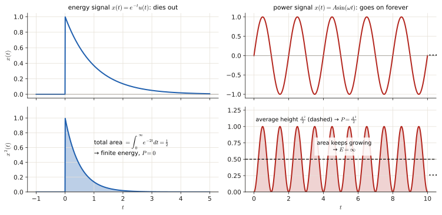
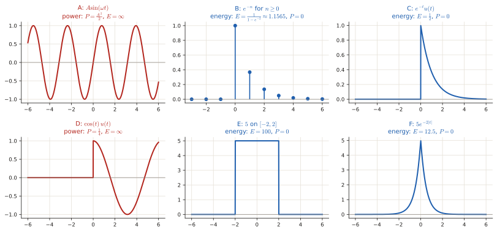
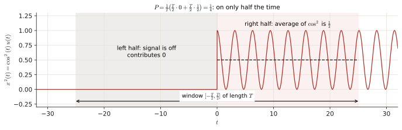
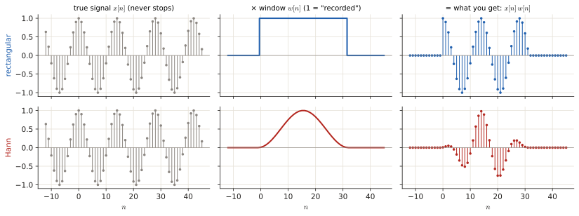
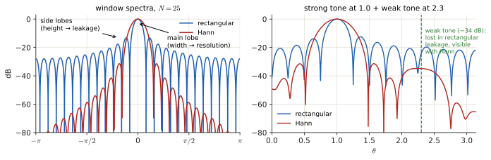
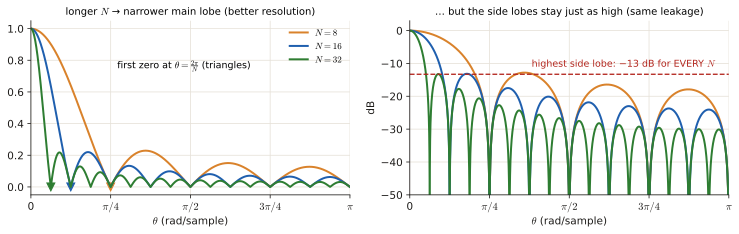
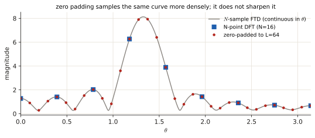
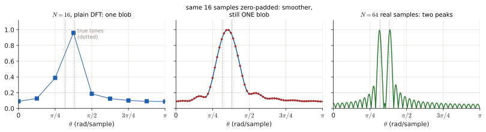
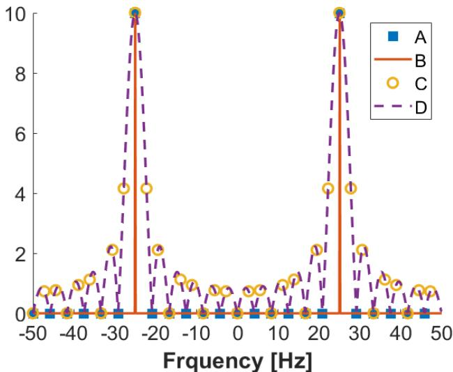

# 3.1 Energy, power, windows, zero padding

This page answers four small questions that every later page uses: <b>(1)</b> is a signal an "energy" or a "power" signal, <b>(2)</b> what does cutting a signal to N samples do to its spectrum, <b>(3)</b> what is the difference between the FTD and the DFT, and <b>(4)</b> why zero padding does not give you better resolution. Everything is explained from the first sentence; nothing is assumed.

!!! need "Before this page (all of it is on [Chapter 0](p0-foundations.md))"
    - What $x(t)$ and $x[n]$ mean, and the difference between them ([0.1](p0-foundations.md#01-what-a-signal-is))
    - Sine, cosine, frequency $f$ vs $\omega$ vs $\theta$ ([0.2](p0-foundations.md#02-sine-cosine-frequency))
    - Integrals = area, sums = adding up, limits = "let it grow forever", the geometric series, $\sin^2\alpha=\frac{1-\cos 2\alpha}{2}$ ([0.4](p0-foundations.md#04-the-three-calculations-you-keep-meeting))
    - What a spectrum is, FTD, DFT, bins, dB ([0.5](p0-foundations.md#05-spectrum-what-a-fourier-transform-tells-you))

    If you read only one thing: **a spectrum is "how much of each frequency is in the signal"**, and the *window* is the fact that you only ever record a finite chunk of the signal.

---

## 1 · Energy vs power: which one is this signal?

### 1.1 The idea before the formulas

Every signal carries *some* amount of "size". There are two different ways to measure that size, and which one is useful depends on whether the signal **dies out** or **keeps going forever**:

- A **battery-powered blip**: it transmits for a moment and then goes silent. What matters is the *total* it delivered → **energy** $E_x$.
- A **power station**: it never stops. The total over forever is infinite and meaningless; what matters is what it delivers *per second on average* → **average power** $P_x$.

That is the entire concept. ==A signal is called an **energy signal** if its total energy is a finite number, and a **power signal** if its total energy is infinite but its average power per second is a finite non-zero number.==

**Why we square the signal.** Electrical energy dissipated in a resistor is proportional to *voltage squared* ($v^2/R$), so =="energy of a signal" always means "area under $x^2$"==, never "area under $x$" (which would be zero for any symmetric wiggle and would let positive and negative parts cancel).

### 1.2 The two formulas, explained symbol by symbol

**Total energy** (continuous time; for discrete time swap $\int dt$ for $\sum$ over $n$):

$$E_x = \int_{-\infty}^{\infty} \lvert x(t)\rvert^2\,dt$$

- $\lvert x(t)\rvert^2$ = the squared size at instant $t$. (For real signals $\lvert x\rvert^2 = x^2$.)
- $dt$ = "…times a tiny slice of time" — this is an integral, i.e. **add up the area under $x^2(t)$ over all time**.
- Limits $-\infty$ to $\infty$ = over the whole life of the signal.

Discrete version: $\displaystyle E_x = \sum_{n=-\infty}^{\infty} \lvert x[n]\rvert^2$ — literally "square every sample and add them all up".

**Average power** = energy per unit of time, measured on a window of length $T$ and then letting the window grow forever:

$$P_x = \lim_{T\to\infty}\frac{1}{T}\int_{-T/2}^{T/2}\lvert x(t)\rvert^2\,dt$$

Read it inside-out: $\int_{-T/2}^{T/2}$ = energy in a window of length $T$; $\frac1T\times$ that = **average energy per second over that window**; $\lim_{T\to\infty}$ = now stretch the window forever and see what value the average settles on. Discrete version: replace $\frac1T\int$ by $\frac1N\sum_{n=-N/2}^{N/2}$.

<figure markdown>

<figcaption>Both formulas are about the bottom row, $x^2(t)$. Left column: a signal that dies out. Its squared version has a finite shaded area, $\frac12$: that number is the energy. Right column: a tone that never stops. Every second adds another $\frac{A^2}{2}$ of area, so the total is infinite. Its <i>average height</i> (dashed line) stays at $\frac{A^2}{2}$, and that average height is the power.</figcaption>
</figure>

<figure class="anim">
<video class="anim" src="video/energy_power.mp4" poster="video/energy_power.jpg" muted loop playsinline controls preload="none"></video>
<figcaption><b>Animation: the two formulas, live.</b> The beige window $[-\frac{T}{2},\frac{T}{2}]$ grows. Top right: the area inside it, $E(T)$. Blue (dies out) levels off at $\frac12$; red (a tone) keeps climbing. Bottom right: that area divided by $T$, the average power $P(T)$. Blue sinks to 0 (a fixed $\frac12$ divided by a growing $T$, section 1.3 below); red settles on $\frac{A^2}{2}=\frac12$. Those two end values are exactly what "$\lim_{T\to\infty}$" means.</figcaption>
</figure>

### 1.3 Why the two categories can never overlap

Suppose $E_x$ is a finite number. Then the average over a window of length $T$ is at most $E_x/T$, and

$$P_x = \lim_{T\to\infty}\frac{E_x}{T} = 0 \qquad\text{(a fixed number divided by something growing forever = 0)}.$$

So: ==**finite energy ⟹ average power is exactly zero.**== That is why the answer to an energy-signal question always ends with "$P=0$", and why a power signal must have $E_x=\infty$.

### 1.4 How to classify a signal in 5 seconds

!!! recipe key "Recipe: energy / power / neither"
    1. **Does it die out?** (tends to 0 as $t\to\pm\infty$, or is non-zero only on a finite stretch, like a pulse) → **energy signal**. Compute $E$ (a sum or an integral of $x^2$), state $P=0$.
    2. **Does it repeat forever?** (a sine, a cosine, any periodic pattern; also random *stationary* signals) → **power signal**. Compute $P$ (the average of $x^2$), state $E=\infty$.
    3. **Does it grow without bound?** (like $e^{t}$) → **neither**.

    Rule of thumb for the average of the square of a wiggle: **the average of $\sin^2$ or $\cos^2$ over many periods is exactly $\frac12$**, so a tone $A\sin(\omega t)$ has $P = A^2/2$. If the tone is only *half* on (switched on at $t=0$ instead of existing forever), the average is halved again: $P = A^2/4$.

### 1.5 Every example the exams use, computed from scratch

<figure markdown>

<figcaption>All six examples below at a glance, blue = energy signal, red = power signal. The recipe of 1.4 is visible in the shapes: everything that sinks to 0 on both sides (B, C, E, F) is an energy signal; everything that keeps wiggling forever (A, D) is a power signal.</figcaption>
</figure>

**Example A — $x(t) = A\sin(\omega t)$, forever.** It repeats, so it is a **power signal**, $E=\infty$. For the power, use the identity from [Chapter 0](p0-foundations.md#04-the-three-calculations-you-keep-meeting): $\sin^2(\omega t) = \frac{1-\cos(2\omega t)}{2}$.

$$P = \lim_{T\to\infty}\frac{1}{T}\int_{-T/2}^{T/2} A^2\underbrace{\frac{1-\cos(2\omega t)}{2}}_{\sin^2(\omega t)}dt$$

Split the integral in two pieces:

$$= \lim_{T\to\infty}\frac{A^2}{T}\left[\int_{-T/2}^{T/2}\frac12\,dt \;-\; \int_{-T/2}^{T/2}\frac{\cos(2\omega t)}{2}\,dt\right]$$

- First piece: $\int_{-T/2}^{T/2}\frac12 dt = \frac12 T$ (area of a constant $\frac12$ over a length-$T$ window). So $\frac{A^2}{T}\cdot\frac{T}{2} = \frac{A^2}{2}$.
- Second piece: $\int \cos(2\omega t)dt = \frac{\sin(2\omega t)}{2\omega}$, and $\sin$ is trapped between $-1$ and $+1$, so that integral is **at most $1/\omega$** — a fixed number. Divided by $T\to\infty$ it becomes 0. (That is what "the cosine averages out" means: a wiggle that spends as much time positive as negative contributes nothing to the average.)

$$\boxed{P = \frac{A^2}{2}},\qquad E = \infty$$

**Example B — $x[n] = e^{-n}$ for $n \ge 0$, zero elsewhere.** It dies out, so it is an **energy signal**. "Elsewhere" = 0 contributes nothing, so sum from $n=0$ to $\infty$:

$$E = \sum_{n=0}^{\infty}\big(e^{-n}\big)^2 = \sum_{n=0}^{\infty} e^{-2n} = \sum_{n=0}^{\infty}\big(e^{-2}\big)^{n}$$

That is a **geometric series** $1 + r + r^2 + \dots$ with $r = e^{-2}\approx 0.1353 < 1$, so it equals $\frac{1}{1-r}$:

$$E = \frac{1}{1-e^{-2}} = \frac{1}{1-0.1353} = \frac{1}{0.8647} \approx 1.1565,\qquad P = 0 .$$

**Example C — $x(t) = e^{-t}u(t)$** ($u(t)$ = the *unit step*: $u(t)=1$ for $t\ge0$, $0$ for $t<0$; it just means "starts at $t=0$"). Dies out → energy signal:

$$E = \int_{-\infty}^{\infty}\big(e^{-t}u(t)\big)^2 dt = \int_{0}^{\infty} e^{-2t}dt = \left[\frac{e^{-2t}}{-2}\right]_0^\infty = 0 - \Big(-\frac12\Big) = \frac12 ,\qquad P = 0 .$$

**Example D — $x(t) = \cos(t)\,u(t)$** (a cosine, but only for $t\ge 0$). It never dies out and it repeats on $[0,\infty)$ → **power signal**, $E=\infty$. The average of $\cos^2(t)$ is $\frac12$, but the signal is only "on" for half of the symmetric window $[-T/2, T/2]$:

$$P = \lim_{T\to\infty}\frac{1}{T}\int_{0}^{T/2}\cos^2(t)\,dt = \frac{1}{2}\times\frac{1}{2} = \frac14 .$$

The extra $\frac12$ is exactly "the tone is on only half the time". (Same reason $A\sin(\omega t)u(t)$ gives $A^2/4$ instead of $A^2/2$.)

<figure markdown>

<figcaption>The window $[-\frac{T}{2},\frac{T}{2}]$ is always centred on $t=0$. The left half (grey) falls before the switch-on, where $x=0$, so it adds nothing. The right half averages $\frac12$ like any $\cos^2$. Averaged over the whole window: half of $\frac12$, i.e. $\frac14$, however long $T$ gets.</figcaption>
</figure>

**Example E — $x(t) = 5$ for $-2 \le t \le 2$, zero elsewhere** (a rectangular pulse). Non-zero only on a finite stretch → energy signal, and $x^2 = 25$ there:

$$E = \int_{-2}^{2} 25\,dt = 25 \times 4 = 100,\qquad P = 0 .$$

**Example F — $x(t) = 5e^{-2\lvert t\rvert}$** (a symmetric two-sided spike). Dies out on both sides → energy signal. The function is symmetric, so integrate from 0 to $\infty$ and double; $\lvert t\rvert = t$ there and $(5e^{-2t})^2 = 25e^{-4t}$:

$$E = 2\int_{0}^{\infty} 25 e^{-4t}dt = 2\times 25\times \left[\frac{e^{-4t}}{-4}\right]_0^\infty = 50\times\frac14 = \frac{25}{2} = 12.5,\qquad P = 0 .$$

!!! trap "Where points get lost here"
    - Answering $P = A^2/2$ when the tone is **switched on at $t=0$** ($u(t)$): the answer is $A^2/4$.
    - ==For an energy signal you must still **write $P = 0$**, and for a power signal **write $E = \infty$**.== The question asks for *both* numbers.
    - $\big(e^{-n}\big)^2 = e^{-2n}$, **not** $e^{-n^2}$. And the geometric series needs $r = e^{-2}$, not $r = e^{-n}$.
    - "Provide only the final answer" means the marker sees **only** your number: write both $E$ and $P$ and label which is which.

---

## 2 · Windows: what cutting the signal to $N$ samples does

### 2.1 Why a window exists at all

You never have "the signal, forever". You record $N$ samples and that is all you get. ==Recording $N$ samples is mathematically the same as **multiplying** the true infinite signal by a *window* $w[n]$== that is 1 inside your recording and 0 outside:

$$\tilde{x}[n] = x[n]\cdot w[n],\qquad w[n] = \begin{cases}1 & n = 0,\dots,N-1\\ 0 & \text{everywhere else}\end{cases}$$

That particular shape is the **rectangular window** (a rectangle: 1 inside, 0 outside). Other windows (Hann, Hamming, triangular) taper smoothly to 0 at the edges instead of cutting hard.

<figure markdown>

<figcaption>Top row: recording 32 samples is the same as multiplying the never-ending signal by a rectangle that is 1 on the samples you keep and 0 elsewhere. Bottom row: a Hann window does the same multiplication but fades the recording in and out, so there is no hard cut at the edges. The hard cut is what produces high side lobes in section 2.2.</figcaption>
</figure>

### 2.2 What multiplication does to the spectrum

The rule from [Chapter 0](p0-foundations.md#05-spectrum-what-a-fourier-transform-tells-you): ==**multiplying signals in time = smearing (convolving) their spectra in frequency**==. So ==the spectrum you compute is not the true spectrum; it is the true spectrum **smeared with the window's own spectrum** $W(e^{j\theta})$==:

$$\text{what you measure} \;=\; \text{true spectrum} \;\otimes\; W(e^{j\theta})$$

Intuition: every true frequency peak gets replaced by a copy of the window's spectrum shape, scaled and centred on that peak. If the window's shape were an infinitely thin spike, nothing would change. Because it is *not* infinitely thin, two bad things happen — and each is caused by one feature of the window's shape:

<figure class="anim">
<video class="anim" src="video/windowing.mp4" poster="video/windowing.jpg" muted loop playsinline controls preload="none"></video>
<figcaption><b>Animation: windowing, start to finish.</b> Top: the true signal (grey), a strong tone plus a tone 100 times weaker, and the window (red); blue is what you record. Bottom: the spectrum you compute (dB). Each true tone (dashed) becomes a copy of the window's spectrum. As $N$ grows the main lobe narrows, but the side lobes stay at −13 dB and bury the weak tone. Switching to a Hann window drops the side lobes and the weak tone appears; the main lobe gets wider in exchange.</figcaption>
</figure>

<figure markdown>

<figcaption>Left: the spectrum of two windows of the same length, in dB (log scale: lower = quieter). The rectangular window (blue) has the <b>narrowest main lobe</b> but its first side lobe is only 13 dB down. The Hann window (orange) has a <b>wider main lobe</b> but side lobes 32 dB down. Right: a strong tone at frequency 1.0 and a second tone 34 dB weaker at 2.3. With the rectangular window the weak tone is buried under the strong tone's side lobes (leakage); with Hann both tones are visible.</figcaption>
</figure>

### 2.3 The vocabulary: main lobe, side lobes, resolution, leakage

| Word | Plain meaning | Picture (left figure) |
|---|---|---|
| **Main lobe** | the big central bump of the window's spectrum | the tall middle peak |
| **Side lobes** | the smaller ripples to the left and right | the small bumps after the main one |
| **Resolution** | ability to see two close frequencies as **two** peaks | set by **how wide the main lobe is**: wider = worse |
| **Leakage** | power of a strong tone showing up at **wrong** frequencies, drowning weak tones | set by **how high the side lobes are**: higher = worse |

So each window feature causes exactly one problem:

| Feature of the window's spectrum | Causes | Symptom |
|---|---|---|
| **main lobe width** | loss of **resolution** | two peaks closer than about $2\pi/N$ (i.e. $f_s/N$ Hz) merge into one; peaks look wider and lower than they are |
| **side lobe height** | spectral **leakage** | background "noise floor" rises; weak tones and spurious peaks get hidden |

### 2.4 What you can change, and what it costs

- ==**Make $N$ bigger** (record longer) → main lobe gets **narrower** → **better resolution**.== But ==the side lobes of a *rectangular* window stay at −13 dB no matter how long the window is.== So the exam statement "increase $N$ to reduce leakage" is marked **false**.
- ==**Use a smoother window** (triangular: −27 dB, Hann: −32 dB, Hamming: similar) → **less leakage**, but the main lobe becomes **wider** → **worse resolution**== for the same $N$. It is always a trade: you buy leakage at the price of resolution.

<figure markdown>

<figcaption>The rectangular window's spectrum for $N=8,16,32$. Left (linear): the main lobe ends at $\theta=\frac{2\pi}{N}$ (triangles), so doubling $N$ halves its width. Right (dB): the highest side lobe sits at −13 dB for every $N$; only more lobes get squeezed in. This one picture answers "does a longer window reduce leakage?" (no) and "does it improve resolution?" (yes).</figcaption>
</figure>

<figure markdown>

<figcaption>Grey curve: the true FTD of 16 samples of a cosine. Blue squares: the 16-point DFT (one sample per bin). Red dots: the DFT after zero padding to 64 points. The red dots simply trace the same grey curve at closer spacing; the peak does not get narrower and no new peak can appear.</figcaption>
</figure>

---

## 3 · FTD, DFT and zero padding {#dft-ftd-and-zero-padding}

### 3.1 The two transforms, one more time

| | **FTD** | **DFT** |
|---|---|---|
| Formula | $X(e^{j\theta}) = \sum_{n} x[n]e^{-jn\theta}$ | $X[k] = \sum_{n=0}^{N-1} x[n]e^{-j2\pi kn/N}$ |
| Input | the whole (infinite) signal | your $N$ recorded samples |
| Output | a **continuous curve** over $\theta \in [-\pi,\pi]$ | **$N$ numbers** at frequencies $\theta_k = 2\pi k/N$ |
| Who can compute it | nobody (it needs the infinite signal) | a computer, in one go |

==The DFT is **the FTD sampled at $N$ evenly spaced frequencies**.== Nothing else. ==The spacing between DFT points is $\theta$-step $= 2\pi/N$, which in Hz is $f_s/N$== ("bin width", [Chapter 0](p0-foundations.md#05-spectrum-what-a-fourier-transform-tells-you)).

### 3.2 Zero padding: what it is

Take your $N$ samples, stick $L-N$ zeros at the end, and compute the **$L$-point** DFT instead. You still only know $N$ real samples; the extra inputs are zeros.

What you get: ==the $L$-point DFT samples **the same $N$-sample FTD curve** at the finer spacing $2\pi k/L$== (i.e. $f_s/L$ Hz). More points on the *same* curve.

<figure class="anim">
<video class="anim" src="video/zero_pad.mp4" poster="video/zero_pad.jpg" muted loop playsinline controls preload="none"></video>
<figcaption><b>Animation.</b> Top: 16 real samples (blue) followed by more and more zeros (grey). Bottom: the $L$-point DFT (red dots) for $L=16,32,64,256$. The dots get denser but never leave the grey curve, the FTD of the 16 real samples. The green curve at the end uses 64 <i>real</i> samples: only that makes the peak narrower.</figcaption>
</figure>

### 3.3 Why it does not improve resolution

==Resolution is set by the **width of the main lobe**, and that width depends only on $N$ and the window== — the zeros you appended carry no information, so the curve cannot get any narrower. ==Zero padding only makes the plot look smoother== (it *interpolates* between the old points). Two tones that were merged into one peak before are still merged after.

<figure markdown>

<figcaption>Two tones only 0.2 rad/sample apart (dotted), closer than $\frac{2\pi}{16}\approx0.39$. Left: 16 samples, plain DFT: one blob. Middle: the same 16 samples zero-padded to 128 points: a smooth curve, still one blob. Right: 64 real samples ($\frac{2\pi}{64}\approx0.1$ apart is now resolvable): two clean peaks. Only real data buys resolution.</figcaption>
</figure>

!!! trap key "Traps (all of these are real exam statements)"
    - "Zero padding increases resolution" → **false**. It increases the *density of frequency samples*, nothing more.
    - "A triangular/Hann window gives higher resolution than rectangular" → **false**. It gives *less leakage*; its main lobe is *wider*, so resolution is worse.
    - "Increasing the window length reduces leakage for a rectangular window" → **false** (side lobes stay at −13 dB). It *does* improve resolution.
    - Bias caused by windowing affects **both** deterministic and random signals. *Variance* (estimates jumping around between records) is the separate, extra problem of random signals.

---

## Exam questions

Every solution below starts with *what the question is actually asking*, then shows every step.

### April 2025 exam · 3a {#apr25-3a}

!!! exam "Final exam Q3, 13 April 2025 · 3a · 0.5 p"
    For each of the following signals, indicate whether they are energy or power signals, and provide their total energy and average power.

    ***Provide only the final answer. The workout will not be checked.***

    1. $x(t) = A \sin(\omega t)$, with $A, \omega$ being the fixed amplitude and frequency, respectively.
    2. $x[n] = e^{-n}$ for $n \geq 0$, and $x[n] = 0$ elsewhere.

???+ solution "Solution"

    **What is being asked?** For each signal give three things: the label (energy or power signal), the total energy $E$, and the average power $P$. Only the three final answers are graded — but to *get* them you must compute, and you have no partial credit, so the computation must be right first time.

    **Symbols in this question**

    | Symbol | Meaning |
    |---|---|
    | $A,\ \omega$ | fixed numbers: amplitude and angular frequency (they stay in the answer — this is a letter answer, not a number) |
    | $\sin(\omega t)$ | a cosine-type wiggle that repeats forever |
    | $x[n]=e^{-n}$, $n\ge0$ | a discrete signal: $1, 0.368, 0.135, 0.050, \dots$ (since $e^{-1}\approx0.368$), i.e. a shrinking list |
    | $E$, $P$ | total energy, average power ([section 1.2](#12-the-two-formulas-explained-symbol-by-symbol)) |

    **Signal 1: $x(t) = A\sin(\omega t)$.**

    1. *Classify.* A sine repeats every $2\pi/\omega$ seconds and never dies out → **power signal** → by [section 1.3](#13-why-the-two-categories-can-never-overlap) its energy is infinite: $E = \infty$.
    2. *Compute $P$.* The average of a squared sine over many periods is $\frac12$ (the identity $\sin^2 = \frac{1-\cos 2\omega t}{2}$, with the cosine part averaging away — full working in [Example A](#15-every-example-the-exams-use-computed-from-scratch)):
        $$P = \frac{A^2}{2}.$$

    **Signal 2: $x[n] = e^{-n}$, $n\ge 0$.**

    1. *Classify.* The samples shrink to zero ($e^{-n}\to0$) and are zero before $n=0$ → it dies out → **energy signal** → $P = 0$.
    2. *Compute $E$.* Square each sample and add them all up:
        $$E = \sum_{n=0}^{\infty}\big(e^{-n}\big)^2 = \sum_{n=0}^{\infty}\big(e^{-2}\big)^{n} \overset{\text{geom. series}}{=} \frac{1}{1-e^{-2}} = \frac{1}{0.8647}\approx 1.1565 .$$

    !!! answer "Answer"
        1. **Power signal**: $E = \infty$, $P = \dfrac{A^2}{2}$.
        2. **Energy signal**: $E = \dfrac{1}{1-e^{-2}} \approx 1.16$, $P = 0$.

### Q2 2023-24 resit · 3a {#q2-24-3a}

!!! exam "Resit Q2 2023-24 · 3a (shown in the Part 3 review lecture)"
    For the signals in the table below, please indicate whether they are energy or power signals, Note that $u(t)$ represents the unit step function.

    | Signal | Energy or Power? |
    |---|---|
    | $x(t) = e^{-t}u(t)$ | |
    | $x(t) = \cos(t)u(t)$ | |
    | $x(t) = 5 \text{ for } -2 \leq t \leq 2, \text{ zero elsewhere.}$ | |
    | $x(t) = 5e^{-2\lvert t\rvert}$ | |

???+ solution "Solution"

    **What is being asked?** One word per row: does this signal die out (energy) or does it keep going forever (power)? The formula sheet for this decision is [the recipe in 1.4](#14-how-to-classify-a-signal-in-5-seconds). $u(t)$ means "0 before $t=0$, unchanged after" — it just switches the signal on at $t=0$.

    | Signal | Does it die out? | Verdict | Work (see [1.5](#15-every-example-the-exams-use-computed-from-scratch)) |
    |---|---|---|---|
    | $e^{-t}u(t)$ | yes, $e^{-t}\to0$ | **energy** | $E=\int_0^\infty e^{-2t}dt = \frac12$ |
    | $\cos(t)u(t)$ | no — keeps wiggling forever | **power** | average of $\cos^2 = \frac12$, on only half the window → $P = \frac14$ |
    | $5$ on $[-2,2]$ | yes, zero outside | **energy** | $E = \int_{-2}^{2}25\,dt = 25\cdot 4 = 100$ |
    | $5e^{-2\lvert t\rvert}$ | yes, both tails die out | **energy** | $E = 2\int_0^\infty 25e^{-4t}dt = 2\cdot\frac{25}{4} = \frac{25}{2}$ |

    Note the third one: a **constant** is fine as an energy signal as long as it is only non-zero on a finite stretch. It is the "keeps going forever" that makes a signal a power signal.

    !!! answer "Answer"
        **Energy** · **Power** · **Energy** · **Energy**

### November 2022 exam · 3b {#nov22-3b}

!!! exam "Final exam Q1, 7 November 2022 · 3b · 0.25 p"
    In the context of windowing and zero-padding, which of the following statements is TRUE?

    - a) Given the same window length, a triangular window provides higher spectral resolution compared to a rectangular window.
    - b) When calculating the spectrum of a windowed signal, the main-lobe width of the window function determines spectral resolution, while the height of the side lobes determines spectral leakage.
    - c) When estimating the spectrum using a rectangular window, spectral leakage can be reduced by increasing the window length.
    - d) When calculating the Fourier transform of a N-sample discrete signal, extending the signal to a length L by zero padding is equivalent to sampling the L-sample Fourier Transform for Continuous time signal (FTD) at a step given by theta = k * 2pi / N

???+ solution "Solution"

    **What is being asked?** One true statement out of four. Test each against the two tables in [section 2.3](#23-the-vocabulary-main-lobe-side-lobes-resolution-leakage): *main lobe ↔ resolution*, *side lobes ↔ leakage*, and the cost table in [2.4](#24-what-you-can-change-and-what-it-costs).

    - **(a)** Triangular vs rectangular at the same length: triangular has a **wider** main lobe, so its resolution is *lower*, not higher. It wins on leakage. → **false**.
    - **(b)** Main lobe width determines resolution; side lobe height determines leakage. That is exactly the table. → **true** ✓
    - **(c)** Making a rectangular window longer narrows the main lobe (better resolution), but the side lobes stay at −13 dB, so leakage is **not** reduced. The review slides mark this false. → **false**.
    - **(d)** Zero padding to $L$ samples the $N$-sample FTD at the finer step $2\pi k\mathbf{/L}$, not $2\pi k/N$ (and the FTD is the transform of a *discrete-time* signal — the word "continuous" in the statement is a typo). → **false**.

    !!! answer "Answer"
        **(b)**

### January 2020 retake · 1c {#jan20-1c}

!!! exam "Retake exam, 20 January 2020 · Exercise 1(c) · 0.25 p"
    In the context of windowing, which one of the following statements is true:

    - A. The higher the side lobes of the window function, the worse the resolution of the spectral estimate.
    - B. The higher the side lobes of the window function, the smaller the effects of spectral leakage.
    - C. The wider the main lobe of the window function, the worse the resolution of the spectral estimate.
    - D. The wider the main lobe of the window function, the larger the effects of spectral leakage.

???+ solution "Solution"

    **What is being asked?** Which statement matches the pairings *main lobe ↔ resolution* and *side lobes ↔ leakage*, with the direction right (wider/higher = worse).

    | Option | Pairing | Direction | Verdict |
    |---|---|---|---|
    | A | side lobes ↔ **resolution** | — | wrong pairing (side lobes are leakage) |
    | B | side lobes ↔ **leakage** | "higher = smaller effect" | right pairing, **wrong direction** (higher side lobes = *more* leakage) |
    | C | main lobe ↔ **resolution** | "wider = worse" | right pairing, right direction ✓ |
    | D | main lobe ↔ **leakage** | — | wrong pairing (main lobe is resolution) |

    !!! answer "Answer"
        **C**

### January 2022 resit · 3a {#jan22-3a}

!!! exam "Resit, 24 January 2022 · 3a · 0.3 p"
    The infinitely-long discrete-time signal $x[n] = 20 \cos(2\pi \frac{f}{f_s} n)$, with $f = 25 \text{ Hz}$ and $f_s = 50 \text{ Hz}$, is windowed with a rectangular window of length $N$ to obtain the window signal $\tilde{x}[n]$. In the plots below, the following Fourier transforms are shown:

    1. The Fourier Transform for Discrete time signals (FTD) of $x[n]$
    2. The FTD of $\tilde{x}[n]$.
    3. The Discrete Fourier Transform (DFT) of $\tilde{x}[n]$ calculated for $N = 24$ and zero padding of $M = 12$ samples.
    4. The Discrete Fourier Transform (DFT) of $\tilde{x}[n]$ calculated for $N = 24$ with no zero padding.

    

    Which of the following is the correct association?

    - (a) 1B, 2D, 3A, 3C
    - (b) 1B, 2D, 3C, 4A
    - (c) 1C, 2A, 3D, 4B
    - (d) 1D, 2B, 3C, 4A

???+ solution "Solution"

    **What is being asked?** Match four descriptions to four drawings labelled A (blue squares), B (orange solid), C (yellow circles), D (purple dashed). The only real question is: *curve or points? thin spikes or smeared bump?*

    **Symbols in this question**

    | Symbol | Meaning |
    |---|---|
    | $f = 25$ Hz, $f_s = 50$ Hz | the tone is at half the sample rate → digital frequency $\theta = 2\pi\frac{25}{50} = \pi$: the fastest possible wiggle, $\cos(\pi n) = (-1)^n$ ([Chapter 0 §0.2](p0-foundations.md#02-sine-cosine-frequency)) |
    | $N = 24$ | we keep 24 samples |
    | $M = 12$ | we append 12 zeros → total length $L = 24 + 12 = 36$ |
    | $\tilde x[n]$ | the windowed signal: the cosine cut to 24 samples |

    **Step 1 — description 1 (FTD of the infinite cosine).** An infinite cosine contains exactly one frequency. Its spectrum is therefore **two infinitely thin spikes** (at $\pm 25$ Hz — two because $\cos\theta = \frac12(e^{j\theta}+e^{-j\theta})$, [Chapter 0 §0.5](p0-foundations.md#05-spectrum-what-a-fourier-transform-tells-you)). In the picture that is the solid orange **B**. *(Thinnest possible peaks = the infinite signal.)*

    **Step 2 — description 2 (FTD of the cut signal).** Cutting to 24 samples smears each thin spike into the window's spectrum shape: a **continuous curve** with a main lobe and side lobes ([section 2.2](#22-what-multiplication-does-to-the-spectrum)). Continuous curve in the picture = dashed **D**. Note this curve is *not* made of points: the FTD is always a curve.

    **Step 3 — how the DFT points sit on that curve.** The DFT is a sampling of curve D with spacing "bin width" $= f_s/L$ where $L$ is the DFT length. Compute both spacings:

    - **No zero padding**: $L = N = 24$ → spacing $= 50/24 \approx 2.08$ Hz.
    - **Zero padding to 36**: spacing $= 50/36 \approx 1.39$ Hz.

    **Step 4 — description 4 (DFT, $N = 24$, no padding) → which drawing?** The tone sits at 25 Hz, and $25/2.0833 = 12$ exactly, so the peak falls exactly **on a bin**. A rectangular window's curve crosses zero at every multiple of $2.0833$ Hz away from the peak — which is exactly where all the other bins sit. Result: **one point at the top, every other point at zero** → the blue squares **A**.

    **Step 5 — description 3 (DFT with zero padding to 36) → which drawing?** Now the points are $1.39$ Hz apart, which no longer matches the $2.08$ Hz zero crossings (only every third point lands on one). So the points land **on the ripples of the curve** and trace the main lobe and side lobes → yellow circles **C**.

    **Sanity check (and the moral).** C and A are just two different samplings of the *same* curve D. The peak width did not change — that is the whole "zero padding adds no resolution" lesson in one picture.

    !!! answer "Answer"
        **(b)** 1B, 2D, 3C, 4A

*[window]: the mask you multiply your signal by because you only recorded N samples; 1 inside the recording, 0 outside (or tapered, for Hann etc.).
*[rectangular window]: the hard-cut window: 1 for n = 0…N−1, 0 elsewhere.
*[main lobe]: the big central bump of a window's spectrum; its width sets the resolution.
*[side lobes]: the ripples left and right of the main lobe; their height sets the leakage.
*[resolution]: the ability to tell two nearby frequencies apart as two peaks.
*[leakage]: power of a strong tone spilling onto other frequencies and hiding weak tones.
*[zero padding]: appending zeros before the DFT; it samples the same spectrum more finely, it does not add information.
*[unit step]: u(t): 0 before t = 0, 1 after; it "switches a signal on" at t = 0.
*[energy signal]: a signal with finite total energy; its average power is 0.
*[power signal]: a signal with infinite total energy but finite average power (e.g. anything periodic).
