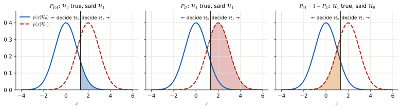
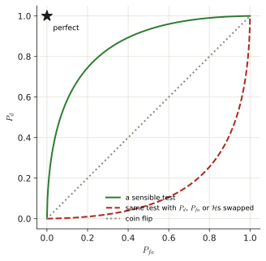
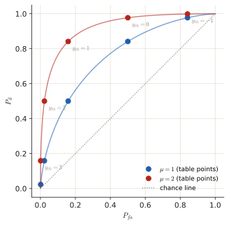

# 4.1 Errors, ROC, Neyman–Pearson

Detection = deciding between two explanations of the data. This page covers the vocabulary that every Part 4 question uses (the four outcomes, $P_{FA}$, $P_D$, $P_M$, ROC curves, Neyman–Pearson) and the multiple-choice questions built on it. It starts from a smoke detector and ends with the exam questions.

!!! need "Before this page"
    - A PDF is a curve whose **area** is a probability ([0.6](p0-foundations.md#random-variable-and-pdf))
    - The Gaussian $\mathcal N(\mu,\sigma^2)$ and the tail function $Q(x)$ ([0.6](p0-foundations.md#the-gaussian-bell-curve))
    - An integral is an area ([0.4](p0-foundations.md#04-the-three-calculations-you-keep-meeting))

    If you read only one thing: **a detector looks at a number, compares it with a threshold, and says "yes" or "no". Two different mistakes are possible (false alarm, miss), and moving the threshold trades one for the other. Everything on this page is a picture of that trade.**

---

## 1 · The setting, from zero

### 1.1 Two stories about the data

Think of a smoke detector. It measures a number $x$ (how much smoke particles). There are two possible **hypotheses** (stories) about the world:

- $\mathcal H_0$, the **null** hypothesis: "nothing is there" (no fire; only noise; the student wrote the essay themselves).
- $\mathcal H_1$, the **alternative**: "something is there" (a fire; a signal; the essay is AI-generated).

Under each story the measurement $x$ follows a different PDF, written $p(x\mid\mathcal H_0)$ and $p(x\mid\mathcal H_1)$ (the "$\mid$" reads "given that"). The two PDFs **overlap**: some values of $x$ could come from either story. That is why mistakes cannot be avoided.

A **detector** is a rule that splits all possible values of $x$ into two regions: values where you answer "$\mathcal H_0$" and values where you answer "$\mathcal H_1$". Usually it is a single **threshold** $\gamma$: say $\mathcal H_1$ when $x>\gamma$.

!!! example "The running example (numbers used below)"
    $\mathcal H_0$: $x\sim\mathcal N(0,1)$ (noise only). $\mathcal H_1$: $x\sim\mathcal N(2,1)$ (noise plus a signal of strength 2). Threshold $\gamma=1$: decide $\mathcal H_1$ whenever $x>1$.

### 1.2 The four outcomes

Two things can be true and two things you can decide, so there are four combinations:

| You decide ↓ / Truth → | $\mathcal H_0$ true | $\mathcal H_1$ true |
|---|---|---|
| $\mathcal H_0$ | ① true negative (prob. $1-P_{FA}$) | ② **miss**, false negative, type II error ($P_M$) |
| $\mathcal H_1$ | ③ **false alarm**, false positive, type I error ($P_{FA}$) | ④ **detection**, true positive ($P_D$) |

Rows are what you **decide**, columns what is **true**. "Positive" = you said $\mathcal H_1$ ("yes, something is there"). The correct decisions are the diagonal (①, ④). *Type I* = rejecting a true $\mathcal H_0$ (the false alarm), *type II* = failing to reject a false $\mathcal H_0$ (the miss).

### 1.3 Each probability is an area

You decide $\mathcal H_1$ in some region of $x$ values. Then

$$P_{FA}=\int_{\text{decide }\mathcal H_1}p(x\mid\mathcal H_0)\,dx,\qquad P_D=\int_{\text{decide }\mathcal H_1}p(x\mid\mathcal H_1)\,dx,\qquad P_M=1-P_D.$$

*(Meaning: $P_{FA}$ = the chance that $x$ lands in the "yes" region **when $\mathcal H_0$ is true**; $P_D$ = the same chance **when $\mathcal H_1$ is true**; the integral of a PDF over a region is the area under the curve there, [0.6](p0-foundations.md#random-variable-and-pdf).)*

!!! example "Numbers for the running example"
    Threshold $\gamma=1$, decide $\mathcal H_1$ for $x>1$. Standardise (subtract the mean, divide by $\sigma=1$) and use $Q$:

    - $P_{FA}=P(x>1\mid\mathcal H_0)=Q\!\left(\frac{1-0}{1}\right)=Q(1)=0.1587$
    - $P_D=P(x>1\mid\mathcal H_1)=Q\!\left(\frac{1-2}{1}\right)=Q(-1)=1-Q(1)=0.8413$
    - $P_M=1-P_D=0.1587$

<figure markdown>

<figcaption>The same threshold (vertical line) in all three panels. $P_{FA}$ is the part of the $\mathcal H_0$ curve that falls in the "decide $\mathcal H_1$" region. $P_D$ is the part of the $\mathcal H_1$ curve in that region. $P_M$ is the rest of the $\mathcal H_1$ curve. Moving the threshold right lowers $P_{FA}$ but also lowers $P_D$: you trade one error for the other.</figcaption>
</figure>

!!! recipe "Recipe: shading questions ('indicate $P_{FA}$ and $P_M$ in the plot')"
    1. Find which side of the threshold is "decide $\mathcal H_1$". Look at the inequality, not your intuition: in Nov 2022 you decide $\mathcal H_1$ for **small** $y$.
    2. $P_{FA}$: shade under the **$\mathcal H_0$** curve on the **$\mathcal H_1$** side.
    3. $P_M$: shade under the **$\mathcal H_1$** curve on the **$\mathcal H_0$** side.

---

## 2 · The ROC curve: all thresholds at once

**Plain words.** Each threshold gives one pair $(P_{FA},P_D)$. Sweep the threshold from $+\infty$ (never say yes) to $-\infty$ (always say yes) and plot every pair: $P_D$ on the vertical axis, $P_{FA}$ on the horizontal. The curve is the **receiver operating characteristic (ROC)**. It shows the *whole menu* of trade-offs a detector offers.

!!! example "ROC of the running example, point by point"
    Rule: decide $\mathcal H_1$ if $x>\gamma$; $P_{FA}=Q(\gamma)$, $P_D=Q(\gamma-2)$.

    | $\gamma$ | $P_{FA}=Q(\gamma)$ | $P_D=Q(\gamma-2)$ |
    |---|---|---|
    | 3 | 0.0013 | $Q(1)=0.1587$ |
    | 2 | 0.0228 | $Q(0)=0.5$ |
    | 1 | 0.1587 | $Q(-1)=0.8413$ |
    | 0 | 0.5 | $Q(-2)=0.9772$ |
    | −1 | 0.8413 | $Q(-3)=0.9987$ |

    Add the end points $(0,0)$ ($\gamma=+\infty$) and $(1,1)$ ($\gamma=-\infty$) and join: a curve that bows up towards the top-left.

<figure markdown>

<figcaption>Every ROC starts at (0,0) (never say $\mathcal H_1$) and ends at (1,1) (always say $\mathcal H_1$). The diagonal is guessing (a coin flip has $P_D=P_{FA}$). A good detector bends towards the top-left corner (perfect: $P_{FA}=0$, $P_D=1$). The more separated the two PDFs (higher SNR), the closer to that corner. A curve **below** the diagonal means something was swapped: flip your decision and it goes above.</figcaption>
</figure>

---

## 3 · Neyman–Pearson: which detector is the best one?

For a given threshold rule you get one point on a ROC. But *which rule* is best? You cannot minimise both errors at once (they trade off), so you must pick one thing to fix. **Neyman–Pearson (NP)**: fix the false-alarm probability you can tolerate, $P_{FA}=\alpha$ (say 1 %), and then **maximise $P_D$**.

Why constrain $P_{FA}$ rather than $P_D$? Under $\mathcal H_0$ there is only noise, so its PDF is known and $P_{FA}$ can be computed exactly; under $\mathcal H_1$ the signal strength is often unknown.

The solution is always a **likelihood ratio test** ([next page](p4-lrt.md)): compute $L(x)=\frac{p(x\mid\mathcal H_1)}{p(x\mid\mathcal H_0)}$ and decide $\mathcal H_1$ when $L(x)>\lambda$, with $\lambda$ chosen so that $P_{FA}=\alpha$.

**Bayesian detection** ([4.3](p4-bayes.md)) is the other classical rule: instead of fixing $P_{FA}$, you assign a **cost** $C_{ij}$ to each wrong decision ($C_{ij}$ = cost of deciding $\mathcal H_i$ when $\mathcal H_j$ is true) and prior probabilities $P_0,P_1$ to the hypotheses, and **minimise the average cost** (the *Bayes risk*). With costs $C_{01}=C_{10}=1$, $C_{00}=C_{11}=0$ the risk is $P_1P_M+P_0P_{FA}$, which is the **total probability of error**.

!!! trap "Words that decide the multiple-choice questions"
    - NP: fixed $P_{FA}$ → **maximise** $P_D$ (not minimise, not "fixed $P_D$").
    - Bayes: **minimise** the risk.
    - Type I = false alarm; type II = miss.
    - The decision region is read from the inequality, not from your intuition about "bigger = more likely".

---

## Exam questions

### November 2022 exam · 4a {#nov22-4a}

!!! exam "Final exam Q1, 7 November 2022 · 4a · 0.25 p"
    In binary hypothesis testing, we assess whether the null hypothesis $\mathcal{H}_0$ or the alternative hypothesis $\mathcal{H}_1$ is true, based on observations $\mathbf{x}$. In general, both hypotheses can cause the same observation $\mathbf{x}$ and, thus, making a wrong decision is unavoidable. We can discern four events depending on the true hypothesis and our decision, which can be summarized in the table below.

    | Decision | True $\mathcal{H}_0$ | True $\mathcal{H}_1$ |
    |---|---|---|
    | $\mathcal{H}_0$ | 1 | 2 |
    | $\mathcal{H}_1$ | 3 | 4 |

    - (a) 1= true negative, 2 = false negative/miss/type II error, 3 = false positive/false alarm/type I error, 4 = true positive/detection
    - (b) 1 = true positive/detection 2 = false negative/miss/type II error, 3 = false positive/false alarm/type I error, 4 = true negative
    - (c) 1 = true negative, 2 = false positive/false alarm/type I error, 3 = false negative/miss/type II error, 4 = true positive/detection
    - (d) 1 = false negative/miss/type II error, 2 = true negative, 3 = true positive/detection, 4 = false positive/false alarm/type I error

???+ solution "Solution"

    **What is being asked?** Name the four cells of the table of [section 1.2](#12-the-four-outcomes).

    **Step 1 — the diagonal.** Cells 1 and 4 are "decision = truth" → correct decisions: cell 1 is a true negative (said $\mathcal H_0$, was $\mathcal H_0$), cell 4 a true positive (detection).

    **Step 2 — the off-diagonal.** Cell 2: said $\mathcal H_0$ while $\mathcal H_1$ was true → **miss** (false negative, type II). Cell 3: said $\mathcal H_1$ while $\mathcal H_0$ was true → **false alarm** (false positive, type I).

    **Step 3 — compare with the options.** (a) matches exactly. (b) swaps 1 and 4; (c) swaps the two error types; (d) calls the correct diagonal "errors".

    !!! answer "Answer"
        **(a)**

### November 2022 exam · 4b {#nov22-4b}

!!! exam "Final exam Q1, 7 November 2022 · 4b · 0.25 p"
    To make a decision in binary hypothesis testing, we partition the observation space in two disjoint sets $\mathcal{X}_0$ and $\mathcal{X}_1$. If the observation $\mathbf{x}$ is part of the decision region $\mathcal{X}_0$, we decide for $\mathcal{H}_0$, and we decide for $\mathcal{H}_1$ if the observation is in the decision region $\mathcal{X}_1$. For a continuous observation space, there uncountable many different partitions. The Neyman-Pearson test partitions the observation space such that

    - (a) for a fixed probability of false alarm, the probability of detection is minimized.
    - (b) for a fixed probability of false alarm, the probability of detection is maximized.
    - (c) for a fixed probability of detection, the probability of false alarm is minimized.
    - (d) the probability of false alarm is equal to the probability of detection.

???+ solution "Solution"

    **What is being asked?** The definition of Neyman–Pearson ([section 3](#3-neymanpearson-which-detector-is-the-best-one)).

    **Step 1.** NP fixes $P_{FA}=\alpha$ and maximises $P_D$. That is (b).

    **Step 2 — why not the others.** (a) says *minimise* $P_D$ (the worst detector). (c) fixes the wrong quantity. (d) describes the diagonal of the ROC, i.e. guessing.

    !!! answer "Answer"
        **(b)**

### April 2024 exam · 4a {#apr24-4a}

!!! exam "Final exam Q3, April 2024 · 4a · 0.5 p"
    Which statement about hypothesis testing is TRUE?

    - a) In Bayesian detection, the decision region is partitioned such that the so-called Bayesian risk is maximised.
    - b) In Bayesian detection, the cost assignment $C_{0,1} = C_{1,0} = 1, C_{1,1} = C_{0,0} = 0$ minimizes the total probability of error.
    - c) With the Neyman-Pearson test, for a fixed probability of false alarm, the probability of detection is minimized.

???+ solution "Solution"

    **What is being asked?** Check each statement against the definitions of NP and Bayes ([section 3](#3-neymanpearson-which-detector-is-the-best-one)).

    **Step 1 — (a).** The Bayes detector **minimises** the risk, not maximises. False.

    **Step 2 — (c).** NP **maximises** $P_D$ at fixed $P_{FA}$. False.

    **Step 3 — (b).** With $C_{01}=C_{10}=1$ and $C_{00}=C_{11}=0$, the risk (average cost) is $1\cdot P(\text{decide }\mathcal H_0,\mathcal H_1\text{ true})+1\cdot P(\text{decide }\mathcal H_1,\mathcal H_0\text{ true})=P_1P_M+P_0P_{FA}$, which *is* the total probability of error. Minimising the risk then minimises that error. **True.**

    !!! answer "Answer"
        **(b)**

### April 2025 exam · 4b {#apr25-4b}

!!! exam "Final exam Q3, 13 April 2025 · 4b · 0.5 p"
    Which statement about hypothesis testing is FALSE?

    - a In Bayesian detection, the decision region is partitioned such that the so-called Bayesian risk is minimised.
    - b In Bayesian detection, the cost assignment $C_{0,1} = C_{1,0} = 10, C_{1,1} = C_{0,0} = 0$ minimizes the total probability of error.
    - c With the Neyman-Pearson test, for a fixed probability of false alarm, the probability of detection is maximised.

???+ solution "Solution"

    **What is being asked?** Find the one false statement — but this is the same family as April 2024 4a with the verbs flipped.

    **Step 1 — (a) and (c)** are the definitions (risk **minimised**, $P_D$ **maximised**): true.

    **Step 2 — (b).** With $C_{01}=C_{10}=10$ the risk is $10\,(P_1P_M+P_0P_{FA})=10\,P_e$. Multiplying all costs by the same factor does not move the minimum, so it still minimises $P_e$ ([4.3](p4-bayes.md): the threshold $\lambda=\frac{(C_{10}-C_{00})P_0}{(C_{01}-C_{11})P_1}$ is unchanged because the factor 10 cancels). True as well.

    The official 2026 solutions confirm: **as printed, all three statements are true**, so there is no false one.

    !!! answer "Answer"
        No option is false (official key). If this reappears, check each verb: risk **min**, $P_D$ **max**.

### Practice exam 2021 · 1e {#pe21-1e}

!!! exam "Practice exam, 28 October 2021 · 1e · 0.5 p"
    When plotting the receiver operating characteristic (ROC) curves, the common practice is to have the probability of detection $P_d$ on the vertical axis and the probability of false alarm $P_{fa}$ on the horizontal axis. In that case, the ROC curves should appear on the upper triangular part of the plot. Assume you are running simulations to generate ROC curves. The two hypotheses are

    $$y[n] \sim \begin{cases} \mathcal{N}(0, \sigma^2), & \text{if } \mathcal{H}_0 \\ \mathcal{N}(\mu, \sigma^2), & \text{if } \mathcal{H}_1 \end{cases},$$

    where $\mu > 0$. If your curves appeared on the lower triangular part of the plot, which one of the following cannot be the reason?

    - a) The variance of the null hypothesis $\mathcal{H}_0$ is set too high.
    - b) $\mathcal{H}_0$ and $\mathcal{H}_1$ are switched in the likelihood ratio.
    - c) The cumulative probability density function is used to calculate $P_d$.
    - d) $P_d$ and $P_{fa}$ are switched.

???+ solution "Solution"

    **What is being asked?** Which of the four causes would **not** push the ROC below the diagonal.

    **Step 1 — what "below the diagonal" means.** $P_d<P_{fa}$: the decision is upside down (worse than a coin flip).

    **Step 2 — (b), (c), (d) all flip the decision.** Inverting the ratio decides the wrong way (b). The CDF is $P(y<t)$, but detection is $P(y>t)$; using the CDF gives $1-P_d$ (c). Swapping the axes mirrors the curve about the diagonal (d).

    **Step 3 — (a).** A wrong variance changes *how good* the test is (how far the curve is from the diagonal), not its direction: a likelihood ratio test built from PDFs you assumed still lands above the diagonal.

    !!! answer "Answer"
        **(a)**

### Practice exam 2021 · 1f {#pe21-1f}

!!! exam "Practice exam, 28 October 2021 · 1f · 0.5 p"
    Consider the t-statistic: $t = \frac{\hat{\mu} - \mu}{\frac{\hat{\sigma}}{\sqrt{N}}}$, where $\mu$ is the mean of the distribution for the null hypothesis $\mathcal{H}_0$, $\hat{\mu}$ is the estimation of the mean, $\hat{\sigma}$ is the estimation of the standard deviation and $N$ is the number of samples. Which one of the following expressions is not correct?

    - a) Deviation of the estimated mean from the mean of the null hypothesis becomes more significant when the number of samples is larger.
    - b) When the estimated standard deviation is large, deviation of the estimated mean from the mean of the null hypothesis becomes less significant.
    - c) As the t-statistic gets smaller, there is a greater chance that the samples do not belong to the null hypothesis $\mathcal{H}_0$.
    - d) The t-statistic is a random variable itself.

???+ solution "Solution"

    **What is being asked?** Which statement about $t$ is wrong. (The t-statistic is no longer in the reader; low priority.)

    **Symbols in this question**

    | Symbol | Meaning |
    |---|---|
    | $\mu$ | the mean claimed by $\mathcal H_0$ |
    | $\hat\mu$ | the mean you measured from the data (a hat = estimate) |
    | $\hat\sigma$ | the standard deviation you measured |
    | $N$ | number of samples |
    | $\hat\sigma/\sqrt N$ | the *standard error*: how much $\hat\mu$ itself wobbles |

    **Step 1 — read $t$ in words.** $t=\dfrac{\text{distance of the measured mean from the }\mathcal H_0\text{ mean}}{\text{typical wobble of the measured mean}}$: "how many standard errors away from $\mathcal H_0$ am I?"

    **Step 2 — test each option.** (a) larger $N$ → smaller standard error → bigger $\lvert t\rvert$ → more significant ✓. (b) larger $\hat\sigma$ → bigger standard error → smaller $\lvert t\rvert$ → less significant ✓. (d) it is computed from random data, so it is random ✓.

    **Step 3 — (c).** Backwards: a **large** $\lvert t\rvert$ is evidence **against** $\mathcal H_0$; a small $t$ means the data fit $\mathcal H_0$ well.

    !!! answer "Answer"
        **(c)**

### Practice exam 2021 · 4a {#pe21-4a}

!!! exam "Practice exam, 28 October 2021 · 4a · 1 p (also shown as 'Resit 2021 4a' in the Part 4 review)"
    For a binary hypothesis testing problem, the distributions for the underlying hypotheses are

    $$y[n] \sim \begin{cases} \mathcal{N}(0, \sigma^2), & \text{if } \mathcal{H}_0 \\ \mathcal{N}(\mu, \sigma^2), & \text{if } \mathcal{H}_1 \end{cases}$$

    where $\sigma^2 = 1$. Given the cumulative distribution function is evaluated as $p(y < y_{th}; \mu, \sigma) = 0.5 \left( 1 + \operatorname{erf} \left( \frac{y_{th} - \mu}{\sigma\sqrt{2}} \right) \right)$ and using the table for the function $\operatorname{erf} \left( \frac{x}{\sqrt{2}} \right)$ given below (TABLE I), calculate the probability of detection $P_d$ and probability of false alarm $P_{fa}$ for the threshold values $y_{th}$ and means $\mu$ listed in TABLE II. Use the calculated $P_d$ and $P_{fa}$ values to plot receiver operating characteristics (ROC) curves, with $P_d$ in the vertical axis and $P_{fa}$ in the horizontal axis.

    TABLE I: $\operatorname{erf}(x/\sqrt2)$ for $x=-3,\dots,3$: $-0.997,\ -0.954,\ -0.683,\ 0,\ 0.683,\ 0.954,\ 0.997$.

    TABLE II: $(y_{th},\mu)$ = $(-1,1)$, $(-1,2)$, $(0,1)$, $(0,2)$, $(1,1)$, $(1,2)$, $(2,1)$, $(2,2)$, $(3,1)$, $(3,2)$; fill in $P_d$ and $P_{fa}$.

???+ solution "Solution"

    **What is being asked?** For each pair (threshold, mean $\mu$) compute one point $(P_{fa},P_d)$, then plot them as ROC curves. This is the running example of [section 2](#2-the-roc-curve-all-thresholds-at-once) with a table instead of $Q$.

    **Symbols in this question**

    | Symbol | Meaning |
    |---|---|
    | $y_{th}$ | the threshold: decide $\mathcal H_1$ when $y>y_{th}$ |
    | $\mu$ | mean under $\mathcal H_1$ (under $\mathcal H_0$ the mean is 0); $\sigma=1$ |
    | erf table | gives $\operatorname{erf}(x/\sqrt2)$ for $x=-3\dots3$, i.e. the Gaussian CDF in disguise |

    **Step 1 — right tails, not the CDF.** The formula given is $P(y<y_{th})$. We decide $\mathcal H_1$ for $y>y_{th}$, so each probability is **1 minus** the CDF:

    $$P_{fa}=\tfrac12\Big[1-\operatorname{erf}\Big(\tfrac{y_{th}-0}{\sqrt2}\Big)\Big],\qquad P_d=\tfrac12\Big[1-\operatorname{erf}\Big(\tfrac{y_{th}-\mu}{\sqrt2}\Big)\Big].$$

    **Step 2 — read the table.** The table is indexed by $x=y_{th}$ for $P_{fa}$ and by $x=y_{th}-\mu$ for $P_d$. Example, row $(y_{th},\mu)=(-1,1)$: $P_{fa}$ needs $x=-1$: $\operatorname{erf}=-0.683$ → $\frac12(1+0.683)=0.8415$. $P_d$ needs $x=-1-1=-2$: $\operatorname{erf}=-0.954$ → $\frac12(1+0.954)=0.977$.

    | $y_{th}$ | $\mu$ | $y_{th}-\mu$ | $P_d$ | $P_{fa}$ |
    |---|---|---|---|---|
    | −1 | 1 | −2 | 0.977 | 0.8415 |
    | −1 | 2 | −3 | 0.9985 | 0.8415 |
    | 0 | 1 | −1 | 0.8415 | 0.5 |
    | 0 | 2 | −2 | 0.977 | 0.5 |
    | 1 | 1 | 0 | 0.5 | 0.1585 |
    | 1 | 2 | −1 | 0.8415 | 0.1585 |
    | 2 | 1 | 1 | 0.1585 | 0.023 |
    | 2 | 2 | 0 | 0.5 | 0.023 |
    | 3 | 1 | 2 | 0.023 | 0.0015 |
    | 3 | 2 | 1 | 0.1585 | 0.0015 |

    **Step 3 — plot.** Each row is one point $(P_{fa},P_d)$. Join the five points of $\mu=1$ (and add $(0,0)$, $(1,1)$), then the five of $\mu=2$. $\mu=2$ lies above $\mu=1$: more separation between the means (higher SNR) gives a better detector.

    

    !!! trap "Read the CDF formula carefully"
        The text gives $P(y<y_{th})$. Detection and false alarm are $P(y>y_{th})$, so use **1 minus** it. Using the CDF directly is exactly the mistake from [1e](#pe21-1e) that puts the ROC below the diagonal.

    !!! answer "Answer"
        The table above; ROC curves through those points, the $\mu=2$ curve above the $\mu=1$ curve.

*[hypothesis]: a possible explanation of the data; H₀ = nothing there, H₁ = something there.
*[null hypothesis]: H₀, "nothing is there" (only noise).
*[detector]: a rule that turns the observation into a decision H₀ or H₁, usually by a threshold.
*[threshold]: the value above which you decide H₁.
*[false alarm]: deciding H₁ when H₀ is true (type I error); probability P_FA.
*[miss]: deciding H₀ when H₁ is true (type II error); probability P_M = 1 − P_D.
*[detection]: deciding H₁ when H₁ is true; probability P_D.
*[ROC]: receiver operating characteristic: P_D against P_FA as the threshold sweeps.
*[Neyman–Pearson]: fix P_FA = α, maximise P_D; solved by a likelihood ratio test.
*[Bayes risk]: the average cost of the decisions, weighted by priors and costs; the Bayes detector minimises it.
*[prior]: P₀, P₁: how likely each hypothesis is before looking at the data.
*[SNR]: signal-to-noise ratio: how strong the signal is compared with the noise.
