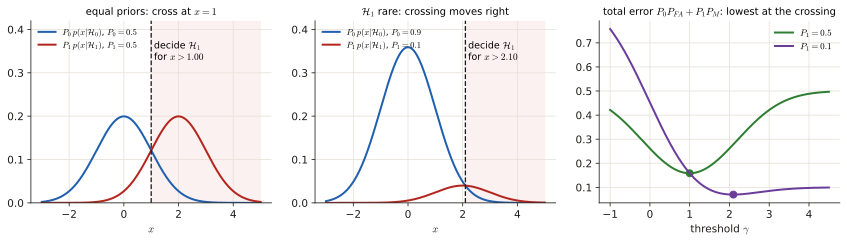
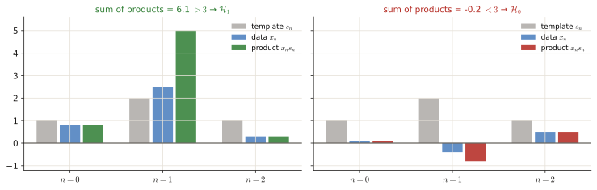
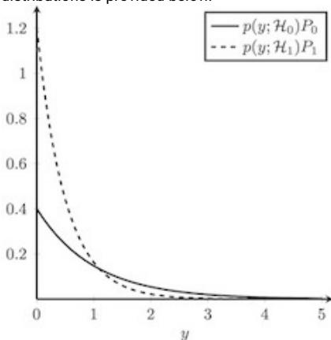
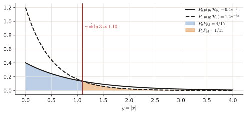

# 4.3 Bayesian detection & matched filter

When you know how often each hypothesis happens (priors) and how bad each mistake is (costs), the threshold of the likelihood ratio test is no longer free: it follows from one formula. Recent exams wrap this in a story (a sensor, a genAI detector) and ask "should we decide $\mathcal H_1$?". This page derives that formula, shows what moves the threshold, and then does the matched filter (a known signal in noise).

!!! need "Before this page"
    - Hypotheses, $P_{FA}$, $P_D$, $P_M$ ([4.1](p4-basics.md)); the likelihood ratio test and its recipe ([4.2](p4-lrt.md))
    - Conditional probability and Bayes' rule ([0.6](p0-foundations.md#conditional-probability-and-independence), [1.1](p1-bayes.md))

    If you read only one thing: **the Bayes detector is the same likelihood ratio test as before, but the threshold is $\lambda=\frac{(\text{cost of a false alarm})\times P_0}{(\text{cost of a miss})\times P_1}$. Rare event or costly false alarm → raise the bar; common event or costly miss → lower it.**

---

## 1 · Priors, costs, risk, and where the threshold comes from

### 1.1 The ingredients

- **Priors** $P_0=P(\mathcal H_0)$, $P_1=P(\mathcal H_1)=1-P_0$: how often each situation occurs *before* you look at the data (e.g. 90 % of the time no device is transmitting).
- ==**Costs** $C_{i,j}$ = cost of **deciding $\mathcal H_i$ when $\mathcal H_j$ is true**.== Usually correct decisions cost 0 ($C_{00}=C_{11}=0$). Then $C_{10}$ is the cost of a **false alarm** (decided $\mathcal H_1$, truth $\mathcal H_0$) and $C_{01}$ the cost of a **miss**.
- **Bayes risk** $R$ = the *average cost* of the decision rule over all situations.

### 1.2 Derivation (short)

Let $\mathcal X_1$ be the set of observations where you decide $\mathcal H_1$. Weight each of the four outcomes ([4.1 §1.2](p4-basics.md#12-the-four-outcomes)) by its cost and its probability:

$$R=C_{00}P_0(1-P_{FA})+C_{10}P_0P_{FA}+C_{01}P_1(1-P_D)+C_{11}P_1P_D .$$

Collect terms and write $P_{FA}=\int_{\mathcal X_1}p(x\mid\mathcal H_0)dx$, $P_D=\int_{\mathcal X_1}p(x\mid\mathcal H_1)dx$:

$$R=\underbrace{C_{00}P_0+C_{01}P_1}_{\text{fixed}}+\int_{\mathcal X_1}\Big[(C_{10}-C_{00})P_0\,p(x\mid\mathcal H_0)-(C_{01}-C_{11})P_1\,p(x\mid\mathcal H_1)\Big]dx .$$

To make $R$ as small as possible, put an observation $x$ into $\mathcal X_1$ **exactly when the bracket is negative**, i.e. when $(C_{01}-C_{11})P_1\,p(x\mid\mathcal H_1)>(C_{10}-C_{00})P_0\,p(x\mid\mathcal H_0)$. Divide by $p(x\mid\mathcal H_0)$ and the positive constant:

$$\boxed{\frac{p(\mathbf x\mid\mathcal H_1)}{p(\mathbf x\mid\mathcal H_0)}\ \underset{\mathcal H_0}{\overset{\mathcal H_1}{\gtrless}}\ \lambda=\frac{(C_{10}-C_{00})\,P_0}{(C_{01}-C_{11})\,P_1}}$$

!!! example "Numbers: a rare signal"
    $\mathcal H_0$: $x\sim\mathcal N(0,1)$, $\mathcal H_1$: $x\sim\mathcal N(2,1)$ (the example of [4.1](p4-basics.md#11-two-stories-about-the-data)). Its ratio is $L(x)=e^{2x-2}$ (the algebra of [4.2](p4-lrt.md#2-the-recipe-with-one-example-done-slowly)). Equal costs, but now $\mathcal H_1$ happens only 10 % of the time: $\lambda=\frac{P_0}{P_1}=\frac{0.9}{0.1}=9$.
    $e^{2x-2}>9\iff2x-2>\ln9=2.197\iff x>2.10$. With equal priors ($\lambda=1$) the threshold would be $x>1$. The rare event needs much stronger evidence.

<figure markdown>

<figcaption>The rule "decide $\mathcal H_1$ where $P_1\,p(x|\mathcal H_1)>P_0\,p(x|\mathcal H_0)$" means: shrink each PDF by its prior, then see where the curves cross. Left: equal priors, crossing at $x=1$. Middle: $\mathcal H_1$ only 10 % of the time, so its curve shrinks to a tenth and the crossing moves to $x=2.10$. Right: the total error $P_0P_{FA}+P_1P_M$ against the threshold; its lowest point (dots) is exactly at those crossings.</figcaption>
</figure>

<figure class="anim">
<video class="anim" src="video/bayes_threshold.mp4" poster="video/bayes_threshold.jpg" muted loop playsinline controls preload="none"></video>
<figcaption><b>Animation: the table of section 1.3, live.</b> The prior $P_1$ slides from 0.5 down to 0.1 and up to 0.8. Each PDF is weighted by its prior, and the decision boundary (dashed) sits where the weighted curves cross. A rarer $\mathcal H_1$ pushes the boundary right (stronger evidence needed); a common $\mathcal H_1$ pulls it left.</figcaption>
</figure>

### 1.3 How the threshold moves (how the MC questions are built)

| Change | Effect on $\lambda$ | Meaning |
|---|---|---|
| $P_0$ larger ($\mathcal H_1$ rarer) | **up** | need stronger evidence to say $\mathcal H_1$ |
| $P_1$ larger | **down** | easier to say $\mathcal H_1$ |
| false alarms more costly ($C_{10}$ up) | up | say $\mathcal H_1$ less often |
| misses more costly ($C_{01}$ up) | down | say $\mathcal H_1$ more often |
| all costs × the same factor | unchanged | the factor cancels in the ratio |

### 1.4 Special cases

- **0/1 costs** ($C_{01}=C_{10}=1$, $C_{00}=C_{11}=0$): ==the risk is $P_0P_{FA}+P_1P_M$, the **total probability of error**. Threshold $\lambda=P_0/P_1$.== Equivalent to "pick the hypothesis with the larger posterior" (the MAP rule): decide $\mathcal H_1$ if $P_1\,p(\mathbf x\mid\mathcal H_1)>P_0\,p(\mathbf x\mid\mathcal H_0)$.
- ==**Equal priors + 0/1 costs**: $\lambda=1$, the **maximum likelihood** rule== ("pick the story that explains the data better").

### 1.5 The same rule with posteriors

By Bayes' rule ([1.1](p1-bayes.md)), $P(\mathcal H_i\mid\mathbf x)=\frac{p(\mathbf x\mid\mathcal H_i)P_i}{p(\mathbf x)}$, so $p(\mathbf x\mid\mathcal H_i)P_i\propto P(\mathcal H_i\mid\mathbf x)$ (the same denominator for both). The rule becomes

$$\text{decide }\mathcal H_1\iff(C_{01}-C_{11})\,P(\mathcal H_1\mid\mathbf x)>(C_{10}-C_{00})\,P(\mathcal H_0\mid\mathbf x).$$

"Compare the posteriors, each weighted by the cost of getting it wrong." (This is how the April 2025 genAI question is phrased.)

---

## 2 · The matched filter: detecting a known signal in noise

**Setting.** A known pattern $s_n$ (a radar pulse, a bit shape) may be present in white Gaussian noise $w_n\sim\mathcal N(0,\sigma^2)$: $\mathcal H_0$: $x_n=w_n$; $\mathcal H_1$: $x_n=s_n+w_n$.

**Derivation** (the recipe of [4.2](p4-lrt.md#2-the-recipe-with-one-example-done-slowly)). Under $\mathcal H_1$ each sample is $\mathcal N(s_n,\sigma^2)$. In $\ln L$ the constants cancel and each sample contributes $-\frac1{2\sigma^2}\big[(x_n-s_n)^2-x_n^2\big]=-\frac1{2\sigma^2}\big[-2x_ns_n+s_n^2\big]$, so

$$\ln L=\frac1{\sigma^2}\sum_nx_ns_n-\frac1{2\sigma^2}\sum_ns_n^2\gtrless\ln\lambda\ \Longrightarrow\ \boxed{\sum_{n=0}^{N-1}x_n\,s_n\ \underset{\mathcal H_0}{\overset{\mathcal H_1}{\gtrless}}\ \lambda'=\sigma^2\ln\lambda+\frac12\sum_ns_n^2 .}$$

==It is a **correlator**: multiply the data with the expected pattern sample by sample and add.== If the pattern is there, all products tend to be positive and the sum is large.

!!! example "Tiny numbers"
    $s=[1,2,1]$, $\sigma^2=1$, $\lambda=1$: threshold $\lambda'=0+\frac12(1+4+1)=3$. Data $x=[0.8,\,2.5,\,0.3]$: $\sum x_ns_n=0.8+5+0.3=6.1>3$ → decide $\mathcal H_1$. Data $x=[0.1,\,-0.4,\,0.5]$: $0.1-0.8+0.5=-0.2<3$ → $\mathcal H_0$.

<figure markdown>

<figcaption>The tiny example as bars. Grey: the known pattern. Blue: the data. Coloured: their products. When the data look like the pattern (left), every product is positive and the biggest sample meets the biggest weight, so the sum is large. When they do not (right), products have mixed signs and cancel.</figcaption>
</figure>

<figure class="anim">
<video class="anim" src="video/matched_filter.mp4" poster="video/matched_filter.jpg" muted loop playsinline controls preload="none"></video>
<figcaption><b>Animation: the same idea along a long record.</b> The pattern $[1,2,3,2,1]$ is hidden in noise at $n=31$, hard to see by eye. The orange template slides along; at each position the overlapping samples are multiplied by the pattern and added (green curve below). Only where the pattern really is does the sum clear the threshold $\frac12\sum s_n^2$.</figcaption>
</figure>

- **As an FIR filter:** ==impulse response = the **time-reversed** signal, $h[n]=s[N-1-n]$, output sampled at $n=N-1$.== (Check: convolution gives $y[N-1]=\sum_kh[k]x[N-1-k]=\sum_ks[N-1-k]x[N-1-k]=\sum_ms[m]x[m]$, the correlator.) ==Writing $h[n]=s[n]$ (no reversal) is a classic wrong option.==
- ==**It maximises the output SNR** among all linear filters.== Reason: weights $\mathbf w$ give signal part $\mathbf w^T\mathbf s$ and noise variance $\sigma^2\lVert\mathbf w\rVert^2$, so SNR $=\frac{(\mathbf w^T\mathbf s)^2}{\sigma^2\lVert\mathbf w\rVert^2}\le\frac{\lVert\mathbf s\rVert^2}{\sigma^2}$ by the Cauchy–Schwarz inequality, with equality exactly when $\mathbf w\propto\mathbf s$.
- ==With **correlated** noise, first *whiten* the data (undo the correlation) and then correlate== (generalised matched filter). It is not limited to uncorrelated noise.

---

## Exam questions

### June 2026 resit · 4c {#jun26-4c}

!!! exam "Resit Q4, June 2026 · 4c · 1 p"
    *(Same Rayleigh sensor as [4b](p4-lrt.md#jun26-4b).)* Now assume prior probabilities $P(H_0) = 0.9$, $P(H_1) = 0.1$, reflecting the fact that a transmitting device is present only 10% of the time. Assume equal costs for false alarms and miss-detections. When should the sensor accept $H_1$?

???+ solution "Solution"

    **What is being asked?** The test of [4b](p4-lrt.md#jun26-4b) had a free threshold $\eta$. Now the priors fix $\eta$; find the resulting rule on $x$.

    **Symbols in this question.** $P(H_0)=0.9$, $P(H_1)=0.1$: priors. $\eta$: threshold on the likelihood ratio. $\sigma_0<\sigma_1$: the Rayleigh scales from 4b.

    **Step 1 — the Bayes threshold.** Equal costs (0 when correct, the same cost for both errors) → $\eta=\dfrac{P_0}{P_1}=\dfrac{0.9}{0.1}=9$ ([1.4](#14-special-cases)).

    **Step 2 — plug into the 4b rule.** The 4b test was $x>\sqrt{\frac{2\sigma_0^2\sigma_1^2}{\sigma_1^2-\sigma_0^2}\ln\big(\eta\frac{\sigma_1^2}{\sigma_0^2}\big)}$. With $\eta=9$:

    $$x>\sqrt{\frac{2\sigma_0^2\sigma_1^2}{\sigma_1^2-\sigma_0^2}\,\ln\!\left(\frac{9\,\sigma_1^2}{\sigma_0^2}\right)}.$$

    **Step 3 — interpretation.** Because the device is rare, the log term is bigger ($\ln(9\sigma_1^2/\sigma_0^2)$ instead of $\ln(\sigma_1^2/\sigma_0^2)$), so the threshold is higher: the sensor needs a clearly stronger envelope before it declares a device.

    !!! answer "Answer"
        Accept $H_1$ when $x>\sqrt{\dfrac{2\sigma_0^2\sigma_1^2}{\sigma_1^2-\sigma_0^2}\ln\!\dfrac{9\sigma_1^2}{\sigma_0^2}}$ (LRT threshold $\eta=9$)

### June 2026 resit · 4a {#jun26-4a}

!!! exam "Resit Q4, June 2026 · 4a · 0.5 p"
    Which of the following statements about prior probabilities in Bayesian hypothesis testing is FALSE?

    - a When prior probabilities are equal, $P(H_0) = P(H_1)$, and equal costs are assigned, the Bayesian decision rule reduces to the maximum likelihood decision rule.
    - b A higher prior probability $P(H_0)$ raises the Bayesian threshold $\eta$, requiring stronger evidence before $H_1$ is selected.
    - c Increasing the prior probability $P(H_1)$ raises the Bayesian decision threshold $\eta$, making it harder to decide in favour of $H_1$.

???+ solution "Solution"

    **What is being asked?** The one false statement about how priors enter the threshold $\eta=\frac{P_0}{P_1}$ (for equal costs).

    **Step 1 — (a).** Equal priors and equal costs → $\eta=1$ → maximum likelihood ([1.4](#14-special-cases)). True.

    **Step 2 — (b).** Larger $P_0$ → larger $\eta=P_0/P_1$ → stronger evidence needed. True.

    **Step 3 — (c).** Larger $P_1$ → **smaller** $\eta$ → *easier* to pick $H_1$, not harder. False.

    !!! answer "Answer"
        **(c)**

### April 2025 exam · 4c {#apr25-4c}

!!! exam "Final exam Q3, 13 April 2025 · 4c · 1 p"
    The teaching team in a MSc course uses an AI agent to detect whether assignments have been generated using genAI which is considered fraudulent. There are two hypotheses to choose from $\mathcal{H}_0$: the assignment has been generated by a student; $\mathcal{H}_1$: the assignment has been generated by genAI. The system uses Bayesian hypothesis testing and the student fails the course if the agent accepts $\mathcal{H}_1$. Assume that $C_{0,1} = 100C_{1,0}$, $C_{1,1} = C_{0,0} = 0$. In addition, assume that the posterior of $\mathcal{H}_0$ is 5 times smaller than the posterior of $\mathcal{H}_1$. Should the student fail the course?

???+ solution "Solution"

    **What is being asked?** Apply the Bayes rule in its *posterior* form ([1.5](#15-the-same-rule-with-posteriors)) and see whether the agent accepts $\mathcal H_1$.

    **Symbols in this question**

    | Symbol | Meaning |
    |---|---|
    | $\mathcal H_0$ / $\mathcal H_1$ | written by a student / generated by genAI |
    | $C_{0,1}$ | cost of deciding $\mathcal H_0$ (student) when $\mathcal H_1$ (AI) is true = **missing** an AI assignment |
    | $C_{1,0}$ | cost of deciding $\mathcal H_1$ when $\mathcal H_0$ is true = failing an honest student (**false alarm**) |
    | $C_{0,1}=100C_{1,0}$ | as given: a miss costs 100 times a false alarm |

    **Step 1 — the rule:** decide $\mathcal H_1$ iff $(C_{01}-C_{11})P(\mathcal H_1\mid x)>(C_{10}-C_{00})P(\mathcal H_0\mid x)$. With $C_{11}=C_{00}=0$ and $C_{01}=100C_{10}$:

    $$100\,C_{10}\,P(\mathcal H_1\mid x)>C_{10}\,P(\mathcal H_0\mid x)\iff\frac{P(\mathcal H_1\mid x)}{P(\mathcal H_0\mid x)}>\frac1{100}=0.01.$$

    **Step 2 — the data.** "The posterior of $\mathcal H_0$ is 5 times smaller than that of $\mathcal H_1$" means $\frac{P(\mathcal H_1\mid x)}{P(\mathcal H_0\mid x)}=5$.

    **Step 3 — compare.** $5>0.01$ → the agent accepts $\mathcal H_1$ → the student fails. With these costs the system would flag an assignment even if AI authorship were 100 times *less* likely than a human author. (Even with equal costs, $5>1$ would still mean fail.)

    !!! answer "Answer"
        **Yes**, the student fails: $5\ge\lambda=0.01$.

### November 2022 exam · 4f, 4g {#nov22-4f}

!!! exam "Final exam Q1, 7 November 2022 · 4f, 4g · 0.5 p each"
    *(Same $y=|x|$ problem as [4c–4e](p4-lrt.md#nov22-4c): $p(y;\mathcal H_0)=e^{-y}$, $p(y;\mathcal H_1)=2e^{-2y}$.)*

    Consider the prior probabilities $P_0 = 0.4$ and $P_1 = 0.6$ for the hypotheses $\mathcal{H}_0$ and $\mathcal{H}_1$, respectively. The Bayesian hypothesis test for the cost $C_{1,1} = C_{0,0} = 0$ and $C_{0,1} = C_{1,0} = 1$ is

    $$L(\mathbf{x}) = \frac{p(\mathbf{x}|\mathcal{H}_1)}{p(\mathbf{x}|\mathcal{H}_0)} \underset{\mathcal{H}_0}{\overset{\mathcal{H}_1}{\gtrless}} \frac{P_0}{P_1},$$

    or, equivalently, $p(\mathbf{x}|\mathcal{H}_1)P_1 \underset{\mathcal{H}_0}{\overset{\mathcal{H}_1}{\gtrless}} p(\mathbf{x}|\mathcal{H}_0)P_0,$ that is, we decide for $\mathcal{H}_1$ if the probability of observing $y$ under $\mathcal{H}_1$ is greater than under $\mathcal{H}_0$. At the threshold, the observation $y$ admits the same probabilities under both hypotheses. A sketch of the two distributions is provided below.

    

    **4f** Find the threshold $\gamma''$, i.e., the value of $y$ for which $p(\mathbf{x}|\mathcal{H}_1)P_1 = p(\mathbf{x}|\mathcal{H}_0)P_0$.

    **4g** Determine the probability of miss $P_M$ and the probability of false alarm $P_{FA}$ for the Bayesian hypothesis test.

???+ solution "Solution"

    **What is being asked?** 4f: where the two *prior-weighted* PDFs cross. 4g: the two error probabilities for that threshold.

    **Reading the plot.** Each PDF is multiplied by its prior: solid $0.4e^{-y}$ (starts at 0.4); dashed $0.6\cdot2e^{-2y}=1.2e^{-2y}$ (starts at 1.2). Where the dashed curve is on top, decide $\mathcal H_1$.

    **Step 1 — 4f: set them equal:** $0.4e^{-y}=1.2e^{-2y}$. Divide by $0.4e^{-2y}$: $e^{y}=3\Rightarrow\gamma''=\ln3\approx1.10$. Decide $\mathcal H_1$ for $y<\ln3$ (the same direction as in [4e](p4-lrt.md#nov22-4c): $\mathcal H_1$ lives at small $y$).

    **Step 2 — 4g: conditional probabilities** (the official clarification says so, **not** weighted by priors):

    $$P_{FA}=\int_0^{\ln3}e^{-y}dy=1-e^{-\ln3}=1-\tfrac13=\tfrac23,\qquad P_M=\int_{\ln3}^\infty2e^{-2y}dy=e^{-2\ln3}=\tfrac19.$$

    

    **Step 3 — check.** Weighted by the priors these are $0.4\cdot\frac23=\frac4{15}$ and $0.6\cdot\frac19=\frac1{15}$, total error $\frac13$, the minimum possible for this problem (the review deck shows only these weighted values; the key gives the conditional ones).

    !!! answer "Answer"
        4f: $\gamma''=\ln3\approx1.10$. 4g: $P_{FA}=\frac23$, $P_M=\frac19$ (prior-weighted: $\frac4{15}$ and $\frac1{15}$, $P_e=\frac13$).

### January 2022 resit · 4a {#jan22-4a}

!!! exam "Resit, 24 January 2022 · 4a · 0.3 p"
    Which of the following statements about the matched filter is true?

    - (a) The signal-to-noise ratio at the output of the matched filter is maximized.
    - (b) The matched filter can be implemented as a FIR filter with impulse response $h[n] = s[n]$.
    - (c) The matched filter can only be applied for uncorrelated noise samples.

???+ solution "Solution"

    **What is being asked?** The properties of the matched filter ([section 2](#2-the-matched-filter-detecting-a-known-signal-in-noise)).

    **Step 1 — (a).** Maximum output SNR is the defining property (Cauchy–Schwarz). **True.**

    **Step 2 — (b).** The impulse response must be the **time-reversed** signal, $h[n]=s[N-1-n]$, so that convolution turns into correlation. False.

    **Step 3 — (c).** With correlated noise you whiten first and then apply the matched filter. False.

    !!! answer "Answer"
        **(a)**

*[prior]: the probability of a hypothesis before seeing the data, P₀ = P(H₀), P₁ = P(H₁).
*[cost]: C_ij, the penalty for deciding H_i when H_j is true.
*[Bayes risk]: the expected cost of a decision rule; the Bayes detector minimises it.
*[posterior]: P(H_i | x): the probability of the hypothesis after seeing the data.
*[MAP]: maximum a posteriori: pick the hypothesis with the larger posterior.
*[matched filter]: the filter whose impulse response is the time-reversed known signal; it maximises the output SNR.
*[correlator]: multiply the data with the known pattern sample by sample and add.
*[whitening]: filtering correlated noise so that it becomes white (uncorrelated).
