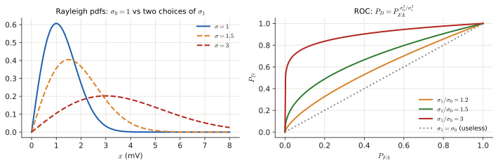
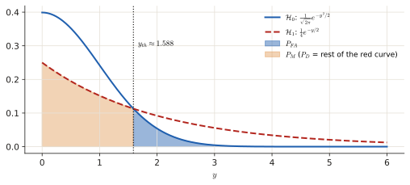
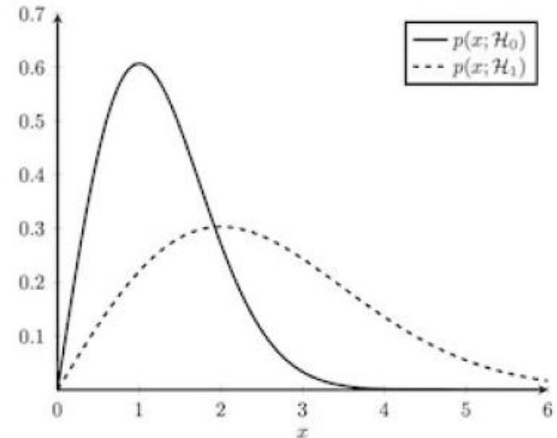
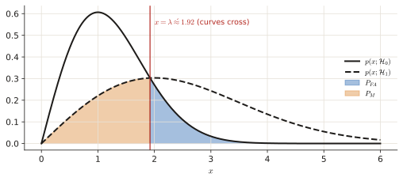
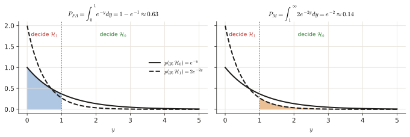
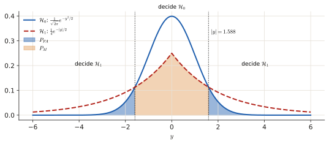
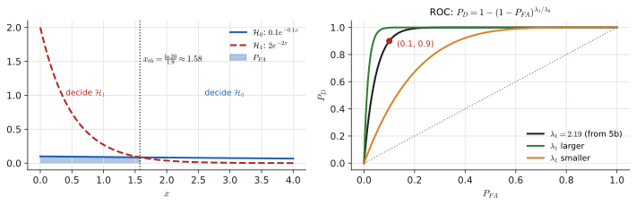
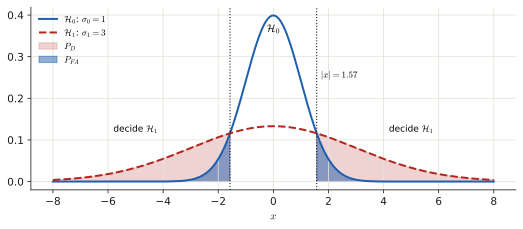

# 4.2 Likelihood ratio tests

The only question type that appears in <b>every</b> exam (9/9). You get two PDFs and must turn "ratio of likelihoods ≷ threshold" into a simple rule like "$x > 1.92$" or "$\sum|x_n| < \gamma'$", then often compute $P_{FA}$ and $P_D$. Same steps every time; the only trap is the direction of the inequality. This page shows where the ratio comes from, then does the algebra slowly.

!!! need "Before this page"
    - Hypotheses, the four outcomes, $P_{FA}$, $P_D$, thresholds, ROC ([4.1](p4-basics.md))
    - PDFs, the Gaussian, $Q(x)$, independence ([0.6](p0-foundations.md#06-probability-from-zero))
    - $\ln$, $e^x$ and their rules ([Toolbox](toolbox.md#2-logs-and-exponentials)); integrals as areas ([0.4](p0-foundations.md#04-the-three-calculations-you-keep-meeting))

    If you read only one thing: **the likelihood ratio says "how many times better does $\mathcal H_1$ explain this data than $\mathcal H_0$ does?". Whatever the PDFs look like, the algebra simply turns that sentence into "compare one number computed from the data with a threshold".**

---

## 1 · The idea, from zero

### 1.1 Which story explains the data better?

You have an observation $x$ and two stories, $\mathcal H_0$ and $\mathcal H_1$. Each story assigns a PDF value to $x$: $p(x\mid\mathcal H_0)$ and $p(x\mid\mathcal H_1)$ — "how plausible is it to see this $x$ if that story were true". The **likelihood ratio** is their ratio:

$$L(\mathbf x)=\frac{p(\mathbf x\mid\mathcal H_1)}{p(\mathbf x\mid\mathcal H_0)}\ \underset{\mathcal H_0}{\overset{\mathcal H_1}{\gtrless}}\ \lambda .$$

Read: "if $L>\lambda$ decide $\mathcal H_1$, otherwise decide $\mathcal H_0$" ($\lambda$ = the **threshold** of the test).

!!! example "Tiny example with numbers"
    $\mathcal H_0$: $x\sim\mathcal N(0,1)$, $\mathcal H_1$: $x\sim\mathcal N(2,1)$ (the example of [4.1](p4-basics.md#11-two-stories-about-the-data)). You observe $x=1.5$.

    - $p(1.5\mid\mathcal H_0)=\frac1{\sqrt{2\pi}}e^{-1.5^2/2}=0.3989\cdot e^{-1.125}=0.3989\cdot0.3247=0.1295$
    - $p(1.5\mid\mathcal H_1)=\frac1{\sqrt{2\pi}}e^{-(1.5-2)^2/2}=0.3989\cdot e^{-0.125}=0.3989\cdot0.8825=0.3521$
    - $L=\dfrac{0.3521}{0.1295}=2.72$: the signal story explains $x=1.5$ about 2.7 times better. With $\lambda=1$ we decide $\mathcal H_1$.

### 1.2 What does the threshold $\lambda$ mean?

- $\lambda=1$: "pick whichever story explains $x$ better". Geometrically it is where the two PDFs **cross**.
- $\lambda>1$: you demand $\mathcal H_1$ to be *much* better before saying yes: fewer false alarms, fewer detections.
- Where $\lambda$ comes from: from a **target $P_{FA}$** (Neyman–Pearson, [4.1](p4-basics.md#3-neymanpearson-which-detector-is-the-best-one)) or from **priors and costs** (Bayes, [4.3](p4-bayes.md): for equal costs $\lambda=P_0/P_1$).

### 1.3 Many samples: products become sums

With $N$ **independent and identically distributed (i.i.d.)** samples $x_0,\dots,x_{N-1}$, the joint PDF of independent things is the **product** of the individual PDFs ([0.6](p0-foundations.md#conditional-probability-and-independence)):

$$p(\mathbf x\mid\mathcal H_i)=\prod_{n=0}^{N-1}p(x_n\mid\mathcal H_i).$$

Products of exponentials turn into exponentials of **sums** ($e^ae^b=e^{a+b}$), and taking $\ln$ turns the whole product into a sum. That is why test statistics look like $\sum x_n$, $\sum x_n^2$, $\sum\lvert x_n\rvert$.

---

## 2 · The recipe, with one example done slowly

!!! recipe "Recipe: from LRT to a simple rule"
    1. Write $L(\mathbf x)$. For $N$ i.i.d. samples each PDF is a **product** over $n$.
    2. Cancel everything common (the factor $x$ in Rayleigh PDFs, $\frac{1}{\sqrt{2\pi}}$, …).
    3. Take $\ln$ of both sides (the log is increasing, so the inequality direction is unchanged).
    4. Move everything that does **not** depend on the data to the right-hand side. That is the new threshold $\gamma'$.
    5. **If you multiply or divide by a negative number, the inequality flips, and so do the $\mathcal H_0$/$\mathcal H_1$ labels.**
    6. Sanity check: the hypothesis whose PDF is larger in a region should be the one you decide there.

!!! example "Worked example: a constant $A>0$ buried in noise"
    $\mathcal H_0$: $x_n\sim\mathcal N(0,\sigma^2)$. $\mathcal H_1$: $x_n\sim\mathcal N(A,\sigma^2)$, $n=0..N-1$, i.i.d.

    1. $L=\dfrac{\prod\frac1{\sqrt{2\pi\sigma^2}}e^{-(x_n-A)^2/2\sigma^2}}{\prod\frac1{\sqrt{2\pi\sigma^2}}e^{-x_n^2/2\sigma^2}}$.
    2. The factors $\frac1{\sqrt{2\pi\sigma^2}}$ cancel. Exponents add: $L=\exp\!\Big[-\frac1{2\sigma^2}\sum\big((x_n-A)^2-x_n^2\big)\Big]$.
    3. Expand $(x_n-A)^2-x_n^2=-2Ax_n+A^2$: $\ \ln L=\dfrac{A}{\sigma^2}\sum x_n-\dfrac{NA^2}{2\sigma^2}$.
    4. $\ln L>\ln\lambda\iff\dfrac A{\sigma^2}\sum x_n>\ln\lambda+\dfrac{NA^2}{2\sigma^2}$.
    5. $A>0$, so dividing by $\frac A{\sigma^2}>0$ does **not** flip: decide $\mathcal H_1$ when $\ \bar x=\frac1N\sum x_n>\dfrac{\sigma^2\ln\lambda}{NA}+\dfrac A2$.
    6. Check: for $\lambda=1$ the threshold is $A/2$, halfway between the two means. ✓

**Typical results** (memorise the shape, not the algebra):

| $\mathcal H_0$ vs $\mathcal H_1$ | Test statistic | Decide $\mathcal H_1$ when |
|---|---|---|
| Gaussian, mean 0 vs mean $A>0$ | sample mean $\bar x$ | $\bar x$ **large** |
| Gaussian, variance $\sigma_0^2$ vs $\sigma_1^2>\sigma_0^2$ | energy $\sum x_n^2$ (or $\lvert x\rvert$) | energy **large** |
| Laplacian, $\mathcal H_1$ narrower | $\sum\lvert x_n\rvert$ | $\sum\lvert x_n\rvert$ **small** |
| Exponential, $\lambda_1>\lambda_0$ | $x$ | $x$ **small** |
| Rayleigh, $\sigma_1>\sigma_0$ | $x$ | $x$ **large** |
| Known signal $s_n$ in white Gaussian noise | $\sum x_ns_n$ (matched filter) | correlation **large** |

(Rule of thumb: the hypothesis with the **wider** PDF wins in the tails, the narrower one wins near the centre.)

### 2.1 From the rule to $P_{FA}$ and $P_D$

The error probabilities are integrals of the PDFs over the "decide $\mathcal H_1$" region ([4.1 §1.3](p4-basics.md#13-each-probability-is-an-area)). Useful tools:

- Gaussians: standardise and use $Q(z)$ (or the erf table).
- Exponential $\lambda e^{-\lambda x}$: right tail $P(X>a)=e^{-\lambda a}$, so $\int_a^b\lambda e^{-\lambda x}dx=e^{-\lambda a}-e^{-\lambda b}$ and $P(X<a)=1-e^{-\lambda a}$.
- Rayleigh $\frac x{\sigma^2}e^{-x^2/2\sigma^2}$: right tail $P(X>a)=e^{-a^2/2\sigma^2}$ (substitute $u=\frac{x^2}{2\sigma^2}$, $du=\frac x{\sigma^2}dx$, the integral becomes $\int e^{-u}du$).
- **Given $P_{FA}=\alpha$, find the threshold:** invert the $P_{FA}$ formula (e.g. $1-e^{-\gamma'}=\alpha\Rightarrow\gamma'=-\ln(1-\alpha)$), then plug it into $P_D$.

---

## Exam questions

### June 2026 resit · 4b {#jun26-4b}

!!! exam "Resit Q4, June 2026 · 4b · 1 p"
    A wireless sensor detects the presence of a transmitting device by measuring the received signal envelope $X$ (in mV). Under normal operating conditions the envelope follows a Rayleigh distribution due to multipath fading. Two hypotheses are proposed:

    1. Under $H_0$ (no device present), $X \sim \text{Rayleigh}(\sigma_0)$.
    2. Under $H_1$ (device present), $X \sim \text{Rayleigh}(\sigma_1)$,

    with $\sigma_1 > \sigma_0 > 0$, both known.

    The Rayleigh pdf with scale parameter $\sigma$ is $p(x \mid \sigma) = \frac{x}{\sigma^2} \exp\left(-\frac{x^2}{2\sigma^2}\right)$, $x \geq 0$.

    - Construct the likelihood-ratio test for a threshold $\eta$.
    - Discuss how the separation between $\sigma_0$ and $\sigma_1$ affects detection performance.

???+ solution "Solution"

    **What is being asked?** (1) Turn "$L(x)>\eta$" into a rule on $x$. (2) Explain in words (and with $P_{FA},P_D$) why a bigger gap between $\sigma_0$ and $\sigma_1$ helps.

    **Symbols in this question**

    | Symbol | Meaning |
    |---|---|
    | $X$ | the measured envelope (always $\ge0$) |
    | $\sigma_0<\sigma_1$ | Rayleigh scale: a larger $\sigma$ means a bigger typical envelope |
    | $\eta$ | the threshold on the likelihood ratio (called $\lambda$ elsewhere) |

    **Step 1 — write $L(x)$ and cancel.** The factor $x$ appears in both PDFs and cancels:

    $$L(x)=\frac{\frac{x}{\sigma_1^2}e^{-x^2/2\sigma_1^2}}{\frac{x}{\sigma_0^2}e^{-x^2/2\sigma_0^2}}=\frac{\sigma_0^2}{\sigma_1^2}\exp\!\left[\frac{x^2}{2}\left(\frac1{\sigma_0^2}-\frac1{\sigma_1^2}\right)\right]\ \underset{H_0}{\overset{H_1}{\gtrless}}\ \eta.$$

    **Step 2 — take $\ln$ and isolate $x^2$.** $\ln\frac{\sigma_0^2}{\sigma_1^2}+\frac{x^2}2\cdot\frac{\sigma_1^2-\sigma_0^2}{\sigma_0^2\sigma_1^2}\gtrless\ln\eta$ (using $\frac1{\sigma_0^2}-\frac1{\sigma_1^2}=\frac{\sigma_1^2-\sigma_0^2}{\sigma_0^2\sigma_1^2}$). Since $\sigma_1>\sigma_0$ this factor is **positive**, so nothing flips when we divide by it:

    $$x^2\ \underset{H_0}{\overset{H_1}{\gtrless}}\ \frac{2\sigma_0^2\sigma_1^2}{\sigma_1^2-\sigma_0^2}\,\ln\!\left(\eta\frac{\sigma_1^2}{\sigma_0^2}\right).$$

    **Step 3 — square root.** $x\ge0$, so taking the root is safe (and keeps the direction):

    $$x\ \underset{H_0}{\overset{H_1}{\gtrless}}\ \gamma=\sqrt{\frac{2\sigma_0^2\sigma_1^2}{\sigma_1^2-\sigma_0^2}\ln\!\left(\eta\frac{\sigma_1^2}{\sigma_0^2}\right)}.$$

    In words: a **strong** envelope means a device is there.

    **Step 4 — performance.** Rayleigh right tail: $P(X>\gamma)=e^{-\gamma^2/2\sigma^2}$ ([section 2.1](#21-from-the-rule-to-p_fa-and-p_d)). So

    $$P_{FA}=e^{-\gamma^2/2\sigma_0^2},\qquad P_D=e^{-\gamma^2/2\sigma_1^2}=\Big(e^{-\gamma^2/2\sigma_0^2}\Big)^{\sigma_0^2/\sigma_1^2}=P_{FA}^{\,\sigma_0^2/\sigma_1^2}.$$

    

    *Example:* $\sigma_1^2=4\sigma_0^2$ gives $P_D=P_{FA}^{1/4}$; at $P_{FA}=0.01$ that is $P_D=0.01^{0.25}=0.316$. With $\sigma_1^2=9\sigma_0^2$, $P_D=0.01^{1/9}=0.60$. A bigger gap → smaller exponent → higher $P_D$ at the same $P_{FA}$.

    **Interpretation.** The larger $\sigma_1/\sigma_0$, the less the two PDFs overlap, so the ROC moves towards the top-left corner. When $\sigma_1\to\sigma_0$ the PDFs coincide, the exponent $\to1$, $P_D\to P_{FA}$ and the detector is no better than guessing.

    !!! answer "Answer"
        Decide $H_1$ if $x>\gamma=\sqrt{\frac{2\sigma_0^2\sigma_1^2}{\sigma_1^2-\sigma_0^2}\ln\!\big(\eta\,\sigma_1^2/\sigma_0^2\big)}$. Bigger separation → less overlap → higher $P_D$ at the same $P_{FA}$ ($P_D=P_{FA}^{\sigma_0^2/\sigma_1^2}$).

### April 2025 exam · 4a {#apr25-4a}

!!! exam "Final exam Q3, 13 April 2025 · 4a · 0.5 p"
    You are conducting a likelihood ratio test using a single datapoint $x$, $0 < x < 1$ whereby $p(x) = k_1 \theta x^{k_2 \theta - 1}$. Two hypothesis can be distinguished

    $$\mathcal{H}_0 : \theta = 3, \qquad \mathcal{H}_1 : \theta = 6.$$

    If $\lambda = 0.2$, $k_1 = 1$, and $k_2 = 2$, what is the value for $x$ for which $\mathcal{H}_1$ should be accepted?

???+ solution "Solution"

    **What is being asked?** Find the values of $x$ for which $L(x)>\lambda=0.2$, i.e. the "accept $\mathcal H_1$" region.

    **Symbols in this question**

    | Symbol | Meaning |
    |---|---|
    | $\theta$ | the parameter of the PDF: 3 under $\mathcal H_0$, 6 under $\mathcal H_1$ |
    | $k_1=1,\ k_2=2$ | constants; so $p(x)=\theta x^{2\theta-1}$ |

    **Step 1 — plug in.** $p(x\mid\mathcal H_0)=3x^{2\cdot3-1}=3x^{5}$ and $p(x\mid\mathcal H_1)=6x^{2\cdot6-1}=6x^{11}$. (Both integrate to $\tfrac12$ on $(0,1)$, which is why they are not perfect PDFs; the factor cancels in the ratio.)

    **Step 2 — the ratio.** $L(x)=\dfrac{6x^{11}}{3x^{5}}=2x^{6}$ (divide the numbers, subtract the exponents).

    **Step 3 — compare with $\lambda$.** $2x^6\ge0.2\iff x^6\ge0.1\iff x\ge0.1^{1/6}$. Numerically: $\ln0.1=-2.3026$, divided by 6: $-0.3838$, and $e^{-0.3838}=0.681$.

    !!! answer "Answer"
        Accept $\mathcal H_1$ for $0.68\lesssim x<1$ ($x\ge0.1^{1/6}$)

### April 2024 exam · 4b {#apr24-4b}

!!! exam "Final exam Q3, April 2024 · 4b · 1.5 p"
    Consider the hypothesis

    $$\mathcal{H}_0: p(y) = \frac{1}{\sqrt{2\pi}} e^{-\frac{y^2}{2}}$$

    $$\mathcal{H}_1: p(y) = \frac{1}{4} e^{-\frac{y}{2}}$$

    where $y > 0$.

    - Sketch the likelihoods.
    - For a threshold $\gamma = 1$, indicate the probability of false alarm and the probability of missed detection.
    - For a threshold $\gamma = 1$, calculate the probability of detection and the probability of false alarm. Use the expression $Q(x) = \int_x^{\infty} \frac{1}{\sqrt{2\pi}} e^{-\frac{u^2}{2}} du$ for the $Q$ function. There is no need to provide exact numerical values.

???+ solution "Solution"

    **What is being asked?** Here "threshold $\gamma=1$" is the threshold on the **likelihood ratio** ($L>1$ means "decide the PDF that is higher"), not a value of $y$. So: (1) draw both PDFs; (2) find the $y$ where they cross (that is where $L=1$) and shade $P_{FA}$ and $P_M$; (3) compute $P_{FA}$ and $P_D$ as tail areas.

    **Step 1 — sketch.** $\mathcal H_0$ starts at $\frac1{\sqrt{2\pi}}=0.40$ at $y=0$ and drops fast (Gaussian tail). $\mathcal H_1$ starts at $0.25$ and decays slowly (exponential tail). So $\mathcal H_0$ is higher near 0 and $\mathcal H_1$ is higher for large $y$.

    **Step 2 — where they cross ($L=1$):**

    $$\frac{\frac14e^{-y/2}}{\frac1{\sqrt{2\pi}}e^{-y^2/2}}=1\iff e^{(y^2-y)/2}=\frac{4}{\sqrt{2\pi}}\iff y^2-y=2\ln\frac{4}{\sqrt{2\pi}}=2(1.3863-0.9189)=0.935.$$

    (Take $\ln$, then multiply by 2. $\ln4=1.3863$ and $\ln\sqrt{2\pi}=\frac12\ln2\pi=0.9189$.) Solve the quadratic $y^2-y-0.935=0$:

    $$y_{th}=\frac{1+\sqrt{1+4(0.935)}}{2}=\frac{1+\sqrt{4.74}}2=\frac{1+2.177}{2}\approx1.588.$$

    Decide $\mathcal H_1$ for $y>1.588$.

    

    **Step 3 — what to shade.** $P_{FA}$ = area under the **$\mathcal H_0$** curve to the right of 1.588 (blue). $P_M$ = area under the **$\mathcal H_1$** curve to the left of 1.588 (orange).

    **Step 4 — the values**, with the densities exactly as printed:

    $$P_{FA}=\int_{y_{th}}^\infty\frac{1}{\sqrt{2\pi}}e^{-y^2/2}dy=Q(y_{th})\approx Q(1.588)\approx0.056,\qquad P_D=\int_{y_{th}}^\infty\frac14e^{-y/2}dy=\Big[-\tfrac12e^{-y/2}\Big]_{y_{th}}^\infty=\tfrac12e^{-y_{th}/2}\approx0.226.$$

    !!! trap "Normalisation"
        On $y>0$ each printed density integrates to ½ (they are the two-sided densities of [Jan 2022 4b](#jan22-4b) cut in half). If you normalise them (×2) you get $P_{FA}=2Q(1.588)\approx0.11$ and $P_D=e^{-0.794}\approx0.45$, the Jan 2022 numbers. The threshold is the same either way. Write the expressions in $Q$ and say which convention you used.

    !!! answer "Answer"
        Decide $\mathcal H_1$ if $y>y_{th}\approx1.59$; $P_{FA}=Q(y_{th})$, $P_D=\frac12e^{-y_{th}/2}$ (≈ 0.056 and 0.23 as printed; ×2 if normalised).

### Q1 2023 resit · 4c, 4d {#q1-23-4c}

!!! exam "Resit Q1 2023 · 4c, 4d (shown in the Part 4 review lecture)"
    Consider a binary hypothesis testing problem where we use the single observations $x$ to discriminate between two hypotheses $\mathcal{H}_0$ and $\mathcal{H}_1$. Under the two hypotheses, the single observation $x$ admits the following distributions:

    $$p(x; \mathcal{H}_0) = x e^{-\frac{x^2}{2}},\ x>0, \qquad p(x; \mathcal{H}_1) = \frac{x}{4} e^{-\frac{x^2}{8}},\ x>0 \quad(0\text{ else}).$$

    **4c** In the figure below, the probability density function for $x$ under both hypotheses is illustrated. For a likelihood ratio test $L(x) = \frac{p(x|\mathcal{H}_1)}{p(x|\mathcal{H}_0)} \underset{\mathcal{H}_0}{\overset{\mathcal{H}_1}{\gtrless}} \lambda$ with threshold $\lambda = 1$, indicate the probability of false alarm and the probability of miss.

    

    **4d** Assuming a single observation, show that the likelihood ratio can be written as a function of the observation $x$, i.e., $x \underset{\mathcal{H}_0}{\overset{\mathcal{H}_1}{\gtrless}} \lambda'$. Find an expression for $\lambda'$ and calculate its value for $\lambda = 1$.

???+ solution "Solution"

    **What is being asked?** 4d: reduce $L(x)>\lambda$ to $x>\lambda'$ and compute $\lambda'$ for $\lambda=1$. 4c: shade $P_{FA}$ and $P_M$ for that threshold.

    **Reading the plot.** Solid = $\mathcal H_0$ (Rayleigh with $\sigma=1$, peak at 1). Dashed = $\mathcal H_1$ (Rayleigh with $\sigma=2$, peak at 2, wider and lower). $\lambda=1$ means the boundary is where the curves **cross**.

    **Step 1 — 4d: the ratio** (the factor $x$ cancels):

    $$L(x)=\frac{\frac x4e^{-x^2/8}}{xe^{-x^2/2}}=\frac14e^{-x^2/8+x^2/2}=\frac14e^{3x^2/8}.$$

    ($-\frac{x^2}8+\frac{x^2}2=\frac{-x^2+4x^2}8=\frac{3x^2}8$.)

    **Step 2 — isolate $x$.** $\frac14e^{3x^2/8}>\lambda\iff e^{3x^2/8}>4\lambda\iff\frac{3x^2}8>\ln(4\lambda)\iff x>\lambda'=\sqrt{\tfrac83\ln(4\lambda)}$ (positive numbers, no flip; $x>0$ so the root is safe).

    **Step 3 — number.** $\lambda=1$: $\lambda'=\sqrt{\frac83\ln4}=\sqrt{2.667\cdot1.386}=\sqrt{3.697}\approx1.92$. (Valid for $\lambda>\frac14$; for smaller $\lambda$, $\ln(4\lambda)<0$ and you always decide $\mathcal H_1$.)

    **Step 4 — 4c: shading.** Right of 1.92 the dashed curve is on top → decide $\mathcal H_1$ there.

    

    - $P_{FA}$ = area under the **solid** curve for $x>1.92$ (value: Rayleigh tail $e^{-1.92^2/2}=e^{-1.85}\approx0.16$).
    - $P_M$ = area under the **dashed** curve for $x<1.92$ (value: $1-e^{-1.92^2/(2\cdot4)}=1-e^{-0.46}\approx0.37$).

    !!! answer "Answer"
        $\lambda'=\sqrt{\frac83\ln(4\lambda)}\approx1.92$ for $\lambda=1$; $P_{FA}$ = $\mathcal H_0$ tail right of 1.92, $P_M$ = $\mathcal H_1$ area left of 1.92.

### November 2022 exam · 4c, 4d, 4e {#nov22-4c}

!!! exam "Final exam Q1, 7 November 2022 · 4c (0.5 p), 4d (0.25 p), 4e (0.5 p)"
    Consider a binary hypothesis testing problem where we use the observations vector $\mathbf{x}$ of length $N$ to decide between two hypotheses $\mathcal{H}_0$ and $\mathcal{H}_1$. Under the two hypotheses, a single observation $x$ admits a zero mean Laplacian distribution, but with different variances which are given as

    $$\mathcal{H}_0 : p(x; \mathcal{H}_0) = \frac{1}{2}e^{-|x|}\qquad\text{and}\qquad\mathcal{H}_1 : p(x; \mathcal{H}_1) = e^{-2|x|}.$$

    Assume that each observation $x_n$ of the observation vector $\mathbf{x}$ is independent and identically distributed.

    **4c** Show that the likelihood ratio test for deciding between these two hypotheses takes the form $\sum_{n=0}^{N-1} |x_n| \underset{\mathcal{H}_1}{\overset{\mathcal{H}_0}{\gtrless}} \gamma'.$ Additionally, determine the threshold $\gamma'$. **Hint:** Pay special attention to the inequality in the decision criteria, i.e., when you decide on one of the two hypotheses.

    **4d** For the case $N = 1$, the hypothesis test becomes $|x_n| \underset{\mathcal{H}_1}{\overset{\mathcal{H}_0}{\gtrless}} \gamma'$, which can be simplified by considering a new random variable $Y = |X|$ with distributions $\mathcal{H}_0: p(y; \mathcal{H}_0) = e^{-y}$, $\mathcal{H}_1: p(y; \mathcal{H}_1) = 2e^{-2y}$. The likelihood ratio test is then given by $y \underset{\mathcal{H}_1}{\overset{\mathcal{H}_0}{\gtrless}} \gamma'$. The distribution of $y$ under the two hypotheses is illustrated below. Indicate the probability of false alarm $P_{FA}$ and the probability of miss $P_M$ for a threshold $\gamma' = 1$ in the plot. **Hint:** Pay special attention to the inequality in the decision criteria, i.e., when you decide on one of the two hypotheses.

    

    **4e** For a $P_{FA} = 0.1$ calculate the threshold $\gamma'$. For the threshold you have found, calculate the probability of detection $P_D$.

???+ solution "Solution"

    **What is being asked?** 4c: derive the sum-of-absolute-values test and its threshold, paying attention to the flip. 4d: shade $P_{FA}$ and $P_M$ (watch which side is "decide $\mathcal H_1$"). 4e: choose the threshold that gives $P_{FA}=0.1$ and compute $P_D$.

    **Symbols in this question**

    | Symbol | Meaning |
    |---|---|
    | $N$ | number of samples; $x_n$ independent |
    | $\gamma$ | threshold on the likelihood ratio |
    | $\gamma'$ | the new threshold on the statistic $\sum\lvert x_n\rvert$ |
    | $y=\lvert x\rvert$ | the absolute value of one sample (an exponential random variable) |

    **Step 1 — 4c: likelihood ratio of $N$ i.i.d. samples** ([1.3](#13-many-samples-products-become-sums)):

    $$L(\mathbf x)=\frac{\prod_ne^{-2|x_n|}}{\prod_n\frac12e^{-|x_n|}}=\frac{e^{-2\sum|x_n|}}{2^{-N}e^{-\sum|x_n|}}=2^Ne^{-\sum_n|x_n|}\ \underset{\mathcal H_0}{\overset{\mathcal H_1}{\gtrless}}\ \gamma.$$

    **Step 2 — take $\ln$:** $N\ln2-\sum_n|x_n|\ \gtrless\ \ln\gamma$. Move $N\ln2$ to the right: $-\sum_n|x_n|\gtrless\ln\gamma-N\ln2$.

    **Step 3 — multiply by $-1$.** This **flips the inequality and the labels** ($\mathcal H_1$ was on top of "$>$", now it sits under "$<$"):

    $$\sum_{n=0}^{N-1}|x_n|\ \underset{\mathcal H_1}{\overset{\mathcal H_0}{\gtrless}}\ \gamma'=N\ln2-\ln\gamma.$$

    So $\mathcal H_1$ (the *narrower* Laplacian) is chosen when the samples are **small** (sum below $\gamma'$). That agrees with intuition: $e^{-2|x|}$ is concentrated near 0.

    **Step 4 — 4d: which side is "decide $\mathcal H_1$"?** Small $y$: $y<\gamma'=1$.

    

    $P_{FA}$ = area under the **solid** $\mathcal H_0$ curve for $0\le y<1$. $P_M$ = area under the **dashed** $\mathcal H_1$ curve for $y>1$. (Not "the tail on the right" as usual: the hint is about exactly this.)

    **Step 5 — 4e: threshold for $P_{FA}=0.1$.** Decide $\mathcal H_1$ for $y<\gamma'$, so $P_{FA}=\int_0^{\gamma'}e^{-y}dy=1-e^{-\gamma'}=0.1\Rightarrow e^{-\gamma'}=0.9\Rightarrow\gamma'=-\ln0.9\approx0.105$.

    **Step 6 — $P_D$** with the same threshold and the $\mathcal H_1$ PDF: $P_D=\int_0^{\gamma'}2e^{-2y}dy=1-e^{-2\gamma'}=1-(e^{-\gamma'})^2=1-0.9^2=1-0.81=0.19$.

    !!! answer "Answer"
        4c: $\gamma'=N\ln2-\ln\gamma$ (decide $\mathcal H_1$ when $\sum|x_n|<\gamma'$). 4d: shaded as above. 4e: $\gamma'=-\ln0.9\approx0.105$, $P_D=0.19$.

### January 2022 resit · 4b, 4c {#jan22-4b}

!!! exam "Resit, 24 January 2022 · 4b (0.7 p), 4c (1 p)"
    Consider hypotheses:

    $$\mathcal{H}_0: p_Y(y) = \frac{1}{\sqrt{2\pi}} e^{-\frac{y^2}{2}},\qquad\mathcal{H}_1: p_Y(y) = \frac{1}{4} e^{-\frac{|y|}{2}}.$$

    **4b** Provide a sketch for the two PDFs and indicate the probability of false alarm and missed detection for a likelihood test with $\gamma = 1$.

    **4c** Calculate the probability of detection and false alarm for $\gamma = 1$. Below you can find a table with selected values of the Q-function which is defined as $Q(x) = \int_x^{\infty} \frac{1}{\sqrt{2\pi}} e^{-\frac{u^2}{2}} du$.

    | x | 1.51 | 1.52 | 1.53 | 1.54 | 1.55 | 1.56 | 1.57 | 1.58 | 1.59 |
    |---|---|---|---|---|---|---|---|---|---|
    | Q(x) | 0.0655 | 0.0643 | 0.0630 | 0.0618 | 0.0606 | 0.0594 | 0.0582 | 0.0571 | 0.0559 |

???+ solution "Solution"

    **What is being asked?** The same problem as [April 2024 4b](#apr24-4b), but now $y$ can be negative (two-sided PDFs), so there are **two** tails. $\gamma=1$ is again the threshold on the ratio.

    **Step 1 — the crossing points.** Same algebra, with $\lvert y\rvert$: $\frac{\sqrt{2\pi}}{4}e^{(y^2-|y|)/2}=1\iff y^2-|y|=2\ln4-\ln2\pi=0.935\iff|y|=1.588.$ Decide $\mathcal H_1$ for $|y|>1.588$ (both tails: the Laplacian has heavier tails than the Gaussian).

    

    **Step 2 — shading.** $P_{FA}$ = the two Gaussian tails beyond $\pm1.588$ (blue). $P_M$ = the Laplacian area between $-1.588$ and $1.588$ (orange).

    **Step 3 — 4c: detection.** By symmetry double the right tail: $P_D=2\int_{1.588}^\infty\frac14e^{-y/2}dy=2\cdot\frac14\cdot2e^{-1.588/2}=e^{-0.794}=0.452$.

    **Step 4 — false alarm.** $P_{FA}=2Q(1.588)$. From the table, $Q(1.59)=0.0559$ (and $Q(1.58)=0.0571$), so $P_{FA}\approx2(0.0559)=0.112$.

    !!! answer "Answer"
        Decide $\mathcal H_1$ if $|y|>1.588$; $P_D\approx0.45$, $P_{FA}\approx0.11$.

### Practice exam 2021 · 4b {#pe21-4b}

!!! exam "Practice exam, 28 October 2021 · 4b · 1 p"
    Consider a binary hypothesis testing problem where the observed data $x[0], x[1], \dots, x[n]$ consists of independent identically distributed samples and follows the PDF's

    $$x[n] \sim \begin{cases} \mathcal{N}(0, \sigma_0^2), & \text{if } \mathcal{H}_0 \\ \mathcal{N}(0, \sigma_1^2), & \text{if } \mathcal{H}_1 \end{cases}$$

    where $\sigma_1 > \sigma_0$. Derive the log-likelihood ratio test that uses the observed data.

???+ solution "Solution"

    **What is being asked?** The recipe of [section 2](#2-the-recipe-with-one-example-done-slowly) for two zero-mean Gaussians that differ only in variance. The result is the classic **energy detector**.

    **Step 1 — the ratio.** Each sample: $\frac1{\sqrt{2\pi\sigma_i^2}}e^{-x_n^2/2\sigma_i^2}$. For $N$ samples (product, the exponents add):

    $$L(\mathbf x)=\frac{(2\pi\sigma_1^2)^{-N/2}e^{-\sum x^2[n]/2\sigma_1^2}}{(2\pi\sigma_0^2)^{-N/2}e^{-\sum x^2[n]/2\sigma_0^2}}.$$

    **Step 2 — $\ln$.** $\ln\frac{(\sigma_1^2)^{-N/2}}{(\sigma_0^2)^{-N/2}}=-\frac N2\ln\frac{\sigma_1^2}{\sigma_0^2}=N\ln\frac{\sigma_0}{\sigma_1}$, and the exponents give $\frac12\big(\frac1{\sigma_0^2}-\frac1{\sigma_1^2}\big)\sum x^2[n]$:

    $$\ln L(\mathbf x)=N\ln\frac{\sigma_0}{\sigma_1}+\frac12\left(\frac1{\sigma_0^2}-\frac1{\sigma_1^2}\right)\sum_nx^2[n]\ \underset{\mathcal H_0}{\overset{\mathcal H_1}{\gtrless}}\ \ln\gamma.$$

    **Step 3 — isolate the data.** Move the constant to the right: $\ln\gamma-N\ln\frac{\sigma_0}{\sigma_1}=\ln\gamma+N\ln\frac{\sigma_1}{\sigma_0}$. The bracket $\frac1{\sigma_0^2}-\frac1{\sigma_1^2}=\frac{\sigma_1^2-\sigma_0^2}{\sigma_0^2\sigma_1^2}$ is positive ($\sigma_1>\sigma_0$), so dividing by it does not flip:

    $$\sum_nx^2[n]\ \underset{\mathcal H_0}{\overset{\mathcal H_1}{\gtrless}}\ \frac{2\sigma_0^2\sigma_1^2}{\sigma_1^2-\sigma_0^2}\left(\ln\gamma+N\ln\frac{\sigma_1}{\sigma_0}\right).$$

    An **energy detector**: a bigger variance shows up as more energy ([3.1](p3-windows.md#1-energy-vs-power-which-one-is-this-signal): energy = squares added).

    !!! answer "Answer"
        $\ln L=N\ln\frac{\sigma_0}{\sigma_1}+\frac12\big(\frac1{\sigma_0^2}-\frac1{\sigma_1^2}\big)\sum x^2[n]\gtrless\ln\gamma$, i.e. decide $\mathcal H_1$ when $\sum x^2[n]$ exceeds the threshold above.

### January 2020 retake · Exercise 5 {#jan20-5}

!!! exam "Retake exam, 20 January 2020 · Exercise 5 · 0.75 + 0.5 + 1.25 p"
    Consider the binary hypothesis testing problem where the observed data $x[0], x[1], \dots, x[n]$ consists of independent identically distributed samples and follows the exponential PDFs

    $$\mathcal{H}_0 : x[n] \sim \lambda_0 e^{-\lambda_0 x},\qquad\mathcal{H}_1 : x[n] \sim \lambda_1 e^{-\lambda_1 x}$$

    where $x \geq 0$, $\lambda_1 > \lambda_0 > 0$.

    - (a) For a single sample of observed data, roughly plot the PDFs for $\lambda_1 = 2$ and $\lambda_0 = 0.1$. Calculate and mark the threshold $x_{th}$ for likelihood ratio $\mathcal{L}(x_{th}) = 1$. Write down the equations for calculating the probability of detection $P_d$ and the probability of false alarm $P_{fa}$ in terms of $\lambda_0$, $\lambda_1$ and $x_{th}$. [0.75 pt.] **Hint:** The cumulative distribution function for the exponential PDF is $P(x < x_{th}) = 1 - e^{-\lambda x}$. Design your binary hypothesis test such that $P_d > P_{fa}$.
    - (b) Given $\lambda_0 = 0.1$, find $\lambda_1$ that gives $P_d = 0.9$ when $P_{fa} = 0.1$. [0.5 pt.]
    - (c) Plot the ROC curve with $P_d$ on the vertical axis and $P_{fa}$ on the horizontal axis for the $\lambda_1$ value calculated in (b), by calculating the $P_d$ for $P_{fa} = 0.5$ and $P_{fa} = 0.9$ as reference points for the ROC curve. Roughly sketch (without calculating $P_d$ and $P_{fa}$) two more curves describing the cases where $\lambda_1$ is increased and $\lambda_1$ is decreased. **Hint:** Even if you are not able to calculate the $\lambda_1$ in (b), roughly plot the ROC curves as described above to get partial grading. [1.25 pt.]

???+ solution "Solution"

    **What is being asked?** (a) Find where the two exponential PDFs cross, decide on which side to say $\mathcal H_1$, write $P_d$ and $P_{fa}$. (b) Find the rate $\lambda_1$ that makes ($P_{fa}=0.1$, $P_d=0.9$) true. (c) Sketch ROC curves.

    **Symbols in this question**

    | Symbol | Meaning |
    |---|---|
    | $\lambda_0,\lambda_1$ | rate of the exponential PDF under each hypothesis (large rate = PDF squeezed towards 0) |
    | $x_{th}$ | threshold on $x$ |
    | CDF $1-e^{-\lambda x}$ | $P(X<x)$ for an exponential |

    **Step 1 — (a): the crossing.** $L(x)=\dfrac{\lambda_1e^{-\lambda_1x}}{\lambda_0e^{-\lambda_0x}}=\dfrac{\lambda_1}{\lambda_0}e^{-(\lambda_1-\lambda_0)x}=20e^{-1.9x}$. Set $L=1$: $e^{-1.9x}=\frac1{20}\Rightarrow x_{th}=\dfrac{\ln20}{1.9}=\dfrac{2.996}{1.9}\approx1.58$.

    **Step 2 — which side?** $L(x)$ *decreases* with $x$ (because $\lambda_1>\lambda_0$): near 0 the steep $\mathcal H_1$ PDF is higher. So **decide $\mathcal H_1$ for $x<x_{th}$** (this is what makes $P_d>P_{fa}$, as the hint asks).

    **Step 3 — probabilities** (CDF, since the region is $x<x_{th}$):

    $$P_d=P(x<x_{th}\mid\mathcal H_1)=1-e^{-\lambda_1x_{th}},\qquad P_{fa}=P(x<x_{th}\mid\mathcal H_0)=1-e^{-\lambda_0x_{th}}.$$

    (Numbers for $\lambda_1=2$: $P_d=1-e^{-3.15}=0.957$, $P_{fa}=1-e^{-0.158}=0.146$.)

    **Step 4 — (b).** $P_{fa}=0.1$: $1-e^{-0.1x_{th}}=0.1\Rightarrow x_{th}=\frac{-\ln0.9}{0.1}=1.054$. Then $P_d=0.9$: $1-e^{-\lambda_1\cdot1.054}=0.9\Rightarrow\lambda_1=\frac{-\ln0.1}{1.054}=\frac{2.303}{1.054}\approx2.19$.

    **Step 5 — (c): the ROC in one formula.** $e^{-\lambda_1x}=\big(e^{-\lambda_0x}\big)^{\lambda_1/\lambda_0}=(1-P_{fa})^{\lambda_1/\lambda_0}$, so

    $$P_d=1-(1-P_{fa})^{\lambda_1/\lambda_0},\qquad\frac{\lambda_1}{\lambda_0}=21.9.$$

    $P_{fa}=0.5$: $P_d=1-0.5^{21.9}\approx1$ (threshold $x_{th}=6.93$). $P_{fa}=0.9$: $P_d\approx1$ ($x_{th}=23$). Together with $(0.1,0.9)$ the curve rises almost vertically and then stays at 1.

    

    **Step 6 — the two extra curves.** Increasing $\lambda_1$ makes the PDFs more different → the ROC moves closer to the top-left corner. Decreasing it towards $\lambda_0$ → closer to the diagonal.

    !!! answer "Answer"
        (a) $x_{th}=\frac{\ln20}{1.9}\approx1.58$, decide $\mathcal H_1$ for $x<x_{th}$, $P_d=1-e^{-\lambda_1x_{th}}$, $P_{fa}=1-e^{-\lambda_0x_{th}}$. (b) $\lambda_1\approx2.19$. (c) $P_d\approx1$ at both points; curves as in the figure.

### November 2019 exam · Exercise 4 {#nov19-4}

!!! exam "Written exam, 4 November 2019 · Exercise 4 · 0.5 + 0.5 + 1 p"
    Consider the binary hypothesis testing problem where the observed data $x[0], x[1], \dots, x[n]$ consists of independent identically distributed samples and follows the PDF's

    $$\mathcal{H}_0 : x[n] \sim \mathcal{N}(0, \sigma_0^2),\qquad\mathcal{H}_1 : x[n] \sim \mathcal{N}(0, \sigma_1^2)$$

    where $\sigma_1 > \sigma_0$.

    - (a) For a single sample of observed data, roughly plot the PDF's and mark the threshold for likelihood ratio $\mathcal{L}(x[n]) = 1$. Write down the equations for calculating the probability of detection $P_d$ and the probability of false alarm $P_{fa}$ in terms of $p(x[n]; \mathcal{H}_1)$ and $p(x[n]; \mathcal{H}_0)$ (i.e. you don't need to write the Gaussian PDF explicitly). [0.5 pt.]
    - (b) Calculate the probability of detection and the probability of false alarm when $\sigma_1 = 3\sigma_0$ and the likelihood ratio is chosen such that the threshold is $x_{th} = \sigma_1$. For the calculations, use the values given below for $x \sim \mathcal{N}(0, \sigma^2)$: $Pr(0 \leq x \leq \sigma) = 0.341$, $Pr(\sigma \leq x \leq 2\sigma) = 0.136$, $Pr(2\sigma \leq x \leq 3\sigma) = 0.021$ [0.5 pt.]
    - (c) Derive the log-likelihood ratio test that uses the observed data $x[0], x[1], \dots, x[n]$, starting from the likelihood ratio formulation $\mathcal{L}(x) = \frac{p(\mathbf{x}; \mathcal{H}_1)}{p(\mathbf{x}; \mathcal{H}_0)} > \gamma$ [1 pt.]

???+ solution "Solution"

    **What is being asked?** Two zero-mean Gaussians with different widths. (a) picture + formulas, (b) numbers from the "68–95–99.7"-style table, (c) the energy detector (identical to [Oct 2021 4b](#pe21-4b)).

    **Step 1 — (a): picture.** Both centred at 0; $\mathcal H_1$ is wider and lower. They cross at $\pm x_{th}$ where $L=1$: $\frac{\sigma_0}{\sigma_1}e^{\frac{x^2}{2}(\frac1{\sigma_0^2}-\frac1{\sigma_1^2})}=1\Rightarrow x_{th}^2=\frac{2\sigma_0^2\sigma_1^2}{\sigma_1^2-\sigma_0^2}\ln\frac{\sigma_1}{\sigma_0}$. The wider PDF wins in the tails, so decide $\mathcal H_1$ for $\lvert x\rvert>x_{th}$ (both tails). By symmetry:

    $$P_d=2\int_{x_{th}}^\infty p(x;\mathcal H_1)dx,\qquad P_{fa}=2\int_{x_{th}}^\infty p(x;\mathcal H_0)dx.$$

    

    **Step 2 — (b): $P_d$.** Threshold $x_{th}=\sigma_1$: under $\mathcal H_1$ it is *one* standard deviation. $P(x>\sigma_1)=0.5-P(0\le x\le\sigma_1)=0.5-0.341=0.159$. Two tails: $P_d=2\cdot0.159=0.318$.

    **Step 3 — $P_{fa}$.** Under $\mathcal H_0$ the same threshold is $x_{th}=\sigma_1=3\sigma_0$: *three* standard deviations. $P(x>3\sigma_0)=0.5-0.341-0.136-0.021=0.002$ (half the area, minus the three slices up to $3\sigma_0$). Two tails: $P_{fa}=2\cdot0.002=0.004$.

    **Step 4 — (c).** Identical to [Oct 2021 4b](#pe21-4b): $\ln\mathcal L(\mathbf x)=N\ln\frac{\sigma_0}{\sigma_1}-\frac{\sum x^2[n]}{2\sigma_1^2}+\frac{\sum x^2[n]}{2\sigma_0^2}>\ln\gamma$.

    !!! answer "Answer"
        (a) decide $\mathcal H_1$ for $|x|>x_{th}$, formulas above. (b) $P_d=0.318$, $P_{fa}=0.004$. (c) the energy detector above.

### January 2019 retake · Exercise 3 {#jan19-3}

!!! exam "Written exam, 21 January 2019 · Exercise 3 · 1.25 + 1.25 p"
    Consider a binary hypothesis testing problem, where a decision on the underlying hypotheses is to be made based on the realizations of the random variable $x$.

    (a) Formulate the likelihood ratio test, probability of false alarm and probability of detection. Represent the distributions for the random variable under the hypotheses $\mathcal{H}_0$ and $\mathcal{H}_1$ as $p(\mathbf{x}; \mathcal{H}_0)$ and $p(\mathbf{x}; \mathcal{H}_1)$ respectively. [1.25 pt.]

    (b) Consider the two hypotheses are $p(x) \sim \mathcal{N}(0, 1)$ under $\mathcal{H}_0$ and $\mathcal{N}(\mu_1, \sigma_1)$ under $\mathcal{H}_1$. Given the cumulative distribution function is calculated as $p(x \leq X; \mu, \sigma) = \frac{1}{2} \left[ 1 + \operatorname{erf} \left( \frac{X - \mu}{\sigma\sqrt{2}} \right) \right]$ and using the table for the function $\operatorname{erf} \left( \frac{X}{\sqrt{2}} \right)$ given below ($X=-3\dots3$: $-0.997, -0.954, -0.683, 0, 0.683, 0.954, 0.997$), calculate the probability of detection $P_d$ and the probability of false alarm $P_{fa}$ for the threshold values $X$, means $\mu_1$ and standard deviations $\sigma_1$ listed in the table: $(X,\mu_1,\sigma_1)=(1,1,1),\ (1,3,1),\ (1,3,2),\ (2,3,1)$. [1.25 pt.]

???+ solution "Solution"

    **What is being asked?** (a) The definitions of [section 1](#1-the-idea-from-zero) and [4.1](p4-basics.md#13-each-probability-is-an-area) written with general PDFs. (b) The same computation as [Practice exam 2021 4a](p4-basics.md#pe21-4a), now with a different $\sigma_1$ as well.

    **Step 1 — (a).**

    $$\mathcal L(\mathbf x)=\frac{p(\mathbf x;\mathcal H_1)}{p(\mathbf x;\mathcal H_0)}\gtrless\gamma,\qquad P_{fa}=\int_{\{\mathbf x:\mathcal L(\mathbf x)>\gamma\}}p(\mathbf x;\mathcal H_0)d\mathbf x,\qquad P_d=\int_{\{\mathbf x:\mathcal L(\mathbf x)>\gamma\}}p(\mathbf x;\mathcal H_1)d\mathbf x.$$

    (The old key writes the ratio upside down; use the standard form above.)

    **Step 2 — (b): right tails.** Decide $\mathcal H_1$ for $x>X$, so each probability is $1-\text{CDF}=\frac12\big[1-\operatorname{erf}\big(\frac{X-\mu}{\sigma\sqrt2}\big)\big]$. Standardise first: $z=(X-\mu)/\sigma$, then read the erf table at $z$.

    - $P_{fa}$: $\mathcal H_0$ is $\mathcal N(0,1)$, so $z=X$.
    - $P_d$: $z=(X-\mu_1)/\sigma_1$.

    Row 3, for example, $(X,\mu_1,\sigma_1)=(1,3,2)$: $z=\frac{1-3}2=-1$; erf $=-0.683$; $P_d=\frac12(1+0.683)=0.8415$.

    | $X$ | $\mu_1$ | $\sigma_1$ | $z$ for $P_d$ | $P_d$ | $P_{fa}$ ($z=X$) |
    |---|---|---|---|---|---|
    | 1 | 1 | 1 | 0 | 0.5 | 0.159 |
    | 1 | 3 | 1 | −2 | 0.977 | 0.159 |
    | 1 | 3 | 2 | −1 | 0.841 | 0.159 |
    | 2 | 3 | 1 | −1 | 0.841 | 0.023 |

    !!! answer "Answer"
        Table above.

*[likelihood ratio]: L(x) = p(x | H₁) / p(x | H₀): how many times better H₁ explains the data than H₀.
*[LRT]: likelihood ratio test: decide H₁ when L(x) exceeds a threshold.
*[i.i.d.]: independent and identically distributed: each sample is independent of the others and has the same PDF.
*[energy detector]: decide H₁ when Σx² is large; optimal for a variance change.
*[Laplacian]: a two-sided exponential PDF, proportional to e^(−|x|/b).
*[Rayleigh]: PDF (x/σ²)e^(−x²/2σ²), x ≥ 0; the envelope of Gaussian noise.
*[matched filter]: correlate the data with the known signal and compare with a threshold.
*[standardise]: subtract the mean and divide by the standard deviation to get an N(0,1) variable.
