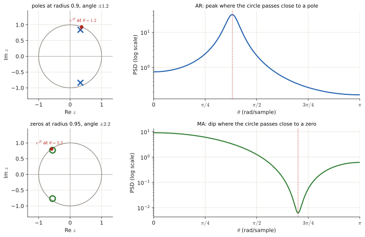

# Toolbox: the maths the solutions use

Every exam solution in this guide is built from the few tools on this page. If a step in a solution looks like magic, it is one of these. Read it once and come back when needed.

## 1. Notation you will meet

| Symbol | Read as | Meaning |
|---|---|---|
| $x[n]$ | "x of n" | a discrete-time signal: one number per integer time $n$ |
| $E[X]$ | "expected value of X" | the average of $X$ over infinitely many repetitions |
| $p(x;\theta)$, $p(x\mid\theta)$ | "pdf of x given theta" | how likely the data $x$ is if the parameter equals $\theta$ |
| $\hat\theta$ | "theta hat" | an *estimate* of $\theta$ computed from data |
| $\theta$ in spectra | "frequency" | normalised angular frequency, from $-\pi$ to $\pi$ (rad/sample) |
| $r[l]$, $r_x[l]$ | autocorrelation at lag $l$ | $E\{x[n]\,x[n-l]\}$: how similar the signal is to itself shifted by $l$ |
| $P(e^{j\theta})$ | power spectral density (PSD) | how the power of the signal is spread over frequency |
| $\mathcal H_0,\mathcal H_1$ | hypotheses | "nothing there" vs "signal / event present" |
| $\sigma_i^2$ | innovation variance | variance of the white noise $i[n]$ that drives a signal model |

## 2. Logs and exponentials

$$\ln(ab)=\ln a+\ln b,\qquad \ln\frac ab=\ln a-\ln b,\qquad \ln a^k=k\ln a,\qquad \ln e^{u}=u,\qquad e^{a}e^{b}=e^{a+b}$$

**Why $\ln(ab)=\ln a+\ln b$:** it is just $e^ae^b=e^{a+b}$ read backwards: logs turn multiplication into addition. The other rules in the line follow from it.

**Why we take logs all the time.** The log is increasing, so ==whatever maximises $f(\theta)$ also maximises $\ln f(\theta)$==. And the log turns a product of $N$ terms (likelihood of independent samples) into a sum, which is much easier to differentiate:

$$\ln\prod_{n=1}^{N} f(x_n)=\sum_{n=1}^{N}\ln f(x_n).$$

The same trick is used in detection: "$L(x)>\lambda$" is the same statement as "$\ln L(x)>\ln\lambda$".

## 3. Derivatives you need

| $f(\theta)$ | $f'(\theta)$ |
|---|---|
| $\theta^k$ | $k\theta^{k-1}$ |
| $\ln\theta$ | $1/\theta$ |
| $1/\theta$ | $-1/\theta^2$ |
| $1/\theta^2$ | $-2/\theta^3$ |
| $e^{c\theta}$ | $c\,e^{c\theta}$ |
| $\ln(1-\theta)$ | $-1/(1-\theta)$ |
| $\cos\theta$, $\sin\theta$ | $-\sin\theta$, $\cos\theta$ |
| sigmoid $\lambda(\theta)=\frac{1}{1+e^{-\theta}}$ | $\lambda(1-\lambda)$ |
| $g(h(\theta))$ (chain rule) | $g'(h(\theta))\,h'(\theta)$ |

**Where they come from:** the power rule is $\frac d{d\theta}\theta^k=k\theta^{k-1}$ (so $1/\theta=\theta^{-1}$ gives $-\theta^{-2}$). The sigmoid one: $\lambda'=\frac{e^{-\theta}}{(1+e^{-\theta})^2}=\lambda\cdot\frac{e^{-\theta}}{1+e^{-\theta}}=\lambda(1-\lambda)$. The chain rule is "derivative of the outside, evaluated at the inside, times the derivative of the inside".

**Maximum or minimum?** ==At a point where $f'=0$, if $f''<0$ it is a maximum.== For MLE/MAP you want a maximum.

## 4. The integrals that keep coming back

$$\int_0^\infty e^{-ax}\,dx=\frac1a,\qquad \int_0^\infty x^n e^{-ax}\,dx=\frac{n!}{a^{n+1}}\quad(a>0)$$

(Why: substitute $u=ax$ and the integral becomes $\frac{1}{a^{n+1}}\int_0^\infty u^ne^{-u}du=\frac{n!}{a^{n+1}}$, because $\int_0^\infty u^ne^{-u}du=n!$ by integrating by parts $n$ times.) So $\int_0^\infty xe^{-ax}dx=1/a^2$ and $\int_0^\infty x^2e^{-ax}dx=2/a^3$. These give every MMSE in this course.

$$\int_{a}^{b}\lambda e^{-\lambda x}dx=e^{-\lambda a}-e^{-\lambda b}\qquad\text{(exponential tail areas: } P_{FA}, P_D)$$

$$\int_{-\infty}^{\infty}e^{-\frac{(x-\mu)^2}{2\sigma^2}}dx=\sqrt{2\pi\sigma^2}\qquad\text{(normalising a Gaussian)}$$

**Gaussian tails.** For $X\sim\mathcal N(\mu,\sigma^2)$: ==$\;P(X>t)=Q\!\left(\frac{t-\mu}{\sigma}\right)$==, where $Q(z)=\int_z^\infty\frac{1}{\sqrt{2\pi}}e^{-u^2/2}du$ is the area of the standard normal to the right of $z$. Useful values: $Q(0)=0.5$, $Q(1)=0.159$, $Q(2)=0.023$, $Q(3)=0.0013$, and ==$Q(-z)=1-Q(z)$==.
Older exams use $\operatorname{erf}$ instead: $P(X\le t)=\tfrac12\left[1+\operatorname{erf}\!\left(\frac{t-\mu}{\sigma\sqrt2}\right)\right]$, so $Q(z)=\tfrac12\left[1-\operatorname{erf}(z/\sqrt2)\right]$.

## 5. Complex exponentials (needed for every PSD)

Euler: $e^{j\theta}=\cos\theta+j\sin\theta$. Adding $e^{j\theta}$ and $e^{-j\theta}$ cancels the sines:

$$\boxed{\cos\theta=\frac{e^{j\theta}+e^{-j\theta}}{2}}\qquad\text{so}\qquad e^{jk\theta}+e^{-jk\theta}=2\cos k\theta.$$

(Picture and animation of why: [Chapter 0 §0.3](p0-foundations.md#03-complex-numbers-and-ejtheta).)

The squared magnitude of a complex number is the number times its conjugate: $|w|^2=w\,w^*$. The single most used identity in Part 3:

$$\boxed{|1+a e^{-j\theta}|^2=(1+ae^{-j\theta})(1+ae^{j\theta})=1+a^2+2a\cos\theta}$$

and for two coefficients:

$$|1+a e^{-j\theta}+b e^{-j2\theta}|^2=1+a^2+b^2+2(a+ab)\cos\theta+2b\cos2\theta .$$

If they ask for the answer "as a function of $\cos\theta$" only, use $\cos2\theta=2\cos^2\theta-1$ (from $\cos2\theta=\cos^2\theta-\sin^2\theta$ and $\sin^2\theta=1-\cos^2\theta$).

**Why the two-coefficient formula:** multiply $(1+ae^{-j\theta}+be^{-j2\theta})$ by its conjugate. The diagonal terms give $1+a^2+b^2$; the pair $1\cdot ae^{j\theta}$ and $ae^{-j\theta}\cdot1$ gives $2a\cos\theta$; the pair $ae^{-j\theta}\cdot be^{j2\theta}$ and its conjugate gives $2ab\cos\theta$; the pair $1\cdot be^{j2\theta}$ and its conjugate gives $2b\cos2\theta$.

## 6. Filters, the $z$-variable and the unit circle

A **difference equation** says how the output is built from inputs and past outputs, e.g. $x[n]=i[n]+b_1 i[n-1]-a_1x[n-1]$. Replace each delay by a factor $z^{-1}$ to get the **transfer function**:

$$H(z)=\frac{1+b_1z^{-1}}{1+a_1z^{-1}}.$$

- **Zeros**: values of $z$ that make the numerator 0 (here $z=-b_1$). **Poles**: values that make the denominator 0 (here $z=-a_1$).
- Evaluating on the unit circle $z=e^{j\theta}$ gives the frequency response; that is why PSDs contain $e^{-j\theta}$.
- ==**Stable and causal**: all poles inside the unit circle ($|{\rm pole}|<1$).==
- ==**Minimum phase**: poles **and** zeros inside the unit circle.== The innovation filter of a spectral factorisation must be minimum phase. For one coefficient this just means $|a|<1$, $|b|<1$.
- ==AR = only poles (peaks in the spectrum), MA = only zeros (dips), ARMA = both.==

<figure markdown>

<figcaption>The last bullet as a picture (explained in <a href="p3-autocorr.html#2-the-psd-of-a-model-without-any-autocorrelation">3.3 §2</a>). The angle of a pole or zero is the frequency of the peak or dip; its distance to the circle sets how sharp it is.</figcaption>
</figure>

## 7. Solving things fast

**Quadratic:** $ax^2+bx+c=0\Rightarrow x=\dfrac{-b\pm\sqrt{b^2-4ac}}{2a}$. ==The two roots of the equations in Part 3 are always $a$ and $1/a$ (their product is $c/a=1$ there): keep the one with $|{\rm root}|<1$.==

**2×2 linear system (Cramer's rule)** (it comes from eliminating one unknown: multiply the first equation by $s$, the second by $q$, and subtract):

$$\begin{cases}px+qy=e\\ rx+sy=f\end{cases}\quad\Rightarrow\quad x=\frac{es-qf}{ps-qr},\qquad y=\frac{pf-er}{ps-qr}.$$

**Geometric series:** $\sum_{k=0}^\infty a^k=\frac{1}{1-a}$ for $|a|<1$. (Why: call the sum $S=1+a+a^2+\dots$; then $aS=a+a^2+\dots=S-1$, so $S(1-a)=1$.)

## 8. Distributions that appear in the exams

| Name | PMF / PDF | Mean | Shows up in |
|---|---|---|---|
| Bernoulli($p$) | $P(1)=p,\ P(0)=1-p$ | $p$ | |
| Binomial($n,p$) | $\binom nk p^k(1-p)^{n-k}$ | $np$ | Oct 21 1d |
| Geometric($p$) | $p(1-p)^{x-1},\ x\ge1$ | $1/p$ | |
| Negative binomial / Pascal($k,\theta$) | $\binom{x-1}{k-1}\theta^k(1-\theta)^{x-k},\ x\ge k$ | $k/\theta$ | Jun 26 2c |
| Poisson($\lambda$) | $\lambda^xe^{-\lambda}/x!$ | $\lambda$ | Jun 26 2d |
| Uniform($a,b$) | $1/(b-a)$ | $(a+b)/2$ | variance $(b-a)^2/12$ |
| Exponential($\lambda$) | $\lambda e^{-\lambda x},\ x\ge0$ | $1/\lambda$ | everywhere in Part 4 |
| Gaussian $\mathcal N(\mu,\sigma^2)$ | $\frac{1}{\sqrt{2\pi\sigma^2}}e^{-(x-\mu)^2/(2\sigma^2)}$ | $\mu$ | everywhere |
| Rayleigh($\sigma$) | $\frac{x}{\sigma^2}e^{-x^2/(2\sigma^2)},\ x\ge0$ | $\sigma\sqrt{\pi/2}$, $E[X^2]=2\sigma^2$ | Nov 19 3, Jun 26 4b |
| Gamma($k,\theta$) scale | $\frac{x^{k-1}e^{-x/\theta}}{\theta^k\Gamma(k)}$ | $k\theta$ | Jun 26 2b |
| Gamma($\alpha,\beta$) rate | $\propto\lambda^{\alpha-1}e^{-\beta\lambda}$ | $\alpha/\beta$, mode $(\alpha-1)/\beta$ | Jun 26 2d |
| Beta($\alpha,\beta$) | $\propto\theta^{\alpha-1}(1-\theta)^{\beta-1}$ | $\frac{\alpha}{\alpha+\beta}$, mode $\frac{\alpha-1}{\alpha+\beta-2}$ | Jun 26 2c, Apr 25 2d |
| Laplacian | $\frac{1}{2b}e^{-\lvert x\rvert/b}$ | 0 | Nov 22 4, Jan 22 4 |
